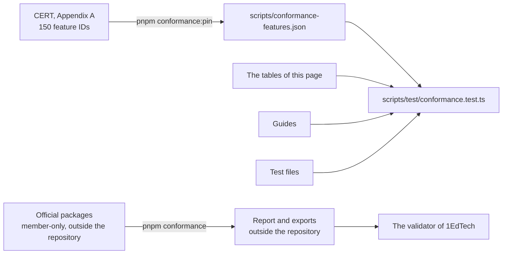

# Conformance

Every feature ID of Appendix A of the [QTI 3.0 Conformance and Certification](https://www.imsglobal.org/spec/qti/v3p0/conf/)
document (CERT), with the guide that says how assesskit implements it and the test that holds it. assesskit is not certified by
1EdTech: certification is for products, each year, with test sets and a validator open to members only. This page says what
assesskit implements; only 1EdTech certifies a product.



| Status       | Meaning                                                                           |
| ------------ | --------------------------------------------------------------------------------- |
| `Implements` | assesskit implements the feature, as the guide says and the test holds            |
| `Partly`     | assesskit implements a part; the cell says what is missing                        |
| `Host`       | assesskit has the slot or the port, and the host supplies the rest of the feature |

`Required at` names the level whose table in CERT requires the feature: `Basic` (and so Advanced), `Advanced`, `Elevated` for
the Elevated Accessibility bundle of its sections 3.3 and 3.4, and `Elective` for the rest. A test is named by its package, its
file below `test/` and its title.

| Required at | Features | Implements | Partly | Host | Not `Implements`                                                                                                 |
| ----------- | -------- | ---------- | ------ | ---- | ---------------------------------------------------------------------------------------------------------------- |
| Basic       | 18       | 18         | 0      | 0    | None                                                                                                             |
| Advanced    | 48       | 48         | 0      | 0    | None                                                                                                             |
| Elevated    | 18       | 17         | 1      | 0    | `A-11`                                                                                                           |
| Elective    | 89       | 75         | 5      | 9    | `T-3`, `Q-31`, `Q-32`, `A-10b`, `A-12`, `A-18`, `A-31`, `A-32`, `A-33`, `A-39`, `A-40d`, `A-40e`, `A-43`, `A-45` |

## Capabilities

CERT certifies a level together with what an application does with content.

| Capability                                           | State                                                                                                                                                                                            |
| ---------------------------------------------------- | ------------------------------------------------------------------------------------------------------------------------------------------------------------------------------------------------ |
| Import of tests with items, and of items alone       | [`readPackage`](package.md) and [`validatePackage`](validate.md) tell valid from invalid; `examples.corpus.test.ts` reads, validates and runs the 1EdTech examples                               |
| Export of tests with items, and of items alone       | The writers pass the official schemas, and [validate](validate.md) holds the Schematron rules. The validator of 1EdTech has not judged their output: `pnpm conformance` prepares it for a member |
| Delivery                                             | [`mountDelivery`](../player/delivery.md) over the [engine](delivery.md), as the tables below say                                                                                                 |
| Scoring from packages and results                    | [Scoring](../player/scoring.md)                                                                                                                                                                  |
| Results Reporting, Usage Data, PCI, CAT presentation | [Results](results.md), [usage](usage.md), [PCI](../player/pci.md), [CAT](cat.md); CERT lists them as future capabilities                                                                         |
| Authoring, and a CAT engine as provider              | Not included: the runtime reads and writes documents and has no editor, and the host implements `CatPort` ([Supported](supported.md#not-included))                                               |

## Features

### A.1 Tests

| ID   | Feature                                 | Required at | Status                                                                                                      | Guide                                                                                       | Test                                                                                                                                                                                                                                                                                                    |
| ---- | --------------------------------------- | ----------- | ----------------------------------------------------------------------------------------------------------- | ------------------------------------------------------------------------------------------- | ------------------------------------------------------------------------------------------------------------------------------------------------------------------------------------------------------------------------------------------------------------------------------------------------------- |
| T-1  | Outcome Declaration                     | Advanced    | Implements                                                                                                  | [runtime/processing](processing.md#test-scope)                                              | `runtime/asi.test.ts`: qti-assessment-test: reads the parts, the declarations and the outcome processing<br>`runtime/validate.test.ts`: checks the outcome processing of the test: targets, types, and the outcomes of the test only                                                                    |
| T-2  | Assessment Time Limits                  | Advanced    | Implements                                                                                                  | [runtime/delivery](delivery.md#time-limits-of-the-plan)                                     | `runtime/delivery.test.ts`: closes a section, a test part and the test at their maximum times, and goes on after them<br>`runtime/delivery.test.ts`: refuses to leave an item, a section, a part or the test before its minimum time                                                                    |
| T-3  | Stylesheet                              | Elective    | Partly: The model reads and writes it; the candidate view carries the stylesheets of items and stimuli only | [runtime/asi](asi.md#the-model)                                                             | `runtime/asi.test.ts`: qti-stylesheet: reads the href, the type, the media and the title                                                                                                                                                                                                                |
| T-4  | Test Part                               | Basic       | Implements                                                                                                  | [runtime/delivery](delivery.md#navigation-and-submission)                                   | `runtime/asi.test.ts`: qti-test-part: reads the modes, the rubric blocks and the sections<br>`runtime/delivery.test.ts`: names the test and the test part, and maps a nonlinear part with every item and the reach of a move                                                                            |
| T-5  | Item Session Control (ISC) in Test Part | Advanced    | Implements                                                                                                  | [runtime/delivery](delivery.md#item-session-control)                                        | `runtime/delivery.test.ts`: follows the item session control of the part, the sections and the item references                                                                                                                                                                                          |
| T-6  | ISC Time Limits in Test Part            | Elective    | Implements                                                                                                  | [runtime/delivery](delivery.md#time-limits-of-the-plan)                                     | `runtime/delivery.test.ts`: closes a section, a test part and the test at their maximum times, and goes on after them                                                                                                                                                                                   |
| T-7  | Sections in TestPart                    | Basic       | Implements                                                                                                  | [runtime/delivery](delivery.md#structure)                                                   | `runtime/delivery.test.ts`: keeps the test parts and the sections of a part in document order, with their items                                                                                                                                                                                         |
| T-8  | Test Feedback in TestPart               | Elective    | Implements                                                                                                  | [runtime/content](content.md#visibility)                                                    | `runtime/content.test.ts`: shows the feedback of the access asked for: during after outcome processing, atEnd at the end of the part or test<br>`runtime/delivery.test.ts`: gives the rubric of the test, the test part and the sections top down for the candidate, and the test feedback              |
| T-9  | Outcomes Processing for Test            | Advanced    | Implements                                                                                                  | [runtime/delivery](delivery.md#outcome-processing)                                          | `runtime/delivery.test.ts`: runs outcome processing after each submission in an individual part, from the outcomes' defaults                                                                                                                                                                            |
| T-10 | Test Feedback (test-level)              | Elective    | Implements                                                                                                  | [runtime/content](content.md#visibility)                                                    | `runtime/content.test.ts`: shows the feedback of the access asked for: during after outcome processing, atEnd at the end of the part or test<br>`player/roots.browser.test.ts`: shows the test feedback that the view gives after the item, in a region of its own with its title                       |
| T-11 | Multiple Test Parts                     | Elective    | Implements                                                                                                  | [runtime/delivery](delivery.md#structure)                                                   | `runtime/delivery.test.ts`: keeps the test parts and the sections of a part in document order, with their items<br>`runtime/delivery.test.ts`: evaluates the branch rules of a section and of a test part when they are completed                                                                       |
| T-12 | Multiple Sections in TestPart           | Advanced    | Implements                                                                                                  | [runtime/delivery](delivery.md#structure)                                                   | `runtime/delivery.test.ts`: keeps the test parts and the sections of a part in document order, with their items                                                                                                                                                                                         |
| T-13 | Rubric Block for AssessmentTest         | Advanced    | Implements                                                                                                  | [runtime/content](content.md#rubric)                                                        | `runtime/content.test.ts`: puts the rubric in the order test, test part, then the sections from the top down, each level in its own order<br>`player/delivery.browser.test.ts`: shows the rubric of the test, the item with its stimuli and the heading of the item, and keeps the rubric on every item |
| T-14 | Record and Restore Responses            | Basic       | Implements                                                                                                  | [runtime/delivery](delivery.md#state)<br>[player/client](../player/client.md#local-session) | `player/client.browser.test.ts`: resumes a session from its store, with its answers<br>`player/delivery.browser.test.ts`: mounts a session that the store restored, where the candidate left it                                                                                                         |

### A.2 Sections

| ID  | Feature                   | Required at | Status     | Guide                                                   | Test                                                                                                                                                                                                                                                 |
| --- | ------------------------- | ----------- | ---------- | ------------------------------------------------------- | ---------------------------------------------------------------------------------------------------------------------------------------------------------------------------------------------------------------------------------------------------- |
| S-0 | Section Root              | Basic       | Implements | [runtime/asi](asi.md#the-model)                         | `runtime/asi.test.ts`: qti-assessment-section: reads sections, references and includes in document order                                                                                                                                             |
| S-1 | Item Session Control      | Elective    | Implements | [runtime/delivery](delivery.md#item-session-control)    | `runtime/delivery.test.ts`: follows the item session control of the part, the sections and the item references                                                                                                                                       |
| S-2 | Time Limits Section Level | Advanced    | Implements | [runtime/delivery](delivery.md#time-limits-of-the-plan) | `runtime/delivery.test.ts`: closes a section, a test part and the test at their maximum times, and goes on after them                                                                                                                                |
| S-3 | Selection                 | Advanced    | Implements | [runtime/delivery](delivery.md#selection)               | `runtime/delivery.test.ts`: takes the first places of a shuffle of the children that are not required, in document order<br>`runtime/delivery.test.ts`: selects every required child once, then draws the others over all children, with replacement |
| S-4 | Ordering                  | Advanced    | Implements | [runtime/delivery](delivery.md#ordering)                | `runtime/delivery.test.ts`: keeps fixed children in their places and shuffles the others among theirs                                                                                                                                                |
| S-5 | Rubric Block              | Advanced    | Implements | [runtime/content](content.md#rubric)                    | `runtime/content.test.ts`: puts the rubric in the order test, test part, then the sections from the top down, each level in its own order                                                                                                            |
| S-6 | Section Include           | Elective    | Implements | [runtime/package](package.md#documents)                 | `runtime/package.test.ts`: resolves an xi:include against the including document, inside the package<br>`runtime/delivery.test.ts`: refuses an xi:include that is left in a section                                                                  |
| S-7 | Items                     | Basic       | Implements | [runtime/delivery](delivery.md#structure)               | `runtime/asi.test.ts`: qti-assessment-item-ref: reads the attributes and the children in schema order<br>`runtime/package.test.ts`: resolves an item reference to the item, its variants and the DRD of the links to them                            |
| S-8 | Nested Sections           | Elective    | Implements | [runtime/delivery](delivery.md#ordering)                | `runtime/delivery.test.ts`: mixes the children of an invisible section that is not kept together into its shuffled parent<br>`runtime/delivery.test.ts`: lets a section that is mixed in select and order its own children first                     |
| S-9 | Section References        | Advanced    | Implements | [runtime/delivery](delivery.md#structure)               | `runtime/delivery.test.ts`: replaces a section reference by the section it names, and resolves what it holds against its document                                                                                                                    |

### A.3 Items

| ID   | Feature                                  | Required at        | Status     | Guide                                                                                          | Test                                                                                                                                                                                                                                                                                               |
| ---- | ---------------------------------------- | ------------------ | ---------- | ---------------------------------------------------------------------------------------------- | -------------------------------------------------------------------------------------------------------------------------------------------------------------------------------------------------------------------------------------------------------------------------------------------------- |
| I-0  | Assessment Item Root                     | Basic              | Implements | [runtime/asi](asi.md#the-model)                                                                | `runtime/asi.test.ts`: qti-assessment-item: reads every attribute and leaves the omitted ones omitted                                                                                                                                                                                              |
| I-1  | Response Declaration                     | Basic              | Implements | [runtime/processing](processing.md#variables)                                                  | `runtime/asi.test.ts`: qti-response-declaration: reads the declaration with its mapping and correct response                                                                                                                                                                                       |
| I-2  | Outcome Declaration                      | Basic              | Implements | [runtime/processing](processing.md#variables)                                                  | `runtime/asi.test.ts`: qti-outcome-declaration: reads the attributes and leaves normal-minimum out when the document omits it                                                                                                                                                                      |
| I-3  | Template Declaration                     | Elective           | Implements | [runtime/processing](processing.md#variables)                                                  | `runtime/asi.test.ts`: qti-template-declaration: reads param-variable and math-variable as booleans<br>`runtime/delivery.test.ts`: runs template processing once at the start, so that each instance records the values of its own clone                                                           |
| I-4  | Shared Stimulus reference                | Advanced           | Implements | [runtime/delivery](delivery.md#candidate-view)                                                 | `runtime/delivery.test.ts`: shows the stimuli of the item, and the stylesheets of both as package paths<br>`player/roots.browser.test.ts`: shows the rubric, the stimuli and the body in an open shadow root, in the order the candidate meets them                                                |
| I-5  | Template Processing                      | Elective           | Implements | [runtime/processing](processing.md#processing)                                                 | `runtime/asi.test.ts`: qti-template-processing: reads the rules of an item in order<br>`runtime/delivery.test.ts`: runs template processing once at the start, so that each instance records the values of its own clone                                                                           |
| I-6  | stylesheet                               | Elective           | Implements | [player/content](../player/content.md#stylesheets)                                             | `runtime/asi.test.ts`: qti-stylesheet: keeps the reference to a CSS 2.1 or 3 style sheet in an item, a stimulus and a portable custom interaction<br>`player/roots.browser.test.ts`: adopts player.css first and the stylesheets of the item after it, and the item's rules apply in the root only |
| I-7  | Item Body                                | Basic              | Implements | [runtime/asi](asi.md#flow-content)                                                             | `runtime/asi.test.ts`: qti-item-body: reads text and elements as typed nodes, and leaves comments out<br>`player/content.browser.test.ts`: renders every HTML element as the element of the same name, in the order of the document                                                                |
| I-8  | HTML5 (QTI Subset)                       | Basic              | Implements | [runtime/asi](asi.md#html)                                                                     | `player/html-elements.xsd.test.ts`: names every HTML element that the ASI schema declares, and no other: the elements without the prefix qti-<br>`runtime/asi.test.ts`: reads every element of the schema back to the model it was written from, in the type that models it                        |
| I-9a | Response Processing: Full                | Advanced           | Implements | [runtime/processing](processing.md#processing)                                                 | `runtime/processing.test.ts`: response processing<br>`runtime/processing.test.ts`: prefers the item's own rules to its template, and treats an empty template as none                                                                                                                              |
| I-9b | Response Processing: Fixed-Template      | Basic              | Implements | [runtime/processing](processing.md#standard-templates)                                         | `runtime/processing.test.ts`: runs a standard template that the item names: SCORE 1 for the correct response, else 0<br>`runtime/processing.test.ts`: holds the six standard templates by their purl URIs                                                                                          |
| I-10 | Modal Feedback                           | Elective           | Implements | [player/content](../player/content.md#feedback)                                                | `player/feedback.browser.test.ts`: opens as a modal dialog named Feedback, with the title and the content of each feedback<br>`runtime/delivery.test.ts`: shows the feedback and the modal feedback only once the outcomes select them, and the submitted responses                                |
| I-11 | Rubric Block                             | Advanced           | Implements | [runtime/content](content.md#rubric)                                                           | `runtime/asi.test.ts`: qti-rubric-block: reads the views and the use in an item body, and the content body after the style sheets<br>`player/content.browser.test.ts`: draws a rubric block for the candidate with its use, and leaves out a block for another view                                |
| I-12 | Item Include                             | Elective           | Implements | [runtime/package](package.md#documents)                                                        | `runtime/package.test.ts`: resolves an xi:include against the including document, inside the package<br>`runtime/asi.test.ts`: keeps an xi:include in content as an XML element, where the content takes one                                                                                       |
| I-13 | Companion Materials                      | Elective           | Implements | [runtime/asi](asi.md#companion-materials)<br>[player/tools](../player/tools.md#tools-in-force) | `runtime/asi.test.ts`: reading companion materials<br>`player/tools.test.ts`: puts the companion materials in force: rules, protractors, calculators, digital materials, then physical ones apart                                                                                                  |
| I-14 | Catalog Resources                        | Advanced, Elevated | Implements | [runtime/content](content.md#catalogs-and-cards)                                               | `player/catalogs.browser.test.ts`: renders the HTML content of the card for a support, as content                                                                                                                                                                                                  |
| I-15 | Context Declarations                     | Elective           | Implements | [runtime/processing](processing.md#context)                                                    | `runtime/asi.test.ts`: qti-context-declaration: reads the identifier, the cardinality and the default value<br>`runtime/delivery.test.ts`: sets the context values before template processing, so that template and response processing read QTI_CONTEXT                                           |
| I-16 | Time Limits                              | Elective           | Implements | [runtime/delivery](delivery.md#time-limits-of-the-plan)                                        | `runtime/delivery.test.ts`: closes an item at its maximum time with the drafts received before it, and moves on                                                                                                                                                                                    |
| I-17 | Composite Items                          | Advanced           | Implements | [runtime/interactions](interactions.md#bindings)                                               | `runtime/interactions.test.ts`: is answered when there is a response and every interaction is valid, an optional one left blank included<br>`runtime/metadata.test.ts`: reads itemTemplate, composite and several scoring modes                                                                    |
| I-18 | MathML                                   | Advanced           | Implements | [player/math](../player/math.md)                                                               | `player/content.browser.test.ts`: draws MathML in the MathML namespace, with its text and without the handlers, links and script of hostile markup<br>`player/roots.browser.test.ts`: typesets the MathML of the root when it has a typesetter, with the styles that MathJax needs in the root     |
| I-19 | QTI Shared Interaction Vocabulary Subset | Basic              | Implements | [player/styling](../player/styling.md#the-vocabulary)                                          | `runtime/interactions.test.ts`: the vocabularies of the interactions<br>`player/player-css.browser.test.ts`: the shared vocabulary                                                                                                                                                                 |
| I-20 | QTI Shared CSS Classes                   | Advanced           | Implements | [player/styling](../player/styling.md#the-vocabulary)                                          | `player/player-css.browser.test.ts`: draws a border with qti-bordered and a well with qti-well                                                                                                                                                                                                     |

### A.4 Interactions

| ID   | Feature                           | Required at | Status                                                                                 | Guide                                                                 | Test                                                                                                                                                                                                                                                                                                 |
| ---- | --------------------------------- | ----------- | -------------------------------------------------------------------------------------- | --------------------------------------------------------------------- | ---------------------------------------------------------------------------------------------------------------------------------------------------------------------------------------------------------------------------------------------------------------------------------------------------- |
| Q-1  | Associate Interaction             | Elective    | Implements                                                                             | [player/interactions](../player/interactions.md#the-kinds)            | `runtime/asi.test.ts`: qti-associate-interaction: reads the association limits and the choices with the number of times each takes part<br>`player/elements.browser.test.ts`: counts a pair once both its places are filled, as a pair                                                               |
| Q-2  | Choice Interaction                | Basic       | Implements                                                                             | [player/interactions](../player/interactions.md#the-kinds)            | `runtime/asi.test.ts`: qti-choice-interaction: reads the limits, the orientation, the prompt and the choices<br>`player/elements.browser.test.ts`: gives a radio button for each choice where at most one may be selected, and a single value                                                        |
| Q-3  | Drawing Interaction               | Elective    | Implements                                                                             | [player/graphics](../player/graphics.md#drawing)                      | `runtime/asi.test.ts`: qti-drawing-interaction: holds the canvas image<br>`player/graphic.browser.test.ts`: draws with the pen where the pointer goes and stores the picture, with the drawing on it, in the type of the image                                                                       |
| Q-4  | End Attempt Interaction           | Elective    | Implements                                                                             | [player/interactions](../player/interactions.md#the-kinds)            | `runtime/asi.test.ts`: qti-end-attempt-interaction: needs the title and reads whether the attempt counts<br>`player/elements.browser.test.ts`: titles the button as the item says and tells the host which interaction was pressed                                                                   |
| Q-5  | Extended Text Interaction         | Basic       | Implements                                                                             | [player/interactions](../player/interactions.md#text)                 | `runtime/asi.test.ts`: qti-extended-text-interaction: reads the answer constraints and the format<br>`player/elements.browser.test.ts`: gives the text of a plain text area as a string, named by the prompt                                                                                         |
| Q-6  | Gap Match Interaction             | Advanced    | Implements                                                                             | [player/interactions](../player/interactions.md#choices-in-places)    | `runtime/asi.test.ts`: qti-gap-match-interaction: holds the choices, and the text with the gaps<br>`player/elements.browser.test.ts`: puts a choice in a gap of the passage, as a directed pair from the choice to the gap                                                                           |
| Q-7  | Graphic Associate Interaction     | Elective    | Implements                                                                             | [player/graphics](../player/graphics.md#the-interactions)             | `runtime/asi.test.ts`: qti-graphic-associate-interaction: holds the image and the associable hotspots<br>`player/graphic.browser.test.ts`: joins two hotspots by choosing one and then the other, with no gesture along a path                                                                       |
| Q-8  | Graphic Gap Match Interaction     | Advanced    | Implements                                                                             | [player/graphics](../player/graphics.md#the-interactions)             | `runtime/asi.test.ts`: qti-graphic-gap-match-interaction: holds the image, the choices to drop and the hotspots to drop them on<br>`player/graphic.browser.test.ts`: places a choice in a gap by choosing the choice and then the gap                                                                |
| Q-9  | Graphic Order Interaction         | Elective    | Implements                                                                             | [player/graphics](../player/graphics.md#the-interactions)             | `runtime/asi.test.ts`: qti-graphic-order-interaction: holds the image and the hotspots to put in order<br>`player/graphic.browser.test.ts`: orders the hotspots as the candidate selects them and numbers them                                                                                       |
| Q-10 | Hot-spot Interaction              | Advanced    | Implements                                                                             | [player/graphics](../player/graphics.md#the-interactions)             | `runtime/asi.test.ts`: qti-hotspot-interaction: holds the image and the hotspots with their shapes<br>`player/graphic.browser.test.ts`: places every shape over the image at its coordinates in the units of the image                                                                               |
| Q-11 | Hot-text Interaction              | Advanced    | Implements                                                                             | [player/interactions](../player/interactions.md#the-kinds)            | `runtime/asi.test.ts`: qti-hottext-interaction: holds a text with the words that the candidate can select<br>`player/elements.browser.test.ts`: makes the text of each hot text the face of its control, in the running text                                                                         |
| Q-12 | Inline Choice Interaction         | Advanced    | Implements                                                                             | [player/interactions](../player/interactions.md#the-kinds)            | `runtime/asi.test.ts`: qti-inline-choice-interaction: sits in a sentence and holds the label and the choices<br>`player/elements.browser.test.ts`: offers the choices in a menu inside the sentence, with the prompt first, and gives NULL for the prompt                                            |
| Q-13 | Match Interaction                 | Advanced    | Implements                                                                             | [player/interactions](../player/interactions.md#choices-in-places)    | `runtime/asi.test.ts`: qti-match-interaction: holds two sets of choices<br>`player/elements.browser.test.ts`: puts the choices of the first set in the second, as directed pairs from the first to the second                                                                                        |
| Q-14 | Media Interaction                 | Elective    | Implements                                                                             | [player/interactions](../player/interactions.md#media)                | `runtime/asi.test.ts`: qti-media-interaction: reads the plays and the media element<br>`player/media.browser.test.ts`: counts from the response that the host restored, and stops at max-plays                                                                                                       |
| Q-15 | Order Interaction                 | Elective    | Implements                                                                             | [player/interactions](../player/interactions.md#choices-in-places)    | `runtime/asi.test.ts`: qti-order-interaction: reads the limits and the orientation, and orders simple choices<br>`player/elements.browser.test.ts`: gives the choices in the order of the places, as an ordered container                                                                            |
| Q-16 | Portable Custom Interaction (PCI) | Elective    | Implements                                                                             | [player/pci](../player/pci.md)<br>[runtime/pci](pci.md)               | `runtime/asi.test.ts`: qti-portable-custom-interaction: reads the type, the modules, the markup, the variables, the style sheets and the catalogs<br>`player/delivery.browser.test.ts`: stores the response and the state of the interaction with the session, so that it restores on another device |
| Q-17 | Position Object Interaction       | Elective    | Implements                                                                             | [player/graphics](../player/graphics.md#the-interactions)             | `runtime/asi.test.ts`: qti-position-object-stage: holds the image and the position object interactions<br>`player/graphic.browser.test.ts`: places the object where the candidate clicks after choosing it, and records the point of its center                                                      |
| Q-18 | Selection Point Interaction       | Elective    | Implements                                                                             | [player/graphics](../player/graphics.md#the-interactions)             | `runtime/asi.test.ts`: qti-select-point-interaction: holds the image on which the candidate marks points<br>`player/graphic.browser.test.ts`: marks the point under a click, in the units of the image                                                                                               |
| Q-19 | Slider Interaction                | Elective    | Implements                                                                             | [player/interactions](../player/interactions.md#the-kinds)            | `runtime/asi.test.ts`: qti-slider-interaction: reads the bounds, the step and the appearance<br>`player/elements.browser.test.ts`: moves in steps by the keyboard, from the lower bound when there is no value                                                                                       |
| Q-20 | Text Entry Interaction            | Basic       | Implements                                                                             | [player/interactions](../player/interactions.md#text)                 | `runtime/asi.test.ts`: qti-text-entry-interaction: sits in a sentence and reads the answer constraints<br>`player/elements.browser.test.ts`: gives the text as a string, and NULL for the empty text                                                                                                 |
| Q-21 | Upload Interaction                | Elective    | Implements                                                                             | [player/interactions](../player/interactions.md#upload-and-recording) | `runtime/asi.test.ts`: qti-upload-interaction: reads the MIME types that it accepts<br>`player/elements.browser.test.ts`: sends the chosen file to the host's storage and gives the reference as the response                                                                                        |
| Q-31 | Custom Interaction (proprietary)  | Elective    | Host: `hooks.customInteraction` draws it; without the hook the candidate gets a notice | [player/interactions](../player/interactions.md#custom-interaction)   | `runtime/asi.test.ts`: qti-custom-interaction: keeps any content, in any namespace, as XML elements<br>`player/elements.browser.test.ts`: mounts the hook of the host where it draws, hands it the response that the candidate gives, and takes it away                                              |
| Q-32 | Custom Interaction (LTI)          | Elective    | Host: The player shows and scores the item; `hooks.ltiLogin` runs the launch           | [player/lti-items](../player/lti-items.md)                            | `runtime/package.test.ts`: resolves an item reference to an LTI link as an LTI deliverable<br>`player/lti-frame.browser.test.ts`: mountDelivery with an item that is a link to a tool                                                                                                                |

### A.5 Accessibility

| ID    | Feature                                                                      | Required at        | Status                                                                                                                             | Guide                                                                                                                      | Test                                                                                                                                                                                                                                                                                                                                                                                                                                                                                  |
| ----- | ---------------------------------------------------------------------------- | ------------------ | ---------------------------------------------------------------------------------------------------------------------------------- | -------------------------------------------------------------------------------------------------------------------------- | ------------------------------------------------------------------------------------------------------------------------------------------------------------------------------------------------------------------------------------------------------------------------------------------------------------------------------------------------------------------------------------------------------------------------------------------------------------------------------------- |
| A-1   | Alternate text for graphics                                                  | Basic, Elevated    | Implements                                                                                                                         | [player/content](../player/content.md#the-renderer)                                                                        | `player/content.browser.test.ts`: keeps the alt text, the long description link and the size, and passes axe                                                                                                                                                                                                                                                                                                                                                                          |
| A-2a  | ARIA Subset                                                                  | Elevated           | Implements                                                                                                                         | [player/content](../player/content.md#attributes)                                                                          | `player/content.browser.test.ts`: passes role and the ARIA attributes, lists included, and the values that are booleans                                                                                                                                                                                                                                                                                                                                                               |
| A-2b  | ARIA Full                                                                    | Elective           | Implements                                                                                                                         | [player/content](../player/content.md#attributes)                                                                          | `player/content.browser.test.ts`: passes role and the ARIA attributes, lists included, and the values that are booleans<br>`player/content.browser.test.ts`: turns data-qti-aria-* into the ARIA attribute it stands for, without replacing one the element has                                                                                                                                                                                                                       |
| A-3a  | Inline Namespaced SSML                                                       | Elective           | Implements                                                                                                                         | [player/speech](../player/speech.md#ssml)                                                                                  | `player/content.browser.test.ts`: draws MathML and SSML in their namespaces, which the typesetter and the speech model look for<br>`player/speech.browser.test.ts`: speaks the alias of each sub, in an SSML 1.1 document that keeps the sub                                                                                                                                                                                                                                          |
| A-3b  | Inline SSML using JSON markup                                                | Elective           | Implements                                                                                                                         | [player/speech](../player/speech.md#what-is-read)                                                                          | `player/speech.browser.test.ts`: speaks the functions of data-ssml: the example of the best practices guide                                                                                                                                                                                                                                                                                                                                                                           |
| A-4a  | Internationalization (bi-directional text)                                   | Elective           | Implements                                                                                                                         | [player/content](../player/content.md#attributes)                                                                          | `player/content.browser.test.ts`: keeps the direction of text: dir on any element, bdo, bdi, and the auto direction                                                                                                                                                                                                                                                                                                                                                                   |
| A-4b  | Internationalization (Ruby)                                                  | Elective           | Implements                                                                                                                         | [player/content](../player/content.md#attributes)                                                                          | `player/content.browser.test.ts`: draws the annotation of a ruby above its base and keeps the parentheses for a browser without ruby                                                                                                                                                                                                                                                                                                                                                  |
| A-5   | additional-directions                                                        | Elective           | Implements                                                                                                                         | [player/supports](../player/supports.md#cards)                                                                             | `player/supports.browser.test.ts`: opens the guidance, the additional directions and the keyboard directions on request, each under its name                                                                                                                                                                                                                                                                                                                                          |
| A-6   | additional-testing-time                                                      | Elevated           | Implements                                                                                                                         | [runtime/delivery](delivery.md#time-limits-of-the-plan)                                                                    | `runtime/delivery.test.ts`: reads the extra time of a profile: a multiplier, fixed minutes or unlimited time<br>`runtime/delivery.test.ts`: applies extra time to the maximum times only, by the arithmetic of the specification                                                                                                                                                                                                                                                      |
| A-7   | alternative-text (PNP assignment)                                            | Elective           | Implements                                                                                                                         | [player/supports](../player/supports.md#cards)                                                                             | `player/supports.browser.test.ts`: shows the alternative text of an image as text after it, and takes it away with the support                                                                                                                                                                                                                                                                                                                                                        |
| A-8   | answer-masking                                                               | Elevated           | Implements                                                                                                                         | [player/tools](../player/tools.md#answer-masking)                                                                          | `player/tools.browser.test.ts`: hides the choices of a choice interaction, visually and to assistive technology, with a mask in their place<br>`player/tools.browser.test.ts`: takes the mask off at the candidate's choice, and puts it back                                                                                                                                                                                                                                         |
| A-9   | audio-description                                                            | Elevated           | Implements                                                                                                                         | [player/supports](../player/supports.md#media)                                                                             | `player/supports.browser.test.ts`: shows the audio description card<br>`player/supports.browser.test.ts`: shows the description track when the audio description is on                                                                                                                                                                                                                                                                                                                |
| A-10a | braille                                                                      | Elevated           | Implements                                                                                                                         | [player/supports](../player/supports.md#cards)                                                                             | `player/supports.browser.test.ts`: gives the text of a braille card to the screen reader, and the file to take for embossing                                                                                                                                                                                                                                                                                                                                                          |
| A-10b | braille preferences (delivery-mode, grade, braille-type, math-type)          | Elective           | Partly: The profile sets them, and no control changes them during a session                                                        | [player/supports](../player/supports.md#cards)                                                                             | `runtime/pnp.test.ts`: braille: the delivery, grade and kind of braille and of its mathematics<br>`player/supports.browser.test.ts`: shows the braille text too when the delivery is embossed                                                                                                                                                                                                                                                                                         |
| A-11  | breaks                                                                       | Elevated           | Partly: A suspension keeps every response, and the policy of the host allows it; `breaks` in a profile does not allow it by itself | [player/server](../player/server.md#client-action-policy)                                                                  | `player/server.test.ts`: lets the host allow suspend and resume for a client, as practice does<br>`runtime/pnp.test.ts`: environment: the description, medical needs, software, hardware and breaks                                                                                                                                                                                                                                                                                   |
| A-12  | calculator-on-screen                                                         | Elective           | Partly: Basic and standard are built in; scientific and graphing are slots of the host                                             | [player/tools](../player/tools.md#calculators)                                                                             | `player/tools.browser.test.ts`: opens the basic calculator for an item that asks for one, with its description<br>`player/tools.browser.test.ts`: opens the standard calculator with the memory, percent, square root and sign that the best practices guide lists                                                                                                                                                                                                                    |
| A-13a | Captions: PNP                                                                | Elective           | Implements                                                                                                                         | [player/supports](../player/supports.md#media)                                                                             | `player/supports.browser.test.ts`: shows the captions track of the media when the captions are on, and gives the mode back when they go                                                                                                                                                                                                                                                                                                                                               |
| A-13b | Captions: track                                                              | Advanced, Elevated | Implements                                                                                                                         | [player/supports](../player/supports.md#media)                                                                             | `player/content.browser.test.ts`: renders the sources and the tracks of a video: captions, descriptions, subtitles and chapters                                                                                                                                                                                                                                                                                                                                                       |
| A-15  | Glossary (on-screen)                                                         | Advanced           | Implements                                                                                                                         | [player/content](../player/content.md#catalogs-and-cards)                                                                  | `player/catalogs.browser.test.ts`: keeps data-catalog-idref on the element and draws no card until the candidate asks for one                                                                                                                                                                                                                                                                                                                                                         |
| A-16  | hazard-avoidance                                                             | Elective           | Implements                                                                                                                         | [runtime/content](content.md#hazards)                                                                                      | `player/roots.browser.test.ts`: withholds the media, the animation and the sound of an item when a hazard that the candidate avoids remains, and says which                                                                                                                                                                                                                                                                                                                           |
| A-17  | high-contrast                                                                | Elective           | Implements                                                                                                                         | [player/supports](../player/supports.md#cards)                                                                             | `player/supports.browser.test.ts`: puts the card of high contrast in place of the content, and gives the content back when the support goes                                                                                                                                                                                                                                                                                                                                           |
| A-18  | Homophone-checker (on-screen)                                                | Elective           | Host: The tool is a slot of the host                                                                                               | [player/tools](../player/tools.md#tools-of-the-host)                                                                       | `player/tools.test.ts`: gives each on-screen tool of the profile a slot of the host                                                                                                                                                                                                                                                                                                                                                                                                   |
| A-19  | input-requirements                                                           | Elective           | Implements                                                                                                                         | [player/supports](../player/supports.md#input-requirements)                                                                | `runtime/pnp.test.ts`: input-requirements: full keyboard or mouse control, or an extension<br>`player/elements.browser.test.ts`: keyboard operation                                                                                                                                                                                                                                                                                                                                   |
| A-20  | invert-display-polarity                                                      | Elective           | Implements                                                                                                                         | [player/styling](../player/styling.md#themes)                                                                              | `player/supports.test.ts`: gives the colors of an inverted display to the properties<br>`player/player-css.browser.test.ts`: inverts the polarity: light text on a dark background                                                                                                                                                                                                                                                                                                    |
| A-21  | item-translation                                                             | Elective           | Implements                                                                                                                         | [runtime/delivery](delivery.md#suspension-supports-and-variants)                                                           | `runtime/delivery.test.ts`: presents the variant that avoids the candidate's hazards and is in the candidate's language<br>`player/supports.browser.test.ts`: names the language of the delivered variant, in the language of the interface and marked as the language it names                                                                                                                                                                                                       |
| A-22  | keyboard-directions                                                          | Elective           | Implements                                                                                                                         | [player/supports](../player/supports.md#cards)                                                                             | `player/supports.browser.test.ts`: opens the guidance, the additional directions and the keyboard directions on request, each under its name                                                                                                                                                                                                                                                                                                                                          |
| A-23  | keyword-emphasis                                                             | Elective           | Implements                                                                                                                         | [player/styling](../player/styling.md#what-the-player-sets)                                                                | `player/player-css.browser.test.ts`: emphasizes the keywords only for a candidate with the support, and not by color alone                                                                                                                                                                                                                                                                                                                                                            |
| A-24  | keyword-translation                                                          | Elective           | Implements                                                                                                                         | [player/supports](../player/supports.md#cards)                                                                             | `player/supports.browser.test.ts`: shows the keyword translation of the language of the support, the same language with a region, or the default entry                                                                                                                                                                                                                                                                                                                                |
| A-25  | language-of-interface                                                        | Elective           | Implements                                                                                                                         | [player/messages](../player/messages.md#choosing-a-catalog)                                                                | `player/messages.test.ts`: chooses the catalog of the language of the interface<br>`player/delivery.browser.test.ts`: names the supports in the language of the interface                                                                                                                                                                                                                                                                                                             |
| A-26  | layout-single-column                                                         | Elective           | Implements                                                                                                                         | [player/styling](../player/styling.md#what-the-player-sets)                                                                | `player/player-css.browser.test.ts`: stacks the columns of a layout row for a candidate who wants a single column                                                                                                                                                                                                                                                                                                                                                                     |
| A-27  | line-reader                                                                  | Elective           | Implements                                                                                                                         | [player/tools](../player/tools.md#line-reader)                                                                             | `player/delivery.browser.test.ts`: turns the line reader on from its button through the session, and the band lies over the text of the item                                                                                                                                                                                                                                                                                                                                          |
| A-28  | linguistic-guidance                                                          | Elective           | Implements                                                                                                                         | [player/supports](../player/supports.md#cards)                                                                             | `player/supports.browser.test.ts`: opens the guidance, the additional directions and the keyboard directions on request, each under its name                                                                                                                                                                                                                                                                                                                                          |
| A-29  | long-description                                                             | Elevated           | Implements                                                                                                                         | [player/supports](../player/supports.md#cards)                                                                             | `player/supports.browser.test.ts`: hides the long description from sight and leaves it to assistive technology, unless the profile shows it                                                                                                                                                                                                                                                                                                                                           |
| A-30a | Magnification                                                                | Advanced, Elevated | Implements                                                                                                                         | [player/supports](../player/supports.md#magnification)                                                                     | `player/delivery.browser.test.ts`: starts at the zoom of the profile and lets the candidate change it up to 400 percent, without drawing the item again<br>`player/player-css.browser.test.ts`: magnifies the text 4 times at a width of 1280 pixels, as WCAG reflow measures 400 percent, and loses no content<br>`player/delivery.browser.test.ts`: enlarges media sized in pixels when magnification is turned on, without drawing the item again or losing the answer             |
| A-30b | Magnification Zoom-amount                                                    | Elective           | Implements                                                                                                                         | [player/supports](../player/supports.md#magnification)<br>[runtime/delivery](delivery.md#suspension-supports-and-variants) | `runtime/pnp.test.ts`: magnification: the zoom of all content, or of text and of non-text<br>`runtime/delivery.test.ts`: changes the settings of a support that is on, those that the candidate may change, and keeps them in the state<br>`player/delivery.browser.test.ts`: keeps the amount on the next item, because the state holds it<br>`player/content.browser.test.ts`: multiplies the pixel size of an image by the magnification of non-text content, and not a percentage |
| A-31  | Note-taking (on-screen)                                                      | Elective           | Host: The tool is a slot of the host                                                                                               | [player/tools](../player/tools.md#tools-of-the-host)                                                                       | `player/tools.test.ts`: gives each on-screen tool of the profile a slot of the host                                                                                                                                                                                                                                                                                                                                                                                                   |
| A-32  | outliner-on-screen                                                           | Elective           | Host: The tool is a slot of the host                                                                                               | [player/tools](../player/tools.md#tools-of-the-host)                                                                       | `player/tools.test.ts`: gives each on-screen tool of the profile a slot of the host                                                                                                                                                                                                                                                                                                                                                                                                   |
| A-33  | Peer-interaction (on-screen)                                                 | Elective           | Host: The tool is a slot of the host                                                                                               | [player/tools](../player/tools.md#tools-of-the-host)                                                                       | `player/tools.test.ts`: gives each on-screen tool of the profile a slot of the host                                                                                                                                                                                                                                                                                                                                                                                                   |
| A-34  | Prohibit set                                                                 | Elective           | Implements                                                                                                                         | [runtime/pnp](pnp.md#sets)                                                                                                 | `player/supports.test.ts`: refuses the action for a prohibited support and one that is on from the start, and leaves the state as it was<br>`player/supports.browser.test.ts`: turns a support on from the panel, applies it to the next view, and refuses what the profile prohibits                                                                                                                                                                                                 |
| A-35  | Pronunciation Lexicon Specification (PLS)                                    | Elective           | Implements                                                                                                                         | [player/speech](../player/speech.md#lexicons)                                                                              | `player/delivery.browser.test.ts`: reads with the lexicons that the item depends on, and with none for an item that depends on none                                                                                                                                                                                                                                                                                                                                                   |
| A-36  | sign-language                                                                | Elevated           | Implements                                                                                                                         | [player/supports](../player/supports.md#cards)                                                                             | `player/supports.browser.test.ts`: shows the sign language video of the language of the support                                                                                                                                                                                                                                                                                                                                                                                       |
| A-37  | simplified-graphics                                                          | Elective           | Implements                                                                                                                         | [player/supports](../player/supports.md#cards)                                                                             | `player/supports.browser.test.ts`: puts the simplified language in place of a passage, and the simplified graphic in place of a picture                                                                                                                                                                                                                                                                                                                                               |
| A-38  | simplified-language-portions                                                 | Elective           | Implements                                                                                                                         | [player/supports](../player/supports.md#cards)                                                                             | `player/supports.browser.test.ts`: puts the simplified language in place of a passage, and the simplified graphic in place of a picture                                                                                                                                                                                                                                                                                                                                               |
| A-39  | Spell-checker (on-screen)                                                    | Elective           | Host: The tool is a slot of the host; the support also turns on the spell check of the browser in an extended text                 | [player/tools](../player/tools.md#tools-of-the-host)<br>[player/interactions](../player/interactions.md#text)              | `player/tools.test.ts`: gives each on-screen tool of the profile a slot of the host<br>`player/delivery.browser.test.ts`: is on while the support is on, from the start or after the candidate turns it on, and off again when it is turned off                                                                                                                                                                                                                                       |
| A-40a | Spoken (reading-type = screen-reader)                                        | Elevated           | Implements                                                                                                                         | [player/speech](../player/speech.md#the-accessible-structure)                                                              | `player/speech.browser.test.ts`: applyReadingType<br>`player/supports.browser.test.ts`: has no controls for the screen reader, which is also the reading type when the support names none, and hides what it suppresses                                                                                                                                                                                                                                                               |
| A-40b | Spoken (reading-type = computer-read-aloud)                                  | Elevated           | Implements                                                                                                                         | [player/supports](../player/supports.md#reading-aloud)                                                                     | `player/supports.browser.test.ts`: shows the controls and reads the content with the voice, with the rate, pitch and volume of the support                                                                                                                                                                                                                                                                                                                                            |
| A-40c | Spoken Restriction Type                                                      | Elevated           | Implements                                                                                                                         | [player/speech](../player/speech.md#restriction-types)                                                                     | `player/speech.browser.test.ts`: restriction types                                                                                                                                                                                                                                                                                                                                                                                                                                    |
| A-40d | Spoken, user preferences for speech-rate, pitch, volume, and link-indication | Elective           | Partly: The profile sets them, and no control changes them during a session                                                        | [player/speech](../player/speech.md#the-request)<br>[player/speech](../player/speech.md#link-indication)                   | `player/supports.browser.test.ts`: shows the controls and reads the content with the voice, with the rate, pitch and volume of the support<br>`player/speech.browser.test.ts`: link indication                                                                                                                                                                                                                                                                                        |
| A-40e | Spoken (typing-echo)                                                         | Elective           | Partly: The profile sets them, and no control changes them during a session                                                        | [player/speech](../player/speech.md#typing-echo)                                                                           | `player/supports.browser.test.ts`: echoes what the candidate types in a text field, as the typing echo says, and stops when the support goes                                                                                                                                                                                                                                                                                                                                          |
| A-40f | Text-to-Speech Suppression                                                   | Elective           | Implements                                                                                                                         | [player/speech](../player/speech.md#what-is-read)                                                                          | `player/speech.browser.test.ts`: leaves out what data-qti-suppress-tts suppresses for computer read-aloud, and reads the alt text and the labels<br>`player/speech.browser.test.ts`: hides the content that data-qti-suppress-tts suppresses for screen readers from the accessible structure                                                                                                                                                                                         |
| A-41  | Tactile                                                                      | Elevated           | Implements                                                                                                                         | [player/supports](../player/supports.md#cards)                                                                             | `player/supports.browser.test.ts`: offers the file of a tactile card                                                                                                                                                                                                                                                                                                                                                                                                                  |
| A-42a | Text-appearance, text and background color                                   | Advanced, Elevated | Implements                                                                                                                         | [player/supports](../player/supports.md#the-color-theme)                                                                   | `player/delivery.browser.test.ts`: starts in the theme of the profile, and lets the candidate change it at any time without drawing the item again<br>`player/delivery.browser.test.ts`: returns to the default colors at any time                                                                                                                                                                                                                                                    |
| A-42b | Text-appearance, other                                                       | Elective           | Implements                                                                                                                         | [player/supports](../player/supports.md#the-look)                                                                          | `player/supports.browser.test.ts`: sets the size, face and spacing of the text appearance and the colors of the profile                                                                                                                                                                                                                                                                                                                                                               |
| A-43  | Thesaurus (on-screen)                                                        | Elective           | Host: The tool is a slot of the host                                                                                               | [player/tools](../player/tools.md#tools-of-the-host)                                                                       | `player/tools.test.ts`: gives each on-screen tool of the profile a slot of the host                                                                                                                                                                                                                                                                                                                                                                                                   |
| A-44  | transcript                                                                   | Elevated           | Implements                                                                                                                         | [player/supports](../player/supports.md#cards)                                                                             | `player/supports.browser.test.ts`: shows the transcript card of audio and video, in a group named Transcript                                                                                                                                                                                                                                                                                                                                                                          |
| A-45  | Visual-organizer (on-screen)                                                 | Elective           | Host: The tool is a slot of the host                                                                                               | [player/tools](../player/tools.md#tools-of-the-host)                                                                       | `player/tools.test.ts`: gives each on-screen tool of the profile a slot of the host                                                                                                                                                                                                                                                                                                                                                                                                   |
| A-46  | Activate-as-option                                                           | Elective           | Implements                                                                                                                         | [runtime/pnp](pnp.md#sets)                                                                                                 | `runtime/pnp.test.ts`: activate-as-option-set: the supports to offer as options, by name alone<br>`player/supports.test.ts`: gives a panel of buttons for the options only: the supports that the engine lets the candidate turn                                                                                                                                                                                                                                                      |
| A-47  | Activate-at-initialization                                                   | Elective           | Implements                                                                                                                         | [runtime/pnp](pnp.md#sets)                                                                                                 | `runtime/delivery.test.ts`: takes the supports of the profile, on from the start when active, and the universal ones as options<br>`player/delivery.browser.test.ts`: applies a support that is on from the start, and draws no control for it                                                                                                                                                                                                                                        |

### A.6 Metadata

| ID   | Feature            | Required at | Status     | Guide                                            | Test                                                                                                                                                                                                                                   |
| ---- | ------------------ | ----------- | ---------- | ------------------------------------------------ | -------------------------------------------------------------------------------------------------------------------------------------------------------------------------------------------------------------------------------------- |
| M-1  | Item Template      | Elective    | Implements | [runtime/metadata](metadata.md#derived-metadata) | `runtime/metadata.test.ts`: has a solution that template processing sets, and is an item template when it has template processing                                                                                                      |
| M-2  | Time Dependent     | Elective    | Implements | [runtime/metadata](metadata.md#derived-metadata) | `runtime/metadata.test.ts`: takes timeDependent from the attribute of the item                                                                                                                                                         |
| M-3  | Composite          | Elective    | Implements | [runtime/metadata](metadata.md#derived-metadata) | `runtime/metadata.test.ts`: is not composite with one interaction or none, and ignores elements of other namespaces that look like interactions<br>`runtime/metadata.test.ts`: reads itemTemplate, composite and several scoring modes |
| M-4  | Interaction Type   | Elective    | Implements | [runtime/metadata](metadata.md#derived-metadata) | `runtime/metadata.test.ts`: derives each of the 22 interaction types from its element                                                                                                                                                  |
| M-5  | Feedback Type      | Elective    | Implements | [runtime/metadata](metadata.md#derived-metadata) | `runtime/metadata.test.ts`: is none without feedback, and nonadaptive or adaptive with feedback, by the attribute adaptive                                                                                                             |
| M-6  | Solution Available | Elective    | Implements | [runtime/metadata](metadata.md#derived-metadata) | `runtime/metadata.test.ts`: has a solution when every declared response has a correct response, and none without a declared response or with a missing one                                                                             |
| M-7  | Tool Name          | Elective    | Implements | [runtime/metadata](metadata.md#derived-metadata) | `runtime/metadata.test.ts`: takes the tool name and version of the item, when they fit 256 characters, and has no vendor                                                                                                               |
| M-8  | Tool Version       | Elective    | Implements | [runtime/metadata](metadata.md#derived-metadata) | `runtime/metadata.test.ts`: takes the tool name and version of the item, when they fit 256 characters, and has no vendor                                                                                                               |
| M-9  | Tool Vendor        | Elective    | Implements | [runtime/metadata](metadata.md#qti-metadata)     | `runtime/metadata.test.ts`: takes a tool string of 256 characters and rejects one of 257                                                                                                                                               |
| M-10 | Scoring Mode       | Elective    | Implements | [runtime/metadata](metadata.md#derived-metadata) | `runtime/metadata.test.ts`: has the scoring modes of the response processing and of the outcomes scored outside, in the order of the vocabulary                                                                                        |

### A.7 Content packaging

| ID   | Feature                              | Required at | Status     | Guide                                                | Test                                                                                                                          |
| ---- | ------------------------------------ | ----------- | ---------- | ---------------------------------------------------- | ----------------------------------------------------------------------------------------------------------------------------- |
| P-1  | Test Instances                       | Basic       | Implements | [runtime/package](package.md#resolvers)              | `runtime/examples.corpus.test.ts`: the 1EdTech example packages                                                               |
| P-2  | Nested Section Instances             | Elective    | Implements | [runtime/package](package.md#resolvers)              | `runtime/package.test.ts`: resolves a stimulus reference to the stimulus and a section reference to the section               |
| P-3  | Item Banks                           | Elective    | Implements | [runtime/package](package.md#the-manifest)           | `runtime/package.test.ts`: writes the schema version 3.0.0 and a manifest without resources                                   |
| P-4  | Item Instances                       | Basic       | Implements | [runtime/package](package.md#resolvers)              | `runtime/package.test.ts`: resolves an item reference to the item, its variants and the DRD of the links to them              |
| P-5  | Manifest Metadata (LOM)              | Elective    | Implements | [runtime/metadata](metadata.md#lom)                  | `runtime/metadata.test.ts`: keeps each LOM category as XML                                                                    |
| P-6  | Resource Metadata (LOM)              | Elective    | Implements | [runtime/metadata](metadata.md#resource-metadata)    | `runtime/metadata.test.ts`: reads the QTI metadata, the curriculum standards and the LOM of a metadata element                |
| P-7  | Resource Metadata (QTI)              | Advanced    | Implements | [runtime/metadata](metadata.md#qti-metadata)         | `runtime/metadata.test.ts`: reading QTI metadata                                                                              |
| P-8  | Curriculum Standards Metadata        | Elective    | Implements | [runtime/metadata](metadata.md#curriculum-standards) | `runtime/metadata.test.ts`: reading curriculum standards                                                                      |
| P-9  | External Metadata                    | Elective    | Implements | [runtime/metadata](metadata.md#resource-metadata)    | `runtime/metadata.test.ts`: reads an external metadata file: the root lom holds the QTI metadata and the curriculum standards |
| P-10 | Learning Tools Interoperability v1.1 | Elective    | Implements | [runtime/package](package.md#lti-links)              | `runtime/package.test.ts`: reading LTI links                                                                                  |
| P-11 | Stimulus Instances                   | Advanced    | Implements | [runtime/package](package.md#resolvers)              | `runtime/package.test.ts`: resolves a stimulus reference to the stimulus and a section reference to the section               |
| P-12 | Variant                              | Elective    | Implements | [runtime/package](package.md#resolvers)              | `runtime/package.test.ts`: reads the variants of a resource with their DRD                                                    |
| P-13 | CASE                                 | Elective    | Implements | [runtime/metadata](metadata.md#curriculum-standards) | `runtime/metadata.corpus.test.ts`: has the curriculum standards that the CASE manifest spells                                 |

## Running the official packages

The test sets and the validator are open to 1EdTech members, and nothing of theirs enters this repository. A member with
a clone of the test set runs `pnpm conformance`, which is opt-in: no gate and no CI job runs it, and it uses no network.

```bash
pnpm schemas
pnpm conformance --packages ../qti-conformance --reports ../conformance-reports
```

| Option       | Default          | Meaning                                                                                                                                   |
| ------------ | ---------------- | ----------------------------------------------------------------------------------------------------------------------------------------- |
| `--packages` | required         | The directory of the official packages: ZIP files, directories with a manifest and no ZIP file beside it, and other XML files such as PNP |
| `--reports`  | required         | The directory for the report and the exports. It is made when it is missing                                                               |
| `--schemas`  | `.cache/schemas` | The directory of the schemas, which `pnpm schemas` downloads                                                                              |

The run refuses either directory when it lies inside the repository, symbolic links followed, so that nothing member-only
can reach a commit. It goes on after a verdict, because some official packages are problematic on purpose: CERT section 4.4
asks a system to flag those and to accept the others.

| Step                                      | Result in `report.json`                                                                                 |
| ----------------------------------------- | ------------------------------------------------------------------------------------------------------- |
| The checks of `assesskit validate`        | `valid` and `validation`: the JSON report of [the command](cli.md#output), or why the input was refused |
| A session of each test of a valid package | `tests`: each `href`, with the `refusal` of the engine when it refused                                  |
| An export of a valid package              | `exported`: a ZIP file below `exports/`, whose QTI documents went through the reader and the writer     |
| A failure of the last two                 | `failure`: its message                                                                                  |

Upload the exports to the validator and keep what it reports in the same directory. Rendering, PNP adjustments and the rest of
CERT section 4.3 stay a demonstration by the member.

## Keeping the page true

`scripts/test/conformance.test.ts` runs in `pnpm test` and fails when a row is missing, is out of order or has another name or
level than CERT; when a guide, a heading or a test that a row names is gone; when a test is skipped; when a `Partly` or `Host`
row does not say why; when the summary differs from the rows; and when this page says more than `implements`. A test that moves
or changes its title changes its row in the same commit.

`pnpm conformance:pin` downloads CERT again and rewrites `scripts/conformance-features.json`. The page is served by a site
whose bytes may change, so the repository holds the list it derives and not a hash of the page.

## Where the document differs

| Case                                                                                                                                              | Reading                                                                                                                |
| ------------------------------------------------------------------------------------------------------------------------------------------------- | ---------------------------------------------------------------------------------------------------------------------- |
| Section 3.1.5 requires `S-2` as "Item Session Control in Sections", while Appendix A gives `S-1` to item session control and `S-2` to time limits | The tables follow Appendix A, so `S-2` is required at Advanced; `S-1` is listed as elective and is implemented as well |
| The tables name the levels Basic and Advanced, and the text also says Entry, Core and Level 1                                                     | The names of the tables                                                                                                |
| `I-19` is required at Basic as a subset and at Advanced in full                                                                                   | One row: the player has the full vocabulary                                                                            |
| The numbers skip `A-14` and `Q-22` to `Q-30`                                                                                                      | No row: Appendix A has none                                                                                            |

## References

| Topic                          | Specification                                                                                        |
| ------------------------------ | ---------------------------------------------------------------------------------------------------- |
| Features, levels, capabilities | [QTI 3.0 Conformance and Certification](https://www.imsglobal.org/spec/qti/v3p0/conf/), document 2.0 |
| What the guides read           | [QTI 3.0 Best Practices and Implementation Guide](https://www.imsglobal.org/spec/qti/v3p0/impl/)     |
| Rules of the code              | [Spec gaps](spec-gaps.md), [Evidence](evidence.md), [Supported](supported.md)                        |
