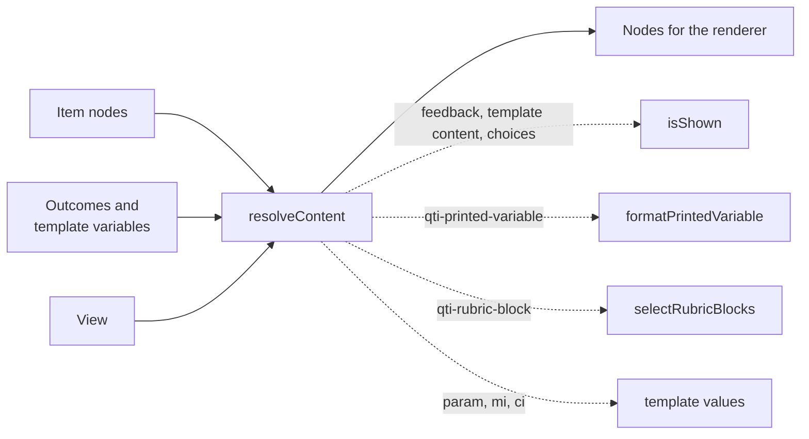

# Item content and feedback

`content` decides what an item shows. It hides what an outcome or a template variable hides, prints variables with the number
formats of the C `printf`, selects the rubric of a view and the card of a catalog, and maps the hazards of a resource to the terms
of a PNP. It imports `values`, `asi` and `pnp` and runs in any JavaScript runtime. It does not render: it returns the nodes and the
text that a renderer draws.



| Function                                           | Does                                                                                             |
| -------------------------------------------------- | ------------------------------------------------------------------------------------------------ |
| `resolveContent(nodes, variables, item, options)`  | Returns the nodes with hidden content removed, variables printed and template values substituted |
| `formatPrintedVariable(printed, value, variables)` | Writes the text of a `qti-printed-variable`                                                      |
| `selectModalFeedback(item, outcomes)`              | Returns the modal feedback an item shows                                                         |
| `selectTestFeedback(feedback, outcomes, access)`   | Returns the test feedback of one access, `during` or `atEnd`                                     |
| `selectRubricBlocks(blocks, view)`                 | Returns the rubric blocks whose `view` lists the view                                            |
| `selectTestRubricBlocks(position, view)`           | Returns the rubric of a test, its part and its sections, in the order the candidate meets it     |
| `selectCard(catalog, support, options?)`           | Returns the content of the card for a support, by `language` and the preferences of `braille`    |
| `validateCatalog(catalog)`                         | Returns `Issue`s for a catalog that breaks the rules of cards                                    |
| `deriveHazardExposure(hazards, options?)`          | Returns the hazards of a resource in the terms of a PNP, each marked avoided or not              |

`VIEWS` lists the six views. The types are `ContentVariables`, `View`, `TestPosition`, `CardContent`, `HazardExposure` and
`ResolveContentOptions`. A hazard is a `DrdHazard` of [metadata](metadata.md) in a resource and a `PnpHazard` of [pnp](pnp.md) in a
profile; the map from one to the other, `HAZARD_TERMS`, is in `content/internal`, with `isShown`, and not exported.

## Quick start

Resolve the content of an item for a view: the score and the number are printed, and the feedback that the outcome shows stays:

```ts
import { readAsi } from "@assesskit/runtime/asi";
import { resolveContent } from "@assesskit/runtime/content";
import { createItemVariables } from "@assesskit/runtime/processing";
import { buildSingle } from "@assesskit/runtime/values";

const { item } = readAsi(`<qti-assessment-item xmlns="http://www.imsglobal.org/xsd/imsqtiasi_v3p0"
    identifier="result" title="Result" time-dependent="false">
  <qti-outcome-declaration identifier="SCORE" cardinality="single" base-type="float"/>
  <qti-outcome-declaration identifier="FEEDBACK" cardinality="single" base-type="identifier"/>
  <qti-template-declaration identifier="N" cardinality="single" base-type="integer"/>
  <qti-item-body>
    <p>Score <qti-printed-variable identifier="SCORE" format="%.1f"/> out of <qti-printed-variable identifier="N"/>.</p>
    <qti-feedback-block outcome-identifier="FEEDBACK" identifier="right" show-hide="show">
      <qti-content-body><p>Well done.</p></qti-content-body>
    </qti-feedback-block>
  </qti-item-body>
</qti-assessment-item>`);
const variables = createItemVariables(item);
const outcomes = new Map(variables.outcomes)
  .set("SCORE", buildSingle("float", 0.7))
  .set("FEEDBACK", buildSingle("identifier", "right"));
const templates = new Map(variables.templates).set("N", buildSingle("integer", 4));
const resolved = resolveContent(item.body.children, { outcomes, templates }, item, { view: "candidate" });
resolved.map(({ kind }) => kind); // => ["p", "feedback-block"]
```

## Visibility

`isShown` of `content/internal`, which the runtime calls and does not export, decides whether content is visible given the variable that controls it. The same rule governs feedback (an outcome),
template blocks and inlines (a template variable), and choices, gaps, hotspots and hot texts that have a `template-identifier`.

| `show-hide`      | The variable matches or contains the identifier | Content |
| ---------------- | ----------------------------------------------- | ------- |
| `show` (default) | yes                                             | Shown   |
| `show` (default) | no                                              | Hidden  |
| `hide`           | yes                                             | Hidden  |
| `hide`           | no                                              | Shown   |

A variable that is NULL or not of base type identifier names nothing. The visibility of integrated feedback after the last attempt
depends on which outcomes are given: for a non-adaptive item the body without feedback is the body at the start of the attempt,
which the default values of the outcomes give, and with feedback it is the outcomes after response processing. The delivery
engine decides.

```ts
import { isShown } from "../content/internal.js";
import { buildSingle } from "@assesskit/runtime/values";

isShown("show", "right", buildSingle("identifier", "right")); // => true
isShown("hide", "right", buildSingle("identifier", "right")); // => false
isShown("show", "right", null); // => false
```

## Resolving content

`resolveContent` applies the visibility rule to a tree and does the rest of the work of presenting content:

| Content                                                          | Resolution                                                                                      |
| ---------------------------------------------------------------- | ----------------------------------------------------------------------------------------------- |
| `qti-printed-variable`                                           | Text; an outcome or a template variable prints, a response variable prints nothing              |
| `qti-feedback-block`, `qti-feedback-inline`                      | Kept when shown for the outcome, else removed                                                   |
| `qti-template-block`, `qti-template-inline`                      | Kept when shown for the template variable, else removed                                         |
| choices, gaps, hotspots and hot texts with `template-identifier` | Removed when the template variable hides them                                                   |
| `qti-rubric-block`                                               | Kept when its `view` lists the view of the options, else removed                                |
| `param` of an `object`                                           | Its `value` replaced by the template variable it names, if declared with `param-variable`       |
| `mi` and `ci` of MathML                                          | Replaced by `mn` and `cn` with the value of the template variable they name, if `math-variable` |

| Option | Default | Meaning                                                                                                  |
| ------ | ------- | -------------------------------------------------------------------------------------------------------- |
| `view` | none    | Required. The view for which the content is resolved: a rubric block stays only when its `view` lists it |

Kept elements keep their order and get their content resolved in turn. The input is not changed. A substituted value is written
as an identifier, string or uri as it is, an integer by `%i`, a float or duration by `%G`, a boolean as `true` or `false`, a point
as `x y` and a pair as `a b`; a NULL variable, a container or a file leaves the parameter or the MathML identifier as authored.

## Printed variables

`formatPrintedVariable` writes a value as text. `format` is one conversion of the C `printf`: `%`, flags, a width, a precision and
one of `E e f G g r R i o X x`. Any other text, such as `%d`, `%s` or a specifier with text around it, is ignored and the default
is used.

| Part        | Meaning                                                                                                                                                 |
| ----------- | ------------------------------------------------------------------------------------------------------------------------------------------------------- |
| flags       | `-` left align, `+` always a sign, space a space for a positive number, `#` alternate form, `0` pad with zeros                                          |
| width       | The least number of characters, at most 1100                                                                                                            |
| precision   | Digits after the point for `f`, `e` and `E`; significant digits for `g`, `G`, `r` and `R`; least digits for `i`, `o`, `x`, `X`; at most 1100            |
| `e` `E`     | Scientific notation, `9.876540e+02`                                                                                                                     |
| `f`         | Fixed notation, `987.654000`                                                                                                                            |
| `g` `G`     | The shorter of the two, with trailing zeros removed unless `#` is set                                                                                   |
| `r` `R`     | As `g` and `G`, but fixed notation also for small numbers: `0.0000987654`; scientific only when the figures are fewer than the digits left of the point |
| `i`         | An integer in `base` (2 to 36, an integer or the identifier of a variable that holds one; 10 by default)                                                |
| `o` `x` `X` | An integer in base 8 or 16                                                                                                                              |

Numbers are rounded from their exact binary value, a tie to the even digit, as the C library does, so that `%.0f` of 2.5 is `2`. A
float with an integer conversion is truncated. Without `format`, an integer is written by `%i` and a float or a duration by `%G`.

| Attribute           | Default | Effect                                                                                    |
| ------------------- | ------- | ----------------------------------------------------------------------------------------- |
| `format`            | none    | One conversion specifier; without it an integer is `%i` and a float or a duration is `%G` |
| `base`              | 10      | The base of `i`; an integer or the identifier of a variable that holds one                |
| `power-form`        | false   | Writes the exponent as ` × 10` and a superscript: `1.5e+03` is `1.5 × 10³`                |
| `delimiter`         | `;`     | Between the values of a container                                                         |
| `index`             | none    | The value of an ordered container to write, counting from 1                               |
| `field`             | none    | The field of a record to write                                                            |
| `mapping-indicator` | `=`     | Between the name and the value of a field when a record writes every field                |

NULL is the empty string, a file is its name, a point is `x y` and a pair `a b`.

## Rubric

`selectRubricBlocks` keeps the blocks whose `view` lists the view. `selectTestRubricBlocks` joins the rubric of the test, its test part and
the sections from the top section down, each level in its own order. A rubric block cannot contain an interaction or another
rubric block: the reader refuses it.

| View              | Shown to                      |
| ----------------- | ----------------------------- |
| `candidate`       | The candidate taking the item |
| `author`          | The author of the item        |
| `proctor`         | The proctor of the test       |
| `scorer`          | Whoever scores the responses  |
| `testConstructor` | The constructor of the test   |
| `tutor`           | A tutor                       |

## Catalogs and cards

`selectCard` takes the card of the support. A card without card entries gives its own content; with entries it gives the entry
whose `xml:lang` is the option `language`, ignoring case, then the first entry with the same primary language (`fr` for `fr-CA`), then the
entry marked `default`. The content is HTML or references to files in the package. A node names its catalog by `data-catalog-idref`,
and the catalog may be anywhere in the item: in its `qti-catalog-info` or in that of feedback or a rubric block.

The best practices guide tells braille and tactile files apart by attributes of the card entries, the parameters of the PNP with
`data-` before them. With the candidate's `braille` settings as the option `braille`, `selectCard` chooses among them:

| Attribute of the entry                | Setting of `braille` |
| ------------------------------------- | -------------------- |
| `data-braille-type`                   | `brailleType`        |
| `data-braille-grade`, or `data-grade` | `grade`              |
| `data-math-type`                      | `mathType`           |

1. The entries that state no attribute against a preference, or state the preferred value (ignoring case), are kept.
2. Among them, the rule of the language and the default chooses; else the first that states a preferred value.
3. Else the rule of the language and the default chooses among all entries, so a candidate who prefers grade 3 gets the
   default grade 2 where no grade 3 exists, as the guide says.

The guide names the grade `braille-grade` where the PNP names it `grade`, and says nothing of the choice: [spec gaps](spec-gaps.md),
G52.

`validateCatalog` returns `Issue`s:

| Rule                                        | Reported when                                                    |
| ------------------------------------------- | ---------------------------------------------------------------- |
| `assesskit/content/duplicate-card`          | two cards of the catalog have the same `support`                 |
| `assesskit/content/empty-card`              | a card or a card entry has no HTML content and no file reference |
| `assesskit/content/duplicate-default-entry` | more than one entry of a card is the `default`                   |

## Hazards

A resource lists its hazards in the terms of the DRD, and a PNP lists the hazards a candidate avoids in its own terms.

| DRD term           | PNP term            |
| ------------------ | ------------------- |
| `flashing`         | `flashing`          |
| `sound`            | `sound`             |
| `olfactoryHazard`  | `olfactory-hazard`  |
| `motionSimulation` | `motion-simulation` |

`deriveHazardExposure(hazards, { profile })` returns each hazard of the resource in the PNP term with `avoided` set when the profile lists
it under `hazard-avoidance`. A candidate who avoids a hazard should not be exposed to content that has it: the delivery engine
picks a variant without the hazard and flags the hazards it cannot avoid.

```ts
import { deriveHazardExposure } from "@assesskit/runtime/content";

deriveHazardExposure(["flashing", "olfactoryHazard"]);
// => [{ hazard: "flashing", avoided: false }, { hazard: "olfactory-hazard", avoided: false }]
```

## Errors

| Situation                                                              | Result                                                   |
| ---------------------------------------------------------------------- | -------------------------------------------------------- |
| An argument of the wrong type, such as variables that are not two maps | `DataError` that says what is wrong and what is expected |
| A `view`, an `access` or a `show-hide` that is not a term              | `DataError` that lists the terms                         |
| A hazard that is not a DRD term                                        | `DataError` that lists the terms                         |
| A `format` that is not one specifier                                   | No error: the default format is used                     |
| A catalog that breaks the rules of cards                               | `Issue`s from `validateCatalog`                          |

## Not included

| Not included                                            | Why                                                                               |
| ------------------------------------------------------- | --------------------------------------------------------------------------------- |
| Rendering                                               | The player draws the nodes and the text that `content` returns                    |
| Deciding when feedback is visible                       | The delivery engine decides which outcomes are given and when                     |
| `printf` conversions other than `E e f G g r R i o X x` | QTI defines these; `%d` and `%s` are not part of the format of a printed variable |

## Differences from the references

| Case                                                                                                                      | Resolution                                                                                                                                                   |
| ------------------------------------------------------------------------------------------------------------------------- | ------------------------------------------------------------------------------------------------------------------------------------------------------------ |
| The best practices guide names the grade `braille-grade`, though the PNP names it `grade`, and says nothing of the choice | `selectCard` reads `data-braille-type`, `data-math-type` and `data-braille-grade` or `data-grade`, and chooses by the braille settings ([G52](spec-gaps.md)) |
| A `format` of a printed variable that is not one conversion of QTI, such as `%d` or `%s`                                  | The default format is used: the specification defines `E e f G g r R i o X x` and no other                                                                   |

## Files

| File                                                     | Concept                                                                                  |
| -------------------------------------------------------- | ---------------------------------------------------------------------------------------- |
| `visibility.ts`, `feedback.ts`                           | The show and hide rule, and the feedback it governs                                      |
| `format-specification.ts`, `format-number.ts`            | A `printf` specifier, and writing a number by it                                         |
| `printed-variable.ts`, `substitution.ts`, `variables.ts` | Printed variables, template values in parameters and MathML, and the variables they read |
| `resolve.ts`                                             | Resolving a tree of content                                                              |
| `rubric.ts`, `catalog.ts`, `hazards.ts`                  | Rubric views, cards, and hazards                                                         |

## References

| Topic                                         | Specification                                                                                     |
| --------------------------------------------- | ------------------------------------------------------------------------------------------------- |
| Visibility, printed variables, rubric, MathML | [QTI 3.0 ASI Information Model](https://www.imsglobal.org/spec/qti/v3p0/info/)                    |
| Catalogs and cards, hazards, `printf` formats | [QTI 3.0 Best Practices and Implementation Guide](https://www.imsglobal.org/spec/qti/v3p0/impl/)  |
| Conversions                                   | [ISO/IEC 9899:2011, formatted output](https://www.open-std.org/jtc1/sc22/wg14/www/docs/n1570.pdf) |
| Places where the specifications differ        | [Spec gaps](spec-gaps.md)                                                                         |
