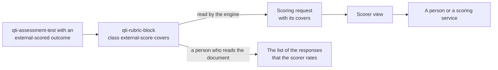

# Conventions

A convention is something the runtime defines because QTI does not. It uses QTI's own elements, so that every document stays valid
against the official schemas and other tools can still read it. There is one: the covers of an externally scored outcome of a
test.



## Covers of externally scored outcomes

An outcome with `external-scored` is set by a scorer, not by processing (INFO section 4.5.10). QTI has no element that says which
responses a test-level outcome of this kind rates. The runtime records it in a rubric block of the test: the place QTI gives to
instructions for scorers (INFO section 2.8.6, `use="scoring"`, `view="scorer"`). The view hides the block from candidates, and a
person who reads the document sees the list of the responses that the scorer rates.

```xml
<qti-rubric-block view="scorer" use="scoring" class="external-score-covers" data-outcome-identifier="CONTENT">
  <qti-content-body>
    <p>Rate content once, across both writing tasks.</p>
    <ul>
      <li data-item-ref="W1" data-response-identifier="RESPONSE">Task 1: essay</li>
      <li data-item-ref="W2" data-response-identifier="RESPONSE">Task 2: letter</li>
    </ul>
  </qti-content-body>
</qti-rubric-block>
```

The markup is valid ASI: the tests validate the block that `scoreCoversBlock` builds against the official schema.

| Part                       | Rule                                                                                                                |
| -------------------------- | ------------------------------------------------------------------------------------------------------------------- |
| Place                      | A child `qti-rubric-block` of `qti-assessment-test`. Blocks of test parts and sections are not covers.              |
| Marker                     | The class token `external-score-covers` (`SCORE_COVERS_CLASS`).                                                     |
| `view`                     | A list that contains `scorer` and not `candidate`; `validate` checks it. `scoreCoversBlock` writes `use="scoring"`. |
| `data-outcome-identifier`  | The outcome the block rates.                                                                                        |
| Content                    | Optional notes, then a `ul` that is a child of the content body. The `li` elements are the covers.                  |
| `data-item-ref`            | On an `li`: the identifier of the `qti-assessment-item-ref` of the item.                                            |
| `data-response-identifier` | On an `li`: the identifier of the response variable of the item.                                                    |
| Label                      | The text of the `li` with white space normalized. It is absent when empty.                                          |
| Several blocks             | Blocks for one outcome add their covers in document order. `validate` reports it as a duplicate.                    |

The block stays an ordinary `RubricBlock` in `test.rubricBlocks`: one source of truth, with its position and attributes kept.
Nothing is copied into the model, and a read followed by a write keeps the block unchanged.

### Reading and writing

| Function                                    | Does                                                                                                                                                                          |
| ------------------------------------------- | ----------------------------------------------------------------------------------------------------------------------------------------------------------------------------- |
| `readScoreCovers(test)`                     | The covers by outcome identifier, in document order. A test without blocks gives an empty map; an entry without both attributes is left out.                                  |
| `scoreCoverBlocks(test)`                    | The blocks that carry the class token, as they are written, with a missing attribute absent, so that `validate` can report them.                                              |
| `scoreCoversBlock(outcome, covers, notes?)` | Builds the block: the attributes, the notes (nodes of the content of a rubric block), then the list. Identifiers are checked, labels are written with white space normalized. |

```ts
import { readAsi, readScoreCovers } from "@assesskit/runtime/asi";

const document =
  readAsi(`<qti-assessment-test xmlns="http://www.imsglobal.org/xsd/imsqtiasi_v3p0" identifier="essays" title="Essays">
  <qti-outcome-declaration identifier="CONTENT" cardinality="single" base-type="float" external-scored="human"/>
  <qti-rubric-block view="scorer" use="scoring" class="external-score-covers" data-outcome-identifier="CONTENT">
    <qti-content-body>
      <p>Rate content once, across both writing tasks.</p>
      <ul>
        <li data-item-ref="W1" data-response-identifier="RESPONSE">Task 1: essay</li>
        <li data-item-ref="W2" data-response-identifier="RESPONSE">Task 2: letter</li>
      </ul>
    </qti-content-body>
  </qti-rubric-block>
  <qti-test-part identifier="P1" navigation-mode="linear" submission-mode="individual">
    <qti-assessment-section identifier="S1" title="Writing" visible="true">
      <qti-assessment-item-ref identifier="W1" href="w1.xml"/>
      <qti-assessment-item-ref identifier="W2" href="w2.xml"/>
    </qti-assessment-section>
  </qti-test-part>
</qti-assessment-test>`);

if (document.kind === "test") {
  readScoreCovers(document.test);
  // Map { "CONTENT" => [
  //   { itemRef: "W1", responseIdentifier: "RESPONSE", label: "Task 1: essay" },
  //   { itemRef: "W2", responseIdentifier: "RESPONSE", label: "Task 2: letter" },
  // ] }
}
```

### Checks

`validateTest` reports the covers as errors, with the codes `assesskit/covers/*`: a block for an outcome the test does not declare,
or one that is not `external-scored`; a cover that names an unknown item reference, or a response the item does not declare;
the same cover twice, or two blocks for one outcome; a block whose `view` lacks `scorer` or contains `candidate`, or that
lacks `data-outcome-identifier`; an entry without both attributes. A block below the test that carries the class token is a
warning, because it is not recognized. [Validate](validate.md#test-structure-and-covers) lists the codes.

### In the engine

The covers come only from the blocks, never from an analysis of the rules that use the outcome, such as sums or routing. A test
without blocks has no covers, and its externally scored outcomes still produce scoring requests, with empty covers. A request
carries the covers resolved to item instances, presented or not, with their labels and the candidate's last submitted
responses; a test outcome is requested when every covered response is over, or when the test ends.
[Delivery](delivery.md#scoring-requests) describes the requests, the scorer view and the supply of scores.
