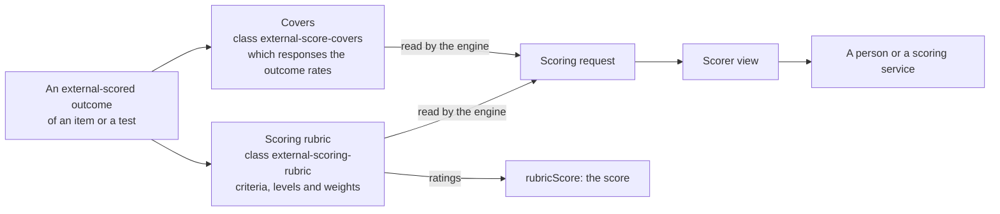
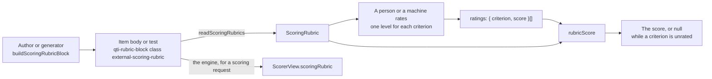
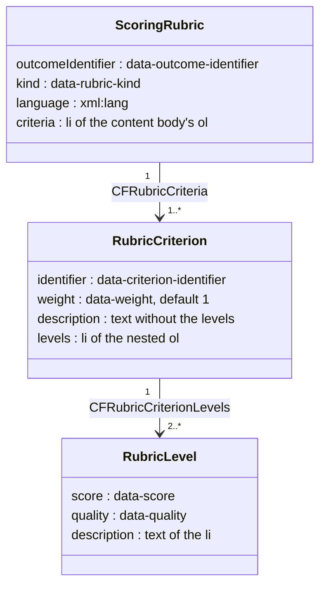

# Conventions for external scores

A convention is something the runtime defines because QTI does not. It uses QTI's own elements, so that every document stays valid
against the published schemas and other tools can still read it. There are three: two are a `qti-rubric-block` for scorers that a
class token marks, and the third is the call of a scoring operator.



| Convention                                      | Marker                           | Place                                  | Says                                           |
| ----------------------------------------------- | -------------------------------- | -------------------------------------- | ---------------------------------------------- |
| [Covers](#covers-of-externally-scored-outcomes) | `external-score-covers`          | A rubric block of a test               | Which responses an outcome of the test rates   |
| [Scoring rubric](#scoring-rubrics)              | `external-scoring-rubric`        | A rubric block of an item or of a test | The criteria, levels and weights of an outcome |
| [Scoring operators](#scoring-operators)         | A `urn:uuid:` definition         | A `qti-custom-operator` of an item     | How a response is scored where QTI cannot      |
| [Compiled scoring](#compiled-scoring)           | `SCORE_<identifier>`, `FEEDBACK` | The outcomes of an item                | The score of each response and its verdict     |

## Covers of externally scored outcomes

An outcome with `external-scored` is set by a scorer, not by processing (INFO section 4.5.10). QTI has no element that says which
responses a test-level outcome of this kind rates. The runtime records it in a rubric block of the test: the place QTI gives to
instructions for scorers (INFO section 2.8.6, `use="scoring"`, `view="scorer"`). The view hides the block from candidates, and a
person who reads the document sees the list of the responses that the scorer rates.

```xml
<qti-rubric-block view="scorer" use="scoring" class="external-score-covers" data-outcome-identifier="CONTENT">
  <qti-content-body>
    <p>Rate content once, across both writing tasks.</p>
    <ul>
      <li data-item-ref="W1" data-response-identifier="RESPONSE">Task 1: essay</li>
      <li data-item-ref="W2" data-response-identifier="RESPONSE">Task 2: letter</li>
    </ul>
  </qti-content-body>
</qti-rubric-block>
```

The markup is valid ASI: the tests validate the block that `buildScoreCoversBlock` builds against the published schema.

| Part                       | Rule                                                                                                                     |
| -------------------------- | ------------------------------------------------------------------------------------------------------------------------ |
| Place                      | A child `qti-rubric-block` of `qti-assessment-test`. Blocks of test parts and sections are not covers.                   |
| Marker                     | The class token `external-score-covers`.                                                                                 |
| `view`                     | A list that contains `scorer` and not `candidate`; `validate` checks it. `buildScoreCoversBlock` writes `use="scoring"`. |
| `data-outcome-identifier`  | The outcome the block rates.                                                                                             |
| Content                    | Optional notes, then a `ul` that is a child of the content body. The `li` elements are the covers.                       |
| `data-item-ref`            | On an `li`: the identifier of the `qti-assessment-item-ref` of the item.                                                 |
| `data-response-identifier` | On an `li`: the identifier of the response variable of the item.                                                         |
| Label                      | The text of the `li` with white space normalized. It is absent when empty.                                               |
| Several blocks             | Blocks for one outcome add their covers in document order. `validate` reports it as a duplicate.                         |

The block stays an ordinary `RubricBlock` in `test.rubricBlocks`: one source of truth, with its position and attributes kept.
Nothing is copied into the model, and a read followed by a write keeps the block unchanged.

### Reading and writing

| Function                                           | Does                                                                                                                                                                                   |
| -------------------------------------------------- | -------------------------------------------------------------------------------------------------------------------------------------------------------------------------------------- |
| `readScoreCovers(test)`                            | The covers by outcome identifier, in document order. A test without blocks gives an empty map; an entry without both attributes is left out.                                           |
| `buildScoreCoversBlock(outcome, covers, options?)` | Builds the block: the attributes, the option `notes` (nodes of the content of a rubric block), then the list. Identifiers are checked, labels are written with white space normalized. |

```ts
import { readAsi, readScoreCovers } from "@assesskit/runtime/asi";

const document =
  readAsi(`<qti-assessment-test xmlns="http://www.imsglobal.org/xsd/imsqtiasi_v3p0" identifier="essays" title="Essays">
  <qti-outcome-declaration identifier="CONTENT" cardinality="single" base-type="float" external-scored="human"/>
  <qti-rubric-block view="scorer" use="scoring" class="external-score-covers" data-outcome-identifier="CONTENT">
    <qti-content-body>
      <p>Rate content once, across both writing tasks.</p>
      <ul>
        <li data-item-ref="W1" data-response-identifier="RESPONSE">Task 1: essay</li>
        <li data-item-ref="W2" data-response-identifier="RESPONSE">Task 2: letter</li>
      </ul>
    </qti-content-body>
  </qti-rubric-block>
  <qti-test-part identifier="P1" navigation-mode="linear" submission-mode="individual">
    <qti-assessment-section identifier="S1" title="Writing" visible="true">
      <qti-assessment-item-ref identifier="W1" href="w1.xml"/>
      <qti-assessment-item-ref identifier="W2" href="w2.xml"/>
    </qti-assessment-section>
  </qti-test-part>
</qti-assessment-test>`);

document.kind === "test" ? readScoreCovers(document.test) : undefined;
// => new Map([["CONTENT", [{ itemRef: "W1", responseIdentifier: "RESPONSE", label: "Task 1: essay" }, { itemRef: "W2", responseIdentifier: "RESPONSE", label: "Task 2: letter" }]]])
```

### Checks

`validateTest` reports the covers as errors, with the rules `assesskit/covers/*`: a block for an outcome the test does not declare,
or one that is not `external-scored`; a cover that names an unknown item reference, or a response the item does not declare;
the same cover twice, or two blocks for one outcome; a block whose `view` lacks `scorer` or contains `candidate`, or that
lacks `data-outcome-identifier`; an entry without both attributes. A block below the test that carries the class token is a
warning, because it is not recognized. [Validate](validate.md#test-structure-and-covers) lists the rules.

### In the engine

The covers come only from the blocks, never from an analysis of the rules that use the outcome, such as sums or routing. A test
without blocks has no covers, and its externally scored outcomes still produce scoring requests, with empty covers. A request
carries the covers resolved to item instances, presented or not, with their labels and the candidate's last submitted
responses; a test outcome is requested when every covered response is over, or when the test ends.
[Delivery](delivery.md#scoring-requests) describes the requests, the scorer view and the supply of scores.

## Scoring rubrics

QTI holds a rubric for scorers only as free content in a `qti-rubric-block view="scorer"`. A host that sends essays to raters, people
or machines, needs the rubric as data: the criteria, their weights, and the levels with their scores and descriptions. The
convention gives that structure to the rubric block, inside the item or test, so that the rubric travels with the content and
survives any QTI tool. The runtime reads it, writes it, and computes the score from ratings.



```xml
<qti-rubric-block view="scorer" use="scoring" class="external-scoring-rubric" xml:lang="en"
    data-outcome-identifier="SCORE" data-rubric-kind="analytic">
  <qti-content-body>
    <p>Rate the essay on each criterion.</p>
    <ol>
      <li data-criterion-identifier="content" data-weight="2">
        <p>Content: the response addresses the task.</p>
        <ol>
          <li data-score="0" data-quality="Absent">No idea relates to the task.</li>
          <li data-score="1" data-quality="Partial">Some ideas relate to the task.</li>
          <li data-score="2" data-quality="Full">Every idea addresses the task.</li>
        </ol>
      </li>
      <li data-criterion-identifier="language">
        <p>Language: grammar and vocabulary.</p>
        <ol>
          <li data-score="0" data-quality="Weak">Errors block meaning.</li>
          <li data-score="1" data-quality="Adequate">Errors do not block meaning.</li>
        </ol>
      </li>
    </ol>
  </qti-content-body>
</qti-rubric-block>
```

The markup is valid ASI: the tests validate the blocks that `buildScoringRubricBlock` builds, and the example above, against the published
schema. The data model follows the rubric of CASE (see [CASE alignment](#case-alignment)).



| Part                        | Rule                                                                                                                                                                                      |
| --------------------------- | ----------------------------------------------------------------------------------------------------------------------------------------------------------------------------------------- |
| Place                       | In an item: a `qti-rubric-block` among the content of `qti-item-body`. In a test: a child `qti-rubric-block` of `qti-assessment-test`. Blocks of test parts and sections are not rubrics. |
| Marker                      | The class token `external-scoring-rubric`. A block cannot also carry the token of the covers.                                                                                             |
| `view`                      | A list that contains `scorer` and not `candidate`. `buildScoringRubricBlock` writes `view="scorer"` and `use="scoring"`, which the schema requires of an item's block.                    |
| `data-outcome-identifier`   | The outcome the rubric rates, the attribute that covers use. Required.                                                                                                                    |
| `data-rubric-kind`          | `analytic`, `holistic`, `checklist` or `single-point`. Default `analytic`.                                                                                                                |
| `xml:lang`                  | The language of the texts: the block's, else the item's. A test has none, so the block gives its own. Absent when neither gives one.                                                      |
| Notes                       | Every child of the content body that is not an `ol`, in order. They stay in the block; scorers read them there.                                                                           |
| Criteria                    | The `li` children of the `ol` children of the content body, in document order. Several lists add up.                                                                                      |
| `data-criterion-identifier` | On a criterion: a QTI identifier, unique in the rubric. Ratings name it. Required.                                                                                                        |
| `data-weight`               | On a criterion: a finite number greater than 0, in the lexical space of `xs:double`. Default 1.                                                                                           |
| Criterion description       | The text of the criterion other than its levels list, with white space normalized. Absent when empty.                                                                                     |
| Levels                      | The `li` children of the `ol` children of the criterion, in document order. A list inside a `div` does not count.                                                                         |
| `data-score`                | On a level: a finite number of 0 or more, in the lexical space of `xs:double`, unique within its criterion. Ratings name a level by it. Required.                                         |
| `data-quality`              | On a level: a short name, such as "Proficient". Absent when missing or empty.                                                                                                             |
| Level description           | The text of the level with white space normalized. Absent when empty.                                                                                                                     |
| One block per outcome       | The first marked block of an outcome, in document order, decides. When it is malformed, the outcome has no rubric.                                                                        |

The block stays an ordinary rubric block, with its class and attributes kept: nothing is copied into the model, and a read followed
by a write keeps the block unchanged. Only the texts can vary under template processing; a list holds only `li`, so a template
cannot change the criteria, the levels or the numbers.

### Kinds and the score

The kind constrains the shape. The score has one formula for every kind: the sum, over the criteria in document order, of weight
times the score of the chosen level. CASE gives the weight of a criterion no formula, so the weighted sum is the rule of this
convention and not of CASE.

| Kind           | Shape                                                                                      | A rating form shows                                                       |
| -------------- | ------------------------------------------------------------------------------------------ | ------------------------------------------------------------------------- |
| `analytic`     | One or more criteria, each with two or more levels                                         | A choice of level for each criterion                                      |
| `holistic`     | Exactly one criterion with two or more levels, and a weight of 1                           | One choice of level                                                       |
| `checklist`    | Criteria with exactly two levels, one of them scoring 0 (not met)                          | Not met and met for each criterion, so "not rated" differs from "not met" |
| `single-point` | Criteria with exactly three levels, below, meets and above, with scores strictly ascending | A choice of three levels for each criterion                               |

A single-point rubric here has three scored levels, while the literature often leaves such a rubric unscored.

| Rule                            | Behavior                                                                                                                                                                                      |
| ------------------------------- | --------------------------------------------------------------------------------------------------------------------------------------------------------------------------------------------- |
| A criterion without a rating    | `rubricScore` returns `null`, so the scoring request stays pending                                                                                                                            |
| The range of the score          | `rubricScoreRange` gives it: from the sum of weight times the lowest score to the sum of weight times the highest score; it starts at 0 only when every criterion has a level of 0            |
| The arithmetic                  | Binary floating point, in the order of the criteria, so the result is deterministic and does not depend on the order of the ratings. A sum such as 0.1 + 0.1 + 0.1 carries its usual rounding |
| An outcome of base type integer | Takes the score only when every weight times score is an integer                                                                                                                              |

### Reading and writing

| Function                                    | Does                                                                                                                                                                                          |
| ------------------------------------------- | --------------------------------------------------------------------------------------------------------------------------------------------------------------------------------------------- |
| `readScoringRubrics(document)`              | The rubrics of an item or a test by outcome identifier. An outcome whose first block breaks a rule has no entry; a document without blocks gives an empty map.                                |
| `buildScoringRubricBlock(rubric, options?)` | Builds the block: the attributes, the option `notes` (nodes of the content of a rubric block, never an `ol`), then the criteria list. Texts are written with white space normalized.          |
| `checkScoringRubric(value)`                 | Checks a rubric that arrived as JSON or from a caller: its shape, its numbers and identifiers, and the shape that its kind requires. Throws a `DataError` with the path.                      |
| `rubricScore(rubric, ratings)`              | The score of `{ criterion, score }` ratings, or `null` while a criterion has none. Throws a `DataError` for a rating that does not fit the rubric.                                            |
| `rubricScoreRange(rubric)`                  | The lowest and the highest score that ratings can give, for a host that shows "7 out of 12" or checks the declaration of the outcome. Throws a `DataError` for a rubric that fails the check. |

```ts
import { readAsi, readScoringRubrics, rubricScoreRange, rubricScore } from "@assesskit/runtime/asi";

const document = readAsi(`<qti-assessment-item xmlns="http://www.imsglobal.org/xsd/imsqtiasi_v3p0"
    identifier="essay" title="Essay" time-dependent="false">
  <qti-item-body>
    <qti-rubric-block view="scorer" use="scoring" class="external-scoring-rubric"
        data-outcome-identifier="SCORE" data-rubric-kind="analytic">
      <qti-content-body>
        <ol>
          <li data-criterion-identifier="content" data-weight="2">
            <p>Content: the response addresses the task.</p>
            <ol>
              <li data-score="0" data-quality="Absent">No idea relates to the task.</li>
              <li data-score="1" data-quality="Partial">Some ideas relate to the task.</li>
              <li data-score="2" data-quality="Full">Every idea addresses the task.</li>
            </ol>
          </li>
          <li data-criterion-identifier="language">
            <p>Language: grammar and vocabulary.</p>
            <ol>
              <li data-score="0" data-quality="Weak">Errors block meaning.</li>
              <li data-score="1" data-quality="Adequate">Errors do not block meaning.</li>
            </ol>
          </li>
        </ol>
      </qti-content-body>
    </qti-rubric-block>
  </qti-item-body>
</qti-assessment-item>`);

const rubric = document.kind === "item" ? readScoringRubrics(document.item).get("SCORE") : undefined;
rubric?.criteria.map(({ identifier, weight }) => [identifier, weight]); // => [["content", 2], ["language", 1]]
rubric?.criteria[0]?.levels.map(({ score, quality }) => [score, quality]); // => [[0, "Absent"], [1, "Partial"], [2, "Full"]]
rubric && rubricScoreRange(rubric); // => { minimum: 0, maximum: 5 }
rubric &&
  rubricScore(rubric, [
    { criterion: "content", score: 2 },
    { criterion: "language", score: 1 },
  ]); // => 5
rubric && rubricScore(rubric, [{ criterion: "content", score: 2 }]); // => null
```

### Placing a block in a document

`buildScoringRubricBlock` and `buildScoreCoversBlock` return a node, not a document, and `writeAsi` writes documents. The model is
plain data: put the node among the content of the item body, or in `rubricBlocks` of a test, in a copy of the model, and write
the document that holds it.

```ts
import { buildScoringRubricBlock, readAsi, readScoringRubrics, writeAsi } from "@assesskit/runtime/asi";

const read = readAsi(`<qti-assessment-item xmlns="http://www.imsglobal.org/xsd/imsqtiasi_v3p0"
    identifier="essay" title="Essay" time-dependent="false">
  <qti-item-body><p>Write an essay about your town.</p></qti-item-body>
</qti-assessment-item>`);
if (read.kind !== "item" || read.item.body === undefined) throw new Error("The document is not an item with a body.");
const block = buildScoringRubricBlock({
  outcomeIdentifier: "SCORE",
  kind: "holistic",
  language: "en",
  criteria: [
    {
      identifier: "quality",
      weight: 1,
      levels: [
        { score: 0, quality: "Weak", description: "Errors block meaning." },
        { score: 1, quality: "Adequate", description: "Errors do not block meaning." },
      ],
    },
  ],
});
const item = { ...read.item, body: { ...read.item.body, children: [...read.item.body.children, block] } };
readScoringRubrics(item).get("SCORE")?.kind; // => "holistic"
writeAsi({ kind: "item", item }).includes('class="external-scoring-rubric"'); // => true
```

### CASE alignment

The fields follow the rubric of the IMS Competencies and Academic Standards Exchange (CASE) Service 1.0 Information Model
([IMS Final Release, 7 July 2017](https://www.imsglobal.org/sites/default/files/CASE/casev1p0/information_model/caseservicev1p0_infomodelv1p0.html)),
sections 7.1.17 (`CFRubric`), 7.1.18 (`CFRubricCriterion`) and 7.1.19 (`CFRubricCriterionLevel`).

| CASE attribute                              | Section, multiplicity   | Convention                                                                                                                        |
| ------------------------------------------- | ----------------------- | --------------------------------------------------------------------------------------------------------------------------------- |
| `CFRubric.CFRubricCriteria`                 | 7.1.17.6, [0..*]        | The criteria list; one or more are required here                                                                                  |
| `CFRubricCriterion.identifier`              | 7.1.18.1, [1], UUID     | `data-criterion-identifier`, a QTI identifier: ratings and the item need no global identity                                       |
| `CFRubricCriterion.description`             | 7.1.18.4, [0..1]        | The criterion text                                                                                                                |
| `CFRubricCriterion.weight`                  | 7.1.18.6, [0..1], Float | `data-weight`, default 1. CASE says only that the weight is "used for scored rubrics"; the weighted sum is this convention's rule |
| `CFRubricCriterion.position`                | 7.1.18.7, [0..1]        | Document order                                                                                                                    |
| `CFRubricCriterion.CFRubricCriterionLevels` | 7.1.18.10, [0..*]       | The levels list; two or more are required here                                                                                    |
| `CFRubricCriterionLevel.description`        | 7.1.19.3, [0..1]        | The level text                                                                                                                    |
| `CFRubricCriterionLevel.quality`            | 7.1.19.4, [0..1]        | `data-quality`                                                                                                                    |
| `CFRubricCriterionLevel.score`              | 7.1.19.5, [0..1], Float | `data-score`, required here because a rating names the level by it                                                                |
| `CFRubricCriterionLevel.position`           | 7.1.19.7, [0..1]        | Document order                                                                                                                    |

| Not carried                                                                                                                                               | Section                                          | Reason                                                                                                                           |
| --------------------------------------------------------------------------------------------------------------------------------------------------------- | ------------------------------------------------ | -------------------------------------------------------------------------------------------------------------------------------- |
| `identifier`, `uri`, `lastChangeDateTime` of the rubric; `uri`, `lastChangeDateTime` of a criterion; `identifier`, `uri`, `lastChangeDateTime` of a level | 7.1.17.1, .2, .5; 7.1.18.2, .9; 7.1.19.1, .2, .9 | A registry's identity and dates, not the item's concern. Ratings name a level by its score, which is unique within the criterion |
| `CFRubric.title`, `CFRubric.description`                                                                                                                  | 7.1.17.3, .4                                     | The `label` of the block holds a title and the notes hold a description; both stay in the block                                  |
| `CFRubricCriterion.category`                                                                                                                              | 7.1.18.3                                         | A label for grouping, with no effect on the score                                                                                |
| `CFRubricCriterion.CFItemURI`                                                                                                                             | 7.1.18.5                                         | Alignment to a competency is QTI metadata (curriculum standards)                                                                 |
| `CFRubricCriterionLevel.feedback`                                                                                                                         | 7.1.19.6                                         | Feedback to candidates is QTI feedback, driven by the supplied outcome                                                           |
| `rubricId`, `rubricCriterionId`                                                                                                                           | 7.1.18.8, 7.1.19.8                               | Back-references, implied by nesting                                                                                              |
| The kind                                                                                                                                                  |                                                  | `data-rubric-kind` has no CASE counterpart; it is an addition of the runtime                                                     |

### Edge cases

| Case                                                             | Behavior                                                                              |
| ---------------------------------------------------------------- | ------------------------------------------------------------------------------------- |
| The first block of an outcome is malformed and a second is valid | The outcome has no rubric                                                             |
| Notes contain an `ol` child of the content body                  | Read as criteria; the builder refuses it                                              |
| A criterion's levels are inside a `div` of the `li`              | The criterion has no levels list, so it is malformed                                  |
| `data-score` of `1e1`, `+2`, `2`, `-0`                           | Read as an `xs:double`: 10, 2, 2 and 0. `INF`, `NaN` and negative numbers are refused |
| `data-weight="0"`                                                | Malformed: a criterion that does not count is not a criterion of the score            |
| A holistic rubric with a weight other than 1                     | A shape error: its score is the score of the chosen level                             |
| Two levels with the same score in one criterion                  | A duplicate: ratings name a level by its score                                        |
| Levels written from high to low                                  | Allowed, except for `single-point`; a form keeps document order                       |
| A checklist with its 0 level second                              | Allowed: exactly one level scores 0                                                   |
| An `xml:lang` on a list entry or an inner element                | Not read; the language comes from the block or the item                               |
| An item with several external outcomes                           | One block per outcome                                                                 |
| An empty list of ratings                                         | `null`                                                                                |

### Checks

`validateAsi` of an item or a test reports the rubrics as errors, with the rules `assesskit/scoring-rubric/*`: a block that breaks
the form of the convention, the shape of its kind, or uses an identifier or a score twice; a block for an outcome that is
undeclared, not `external-scored`, or not a single integer or float (an integer outcome needs whole points); two blocks for one
outcome. A rubric whose sums leave the normal range of the outcome, and a block with the class token where it is not
recognized, are warnings. [Validate](validate.md#scoring-rubrics) lists the rules.

### In the engine

`scorerView` gives a rater the rubric of the request in `scoringRubric`, so that no host searches the content for it. Which block
applies depends on the scope of the outcome:

| Request      | `scoringRubric` comes from                                                                                                        | The rubric blocks of the scorer view leave out                                                                                            |
| ------------ | --------------------------------------------------------------------------------------------------------------------------------- | ----------------------------------------------------------------------------------------------------------------------------------------- |
| Item outcome | The first marked block of the item for the outcome, after template processing, with the item's `xml:lang` when the block has none | Every covers and scoring rubric block of the test, even for an outcome of the same name; the scoring rubrics of the item's other outcomes |
| Test outcome | The first marked block of the test for the outcome                                                                                | The covers and scoring rubric blocks of other outcomes; every scoring rubric block of the covered items                                   |

An outcome with no marked block has no `scoringRubric`, and the host rates it by its own means. Template content in a rubric
resolves in the scorer view, and only its texts can vary: the criteria, the levels and the numbers are those of the document.
`createEngine` runs the static checks of `validate`, so a block that breaks a rule is refused before a session starts.
[Delivery](delivery.md#scorer-view) describes the view.

### Not included

| Not included                                           | Reason                                                                                       |
| ------------------------------------------------------ | -------------------------------------------------------------------------------------------- |
| Rater comments, those of single-point rubrics included | Part of the host's rating workflow, not of the score                                         |
| Anchor responses and exemplars per level               | Often copyrighted or secret rater-training material that does not travel in a delivered item |
| Conditions such as "too short" or "off topic"          | Policy of a scoring service, not structure of a rubric                                       |
| Mapping the sum onto another scale                     | The declaration of the outcome is the scale                                                  |
| Negative scores (penalties)                            | Keeps the range and the checklist rule simple; a penalty is response processing              |
| A rubric shared across items at section level          | QTI items are self-contained; each item carries its rubric                                   |
| Agreement or severity across raters                    | Measurement, outside QTI                                                                     |

## Scoring operators

A `qti-custom-operator` whose `definition` is one of `OPERATOR_DEFINITIONS` calls a scoring operator of
[operators](operators.md): its `class` is the operator's name, its first operand the response, its second, for a follow-through,
the earlier response, and its key is one attribute, `options`, in `OPERATOR_NAMESPACE`, the canonical JSON of RFC 8785 with
every default resolved. The schema of QTI allows an attribute of another namespace on the element, so the item stays valid,
and a processor without the operators refuses the item rather than scoring it wrongly: `validate` reports the operator, and
processing throws a `ProcessingError`. The definitions name no brand, so an item scores alike under any publisher's name.

| Part       | Rule                                                                                                                  |
| ---------- | --------------------------------------------------------------------------------------------------------------------- |
| Definition | A `urn:uuid:` for each operator; a change that alters a verdict takes a new one, and the earlier ones stay registered |
| Attribute  | `options` in `urn:uuid:37ee0bb1-9b3b-4da2-92a2-3102380d98b5`, read by namespace whatever its prefix                   |
| Writer     | `buildOperatorCall`, which writes the prefix `operator` and checks the key as the operator reads it                   |

## Compiled scoring

`compileScoring` of [scoring](scoring.md) names the outcomes that QTI leaves to the author beside `SCORE` and `MAXSCORE`, so that a
test's outcome processing and an item's feedback read them by name. They are plain outcome declarations, so the item stays valid.

| Outcome              | Rule                                                                                                                         |
| -------------------- | ---------------------------------------------------------------------------------------------------------------------------- |
| `SCORE_<identifier>` | A float, the points of one response of an item of several, with `normal-maximum` its maximum; `SCORE` is their sum           |
| `FEEDBACK`           | Of cardinality `multiple`, base type `identifier`: `<identifier>-correct`, `-partial`, `-incorrect` or `-blank` per response |
