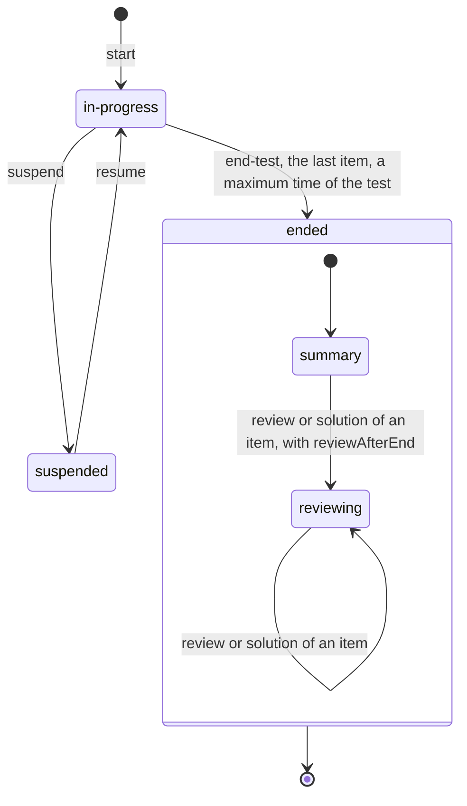
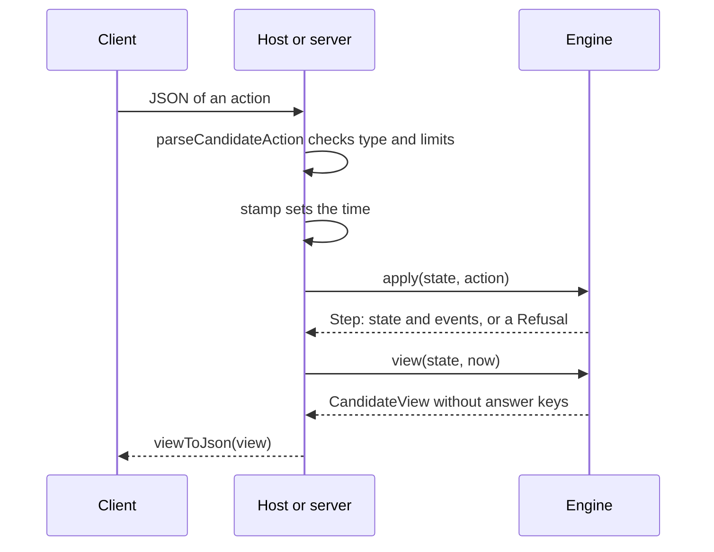
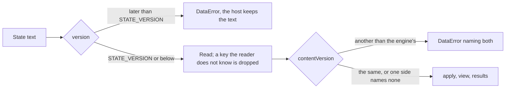
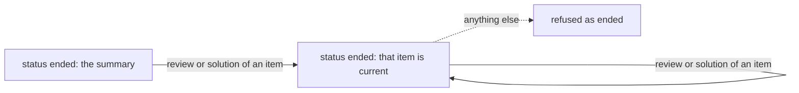
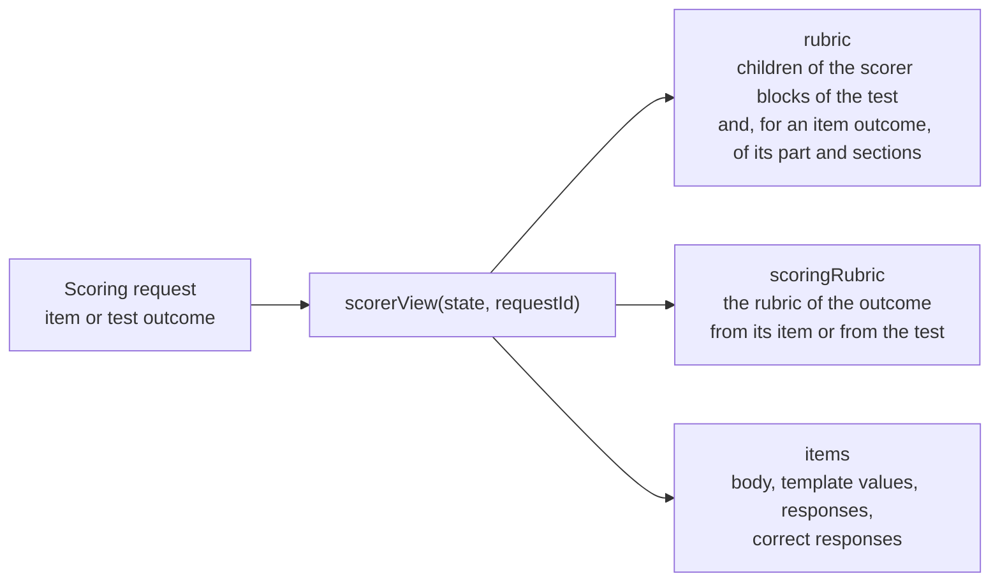
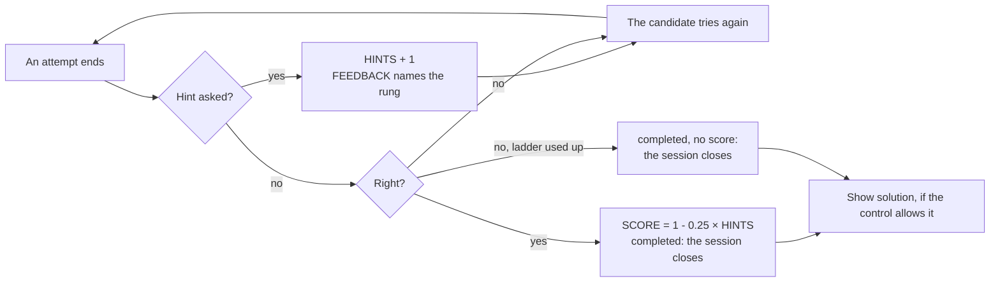
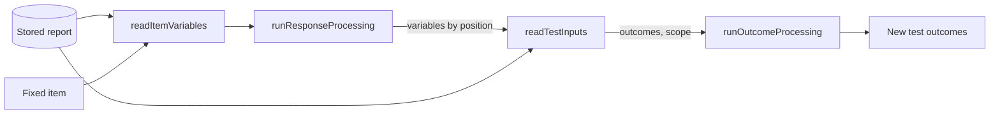
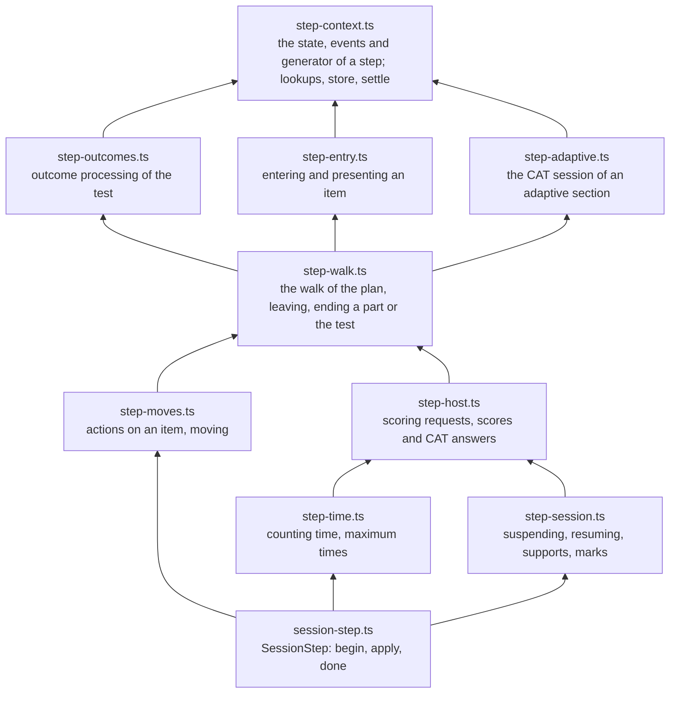

# Delivery

`delivery` is the headless delivery engine. `createEngine` builds the engine of a test, or of an item delivered alone for
practice, after a static gate over everything a session can reach. The engine is a pure reducer of candidate sessions: an action
and a state go in, a new state with its events or a refusal comes out. Around the reducer the module plans a test session
(sections, items, order, rules), runs the session of each item instance, builds the view of a candidate, which holds no answer
key, writes and reads the JSON forms of views, actions and states, and holds what the engine waits on the host for: scores,
answers of CAT engines, and links to tools. It imports `values`, `asi`, `results`, `pnp`, `interactions`, `content`, `processing`,
`cat`, `package` and `validate` and runs in any JavaScript runtime. It reads no clock: every step takes the time it happened.

The session of a candidate is in one of three states.



`ended` is final unless the engine is built with `reviewAfterEnd`: then `review` and `solution` are accepted in it, and its
status stays `ended` ([Review after the end](#review-after-the-end)).

An action reaches the candidate's view through the host. The host keeps the state, and the client holds only views and actions.



| Function or type                                               | Does                                                                                                 |
| -------------------------------------------------------------- | ---------------------------------------------------------------------------------------------------- |
| `createEngine(definition, options?)`                           | The `Engine`: `start`, `apply`, `deadlines`, `view`, `pending`, `scorerView`, `results`.             |
| `stamp(state, action, now)`                                    | The action with `at` = max(`now`, the time of the latest step).                                      |
| `viewToJson(view)`, `viewFromJson(json)`                       | The JSON form of a `CandidateView`, and the view of a JSON form.                                     |
| `actionToJson(action)`, `parseCandidateAction(json, options?)` | The JSON form of a candidate action, and the action of a JSON form, within limits.                   |
| `CandidateView`, `CandidateItem`, `NavigationEntry`, …         | What the candidate sees: the item, the navigation map, timers, actions and supports.                 |
| `DEFAULT_ACTION_LIMITS`, `ActionLimits`                        | The limits of `parseCandidateAction`.                                                                |
| `serializeState(state)`, `deserializeState(text)`              | The JSON text of a state, and the state of a text, with the version of the format.                   |
| `DeliveryState`, `Step`, `Deadline`                            | A candidate session as plain data, the result of a step, a time limit as an absolute time.           |
| `CandidateAction`, `HostAction`, `Action`                      | The actions of the candidate and the host, with their time.                                          |
| `DeliveryDefinition`, `EngineOptions`, `StartOptions`          | What the engine delivers, its options, and the options of a session.                                 |
| `drainCat(engine, state, port, now, options?)`                 | Makes the waiting requests of CAT engines through a `CatSessionPort` and applies each answer.        |
| `sendCatRequest(port, request, options?)`                      | Makes one CAT request through a `CatSessionPort` and returns the answer for a `cat-response` action. |
| `DrainCatOptions`, `SendCatRequestOptions`                     | The options of `drainCat` and `sendCatRequest`: `signal`.                                            |
| `PendingWork`, `ScoringRequest`, `CatRequest`                  | What the engine waits on the host for: scores and answers of CAT engines.                            |
| `ScorerView`, `ScorerItem`                                     | What a scorer needs to rate a request, correct responses included.                                   |
| `CatSession`, `CatSectionRef`                                  | The session of an adaptive section in a state, and where its CAT engine is.                          |
| `resolveStructure(test, base, resolvers)`                      | The `TestStructure`: parts, sections and item references, section references replaced.               |
| `planTest(structure, options)`                                 | A `TestPlan`: the sections and item instances of one session.                                        |
| `planItems(plan, part?)`                                       | The item instances of a plan, or of one test part, in order of presentation.                         |
| `nextItem(structure, plan, from, rules)`                       | The item to present after `from`, or the first item; pre-conditions and branch rules apply.          |
| `previousItem(structure, plan, from)`                          | The item before `from`, in a nonlinear part.                                                         |
| `sessionControl(item)`                                         | The item session control of an item reference after inheritance.                                     |
| `timeLimits(node, extra?)`                                     | The time limits of the test, a part, a section or an item reference, with extra time.                |
| `additionalTestingTime(profile)`                               | The extra testing time of a PNP.                                                                     |
| `ancestry(node)`, `partOf(node)`                               | The nodes that enclose a node, outermost first; the test part of a section or item reference.        |
| `ItemKey`                                                      | An item instance: the identifier of the item reference and the instance, from 1.                     |
| `TestPlan`, `PlannedPart`, `PlannedSection`, …                 | The plan: plain data, identifiers and numbers only.                                                  |
| `TestNode`, `PartNode`, `SectionNode`, …                       | The nodes of the structure, with their models and the path of the document that holds them.          |
| `RuleContext`                                                  | What pre-conditions and branch rules read.                                                           |
| `EffectiveSessionControl`, `EffectiveTimeLimits`               | The results of `sessionControl` and `timeLimits`.                                                    |
| `DEFAULT_PLAN_LIMITS`, `PlanLimits`, `PlanOptions`             | The limit on the size of a plan, and the options of `planTest`.                                      |
| `startItemSession(key, at, context, options?)`                 | A new item session in the state `initial`, after template processing.                                |
| `presentItem(session, at, context)`                            | Presents the item: the first time it starts the first attempt; a suspended session resumes.          |
| `suspendItem(session, at)`                                     | Suspends an interacting session, as when the candidate moves to another item.                        |
| `closeItem(session, at, context)`                              | Closes the session, ending an open attempt with its drafts.                                          |
| `applyItemAction(session, action, context)`                    | Applies an action of the candidate: responses, submit, skip, end attempt, review and more.           |
| `itemFeedback(session, item, control)`                         | The outcomes that decide the feedback shown in the state of the session.                             |
| `itemResponses(session)`                                       | The responses the item shows: drafts, submitted responses, or the solution.                          |
| `resultStatus(session, item)`                                  | The session status of Results Reporting.                                                             |
| `readItemVariables(item, result)`                              | The variables that response processing starts from, read from a stored result of one instance.       |
| `readTestInputs(structure, result, items, options?)`           | The outcomes and the scope that outcome processing takes, read from a stored report.                 |
| `TestInputs`, `ReadTestInputsOptions`                          | What `readTestInputs` returns, and its option `variables`.                                           |
| `standaloneSessionControl(control?)`                           | The item session control of an item delivered alone.                                                 |
| `ItemSession`, `ItemSessionStatus`                             | The state of an item session: plain data with its variables, drafts and attempts.                    |
| `ItemSessionContext`, `ItemAction`, `ItemStep`                 | What a step reads besides the session, the actions of the candidate, and the result of a step.       |
| `Refusal`, `RefusalCode`, `DeliveryEvent`, …                   | Why a step is refused, and what an accepted step reports.                                            |

## Engine

```ts
import { readAsi } from "@assesskit/runtime/asi";
import { createEngine, deserializeState, serializeState, stamp } from "@assesskit/runtime/delivery";
import { single } from "@assesskit/runtime/values";

const itemXml = (identifier) => `<qti-assessment-item xmlns="http://www.imsglobal.org/xsd/imsqtiasi_v3p0"
    identifier="${identifier}" title="${identifier}" time-dependent="false">
  <qti-response-declaration identifier="RESPONSE" cardinality="single" base-type="identifier">
    <qti-correct-response><qti-value>B</qti-value></qti-correct-response>
  </qti-response-declaration>
  <qti-outcome-declaration identifier="SCORE" cardinality="single" base-type="float"/>
  <qti-item-body>
    <qti-choice-interaction response-identifier="RESPONSE" max-choices="1">
      <qti-simple-choice identifier="A">A</qti-simple-choice>
      <qti-simple-choice identifier="B">B</qti-simple-choice>
    </qti-choice-interaction>
  </qti-item-body>
  <qti-response-processing template="https://purl.imsglobal.org/spec/qti/v3p0/rptemplates/match_correct"/>
</qti-assessment-item>`;
const items = new Map([
  ["q1.xml", readAsi(itemXml("q1")).item],
  ["q2.xml", readAsi(itemXml("q2")).item],
]);
const { test } =
  readAsi(`<qti-assessment-test xmlns="http://www.imsglobal.org/xsd/imsqtiasi_v3p0" identifier="quiz" title="Quiz">
  <qti-outcome-declaration identifier="TOTAL" cardinality="single" base-type="float"/>
  <qti-time-limits max-time="600"/>
  <qti-test-part identifier="part" navigation-mode="linear" submission-mode="individual">
    <qti-assessment-section identifier="main" title="Main" visible="true">
      <qti-assessment-item-ref identifier="q1" href="q1.xml"/>
      <qti-assessment-item-ref identifier="q2" href="q2.xml"/>
    </qti-assessment-section>
  </qti-test-part>
  <qti-outcome-processing>
    <qti-set-outcome-value identifier="TOTAL"><qti-sum><qti-test-variables variable-identifier="SCORE"/></qti-sum></qti-set-outcome-value>
  </qti-outcome-processing>
</qti-assessment-test>`);
const engine = createEngine({
  kind: "test",
  test,
  base: "quiz.xml",
  resolvers: {
    items: (href) => ({
      resource: href,
      deliverable: { kind: "qti", item: items.get(href) },
      hazards: [],
      variants: [],
    }),
    sections: () => {
      throw new Error("The test has no section references.");
    },
    stimuli: () => {
      throw new Error("The items have no stimuli.");
    },
  },
});
const started = engine.start({ seed: 42, at: 1_000 });
started.events;
// => [{ type: "section-entered", at: 1000, scope: "main" }, { type: "presented", at: 1000, item: { ref: "q1", instance: 1 } }]
engine.deadlines(started.state);
// => [{ scope: "test", identifier: "quiz", kind: "max-time", at: 601000, lateSubmission: false }]
const answer = {
  type: "set-responses",
  item: { ref: "q1", instance: 1 },
  responses: new Map([["RESPONSE", single("identifier", "B")]]),
};
const answered = engine.apply(started.state, stamp(started.state, answer, 5_000));
const moved = engine.apply(answered.state, { type: "move", to: "next", at: 9_000 });
moved.state.outcomes.get("TOTAL"); // => { cardinality: "single", baseType: "float", value: 1 }
moved.state.current; // => { ref: "q2", instance: 1 }
engine.apply(moved.state, { type: "move", to: "previous", at: 10_000 }).refusal.code; // => "linear-backward"
const restored = deserializeState(serializeState(moved.state));
engine.apply(restored, { type: "time", at: 601_000 }).state.status; // => "ended"
```

The engine is a pure reducer. `start` gives the first state, `apply(state, action)` the next state and its events or
a refusal, and `deadlines(state)` the times at which the host sends `{ type: "time", at }`. A step never changes the state
it is given, and a refusal gives no state. `apply` never throws on a state of its engine: a processing failure is an event.

### Definition and options

| `DeliveryDefinition` | Fields                                                                                                  |
| -------------------- | ------------------------------------------------------------------------------------------------------- |
| `kind: "test"`       | `test`, `base`, `resolvers` (such as `packageResolvers(pkg)`), `catSections` (default: none)            |
| `kind: "item"`       | `item`, `base` (the path of the item document), `control` (a `qti-item-session-control`; default: none) |

| `EngineOptions`   | Default                                            | Meaning                                                                                                             |
| ----------------- | -------------------------------------------------- | ------------------------------------------------------------------------------------------------------------------- |
| `customOperators` | none                                               | The custom operators, by `definition`, else `class`.                                                                |
| `resolveTemplate` | none                                               | The response processing of a template URI other than the six standard ones.                                         |
| `limits`          | `maxContainerSize`: 10,000; `maxPlanNodes`: 10,000 | The limits of processing and of the plan of a session.                                                              |
| `contentVersion`  | none                                               | The version of the content, as the host names it: see [State](#state).                                              |
| `eventOutcomes`   | `false`                                            | `response-processed` carries the outcomes of the item: see [Events](#events).                                       |
| `reviewAfterEnd`  | `false`                                            | A candidate may review the items presented after the test ended: see [Review after the end](#review-after-the-end). |

`createEngine` runs the static gate first: `validateTest`, or `validateAsi` for an item, with the custom operators
and the template resolver given, so that a custom operator that none serves is an error. Any issue of severity `error` is a
`DataError` whose message lists the issues with their codes and paths; warnings pass. It then resolves the section
references and every item reference with its variants, once. An item reference that names a link to a tool is an item
without response variables and with the outcomes `SCORE` and `MAXSCORE`, single floats scored by the tool
(`external-scored="externalMachine"`).

### Resolvers

`resolvers` are three synchronous functions. Each takes the `href` as the document writes it and the path of the document
that holds it.

| Resolver               | Returns                                                                                                        |
| ---------------------- | -------------------------------------------------------------------------------------------------------------- |
| `items(href, base)`    | A `ResolvedItem`: the resource, the deliverable (a QTI item or an LTI link), its DRD hazards and its variants. |
| `sections(href, base)` | The `AssessmentSection` that a `qti-assessment-section-ref` names.                                             |
| `stimuli(href, base)`  | The `AssessmentStimulus` that a `qti-assessment-stimulus-ref` names.                                           |

`packageResolvers(pkg)` builds them from a `QtiPackage`. A resolver reports a reference it cannot resolve by throwing, and
the error leaves `createEngine`. A resolver returns its value and never a promise: `createEngine` throws a `DataError` that
names the resolver, and `validateTest` and `resolveStructure` do the same. `createEngine` calls each resolver while
it builds the engine and the engine never calls one again, so a host whose documents are in a store loads those the test can
reach, a pool of an adaptive section included, before it calls `createEngine`, and returns them from memory. One engine
serves every session of a test, and a session does no I/O.

### Start

| `StartOptions`      | Default                      | Meaning                                                                                              |
| ------------------- | ---------------------------- | ---------------------------------------------------------------------------------------------------- |
| `seed`              | —                            | The seed of the generator of the session: selection, ordering, template values, shuffles.            |
| `at`                | —                            | The time of the start, in epoch milliseconds.                                                        |
| `pnp`               | none                         | The candidate's profile: supports, extra time, hazards avoided, item translation.                    |
| `universalSupports` | none                         | Supports the program gives every candidate; options unless the profile names them.                   |
| `context`           | none                         | Values of context variables, `QTI_CONTEXT` included, for the test and every item that declares them. |
| `resultContext`     | `{ sessionIdentifiers: [] }` | Who took the test, for the results `context`: `sourcedId` and delivery system sessions.              |

`start` plans the session with `planTest` and `createRandom(seed)`, and presents the first item that the walk of
pre-conditions and branch rules gives; a test with nothing to present ends at once. A context value must fit every
declaration of its variable, in the test and in its items, else `start` throws a `DataError`. A time, in `at` and in every
action, is epoch milliseconds from the year 1 to the year 9999, so that a results report can write it as a datestamp.

### Actions

| Action                                                                                            | Effect                                                                        |
| ------------------------------------------------------------------------------------------------- | ----------------------------------------------------------------------------- |
| `set-responses`, `submit`, `skip`, `end-attempt`, `next-attempt`, `review`, `solution`, `comment` | `applyItemAction` on the item presented; an attempt that ends is a submission |
| `mark`                                                                                            | Marks an item instance presented for review, or takes the mark away; by value |
| `move` `next`                                                                                     | Leaves the item presented for what the walk gives                             |
| `move` `previous`                                                                                 | The item before, in a nonlinear part                                          |
| `move` to an item instance                                                                        | Any item of the part in a nonlinear part; the next item only in a linear part |
| `end-part`                                                                                        | Ends the test part, then goes on after it                                     |
| `end-test`                                                                                        | Ends the test part and the test                                               |
| `suspend`, `resume`                                                                               | Suspends and resumes the candidate session                                    |
| `support`                                                                                         | Turns a support that is an option on or off                                   |
| `support-settings`                                                                                | Changes the settings of a support that is on, as the candidate prefers them   |
| `time` (host)                                                                                     | Applies the maximum times that passed; nothing else                           |
| `supply-scores` (host)                                                                            | Gives the value of an externally scored outcome, in any state                 |
| `cat-response` (host)                                                                             | Gives the answer of a CAT engine to a request, in any state                   |

Every action carries `at`. Before the action, the maximum times that passed by `at` apply, each at its own time.
`stamp(state, action, now)` sets `at` to max(`now`, `state.at`), so a server whose clock steps back never has an action
refused; an action stamped earlier than the latest step is refused `clock-regression`.

A refusal is its stable `code` and a `message`. The codes are these; the rules of the item session, which `apply` also
applies, are listed under Item sessions.

| Refusal code             | When                                                                                                                                                                                                                                                                                                                       |
| ------------------------ | -------------------------------------------------------------------------------------------------------------------------------------------------------------------------------------------------------------------------------------------------------------------------------------------------------------------------- |
| `attempts-exhausted`     | `next-attempt`, or the first action after an attempt, on an item whose session allows no further attempt.                                                                                                                                                                                                                  |
| `awaiting-cat`           | The next item depends on a CAT engine that has not answered, or a first stage is awaited.                                                                                                                                                                                                                                  |
| `clock-regression`       | `at` is before the latest step.                                                                                                                                                                                                                                                                                            |
| `comment-not-allowed`    | `comment` on an item whose item session control does not allow comments.                                                                                                                                                                                                                                                   |
| `ended`                  | The test has ended, and the action is not `supply-scores`, `cat-response` or, with `reviewAfterEnd`, `review` or `solution`.                                                                                                                                                                                               |
| `invalid-response`       | `set-responses` for a variable the candidate does not set, or a value of another type; `end-attempt` or a portable custom interaction state that the item does not have; a `submit` of responses that `validate-responses` rejects; a `cat-response` that does not fit its request, or whose stage exceeds `maxPlanNodes`. |
| `item-closed`            | `set-responses` or `submit` on a session that is closed.                                                                                                                                                                                                                                                                   |
| `linear-backward`        | `previous`, or a move to an earlier item, in a linear part.                                                                                                                                                                                                                                                                |
| `min-time-not-reached`   | Leaving an item, section, part or test before its minimum time.                                                                                                                                                                                                                                                            |
| `not-current`            | An action on an item that is not presented; a move to another part, or past the next item in a linear part.                                                                                                                                                                                                                |
| `review-not-allowed`     | `review` before the session closed, or without `allow-review`.                                                                                                                                                                                                                                                             |
| `score-type-mismatch`    | `supply-scores` gives a value that does not fit the declaration of the outcome.                                                                                                                                                                                                                                            |
| `setting-not-adjustable` | `support-settings` for a support without settings that the candidate may change, or that changes another of its settings.                                                                                                                                                                                                  |
| `skipping-not-allowed`   | `submit` or `skip` without a response on an item under `allow-skipping="false"`.                                                                                                                                                                                                                                           |
| `solution-not-allowed`   | `solution` before the session closed, or without `show-solution`.                                                                                                                                                                                                                                                          |
| `support-not-available`  | `support` for a support that is not an option; `support-settings` for a support that is off or not offered.                                                                                                                                                                                                                |
| `suspended`              | The session is suspended and the action is not `resume`.                                                                                                                                                                                                                                                                   |
| `time-over`              | The item, or a scope that holds it, closed at its maximum time; or the test ended at it in this step.                                                                                                                                                                                                                      |
| `unknown-item`           | The plan has no such item instance, or no item before the first of a nonlinear part; `mark` for an item instance that was not presented.                                                                                                                                                                                   |
| `unknown-request`        | `supply-scores` or `cat-response` names a request the state lacks, or one that waits for no answer.                                                                                                                                                                                                                        |
| `value-out-of-range`     | `set-responses` gives an integer outside the safe integers.                                                                                                                                                                                                                                                                |
| `wrong-submission-mode`  | `submit`, `skip` or `end-attempt` in a part with simultaneous submission.                                                                                                                                                                                                                                                  |

A mark is for the candidate to come back to an item: `mark` names any item instance presented, not only the one on the
screen, and the mark shows as `marked` in the navigation map. It is a field of the state (`marked`, present only on a
marked item), not of QTI, so it stays out of `results()` and the report. Marking a marked item, or taking the mark from an item that has none,
changes nothing. A part with a linear navigation takes the action too, but its map lists the items presented, none reachable,
so a mark has nowhere to lead there.

### Navigation and submission

| Part                       | Leaving the item presented                                                                                                      |
| -------------------------- | ------------------------------------------------------------------------------------------------------------------------------- |
| linear, individual         | An open attempt is submitted, with the checks of skipping and validity, and the session closes: the candidate cannot come back. |
| nonlinear, individual      | The session is suspended with its attempt open; the candidate submits each item.                                                |
| simultaneous (either mode) | The session is suspended with its attempt open; no item is submitted alone.                                                     |

- The walk decides after the submission and its outcome processing, so pre-conditions and branch rules read the new
  outcomes.
- When the walk leaves the test part, the part ends: every session of the part closes, so an open attempt ends with its
  drafts (in simultaneous mode this submits the group); outcome processing runs; then the part is completed, so its own
  branch rules read the outcomes of the group, and the walk goes on. `end-part` and `end-test` end the part the same way,
  from any item. A branch rule that leads to another part ends the part first too.
- The items of an adaptive section are submitted one by one, also in a part with simultaneous submission.
- An item is reviewed while its part is current; a part that ended is not visited again.

### Outcome processing

Outcome processing runs once after the attempts that ended in a step: after a submission in individual mode, after the
group at the end of a simultaneous part. The outcomes start from their defaults each time. What the
test's expressions read:

| Reference                                       | Value                                                                                                             |
| ----------------------------------------------- | ----------------------------------------------------------------------------------------------------------------- |
| `ITEM.VAR`                                      | The instance whose attempt ended last; before any ended, the last instance of the plan.                           |
| `ITEM.n.VAR`                                    | The instance `n`.                                                                                                 |
| the `qti-number-*`, `qti-test-variables`, …     | Every instance of the plan; one not yet presented is a session in the state `initial` before template processing. |
| `duration`, `PART.duration`, `SECTION.duration` | The time spent in the test, part or section, suspended time excluded.                                             |
| a context variable, `QTI_CONTEXT`               | The value given at the start, else the default.                                                                   |

Item variables are read with the weights and variable mappings of the item reference and as submitted, never
as drafts. The template defaults of an item reference are evaluated in the test when the item is first presented,
and replace the defaults of its template variables before template processing.

The cost of outcome processing is stated in [performance](performance.md#outcome-processing).

### Time limits

Time runs in the test, the test part and the sections of the item presented, and in the item while its session is
interacting; never while the session is suspended. A section selected more than once has one clock.
`deadlines(state)` gives the maximum time of each running scope that has not passed and the minimum time not yet reached,
as absolute times with the candidate's extra time.

| Maximum time passes             | Effect                                                                                                                                                                                                                                                                       |
| ------------------------------- | ---------------------------------------------------------------------------------------------------------------------------------------------------------------------------------------------------------------------------------------------------------------------------- |
| without `allow-late-submission` | `time-out`: the open attempts of the scope end with the drafts received before the deadline, the scope closes, and the candidate goes on as after leaving it: the next item, the part after a part, the end of the test. Later actions in the scope are refused `time-over`. |
| with `allow-late-submission`    | `time-limit-passed`: the scope stays open; each attempt that ends in it reports `late-submission`, until the candidate or the host ends the scope.                                                                                                                           |

A refused action leaves the state as it was, the time-outs it applied included; the next `time` action applies them again.
The minimum time of a scope must be reached before the candidate leaves it by `move`, `end-part` or `end-test`; a time-out
leaves without it.

### Suspension, supports and variants

- `suspend` suspends the item presented and stops every clock; while suspended, every action but `resume` is refused.
  `resume` presents the item again. `resume` on a running session changes nothing.
- Supports: a support the profile names has the state `resolveSupports` gives it, on from the start when `active`
  or `assigned`; a universal support it does not name is an option. Only an option turns on and off. The supports on while
  an item is presented are recorded with the item (`DeliveredItem.supports`).
- Variants: at the first presentation of an instance, the item or one of its variants is chosen and kept for the
  session: candidates with a hazard the profile avoids are dropped; among the rest a variant whose `languageOfAdaptation` is
  the `item-translation` language is preferred, the whole tag first, then the primary subtag, else the item itself, or the
  first variant left when the item was dropped. When every candidate is dropped, the item itself is presented and the step
  reports `hazard-unavoidable`. A choice among variants reports `variant-selected`.
- Settings: the profile sets the preferences of a support when the session starts, and `support-settings` changes them while
  the support is on, whatever its state, as CERT asks of braille, magnification and reading aloud (`A-10b`, `A-30b`, `A-40d`,
  `A-40e`). The action carries the settings whole; only those of `ADJUSTABLE_SETTINGS` may differ from the settings in force,
  so the program's own, such as the restrictions of reading aloud, stay. The state keeps the new settings, so a session read
  back on another device has them, and the step reports `support-changed` with the detail `<name> settings`.

| Support           | Settings the candidate changes                                             |
| ----------------- | -------------------------------------------------------------------------- |
| `braille`         | `deliveryMode`, `grade`, `brailleType`, `mathType`                         |
| `magnification`   | `allContent`, `text`, `nonText`                                            |
| `spoken`          | `speechRate`, `pitch`, `volume`, `linkIndication`, `typingEcho`            |
| `text-appearance` | `colorTheme`, the colors, and the size, face, spacing and wrapping of text |

### Events

`Step.events` lists what happened, in order, with times and the item or scope: the item events of item sessions, and
`outcome-processed`, `moved`, `section-entered`, `part-ended`, `test-ended`, `time-limit-passed`, `time-out`,
`late-submission`, `suspended`, `resumed`, `support-changed`, `variant-selected`, `hazard-unavoidable`, `scoring-requested`,
`scores-applied`, `scores-replaced`, `cat-requested` and `cat-stage-added`. The TSDoc of `DeliveryEventType` gives
the fields of each.

`response-processed` says which attempt it was and what it gave, so that a host that feeds a learner model needs no `results()`
call after each step:

| Field      | Holds                                                                                                                                                    | Present                   |
| ---------- | -------------------------------------------------------------------------------------------------------------------------------------------------------- | ------------------------- |
| `attempt`  | The number of the attempt, from 1, as `numAttempts` counts it                                                                                            | Always                    |
| `duration` | The milliseconds the candidate spent in the item up to the event, over all its attempts, as `at` counts them. `results()` shows the same time in seconds | Always                    |
| `outcomes` | The outcomes of the item after the attempt, by identifier, as JSON-safe wire values; an outcome named `__proto__` stays data                             | With `eventOutcomes` only |

The time of one attempt is the `duration` of its event minus that of the previous event of the same item; the first attempt's is
the value itself. Time that the session is suspended never runs, so a pause, or a gap that `maxIdle` counts as one, is left out.
`attempt` and `duration` hold no score. `outcomes` does, so the events go to the host's log ([server](../player/server.md#forwarding-the-steps))
and never to a candidate, whose view has no events.

### State

`DeliveryState` is plain data that holds no item content: the version of the format, the status, the time of the latest
step, the generator state, the plan, the item presented, the item instances presented with their sessions, variants,
supports, expiries and marks for review, the test outcomes, the context values, the clocks of the test, parts and sections, the supports,
what the engine takes from the profile, the scoring requests with their supplied values, the sessions of adaptive sections,
and the context of the results. `serializeState` writes it as JSON with values as `WireValue`s and maps as arrays
of entries; `deserializeState` reads it back equal. Replaying the actions from the seed reproduces a state and its events
exactly.

#### State across releases



| Rule                                        | Meaning                                                                                                                                                                           |
| ------------------------------------------- | --------------------------------------------------------------------------------------------------------------------------------------------------------------------------------- |
| A 1.x release reads every earlier 1.x state | A host that upgrades the runtime keeps its stored states. `test/fixtures/state-1.json` holds states that the first release wrote; every release reads them and goes on from them. |
| `STATE_VERSION` (`1`)                       | Changes only when a field changes meaning, which is a major release. It is exported from `@assesskit/runtime/delivery`.                                                           |
| A new optional field                        | Leaves the version. A state without it means the behavior before the field, and the field is a minor release of the writer and the reader together.                               |
| A state of a later version                  | Refused with a `DataError` that names both versions; the host keeps the text.                                                                                                     |
| Rolling back to an earlier 1.x release      | Not supported. A reader drops the keys it does not know, so an older release that reads a newer state and saves it writes it without the newer fields.                            |
| Recovering a state                          | Replaying the actions from the seed reproduces any state, whatever the release.                                                                                                   |

`EngineOptions.contentVersion` guards a stored state against content that was edited. The host names the version of its
content, such as a hash of the package; `start` keeps it in the state, and every call that reads a state (`apply`, `view`,
`deadlines`, `pending`, `scorerView`, `results`) throws a `DataError` that names both versions when the state started on
another. A state that names none passes, as it started before the option was used, and an engine that names none checks
nothing. A host that wants to go on with the old content keeps the engine of the old version.

### Item delivered alone

`createEngine({ kind: "item", item, base, control })` delivers an item as a test of one nonlinear test part with individual
submission: the test is named as the item, the part `<identifier>-part`, its section `<identifier>-section`, and the
item reference has the identifier of the item. Its control is `standaloneSessionControl(control)`. The definition may give
`resolvers` with `stimuli`, to present the stimuli the item names.

### Review after the end



A candidate may look at the items that were presented once the test has ended, as the item session control of each allows. The
option is on the engine, so a program opens review when it chooses: the same stored state, read by a second engine with
`reviewAfterEnd`, for example when results are released. It is off by default, because `allow-review` is true unless an item says
otherwise, and honoring it unasked would open every exam.

| Rule                 | Behavior                                                                                                                                                                                                                                                   |
| -------------------- | ---------------------------------------------------------------------------------------------------------------------------------------------------------------------------------------------------------------------------------------------------------- |
| Actions              | `review` and `solution`, each naming an item; the item becomes `current` with the event `moved`. Every other action stays refused as `ended`, and `supply-scores` and `cat-response` are accepted as before.                                               |
| Which items          | Any item presented, in any part and in both submission modes. An item that was not presented is refused as `not-current`.                                                                                                                                  |
| Control              | `allow-review` and `show-solution` of the item, refused as `review-not-allowed` and `solution-not-allowed`. `show-feedback` decides the feedback as in a running session.                                                                                  |
| Time limits          | They bind responses, so an item that a maximum time closed, and a test that a time-out ended, can be reviewed.                                                                                                                                             |
| Clocks and outcomes  | No clock runs and no outcome processing runs. `results()` is deep-equal before and after a review.                                                                                                                                                         |
| Time of an action    | Not earlier than the latest step, as ever. A review leaves the time of the state and of each item session alone, because the results report them as datestamps; the event carries the time of the action.                                                  |
| The view             | `status` stays `ended`. `navigation` lists the items presented in every part, `reachable` where review is allowed; `actions` lists `review` and `solution` when any item allows them; `current` and `part` follow the item reviewed. `testFeedback` stays. |
| Without the option   | An `ended` view has no navigation, no item and no action, and a review is refused as `ended`.                                                                                                                                                              |
| A solution-only item | `reachable` follows `allow-review`, because the player's map sends `review`. A host reaches an item that allows only its solution by sending `solution`.                                                                                                   |

The state holds no item, so a review shows what the engine reads from the content it was built with. A compile of the form with other
session control and nothing else gives the same responses and results, which is the case for a review that shows feedback the exam hid.
A compile with an edited item reads the state too, and silently, so the engine is pinned to the content version:

| The state started on | A review engine that names | Result                                                                   |
| -------------------- | -------------------------- | ------------------------------------------------------------------------ |
| a content version    | the same version           | The review opens.                                                        |
| a content version    | another version            | `DataError` that names both.                                             |
| a content version    | none                       | `DataError` that names the state's version and the option to build with. |
| no content version   | any, or none               | The review opens, as the state predates the option.                      |

Name the content version that the state started on, such as a hash of the package, and keep it across a recompile that changes
session control only; any other change is a new version, and the review needs the definition the state ran on
([sessions across content edits](#sessions-across-content-edits)).

## Modes

The same engine serves an exam on a server and practice on a device. Only the placement of the answer keys differs.

| Mode   | Where the engine runs | What the client holds                         | Use                                        |
| ------ | --------------------- | --------------------------------------------- | ------------------------------------------ |
| Server | On the server         | Views, and the actions it sends               | Exams: the keys and the seed never leave.  |
| Device | In the client         | The engine, the items, the keys and the state | Practice: nothing needs to be kept secret. |

**Server mode.** The server owns the engine, the states and the clock. A request is handled in four steps, and the answer is
the view:

1. `parseCandidateAction(json, options?)` reads the JSON of the client into an action, and throws a `DataError` for one that is
   malformed or an action of the host, and a `SecurityError` for one above a limit.
2. `stamp(state, action, now)` sets the time of the action to the clock of the server.
3. `engine.apply(state, action)` gives the next state, or a refusal, which the server reports to the client.
4. `viewToJson(engine.view(state, now))` is what the client receives.

The server keeps the state between requests with `serializeState`, fires `{ type: "time", at }` at the `deadlines` of the
state, and supplies the other actions of the host, `supply-scores` and `cat-response`. A client holds only views, which
`viewFromJson` reads, and sends actions, which `actionToJson` writes; neither imports engine code, so a bundle of them holds
no answer key. The seed of a session stays on the server too: selection and shuffles are reproducible from it
([SECURITY](https://github.com/assesskit/assesskit/blob/main/SECURITY.md)).

**Device mode.** The engine and `engine.view` run in the client, with actions passed to `apply` directly and nothing
converted. The client holds the items with their correct responses, processing and the seed, so the mode is for practice,
and a candidate who wants the answers can read them. The core uses no platform API, so the engine runs in a browser.

**Client actions.** The engine applies every action that its rules allow, whoever sends it. Among the actions of a candidate
are `suspend` and `resume`, and suspended time counts nowhere, so a client that may send them can stop its own clock.
The policy about which candidate actions a client may send belongs to the player, not to the runtime. The player's exam default allows
every candidate action except `suspend` and `resume`, and breaks go through the proctor, on the host's authority, unless the
candidate's profile has breaks. A host that
uses the runtime without the player filters the actions of its clients before it applies them.

## Time

The runtime reads no clock. Every time is epoch milliseconds, between the year 1 and the year 9999, that the caller supplies:

| Where                                        | The time is                                                                                                                   |
| -------------------------------------------- | ----------------------------------------------------------------------------------------------------------------------------- |
| `start({ at })` and the `at` of every action | When the step happened. An action before the latest step is refused `clock-regression`.                                       |
| `stamp(state, action, now)`                  | Sets `at` to the greater of `now` and the time of the latest step, so a server's clock stepping back never refuses an action. |
| `engine.view(state, now)`                    | The moment of the view. The maximum times that passed by `now` apply to the view; the state is not changed.                   |
| `engine.deadlines(state)`                    | Absolute times at which the host sends `{ type: "time", at }`, with the candidate's extra time.                               |
| `drainCat(engine, state, port, now)`         | A function that gives the time of each answer of a CAT engine.                                                                |

Time runs in the test, the test part, the sections and the item presented, and stops while the session is suspended.
Every duration and datestamp of a results report derives from these times, so replaying the actions from the seed gives the
same states and events. The extra time of a candidate comes from the PNP given to `start`; the engine has no action that
extends a limit during a session. [Time limits](#time-limits) describes what happens when a maximum time passes, and
[Time limits of the plan](#time-limits-of-the-plan) the arithmetic of the limits.

## Candidate view

`engine.view(state, now)` gives what the candidate sees of a state. It first applies the maximum times that passed up
to `now`, each at its time, as a `time` action would; a time before the latest step counts as that step. It then builds
the view field by field from the item session and the item, so that nothing else can reach it. The state is not
changed.

```ts
import { readAsi } from "@assesskit/runtime/asi";
import { actionToJson, createEngine, parseCandidateAction, stamp, viewToJson } from "@assesskit/runtime/delivery";
import { single } from "@assesskit/runtime/values";

const { item } = readAsi(`<qti-assessment-item xmlns="http://www.imsglobal.org/xsd/imsqtiasi_v3p0" identifier="capital"
    title="Capital" time-dependent="false">
  <qti-response-declaration identifier="RESPONSE" cardinality="single" base-type="identifier">
    <qti-correct-response><qti-value>B</qti-value></qti-correct-response>
  </qti-response-declaration>
  <qti-item-body>
    <qti-choice-interaction response-identifier="RESPONSE" max-choices="1">
      <qti-simple-choice identifier="A">A</qti-simple-choice>
      <qti-simple-choice identifier="B">B</qti-simple-choice>
    </qti-choice-interaction>
  </qti-item-body>
</qti-assessment-item>`);
const engine = createEngine({ kind: "item", item, base: "capital.xml" });
const started = engine.start({ seed: 1, at: 0 });
const view = engine.view(started.state, 2_000);
view.status; // => "in-progress"
view.current.interactions[0].choices.map((choice) => choice.identifier); // => ["A", "B"]
view.actions; // => ["set-responses", "submit", "skip", "mark", "move", "end-part", "end-test", "suspend"]
const answer = {
  type: "set-responses",
  item: { ref: "capital", instance: 1 },
  responses: new Map([["RESPONSE", single("identifier", "B")]]),
};
const text = JSON.stringify(actionToJson(answer));
const received = parseCandidateAction(JSON.parse(text), { limits: { maxActionSize: 100_000 } });
stamp(started.state, received, 5_000).at; // => 5000
const step = engine.apply(started.state, stamp(started.state, received, 5_000));
JSON.parse(JSON.stringify(viewToJson(engine.view(step.state, 5_000)))).current.responses;
// => [["RESPONSE", { cardinality: "single", baseType: "identifier", value: { base: { identifier: "B" } } }]]
```

| Field of `CandidateView` | Holds                                                                                                                                                                                                                                                                                                                                                                                                                          |
| ------------------------ | ------------------------------------------------------------------------------------------------------------------------------------------------------------------------------------------------------------------------------------------------------------------------------------------------------------------------------------------------------------------------------------------------------------------------------ |
| `status`                 | `in-progress`, `suspended` or `ended`. A suspended session shows no content and the action `resume` only; an ended one shows the test feedback `atEnd`, and with [`reviewAfterEnd`](#review-after-the-end) the items presented and the item reviewed.                                                                                                                                                                          |
| `test`, `part`           | The identifier and title of the test; the identifier, navigation mode and submission mode of the test part presented.                                                                                                                                                                                                                                                                                                          |
| `navigation`             | The visible sections and the item instances of the test part, in order, with the state of each item session, whether it is current, whether the candidate marked it for review and whether a `move` reaches it. A nonlinear part lists every instance; a linear part lists those presented so far, none reachable. After the end, with `reviewAfterEnd`, the items presented in every part, reachable where review is allowed. |
| `current`                | The `CandidateItem`.                                                                                                                                                                                                                                                                                                                                                                                                           |
| `rubric`                 | The content of the rubric blocks for the candidate: of the test, then of the test part, then of the sections from the top down.                                                                                                                                                                                                                                                                                                |
| `testFeedback`           | The content of the test feedback that is shown: `during` while the session runs, of the test and of the test part; `atEnd` once it ended, of the test and of the test parts entered.                                                                                                                                                                                                                                           |
| `timers`                 | For each running scope with a limit: `remaining` and `minimumRemaining` in milliseconds, and `late` after a maximum time that allows late submission.                                                                                                                                                                                                                                                                          |
| `actions`                | The types of the actions the state allows. The data of an action can still make it refused, such as a `submit` without a response under `allow-skipping="false"`.                                                                                                                                                                                                                                                              |
| `supports`               | Each support with its state, whether it is on and its settings, those of the profile as the candidate changed them; the settings of a prohibited support stay out.                                                                                                                                                                                                                                                             |

| Field of `CandidateItem`                             | Holds                                                                                                                                                                                                                                                                     |
| ---------------------------------------------------- | ------------------------------------------------------------------------------------------------------------------------------------------------------------------------------------------------------------------------------------------------------------------------- |
| `key`, `title`, `label`, `language`, `timeDependent` | The item instance and the attributes of the item, of the variant when one was presented; the title of a link to a tool is the title of the link.                                                                                                                          |
| `status`, `numAttempts`, `attemptsLeft`              | The state of the item session, the attempts started, and the attempts left including the open one; none when the item allows any number.                                                                                                                                  |
| `body`, `stimuli`, `modalFeedback`                   | Content after resolution (below).                                                                                                                                                                                                                                         |
| `stylesheets`, `catalogs`, `companionMaterials`      | The package paths of the stylesheets of the item and its stimuli, the catalogs of the visible content, and the materials of the item.                                                                                                                                     |
| `interactions`, `responses`                          | The `InteractionDescriptor` of each interaction in the content, with its choices in the order of presentation; and its response by identifier: the drafts while the session is open, the submitted responses once it closed, the correct responses in the solution state. |
| `pci`                                                | For each portable custom interaction: the template and context values it names with `qti-template-variable` and `qti-context-variable`, and its stored state.                                                                                                             |
| `variant`, `hazards`, `lti`                          | The variant presented with its language; the hazards in the terms of the PNP with whether the candidate avoids each; the link to a tool.                                                                                                                                  |

Resolution of content follows `content.resolveContent` for the view `candidate`: printed variables become text; feedback,
template content and choices that the variables hide are removed; rubric blocks without the view `candidate` are removed.
Then every list of choices in an interaction takes the order that the session drew, so that the content and the
descriptors agree. References in the content are as the item writes them, against the document of the item; only
`stylesheets` are package paths.

While the first stage of an adaptive section is awaited, no item is presented: the view has the part, the navigation
map of its presented items and the actions `end-part`, `end-test` and `suspend` (and `support` and `support-settings` as
the supports allow), and no `current`.

The view never holds:

- response, template or outcome processing, mappings, area mappings and lookup tables;
- correct responses, except in the solution state, which the item session control allows only after the item closed;
- outcome declarations or values: the candidate sees outcomes through feedback and printed variables only;
- template declarations or values, except those a portable custom interaction names;
- hidden feedback, template content and choices, and rubric for other views;
- any metadata but the hazards.

### Wire forms

The JSON forms carry values as `WireValue`: `{ cardinality, baseType?, value }` around the JSON of the best practices guide,
with NULL as `null`, durations as `PT<seconds>S`, and files as references. Maps are arrays of `[identifier, value]` entries,
so an identifier such as `__proto__` stays data. They decode without declarations and lose nothing: `multiple` stays apart
from `ordered`, and the NULL of one type from that of another.

| Function                               | Does                                                                                                                                                         |
| -------------------------------------- | ------------------------------------------------------------------------------------------------------------------------------------------------------------ |
| `viewToJson(view)`                     | Builds the JSON form property by property, reads it back with `viewFromJson` and returns it. The content nodes are shared with the view.                     |
| `viewFromJson(json)`                   | Checks every property of the form and no other, the type of each field, the values, and the content as plain JSON of at most 256 levels with finite numbers. |
| `actionToJson(action)`                 | Writes the properties of the action's type and no other: the time `at` is not written.                                                                       |
| `parseCandidateAction(json, options?)` | Reads an action of the candidate, checks its type, its properties and its limits, and refuses an action of the host and any property `at`.                   |

| Limit               | Default   | Bounds                                                                                                     |
| ------------------- | --------- | ---------------------------------------------------------------------------------------------------------- |
| `maxActionSize`     | `4194304` | The size of the action: each node of the JSON counts 1, and each string and property name adds its length. |
| `maxPciStateLength` | `1048576` | The length of one portable custom interaction state, in code units.                                        |

Host actions (`time`, `supply-scores`, `cat-response`) never come from a client, and the time of an action is the server's
`stamp`. `viewFromJson` and `actionToJson` import no engine code, so a browser bundle of them holds none of the answer keys.
[Modes](#modes) says how a server and a device use these forms.

## Pending work

`engine.pending(state)` lists what the session waits on the host for: `scoring`, the scoring requests whose value has not
been supplied, and `cat`, the requests that wait for the answer of a CAT engine. Nothing in the session blocks on it, apart
from an adaptive section that cannot present an item until its engine has answered. The host answers with an action of its
own: `supply-scores` for a score, `cat-response` for a CAT engine. Both are accepted in any state, after the test ended too,
as long as their request exists.

### Scoring requests

An outcome with `external-scored` is one that a scorer sets, not processing. The engine asks for each
one once, and keeps the request in the state after its value is supplied, so that a second supply can replace the first. `pending(state).scoring` lists the requests with no value yet.

| Outcome of | The request is made when …                                                                                                                  |
| ---------- | ------------------------------------------------------------------------------------------------------------------------------------------- |
| an item    | the session of the instance is over: its last attempt ended, or the part or a time-out closed it, or the candidate left it in a linear part |
| the test   | every response its covers name has been presented and its session is over; with no covers, when the test ends                               |

| `ScoringRequest`                           | Meaning                                                                                                                                                                                                                                                                                                                                                                                                                                                                                                                |
| ------------------------------------------ | ---------------------------------------------------------------------------------------------------------------------------------------------------------------------------------------------------------------------------------------------------------------------------------------------------------------------------------------------------------------------------------------------------------------------------------------------------------------------------------------------------------------------- |
| `id`                                       | `item:<ref>:<instance>:<outcome>` or `test:<outcome>`, which `supply-scores` and `scorerView` name.                                                                                                                                                                                                                                                                                                                                                                                                                    |
| `scope`, `item`                            | `item` with the instance, or `test`.                                                                                                                                                                                                                                                                                                                                                                                                                                                                                   |
| `outcome`, `mode`, `variableIdentifierRef` | The outcome, who scores it (`human` or `externalMachine`), and the `variable-identifier-ref` of its declaration.                                                                                                                                                                                                                                                                                                                                                                                                       |
| `declaration`                              | Cardinality, base type, normal minimum and maximum, mastery value, interpretation and long interpretation.                                                                                                                                                                                                                                                                                                                                                                                                             |
| `covers`                                   | The responses the outcome rates: the instance, the response identifier, the label, `presented`, the kind of interaction and the last submitted value, exact. An item outcome covers the responses of its item. A test outcome covers what the `qti-rubric-block` of the runtime convention names (`readScoreCovers`), resolved to every instance in the plan; an instance never presented has `presented: false` and a NULL response. The covers come from the blocks only, never from the rules that use the outcome. |
| `lti`                                      | `true` for an item that models a link to a tool.                                                                                                                                                                                                                                                                                                                                                                                                                                                                       |
| `requestedAt`, `supplied`                  | When it was made, and the value supplied with its time and scorer.                                                                                                                                                                                                                                                                                                                                                                                                                                                     |

`supply-scores` gives one value for one request. The value must fit the declaration, an integer for a float; NULL is
a value. It is accepted in any state, also after the test ended and while the session is suspended, as long as the request
exists, and a second one replaces the first (`scores-replaced`). An item outcome is set in the item session without
running response processing again; the outcome processing of the test runs again, and an externally scored outcome
of the test starts every run from its supplied value, since the specification resets test outcomes before each run; until then it has its
declared default. A link to a tool is an item whose `SCORE` and `MAXSCORE` are scored by the tool: both are requested when
`submit` or leaving closes the session, and the host supplies the grade and its maximum from the tool.

While a request is pending the report is provisional: the item result has the status `pendingExternalScoring`, and the
responses it covers `scoreStatus="notscored"`.

```ts
import { readAsi } from "@assesskit/runtime/asi";
import { createEngine } from "@assesskit/runtime/delivery";
import { single } from "@assesskit/runtime/values";

const { item } = readAsi(`<qti-assessment-item xmlns="http://www.imsglobal.org/xsd/imsqtiasi_v3p0" identifier="essay"
    title="Essay" time-dependent="false">
  <qti-response-declaration identifier="RESPONSE" cardinality="single" base-type="string"/>
  <qti-outcome-declaration identifier="SCORE" cardinality="single" base-type="float" external-scored="human"/>
  <qti-item-body><qti-extended-text-interaction response-identifier="RESPONSE"/></qti-item-body>
</qti-assessment-item>`);
const engine = createEngine({ kind: "item", item, base: "essay.xml" });
const started = engine.start({ seed: 1, at: 0 });
const key = { ref: "essay", instance: 1 };
const written = engine.apply(started.state, {
  type: "set-responses",
  item: key,
  responses: new Map([["RESPONSE", single("string", "Dear Sir")]]),
  at: 1_000,
});
const submitted = engine.apply(written.state, { type: "submit", item: key, at: 2_000 });
const [request] = engine.pending(submitted.state).scoring;
request.id; // => "item:essay:1:SCORE"
request.covers[0].response; // => { cardinality: "single", baseType: "string", value: "Dear Sir" }
engine.results(submitted.state).itemResults[0].sessionStatus; // => "pendingExternalScoring"
const scored = engine.apply(submitted.state, {
  type: "supply-scores",
  request: request.id,
  value: single("float", 7.5),
  scorer: "human",
  at: 3_000,
});
scored.events.map(({ type }) => type); // => ["scores-applied", "outcome-processed"]
engine.pending(scored.state).scoring; // => []
engine.results(scored.state).itemResults[0].sessionStatus; // => "final"
```

### Scorer view



`scorerView(state, requestId)` gives what a rater needs. The blocks of the conventions are chosen by scope and outcome, so a scorer
sees only the rubric being rated, even when an item and the test name an outcome alike:

| Part of the view    | Item outcome                                                                                                                                                                              | Test outcome                                                                                               |
| ------------------- | ----------------------------------------------------------------------------------------------------------------------------------------------------------------------------------------- | ---------------------------------------------------------------------------------------------------------- |
| `rubric`            | The rubric blocks of the test, its part and its sections for `scorer`, without any covers or scoring rubric block of the test                                                             | The rubric blocks of the test for `scorer`, without the covers and scoring rubric blocks of other outcomes |
| `scoringRubric`     | The [scoring rubric](conventions.md#scoring-rubrics) of the outcome, from the first marked block of the item, read after template processing, in the language of the block or of the item | The scoring rubric of the outcome, from the first marked block of the test                                 |
| `items[].body`      | The body as the candidate saw it after template processing, then the rubric blocks of the item for `scorer`, without the scoring rubrics of the item's other outcomes                     | The same for each covered instance, without any scoring rubric of the item                                 |
| `items[]` otherwise | Title, template values, submitted responses and correct responses of the instance                                                                                                         | Each covered instance, presented or not; an instance not presented has an empty body and empty maps        |

`scoringRubric` is absent when the outcome has no marked block. The engine's static checks refuse a block that breaks the
convention, so a delivered rubric is always whole. The view holds the correct responses, so it belongs on the server.

### Adaptive sections

An adaptive section (`qti-adaptive-selection`) takes its items from a CAT engine in stages. The definition names
the engine of each one in `catSections`: the URL prefix and the identifier that `CatPort.createSection` returned when the
host deployed the section. The host answers the engine's requests: `sendCatRequest` makes one through a `CatPort`, and
`drainCat` makes them all.

| Moment                                                         | What the engine does                                                                                                                                                                                                                                                                            |
| -------------------------------------------------------------- | ----------------------------------------------------------------------------------------------------------------------------------------------------------------------------------------------------------------------------------------------------------------------------------------------- |
| The candidate reaches the section                              | Makes the Create Session request, with the candidate's PNP as `writePnp` writes it, in base64, and waits: no item is presented, and the clocks stand still.                                                                                                                                     |
| `cat-response` to Create Session                               | Stores the session identifier and state, adds the items of the first stage to the section, each an instance as in a selection with replacement, and presents the first.                                                                                                                         |
| The first `stageLength` items of the stage are submitted       | Makes the Submit Results request with the minimal report of the CAT specification for the items not yet reported, the earlier ones again when a further attempt changed them, and the stored `sessionState`. The candidate is refused `awaiting-cat` where the next item depends on the answer. |
| `cat-response` to Submit Results                               | Merges the outcomes the engine reported, stores `sessionState` (an absent one clears it), drops the items of the old stage that were not presented, and adds the next stage; an answer without items ends the session.                                                                          |
| The candidate leaves the section, or the part or the test ends | Sends the results not yet reported in a last Submit Results, and End Session unless the engine's answer ended the session.                                                                                                                                                                      |

- A candidate who moves on while a request is made waits where the move was asked; when the answer has come, the move goes on.
- Pre-conditions and branch rules on the items of an adaptive section are ignored; a branch rule that targets one finds no
  target, since the pool is not in the plan until the engine sends it. The section itself keeps both.
- The items of an adaptive section are processed one by one, also in a part with simultaneous submission: response and
  outcome processing run before the request.
- The outcomes of a report: a declared outcome with `external-scored="externalMachine"` takes the value,
  by its own identifier or by its `variable-identifier-ref`, and keeps it through later outcome processing; the same name as a
  context, template or response variable, or as an outcome without that attribute, is ignored; any other outcome is kept as
  if declared, with `external-scored="externalMachine"` in the results. An outcome that one engine set is not overwritten by
  the engine of another section. The sessions of the report join the `context` of the results.
- A report to the engine names an item the plan holds more than once `<ref>.<instance>`, has an empty `context`,
  and gives an item that the candidate submitted without a response no response variables and no `SCORE`, with the status
  `initial`; items not presented are left out.
- `sendCatRequest(port, request, options?)` makes one request through the method of the port that its kind needs (Create Session,
  Submit Results or End Session) and returns the answer as a `cat-response` action takes it; the answer to End Session is
  `{ ended: true }`. It throws `DataError` when `request` is not a CAT request or the port lacks the method it needs.
- `drainCat(engine, state, port, now, options?)` makes the waiting requests one by one with `sendCatRequest` and applies
  each answer with `now()` as its time. A request that the port rejects rejects the call and loses the answers so far,
  because the requests of a CAT engine are not idempotent: a host that must resume reads `pending(state).cat`, calls
  `sendCatRequest` and applies the `cat-response` itself, one request at a time.

| Option   | Type          | Default | Meaning                                                                                                                                                                                                                        |
| -------- | ------------- | ------- | ------------------------------------------------------------------------------------------------------------------------------------------------------------------------------------------------------------------------------ |
| `signal` | `AbortSignal` | none    | Ends the wait of the caller, of `sendCatRequest` and of `drainCat`: the call rejects with the reason of the signal, at once if it has aborted. A request already sent runs to the timeout of the port, and its answer is lost. |

A test part that holds an adaptive section should be linear; the engine waits for the first stage where the walk
reaches the section, in a nonlinear part too.

## Results

`results(state)` assembles the Results Reporting document: the `context` given at `start`; the result of the test, with its
`duration`, `PART.duration` and `SECTION.duration`, its context variables and outcomes, and the supports used; and an item
result for each instance of the plan, in plan order. The `sequenceIndex` of an instance presented is its place in the order of
presentation, from 1; those not presented take the next indexes. Plan order keeps the nth result of an item reference its
instance `n` after the jumps of a nonlinear part, so a report can be scored again as the engine scored the session
([Rescoring a stored report](#rescoring-a-stored-report)).

| Item result       | Content                                                                                                                                                                                                                     |
| ----------------- | --------------------------------------------------------------------------------------------------------------------------------------------------------------------------------------------------------------------------- |
| `datestamp`       | The time of its last event: the end of its last attempt (a submission, a skip, a time-out), else its latest change. `RFC 3339` with the offset `Z` and milliseconds.                                                        |
| `sessionStatus`   | `resultStatus`, with `pendingExternalScoring` until every score of the item is supplied, and while a pending score of the test covers one of its responses.                                                                 |
| responses         | `numAttempts` and `duration` (also for an item that is not time dependent), then each declared response with its last submitted value, `choiceSequence` when the choices were shuffled, `scoreStatus` and `answeredStatus`. |
| other variables   | Template and context variables, then `completionStatus` and each declared outcome with its `view`, interpretation, normal and mastery values, `external-scored` and `variable-identifier-ref`.                              |
| comment, supports | The candidate's comment, and the supports on while the item was presented: `assigned` when the profile names them, `universal` when only the program gives them.                                                            |
| not presented     | An instance of the plan that was never shown: `numAttempts` 0, `duration` 0, the status `initial`, the datestamp of the test result and no other variable. An adaptive section lists only what it presented.                |
| correct response  | Written for a response variable whose key template processing set with `qti-set-correct-response`, in the report of the session only; a declared key is in the item, and a report to a CAT engine never holds one.          |

The result of the test has no datestamp of its own: it is the time of the latest step. An item delivered alone has no result
of the test. A datestamp is always written with an offset because the JSON binding of CAT 1.0 declares it as
`format: date-time`, which RFC 3339 defines with one, while an `xs:dateTime` may lack it.

## Planning example

```ts
import { createRandom } from "@assesskit/runtime";
import { readAsi } from "@assesskit/runtime/asi";
import {
  nextItem,
  planItems,
  planTest,
  resolveStructure,
  sessionControl,
  timeLimits,
} from "@assesskit/runtime/delivery";
import { single } from "@assesskit/runtime/values";

const { test } =
  readAsi(`<qti-assessment-test xmlns="http://www.imsglobal.org/xsd/imsqtiasi_v3p0" identifier="demo" title="Demo">
  <qti-outcome-declaration identifier="PASSED_WARMUP" cardinality="single" base-type="boolean"/>
  <qti-time-limits max-time="3600"/>
  <qti-test-part identifier="part" navigation-mode="linear" submission-mode="individual">
    <qti-item-session-control show-feedback="true" max-attempts="1"/>
    <qti-assessment-section identifier="warmup" title="Warm-up" visible="true">
      <qti-assessment-item-ref identifier="w1" href="w1.xml"/>
    </qti-assessment-section>
    <qti-assessment-section identifier="main" title="Main" visible="true">
      <qti-pre-condition><qti-variable identifier="PASSED_WARMUP"/></qti-pre-condition>
      <qti-selection select="2"/>
      <qti-ordering shuffle="true"/>
      <qti-assessment-item-ref identifier="q1" href="q1.xml"/>
      <qti-assessment-item-ref identifier="q2" href="q2.xml"/>
      <qti-assessment-item-ref identifier="q3" href="q3.xml">
        <qti-item-session-control max-attempts="3"/>
      </qti-assessment-item-ref>
    </qti-assessment-section>
  </qti-test-part>
</qti-assessment-test>`);
const structure = resolveStructure(test, "tests/demo.xml", {
  sections: () => {
    throw new Error("This test has no section references.");
  },
});
const plan = planTest(structure, { random: createRandom(7) });
planItems(plan); // => [{ ref: "w1", instance: 1 }, { ref: "q2", instance: 1 }, { ref: "q3", instance: 1 }]
const rules = (passed) => ({
  outcomes: new Map([["PASSED_WARMUP", single("boolean", passed)]]),
  scope: { itemSessions: () => [], itemSession: () => undefined, variable: () => undefined },
  context: { random: createRandom(1) },
});
const first = nextItem(structure, plan, undefined, rules(true));
first; // => { ref: "w1", instance: 1 }
nextItem(structure, plan, first, rules(true)); // => { ref: "q2", instance: 1 }
nextItem(structure, plan, first, rules(false)); // => undefined
sessionControl(structure.itemRef("q3")).maxAttempts; // => 3
timeLimits(structure.test); // => { maxTime: 3600, allowLateSubmission: false }
timeLimits(structure.test, { kind: "time-multiplier", multiplier: 1.5 }); // => { maxTime: 5400, allowLateSubmission: false }
```

## Structure

`resolveStructure` calls `resolvers.sections(href, base)` once for each `qti-assessment-section-ref` and puts the section it
returns where the reference was. The references inside that section resolve against the path of its
document, which `resolveReference` of `package` computes from the reference and its base, so that each node records the
`base` of the document that holds it. Item references stay unresolved: a session resolves an item only when it presents it.

- The identifiers of test parts, sections and item references are one set. A repeat is a `DataError`, also when one section
  document is referenced from two places.
- A section reference and the section it names have the same identifier; a different one is a `DataError`.
- An `xi:include` left in a section is a `DataError`; `packageResolvers` resolves includes.
- `structure.part(id)`, `structure.section(id)` and `structure.itemRef(id)` find a node, `undefined` for an identifier the
  test does not have.
- An adaptive section keeps its item references in the structure, as the pool of its CAT engine; the plan gives it no items.

`SectionNode.dissolved` tells whether ordering mixes a section into its parent (see Ordering).

## Plan

`planTest(structure, { random })` returns a `TestPlan`: test parts in document order, each with its sections, and in them the
item instances and sections that selection left, in the order ordering gave. The plan is plain data, so it serializes as it
is, and the same structure rebuilds the same session from it. The test parts, and the sections of a part, keep document
order. Only the children of a section are selected and ordered, by its `qti-selection` and `qti-ordering`.

The draws come from `random` in a fixed order, so equal generator states give equal plans and a stored state replays a
session: depth first in document order, a section draws its selection, then each section it selected draws its own, then it
draws its ordering. A section that selects all its children without shuffling takes no draw. Changing a draw procedure is a
breaking change.

### Selection

| Case                | Procedure                                                                                                                                                             |
| ------------------- | --------------------------------------------------------------------------------------------------------------------------------------------------------------------- |
| No `qti-selection`  | Every child.                                                                                                                                                          |
| Without replacement | Every `required` child, and a uniform subset of the others: they are shuffled with the procedure below and the first places are taken. A section counts as one child. |
| With replacement    | Every `required` child once, then `select` minus their number independent draws, each `floor(uniform × n)` over all `n` children. `select` may exceed `n`.            |

The selected children are in document order, the copies of one child next to each other. A selection that asks for fewer
children than are required, for more than exist without replacement, for a negative number, or for children of a section
that has none, is a `DataError`.

### Ordering

`qti-ordering shuffle="true"` permutes the selected children with the Fisher–Yates procedure of `shuffle` in `random.ts`: for
`i` from the last movable place down to 1, the item at `i` swaps with the item at `floor(uniform × (i + 1))`. Children with
`fixed="true"` keep their places, which are the places in the selected list. Without `shuffle` the
order is the selected order.

An invisible section that is not kept together (`visible="false" keep-together="false"`) and is not `fixed` is mixed into
the list of its parent when the parent shuffles: it first selects and orders its own children, then they stand in the
parent's list as if they were its children, and a section nested in it that qualifies goes up with them. Such
a section is not in the plan, and its pre-conditions, branch rules and time limits are not in force, because it has no
place of its own. A visible section, a section kept together (the default), and a `fixed` section stay a block. A parent
that does not shuffle never mixes.

### Instances

Each occurrence of an item reference in the plan is an item instance `{ ref, instance }`, counted from 1 in order of
presentation across the whole test, so that selection with replacement gives one reference several instances and
`ITEM.2.VAR` names the second. A section selected more than once is planned once for each selection, with
draws of its own, and numbered the same way.

### Limits

| Limit          | Default | Unit  | Meaning                                                                                                                            |
| -------------- | ------- | ----- | ---------------------------------------------------------------------------------------------------------------------------------- |
| `maxPlanNodes` | 10,000  | nodes | The most sections and items a plan may hold. A larger plan is a `SecurityError`, raised before a selection with replacement draws. |

## Navigation

`nextItem(structure, plan, from, rules)` returns the item to present after the candidate leaves `from`, or the first item of
the test when `from` is `undefined`; `undefined` is returned when no item follows. `rules` holds the outcomes of the test, the
`TestScope` of its item sessions and the processing context, as `runOutcomeProcessing` takes them.

| Topic             | Rule                                                                                                                                                                                                                                               |
| ----------------- | -------------------------------------------------------------------------------------------------------------------------------------------------------------------------------------------------------------------------------------------------- |
| Nonlinear part    | The next item of the plan. Pre-conditions and branch rules of the part and of what it holds are ignored. A part ends into the first item of the next part.                                                                                         |
| Linear part       | Entering a node evaluates its pre-conditions in order; a false or NULL one skips the node with everything in it. A part with nothing to present is passed over.                                                                                    |
| Branch rules      | Completing a node evaluates its branch rules in order; the first true one decides. A NULL expression is false. A skipped node is not completed, so its rules do not run.                                                                           |
| Completing        | A node is completed after its last child, and after an exit that names it. A node that was entered but has nothing to present, such as an adaptive section, is completed too.                                                                      |
| Targets           | An item or section in the same part, or a test part, that comes after the node that has the rule. A rule whose target is behind, inside, in another part, or not in the plan is not evaluated. Of the repeats of a target, the first ahead counts. |
| Entering a target | The sections of the target that the walk is not in are entered from the outermost, and a false pre-condition skips that section.                                                                                                                   |
| `EXIT_SECTION`    | Completes the section that holds the node, so its branch rules follow. A node that is a section or a part has nothing to leave: the walk goes on after it.                                                                                         |
| `EXIT_TESTPART`   | Completes the test part, so its branch rules follow. `EXIT_TEST` ends the test.                                                                                                                                                                    |
| Expressions       | NULL counts as false; a value that is not a single boolean is a `ProcessingError`.                                                                                                                                                                 |

`previousItem` gives the item before `from` in a nonlinear part, `undefined` at the first item and in a linear part, which
moves forward only.

## Item session control

`sessionControl(item)` starts from the defaults and applies the `qti-item-session-control` of the test part, of each section
from the outermost, and of the item reference, attribute by attribute. A section that
ordering mixes into its parent still passes its control to its items.

| Attribute            | Default                                              |
| -------------------- | ---------------------------------------------------- |
| `max-attempts`       | Absent: the item decides, 1 for a non-adaptive item. |
| `show-feedback`      | `false`                                              |
| `allow-review`       | `true`                                               |
| `show-solution`      | `false`                                              |
| `allow-comment`      | `false`                                              |
| `allow-skipping`     | `true`                                               |
| `validate-responses` | `false`                                              |

## Time limits of the plan

`timeLimits(node, extra?)` returns `minTime`, `maxTime` (seconds, absent when undeclared) and `allowLateSubmission`
(default `false`) of the scope. Each scope declares its own limits; nothing is inherited. The minimum
time of a section or item reference is absent in a nonlinear part. A section that ordering mixes into its parent has no
limits.

Extra time comes from `additionalTestingTime(profile)`, the `additional-testing-time` support unless the profile prohibits it, and changes maximum times only:

| Extra time        | Effect on each maximum time                                                                                                                       |
| ----------------- | ------------------------------------------------------------------------------------------------------------------------------------------------- |
| `time-multiplier` | Multiplied by the factor, which must be positive.                                                                                                 |
| `fixed-minutes`   | The minutes are added to the outermost maximum: a scope whose enclosing scopes declare none. Each path from the test to an item is extended once. |
| `unlimited`       | Removed.                                                                                                                                          |

## Item sessions

An item session is the state of one item instance for one candidate: its variables, its drafts, its
attempts and its state. `ItemSession` is plain data that holds no item content, so each step takes the item in an
`ItemSessionContext` with the item session control in force and what processing needs: `random`, `customOperators`,
`resolveTemplate` and `limits`. A step returns `{ ok: true, session, events }` or `{ ok: false, refusal }`, and never
changes the session it is given. Every step takes `at`, epoch milliseconds; a step earlier than the latest change of the
session is refused `clock-regression`.

```ts
import { createRandom } from "@assesskit/runtime";
import { readAsi } from "@assesskit/runtime/asi";
import {
  applyItemAction,
  presentItem,
  resultStatus,
  standaloneSessionControl,
  startItemSession,
} from "@assesskit/runtime/delivery";
import { single } from "@assesskit/runtime/values";

const { item } = readAsi(`<qti-assessment-item xmlns="http://www.imsglobal.org/xsd/imsqtiasi_v3p0" identifier="capital"
    title="Capital" adaptive="true" time-dependent="false">
  <qti-response-declaration identifier="RESPONSE" cardinality="single" base-type="identifier">
    <qti-correct-response><qti-value>jakarta</qti-value></qti-correct-response>
  </qti-response-declaration>
  <qti-outcome-declaration identifier="SCORE" cardinality="single" base-type="float"/>
  <qti-item-body>
    <qti-choice-interaction response-identifier="RESPONSE" max-choices="1">
      <qti-simple-choice identifier="bandung">Bandung</qti-simple-choice>
      <qti-simple-choice identifier="jakarta">Jakarta</qti-simple-choice>
    </qti-choice-interaction>
  </qti-item-body>
  <qti-response-processing>
    <qti-response-condition>
      <qti-response-if>
        <qti-match><qti-variable identifier="RESPONSE"/><qti-correct identifier="RESPONSE"/></qti-match>
        <qti-set-outcome-value identifier="SCORE"><qti-base-value base-type="float">1</qti-base-value></qti-set-outcome-value>
        <qti-set-outcome-value identifier="completionStatus"><qti-base-value base-type="identifier">completed</qti-base-value></qti-set-outcome-value>
      </qti-response-if>
    </qti-response-condition>
  </qti-response-processing>
</qti-assessment-item>`);
const context = { item, control: standaloneSessionControl(), random: createRandom(7) };
const key = { ref: "capital", instance: 1 };
const answer = (choice, at) => ({
  type: "set-responses",
  item: key,
  responses: new Map([["RESPONSE", single("identifier", choice)]]),
  at,
});
const started = startItemSession(key, 0, context);
const presented = presentItem(started.session, 1_000, context);
presented.session.status; // => "interacting"
const wrong = applyItemAction(
  applyItemAction(presented.session, answer("bandung", 5_000), context).session,
  { type: "submit", item: key, at: 5_500 },
  context,
);
wrong.session.status; // => "interacting"
wrong.session.variables.outcomes.get("SCORE"); // => { cardinality: "single", baseType: "float", value: 0 }
const right = applyItemAction(
  applyItemAction(wrong.session, answer("jakarta", 9_000), context).session,
  { type: "submit", item: key, at: 9_500 },
  context,
);
right.session.status; // => "closed"
right.session.variables.outcomes.get("SCORE"); // => { cardinality: "single", baseType: "float", value: 1 }
resultStatus(right.session, item); // => "final"
applyItemAction(right.session, answer("bandung", 10_000), context).refusal.code; // => "item-closed"
```

`startItemSession(key, at, context, options?)` takes these options:

| Option             | Default | Meaning                                                                                                                                                                                                                                    |
| ------------------ | ------- | ------------------------------------------------------------------------------------------------------------------------------------------------------------------------------------------------------------------------------------------ |
| `contextValues`    | none    | The values of context variables, `QTI_CONTEXT` included, set before any processing; one left out has its default, else NULL.                                                                                                               |
| `templateDefaults` | none    | The defaults that the test gives template variables in place of their declared ones, from the `qti-template-default` of the item reference; an identifier that names no template variable, or a value that does not fit, is a `DataError`. |

### States

| From                       | Step                                                 | To                             |
| -------------------------- | ---------------------------------------------------- | ------------------------------ |
| —                          | `startItemSession`                                   | `initial`                      |
| `initial`                  | `presentItem`: the first attempt starts              | `interacting`                  |
| `initial`                  | `closeItem`: never attempted, responses stay NULL    | `closed`                       |
| `interacting`              | `suspendItem`                                        | `suspended`                    |
| `suspended`                | `presentItem`                                        | `interacting`                  |
| `interacting`              | `submit`, `skip`, `end-attempt` with no attempt left | `closed`                       |
| `interacting`              | `submit`, `skip`, `end-attempt` with attempts left   | `interacting`, no attempt open |
| `interacting`, `suspended` | `closeItem`: an open attempt ends with its drafts    | `closed`                       |
| `closed`, `solution`       | `review`, when `allow-review` is true                | `review`                       |
| `closed`, `review`         | `solution`, when `show-solution` is true             | `solution`                     |

`presentItem` on a session that is interacting or closed, `suspendItem` on one that is not interacting, and `closeItem`
on a closed one change nothing.

### Attempts

| Topic                   | Rule                                                                                                                                                                                                                                  |
| ----------------------- | ------------------------------------------------------------------------------------------------------------------------------------------------------------------------------------------------------------------------------------- |
| Start                   | `numAttempts` is 0, then goes up by 1 when an attempt starts. The first starts at the first presentation; the next with `next-attempt`, or with the next action on the item.                                                          |
| First attempt           | Each response variable takes its default value; the drafts take the responses the interactions start with, so a choice interaction starts with nothing selected; `completionStatus` goes from `not_attempted` to `unknown`.           |
| End                     | `submit`, `skip` and `end-attempt` end the attempt; the drafts become the submitted responses and response processing runs.                                                                                                           |
| End attempt interaction | Its variable is true when it ended the attempt, false otherwise; its default is ignored.                                                                                                                                              |
| Outcomes                | A non-adaptive item resets its outcomes to their default values, else 0 for a numeric single, else NULL, before each response processing; an adaptive item keeps them. `completionStatus` is never reset.                             |
| Budget                  | A non-adaptive item closes when the attempts counted reach `max-attempts`: absent is 1, 0 is unlimited. An attempt that an end attempt interaction with `count-attempt="false"` ended is not counted, though `numAttempts` counts it. |
| Adaptive item           | `max-attempts` is ignored; the session closes when response processing sets `completionStatus` to `completed`.                                                                                                                        |
| Choices                 | The order of the choices of every interaction is drawn at the first presentation and kept; an order interaction with a default keeps the order of the document.                                                                       |
| Time                    | `duration` sums the time the session is interacting, between attempts included, and leaves out suspended time and the time after it closed; it is truncated to the millisecond.                                                       |

Only submitted responses count: the response variables, which processing and a test read, change only when an attempt
starts for the first time or ends. The drafts hold what the candidate entered.

### Actions and refusals

`applyItemAction` takes an `ItemAction` with `at`. The rules are checked in this order, and the first that fails refuses
the action.

| Action          | Refused with                                                                                                                                                                                                                                                                                                                                                                  |
| --------------- | ----------------------------------------------------------------------------------------------------------------------------------------------------------------------------------------------------------------------------------------------------------------------------------------------------------------------------------------------------------------------------- |
| any             | `unknown-item` for another item instance; `clock-regression`; `not-current` before the first presentation; `suspended` while suspended                                                                                                                                                                                                                                        |
| `set-responses` | `item-closed` after the session closed; `invalid-response` for a variable the candidate does not set (undeclared, built in, or of an end attempt interaction), a value of another cardinality or base type (an integer goes into a float), or a PCI state for a variable without a portable custom interaction; `value-out-of-range` for an integer outside the safe integers |
| `submit`        | `item-closed`; `skipping-not-allowed` under `allow-skipping="false"` when every response is NULL or its default; `invalid-response` under `validate-responses="true"` when the response of an interaction the candidate sees breaks its constraints                                                                                                                           |
| `skip`          | `item-closed`; `skipping-not-allowed` under `allow-skipping="false"`, unless the item has no response variables. A skip submits every response as NULL.                                                                                                                                                                                                                       |
| `end-attempt`   | `item-closed`; `invalid-response` when no end attempt interaction is bound to `interaction`. It is neither a skip nor checked for validity.                                                                                                                                                                                                                                   |
| `next-attempt`  | `attempts-exhausted` after the session closed; during an attempt it changes nothing                                                                                                                                                                                                                                                                                           |
| `review`        | `review-not-allowed` before the session closed or without `allow-review`                                                                                                                                                                                                                                                                                                      |
| `solution`      | `solution-not-allowed` before the session closed or without `show-solution`                                                                                                                                                                                                                                                                                                   |
| `comment`       | `comment-not-allowed` without `allow-comment`; a comment replaces the one before                                                                                                                                                                                                                                                                                              |

`set-responses` may carry `pciStates`, the opaque state of each portable custom interaction by response identifier; the
session keeps the latest for the PCI's `getInstance`.

### Feedback and responses shown

`itemFeedback` gives the outcomes that decide integrated feedback and whether modal feedback shows, for `content` to
resolve. Feedback that is not shown is decided by the values that response processing starts from, which
show the body as at the start of an attempt.

| State                | Feedback shown                                                                       |
| -------------------- | ------------------------------------------------------------------------------------ |
| `initial`            | none                                                                                 |
| an attempt open      | the integrated feedback of earlier attempts for an adaptive item; none otherwise     |
| between attempts     | all, modal included: more than one attempt means feedback is shown                   |
| `closed`             | all when `show-feedback` is true                                                     |
| `review`, `solution` | all when `show-feedback` is true, or when the item is adaptive and review is allowed |

`itemResponses` gives the drafts while the session is open, the submitted responses when it is closed or in review, and in
the solution state the correct responses, NULL where none is declared; the session keeps the candidate's.

### Results status and processing failures

| `resultStatus`              | When                                                                            |
| --------------------------- | ------------------------------------------------------------------------------- |
| `initial`                   | `numAttempts` is 0                                                              |
| `pendingSubmission`         | an attempt is open                                                              |
| `pendingResponseProcessing` | response processing of the latest submission failed                             |
| `pendingExternalScoring`    | response processing ran and the item declares an outcome with `external-scored` |
| `final`                     | response processing ran                                                         |

Template and response processing never throw from a step. When one fails with a runtime error, such as a container above
`maxContainerSize` or a value of the wrong type, the step reports `processing-failed` with the message: template
variables keep their defaults, and outcomes stay as response processing found them, the reset values of a non-adaptive
item or the outcomes of the earlier attempt of an adaptive one. The attempt still counts.

### Item delivered alone

`standaloneSessionControl(control?)` gives the control of an item delivered outside a test: the defaults of item
session control, except that `show-feedback` and `allow-review` are true, with the attributes of the control given in
their place. `max-attempts` stays with the item when no control sets it.

## Rules that the specifications leave open

Where the specifications are silent or contradict themselves, the engine follows these rules; [spec gaps](spec-gaps.md) gives the reasons.

| Topic                            | Rule                                                                                                                                                                                                                                               |
| -------------------------------- | -------------------------------------------------------------------------------------------------------------------------------------------------------------------------------------------------------------------------------------------------- |
| Selection                        | Without replacement, a uniform subset of the children that are not required, plus the required ones. With replacement, the required ones once and the other draws uniform over all children. Ordering follows.                                     |
| Extra time                       | A multiplier on every maximum, the fixed minutes on the outermost maximum, `unlimited` removes the maximums, minimums unchanged.                                                                                                                   |
| Selection and ordering           | The selected children keep document order until ordering reorders them. A `select` above the number of children is a `DataError` without replacement.                                                                                              |
| Invisible sections               | An invisible section that is not kept together or fixed is mixed into a shuffled parent and has no pre-conditions, branch rules or time limits of its own.                                                                                         |
| Section references               | A section reference has the identifier of the section it names.                                                                                                                                                                                    |
| Pre-conditions                   | A NULL pre-condition skips. A nonlinear part ignores its own pre-conditions and branch rules as well as those of its sections and items.                                                                                                           |
| Branch rule targets              | A target is an item or section of the same part, or a part. `EXIT_SECTION` and `EXIT_TESTPART` complete the container, so its rules follow. The first repeat ahead is the target.                                                                  |
| Extra time and sets              | Extra time applies whenever the profile has the support and does not prohibit it, whether or not a set lists it.                                                                                                                                   |
| Instance numbers                 | Instances are counted in order of presentation, for sections too.                                                                                                                                                                                  |
| Attempts                         | An attempt starts at the first presentation, with `next-attempt`, or with the next action on the item after the feedback of the last attempt.                                                                                                      |
| Skipping                         | A skip submits NULL responses. The variables of end attempt interactions are not responses, so an end attempt is never a skip.                                                                                                                     |
| Validation                       | Only the interactions that the candidate sees are validated: those in hidden feedback or template content are not, and an end attempt is not.                                                                                                      |
| Failed response processing       | A failed response processing leaves the outcomes it started from: the reset values of a non-adaptive item, the earlier outcomes of an adaptive one.                                                                                                |
| External scoring status          | An item with an externally scored outcome is `pendingExternalScoring` after response processing, until the scores are supplied.                                                                                                                    |
| Start of an item session         | An item session starts at the first presentation of its instance: the variant is chosen and the template defaults are evaluated then. An instance not yet presented reads as a session before template processing.                                 |
| Item variables of repeated items | `ITEM.VAR` reads the instance whose attempt ended last, in both submission modes. `validateTest` warns when a test reads it for an item that selection with replacement can repeat in a part that submits each item alone.                         |
| Leaving an item                  | Leaving an item of a linear part with individual submission submits its open attempt, with the checks, and closes it. `end-part` and `end-test` work from any item, and end open attempts without the checks.                                      |
| Branch rules of a part           | The branch rules of a test part are evaluated after the part ended, so after the submission of a simultaneous group.                                                                                                                               |
| Time-outs                        | After a time-out the candidate goes on as after leaving the scope, in both navigation modes. Minimum times bind the candidate's moves, not time-outs.                                                                                              |
| Failures of rules and processing | A pre-condition or branch rule that fails ends the test; outcome processing that fails leaves the outcomes at their defaults; a template default that fails leaves the declared default. Each reports `processing-failed`.                         |
| Supports                         | Supports `active` and `assigned` are on from the start; only options turn on and off; universal supports are options unless the profile names them.                                                                                                |
| Variants and hazards             | When the item itself has an avoided hazard and no variant matches the language, the first variant without one is presented.                                                                                                                        |
| The navigation map               | The navigation map lists the item instances of the test part presented only; a linear part lists those presented so far and marks none reachable, a nonlinear part marks every other instance that no maximum time closed.                         |
| Suspended and ended sessions     | A suspended session shows no content, so that suspending the session withholds the items. An ended one shows the `atEnd` test feedback and no rubric.                                                                                              |
| Rubric and feedback in the view  | `rubric`, `testFeedback` and `modalFeedback` are the contents of the blocks and feedback that are shown, concatenated in order. The stylesheets and catalogs of a block of the test are not carried; those of the item and its modal feedback are. |
| Invisible sections in the view   | An invisible section has no entry in the map and its items stand at the depth of the section above; its rubric is still given, because the rubric of every section that holds the item is shown.                                                   |
| Stylesheets                      | `stylesheets` are package paths against the document of the item, and of each stimulus against its own; a variant, whose path the resolvers do not give, resolves against the package root.                                                        |
| Time-dependent items             | `timeDependent` is part of `CandidateItem`, because the player marks time-dependent items. The title of an item that models a link to a tool is the title of the link.                                                                             |
| Times in the view                | `remaining` and `minimumRemaining` are in milliseconds, like every time of the engine.                                                                                                                                                             |
| Limits of requests               | A request above a limit of `parseCandidateAction` is a `SecurityError`, as for every other limit. The limits are the option `limits` of `parseCandidateAction`; `EngineOptions.limits` keeps the limits of processing and planning.                |
| Settings of supports             | The settings of a support are kept in the state (`SessionSupport.settings`), so that the view of a state read back on another device has them.                                                                                                     |

### Pending work

| Topic                                 | Rule                                                                                                                                                                                                             |
| ------------------------------------- | ---------------------------------------------------------------------------------------------------------------------------------------------------------------------------------------------------------------- |
| Scoring requests                      | A test outcome is requested when its covers are presented and over, or the test ended; with no covers, at the end. An item outcome, when its session is over. A request is made once.                            |
| Supplied test scores                  | A supplied value of a test outcome is its starting value for every later outcome processing, a failed run included. A supply is accepted after the test ended.                                                   |
| Item scores                           | Supplying an item score does not run response processing again; the outcome processing of the test does run.                                                                                                     |
| Results to a CAT engine               | Results go to a CAT engine when the first `stageLength` items are submitted, or the candidate leaves the section (past its last item, or the part or test ends). A `stageLength` absent or 0 is the whole stage. |
| Stages of a CAT engine                | Items of a stage not presented when the next stage comes leave the plan: a stage replaces what the engine did not ask the candidate to answer.                                                                   |
| Adaptive sections in a nonlinear part | A test part with an adaptive section waits for the first stage where the walk reaches the section, also when the part is nonlinear.                                                                              |
| The binding of CAT results            | The port carries the typed `AssessmentResult`; the codec of [CAT](cat.md#json-binding) writes and reads the field names of the binding's OpenAPI 3.0 listing.                                                    |
| Datestamps                            | A datestamp is a time in UTC with milliseconds and `Z`; a time outside the years 1 to 9999 is a `DataError` at `start` and `apply`.                                                                              |

## Recipes



| Recipe                                                          | For                                                                                         | Where                                                                         |
| --------------------------------------------------------------- | ------------------------------------------------------------------------------------------- | ----------------------------------------------------------------------------- |
| [A ladder of hints](#a-ladder-of-hints)                         | A practice item that gives a hint for each request, charges for them and ends in a solution | Below, with the player in `hint-ladder.browser.test.ts`                       |
| [Sessions across content edits](#sessions-across-content-edits) | A host that edits items while stored sessions exist                                         | Below                                                                         |
| [Sessions across days](#sessions-across-days)                   | A learner who comes back after days                                                         | Below, and [a learner who is away](../player/client.md#a-learner-who-is-away) |
| [Attempts for a learner model](#events)                         | A host that feeds each attempt to a model of what the learner knows                         | [Events](#events)                                                             |
| [Rescoring a stored report](#rescoring-a-stored-report)         | A host that fixes an item or a weight and recomputes the outcomes of stored reports         | Below                                                                         |

### A ladder of hints

| Part of the item                                                      | Why                                                                                                                                                                               |
| --------------------------------------------------------------------- | --------------------------------------------------------------------------------------------------------------------------------------------------------------------------------- |
| `adaptive="true"`                                                     | An adaptive item keeps its outcomes from one attempt to the next, so `HINTS` counts the requests. A non-adaptive item resets its outcomes before each attempt: the count stays 1. |
| A `qti-end-attempt-interaction` bound to a boolean response (`HINT`)  | The candidate presses it to ask for a hint. It ends the attempt with `HINT` true, so that response processing can tell a hint from an answer.                                     |
| An integer outcome `HINTS`                                            | Response processing adds 1 for each hint. It is the number of the rung.                                                                                                           |
| A `qti-feedback-block` for each rung, bound to the outcome `FEEDBACK` | Response processing sets `FEEDBACK` to `hint1`, `hint2`, `hint3`; the block of that rung shows after the attempt.                                                                 |
| A score that falls with `HINTS`                                       | The price of a hint. The sample takes a quarter for each.                                                                                                                         |
| `completionStatus` set to `completed`                                 | An adaptive item closes only when response processing completes it: on the right answer, and when the ladder is used up.                                                          |

A session that has closed shows its solution when the item session control sets `show-solution="true"`; before that the engine refuses `solution` as
`solution-not-allowed`. A non-adaptive item with unlimited attempts (`max-attempts="0"`) never closes, so its solution cannot be reached: use
the adaptive form. With [`eventOutcomes`](#events) the host reads the rung, the score and the time of each attempt in the events of the steps.

```ts
import { readAsi } from "@assesskit/runtime/asi";
import { createEngine } from "@assesskit/runtime/delivery";
import { single } from "@assesskit/runtime/values";

const { item } = readAsi(`<qti-assessment-item xmlns="http://www.imsglobal.org/xsd/imsqtiasi_v3p0"
    identifier="ladder" title="Ladder" adaptive="true" time-dependent="false">
  <qti-response-declaration identifier="RESPONSE" cardinality="single" base-type="identifier">
    <qti-correct-response><qti-value>B</qti-value></qti-correct-response>
  </qti-response-declaration>
  <qti-response-declaration identifier="HINT" cardinality="single" base-type="boolean"/>
  <qti-outcome-declaration identifier="HINTS" cardinality="single" base-type="integer">
    <qti-default-value><qti-value>0</qti-value></qti-default-value>
  </qti-outcome-declaration>
  <qti-outcome-declaration identifier="SCORE" cardinality="single" base-type="float">
    <qti-default-value><qti-value>0</qti-value></qti-default-value>
  </qti-outcome-declaration>
  <qti-outcome-declaration identifier="FEEDBACK" cardinality="single" base-type="identifier"/>
  <qti-item-body>
    <qti-choice-interaction response-identifier="RESPONSE" max-choices="1">
      <qti-simple-choice identifier="A">3</qti-simple-choice>
      <qti-simple-choice identifier="B">7</qti-simple-choice>
    </qti-choice-interaction>
    <p><qti-end-attempt-interaction response-identifier="HINT" title="Show a hint"/></p>
    <qti-feedback-block outcome-identifier="FEEDBACK" identifier="hint1" show-hide="show">
      <qti-content-body><p>Compare the digits.</p></qti-content-body>
    </qti-feedback-block>
    <qti-feedback-block outcome-identifier="FEEDBACK" identifier="hint2" show-hide="show">
      <qti-content-body><p>Seven is more than five.</p></qti-content-body>
    </qti-feedback-block>
    <qti-feedback-block outcome-identifier="FEEDBACK" identifier="hint3" show-hide="show">
      <qti-content-body><p>The answer is the second choice.</p></qti-content-body>
    </qti-feedback-block>
  </qti-item-body>
  <qti-response-processing>
    <qti-set-outcome-value identifier="FEEDBACK"><qti-base-value base-type="identifier">none</qti-base-value></qti-set-outcome-value>
    <qti-response-condition>
      <qti-response-if>
        <qti-variable identifier="HINT"/>
        <qti-set-outcome-value identifier="HINTS">
          <qti-sum><qti-variable identifier="HINTS"/><qti-base-value base-type="integer">1</qti-base-value></qti-sum>
        </qti-set-outcome-value>
        <qti-response-condition>
          <qti-response-if>
            <qti-gte><qti-variable identifier="HINTS"/><qti-base-value base-type="integer">3</qti-base-value></qti-gte>
            <qti-set-outcome-value identifier="FEEDBACK"><qti-base-value base-type="identifier">hint3</qti-base-value></qti-set-outcome-value>
          </qti-response-if>
          <qti-response-else-if>
            <qti-gte><qti-variable identifier="HINTS"/><qti-base-value base-type="integer">2</qti-base-value></qti-gte>
            <qti-set-outcome-value identifier="FEEDBACK"><qti-base-value base-type="identifier">hint2</qti-base-value></qti-set-outcome-value>
          </qti-response-else-if>
          <qti-response-else>
            <qti-set-outcome-value identifier="FEEDBACK"><qti-base-value base-type="identifier">hint1</qti-base-value></qti-set-outcome-value>
          </qti-response-else>
        </qti-response-condition>
      </qti-response-if>
      <qti-response-else>
        <qti-response-condition>
          <qti-response-if>
            <qti-match><qti-variable identifier="RESPONSE"/><qti-correct identifier="RESPONSE"/></qti-match>
            <qti-set-outcome-value identifier="SCORE">
              <qti-subtract>
                <qti-base-value base-type="float">1</qti-base-value>
                <qti-product>
                  <qti-base-value base-type="float">0.25</qti-base-value>
                  <qti-integer-to-float><qti-variable identifier="HINTS"/></qti-integer-to-float>
                </qti-product>
              </qti-subtract>
            </qti-set-outcome-value>
            <qti-set-outcome-value identifier="completionStatus"><qti-base-value base-type="identifier">completed</qti-base-value></qti-set-outcome-value>
          </qti-response-if>
          <qti-response-else-if>
            <qti-gte><qti-variable identifier="HINTS"/><qti-base-value base-type="integer">3</qti-base-value></qti-gte>
            <qti-set-outcome-value identifier="completionStatus"><qti-base-value base-type="identifier">completed</qti-base-value></qti-set-outcome-value>
          </qti-response-else-if>
        </qti-response-condition>
      </qti-response-else>
    </qti-response-condition>
  </qti-response-processing>
</qti-assessment-item>`);
const engine = createEngine({ kind: "item", item, base: "ladder.xml" }, { eventOutcomes: true });
const started = engine.start({ seed: 1, at: 0 });
const key = started.state.current;
const hint = (state, at) => engine.apply(state, { type: "end-attempt", item: key, interaction: "HINT", at });
const again = (state, at) => engine.apply(state, { type: "next-attempt", item: key, at });
const first = hint(started.state, 2_000);
const second = hint(again(first.state, 2_500).state, 3_000);
const responses = new Map([["RESPONSE", single("identifier", "B")]]);
const answered = engine.apply(again(second.state, 3_500).state, {
  type: "set-responses",
  item: key,
  responses,
  at: 4_000,
});
const solved = engine.apply(answered.state, { type: "submit", item: key, at: 5_000 });
const rungs = [first, second, solved].map(({ events }) => events.find(({ type }) => type === "response-processed"));
rungs.map(({ attempt, duration }) => [attempt, duration]); // => [[1, 2000], [2, 3000], [3, 5000]]
rungs.map(({ outcomes }) => outcomes.HINTS.value.base.integer); // => [1, 2, 2]
rungs.map(({ outcomes }) => outcomes.FEEDBACK.value.base.identifier); // => ["hint1", "hint2", "none"]
rungs.map(({ outcomes }) => outcomes.SCORE.value.base.float); // => [0, 0, 0.5]
solved.state.items[0].session.status; // => "closed"
```

### Rescoring a stored report

A key found wrong after an exam, a changed mapping or weight, or a regrade: the host reads each stored report back into the inputs of
`runResponseProcessing` and `runOutcomeProcessing`, runs the fixed item, then the test, and stores what it chooses. The runtime reads;
the host decides which items are corrected, stores results and supplies new scores.



```ts
import {
  createEngine,
  createRandom,
  readAsi,
  readItemVariables,
  readResults,
  readTestInputs,
  resolveStructure,
  runOutcomeProcessing,
  runResponseProcessing,
  writeResults,
} from "@assesskit/runtime";

const itemXml = (
  key,
) => `<qti-assessment-item xmlns="http://www.imsglobal.org/xsd/imsqtiasi_v3p0" identifier="Q1" title="Q1" time-dependent="false">
  <qti-response-declaration identifier="RESPONSE" cardinality="single" base-type="identifier">
    <qti-correct-response><qti-value>${key}</qti-value></qti-correct-response>
  </qti-response-declaration>
  <qti-outcome-declaration identifier="SCORE" cardinality="single" base-type="float"/>
  <qti-item-body>
    <qti-choice-interaction response-identifier="RESPONSE" max-choices="1">
      <qti-simple-choice identifier="A">A</qti-simple-choice><qti-simple-choice identifier="B">B</qti-simple-choice>
    </qti-choice-interaction>
  </qti-item-body>
  <qti-response-processing template="https://purl.imsglobal.org/spec/qti/v3p0/rptemplates/match_correct"/>
</qti-assessment-item>`;
const test = readAsi(`<qti-assessment-test xmlns="http://www.imsglobal.org/xsd/imsqtiasi_v3p0" identifier="T" title="T">
  <qti-outcome-declaration identifier="TOTAL" cardinality="single" base-type="float"/>
  <qti-test-part identifier="P" navigation-mode="linear" submission-mode="individual">
    <qti-assessment-section identifier="S" title="S" visible="true">
      <qti-assessment-item-ref identifier="Q1" href="Q1.xml"/>
    </qti-assessment-section>
  </qti-test-part>
  <qti-outcome-processing>
    <qti-set-outcome-value identifier="TOTAL"><qti-sum><qti-test-variables variable-identifier="SCORE"/></qti-sum></qti-set-outcome-value>
  </qti-outcome-processing>
</qti-assessment-test>`).test;
const wrongKey = readAsi(itemXml("A")).item;
const fixedKey = readAsi(itemXml("B")).item;
const resolvers = {
  items: (href) => ({ resource: href, deliverable: { kind: "qti", item: wrongKey }, hazards: [], variants: [] }),
  sections: () => undefined,
  stimuli: () => undefined,
};

// The session, as it was stored: the candidate answered B, and the key then was A.
const engine = createEngine({ kind: "test", test, base: "test.xml", resolvers });
const started = engine.start({ seed: 1, at: 0 });
const answered = engine.apply(started.state, {
  type: "set-responses",
  item: { ref: "Q1", instance: 1 },
  responses: new Map([["RESPONSE", { cardinality: "single", baseType: "identifier", value: "B" }]]),
  at: 1000,
});
const submitted = engine.apply(answered.state, { type: "submit", item: { ref: "Q1", instance: 1 }, at: 2000 });
const stored = writeResults(engine.results(submitted.state));
submitted.state.outcomes.get("TOTAL"); // => { cardinality: "single", baseType: "float", value: 0 }

// The recipe: the report and the fixed item in, the new outcomes out.
const report = readResults(stored);
const structure = resolveStructure(test, "test.xml", resolvers);
const items = new Map([["Q1", fixedKey]]);
const corrected = new Set(["Q1"]);
const context = { random: createRandom(1) };
const variables = new Map(
  report.itemResults.flatMap((itemResult, position) =>
    corrected.has(itemResult.identifier) && !["initial", "pendingSubmission"].includes(itemResult.sessionStatus)
      ? [
          [
            position,
            runResponseProcessing(
              items.get(itemResult.identifier),
              readItemVariables(items.get(itemResult.identifier), itemResult),
              context,
            ),
          ],
        ]
      : [],
  ),
);
const inputs = readTestInputs(structure, report, items, { variables });
runOutcomeProcessing(structure.test.model, inputs.outcomes, inputs.scope, context).get("TOTAL"); // => { cardinality: "single", baseType: "float", value: 1 }
```

Skip the results with the status `initial`, which ran no response processing, and `pendingSubmission`, which holds a response never submitted:
the recipe is for ended sessions. Filter `itemResults` to leave an item out of the score, as the mock correction does; put the host's own values
into `variables` for a regrade such as full credit.

| What                                                 | Happens in the recipe                                          | Why                                                                                                                                                                                                                       |
| ---------------------------------------------------- | -------------------------------------------------------------- | ------------------------------------------------------------------------------------------------------------------------------------------------------------------------------------------------------------------------- |
| Responses, template and context values               | The report's                                                   | The fix changes the scoring, not what the candidate did                                                                                                                                                                   |
| A key that the declaration holds                     | The fixed item's                                               | The reason for the recipe                                                                                                                                                                                                 |
| A key that `qti-set-correct-response` sets           | The report's, so a fix to that rule changes no score by itself | The rule ran once, with draws that a report does not hold. Put the new key in first: `{ ...variables, correctResponses: new Map(variables.correctResponses).set("RESPONSE", key) }`, on what `readItemVariables` returned |
| A default that `qti-set-default-value` set           | The declared one                                               | A report holds no defaults                                                                                                                                                                                                |
| Outcomes that processing sets                        | Reset as the engine resets them                                | The specification resets outcomes before each run                                                                                                                                                                         |
| An item outcome that a scorer sets                   | Kept from the report                                           | A rating does not depend on the key                                                                                                                                                                                       |
| An outcome of the test that a scorer sets            | In `inputs.outcomes`, as the report holds it                   | As the engine keeps supplied scores. A declared `THETA_*` stays as it was, so it is stale when a corrected item fed it: set the new value first, `new Map(inputs.outcomes).set("THETA_READING", value)`                   |
| An outcome of a CAT engine that no declaration takes | Not an input; it stays in the report                           | Outcome processing cannot read it                                                                                                                                                                                         |
| Every other outcome of the test                      | Starts from its default                                        | The specification's reset                                                                                                                                                                                                 |
| Durations                                            | The test result's, at the end of the session                   | The engine reads its clock at the last outcome processing, so an outcome that reads `duration` differs by the time that passed after it                                                                                   |
| Route, selection, CAT stages                         | Stay as taken                                                  | The recipe evaluates no navigation: a corrected item never reroutes a finished session                                                                                                                                    |
| `qti-random` in processing                           | Fresh draws from `context.random`                              | A report holds no seed                                                                                                                                                                                                    |
| The variant of an item that was delivered            | The item in `items`                                            | A report does not name the variant; variants share their scoring by content rule                                                                                                                                          |
| `QTI_CONTEXT`, when the test does not declare it     | NULL                                                           | A report holds no value for an undeclared variable: declare it to read it                                                                                                                                                 |

`ITEM.VAR` reads the result with the latest datestamp among those of the reference that have an attempt and are not `pendingSubmission`, and
the last result of the reference when none has; on equal datestamps, such as those of a part that submits its items together, the later in
the report. `ITEM.n.VAR` reads the nth result of the reference. Both read a report of `results` as the engine read the session, because it
lists the instances in plan order.

| Options of `readTestInputs` | Default | Meaning                                                                                                   |
| --------------------------- | ------- | --------------------------------------------------------------------------------------------------------- |
| `variables`                 | none    | The variables that replace the report's for an instance, by its position in `itemResults`, counted from 0 |

The readers take one result for each planned instance, as `results` writes them. A report that lists presented instances only, or several
results for one instance, makes `ITEM.n`, `qti-number-*` and every aggregate read wrong, and no error says so. An adaptive item has no reader:
a report holds its last attempt, and its outcomes depend on all of them, so replay its attempts.

| Failure                                                                  | Result                                                                     |
| ------------------------------------------------------------------------ | -------------------------------------------------------------------------- |
| An item of the report is missing from `items`, or from the test          | `DataError` that names it                                                  |
| A response, template or context value does not fit the fixed declaration | `DataError`: the fix changed the declaration, so the host voids the result |
| An adaptive item given to `readItemVariables`                            | `DataError`: replay the attempts                                           |
| A report without a test result                                           | `DataError`: an item delivered alone uses `readItemVariables` alone        |
| A position of `variables` outside `itemResults`                          | `DataError`                                                                |
| A datestamp that is not a date and time                                  | `DataError`                                                                |
| An outcome of the report that the item or the test does not declare      | Left out, as the extras of a CAT engine are                                |
| A rule of processing fails                                               | `ProcessingError` passes through; the host voids the result                |

### Sessions across content edits

A state does not hold the item. It keeps what the session captured when it started, and the engine reads the rest from the item it was
built with, on every call. Content that was edited after a session started is therefore scored, and shown, without a word.

| The state keeps                                                                                   | The engine reads from its item                                                                                                      |
| ------------------------------------------------------------------------------------------------- | ----------------------------------------------------------------------------------------------------------------------------------- |
| The correct responses, the defaults and the template values of the item, the order of its choices | The rules of response and outcome processing, the interactions and the text of the item, the item session control of the definition |
| The responses and outcomes so far, the attempts and the clocks                                    |                                                                                                                                     |

Name the version of the content when the engine is built, such as a hash of the package: `createEngine(definition, { contentVersion })`.
`start` keeps it in the state, and every call that reads a state throws a `DataError` that names both versions when another started it.
A state that names none passes, so that sessions from before the option go on. To finish old sessions on the old content, a host keeps an
engine of each version it has sessions for and picks the engine by the version in the state (`JSON.parse(text).contentVersion`). A state is
also a record of what the candidate saw, so a host that edits content while exams are open starts new sessions on the new version only.

### Sessions across days

A learner who closes the page and comes back three days later has not worked in between. With `maxIdle` on a practice session
or a session host, the first action after a gap above it suspends the session at its latest step and resumes it now, so that `duration`
and every running maximum time leave the gap out, exactly as an explicit `suspend` and `resume` would. The `duration` of a
`response-processed` event is then the time on task. [A learner who is away](../player/client.md#a-learner-who-is-away) has the
rules, and the value to choose: above the longest pause that a learner takes while working.

## Errors

| Class             | Thrown when                                                                                                                                                                                                                                                                                                                                                                                                                                                                                                                                                                                                                                                                                                                                                                                                                                                                                                                                                                                      |
| ----------------- | ------------------------------------------------------------------------------------------------------------------------------------------------------------------------------------------------------------------------------------------------------------------------------------------------------------------------------------------------------------------------------------------------------------------------------------------------------------------------------------------------------------------------------------------------------------------------------------------------------------------------------------------------------------------------------------------------------------------------------------------------------------------------------------------------------------------------------------------------------------------------------------------------------------------------------------------------------------------------------------------------ |
| `DataError`       | `parseCandidateAction` meets input that is not an action of the candidate; `viewFromJson` meets JSON that is not a view; `viewToJson` or `actionToJson` is given something else; the static checks of `createEngine` find an error; a context value given to `start` names no context variable or does not fit one; a state is not one of the format, or started on another content version than the engine's; an argument has the wrong type; identifiers repeat; a section reference and its section differ; a selection cannot be made; a multiplier is not positive; a plan does not match its structure; an item instance is not in the plan; a context value does not fit its declaration; a response is not a value; `readItemVariables` is given an adaptive item, or `readItemVariables` or `readTestInputs` meets a value of a report that does not fit the declaration, an item or a position that the test lacks, a report without a test result, or a datestamp that is not a date. |
| `SecurityError`   | An action is above `maxActionSize` or `maxPciStateLength` at `parseCandidateAction`; a plan would hold more than `maxPlanNodes` sections and items, also at `start`; an expression of a pre-condition or branch rule builds a container above its limit.                                                                                                                                                                                                                                                                                                                                                                                                                                                                                                                                                                                                                                                                                                                                         |
| `ProcessingError` | A pre-condition or branch rule fails, or does not give a boolean; a declared value of an item is not in the lexical form of its base type, also in `readItemVariables`.                                                                                                                                                                                                                                                                                                                                                                                                                                                                                                                                                                                                                                                                                                                                                                                                                          |
| `ReadError`       | A resolver cannot find a section.                                                                                                                                                                                                                                                                                                                                                                                                                                                                                                                                                                                                                                                                                                                                                                                                                                                                                                                                                                |

A well-formed action that the rules do not allow is a refusal, not an error, and processing failures in item sessions and in the engine are data.

## Not included

| Not included                                                | Why                                                                                                     |
| ----------------------------------------------------------- | ------------------------------------------------------------------------------------------------------- |
| A clock, timers and storage                                 | The host passes every time in and keeps the state; the player owns them                                 |
| The policy about which actions a client may send            | The player's exam default is stricter than the engine; a host without the player filters actions itself |
| The HTTP client of a CAT engine and the transport of scores | The host implements `CatPort` and `supply-scores`                                                       |
| Rendering of the view                                       | The player draws the `CandidateView`                                                                    |
| Asynchronous resolvers                                      | The engine does no I/O; the host loads documents before `createEngine`                                  |
| A rescoring job, a store of reports, a report writer        | The host decides what is corrected and stores the results; the runtime reads reports and processes them |

## Files

The reducer is one class, `SessionStep`, that holds the context of a step, and the rules are functions of the `step-*.ts` files on that context. Each file imports only the files below it.



| File                                                                                                                                     | Concept                                         |
| ---------------------------------------------------------------------------------------------------------------------------------------- | ----------------------------------------------- |
| `engine.ts`, `course.ts`, `delivery-state.ts`, `state-json.ts`                                                                           | The engine, what it delivers, and the state     |
| `session-step.ts`, `step-*.ts`                                                                                                           | The reducer: a step and its rules, in layers    |
| `action.ts`, `action-json.ts`, `candidate-actions.ts`, `item-action.ts`, `refusal.ts`, `events.ts`                                       | Actions, their JSON forms, refusals and events  |
| `structure.ts`, `plan.ts`, `plan-index.ts`, `selection.ts`, `navigation.ts`, `session-control.ts`, `time-limits.ts`, `deadlines.ts`      | Planning a session                              |
| `item-session.ts`, `item-lifecycle.ts`, `attempt.ts`, `item-display.ts`, `result-status.ts`                                              | The session of an item instance                 |
| `view.ts`, `view-body.ts`, `view-item.ts`, `view-navigation.ts`, `view-actions.ts`, `candidate-view.ts`, `view-json.ts`                  | The candidate view                              |
| `scoring.ts`, `scorer-view.ts`, `cat-session.ts`, `cat-flow.ts`, `cat-outcomes.ts`, `drain-cat.ts`, `pending-work.ts`, `pending-json.ts` | Pending work                                    |
| `results-assembly.ts`                                                                                                                    | The results report                              |
| `result-variables.ts`, `result-scope.ts`                                                                                                 | Reading a stored report back into processing    |
| `internal.ts`                                                                                                                            | The helpers that the tests of the package share |

## References

| Topic                                                     | Specification                                                                                             |
| --------------------------------------------------------- | --------------------------------------------------------------------------------------------------------- |
| Sessions, items, tests, processing, time limits           | [QTI 3.0 ASI Information Model](https://www.imsglobal.org/spec/qti/v3p0/info/)                            |
| Supports, additional testing time, the delivery of a test | [QTI 3.0 Best Practices and Implementation Guide](https://www.imsglobal.org/spec/qti/v3p0/impl/)          |
| The results report                                        | [QTI 3.0 Results Reporting](https://www.imsglobal.org/sites/default/files/spec/qti/v3/rr-bind/index.html) |
| Adaptive sections                                         | [1EdTech Computer Adaptive Testing 1.0](https://www.imsglobal.org/spec/cat/v1p0/impl/)                    |
| Places where the specifications differ                    | [Spec gaps](spec-gaps.md)                                                                                 |
