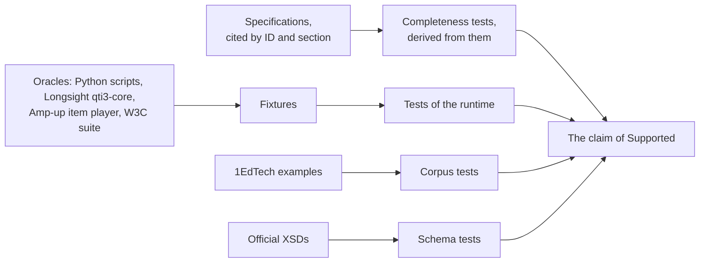
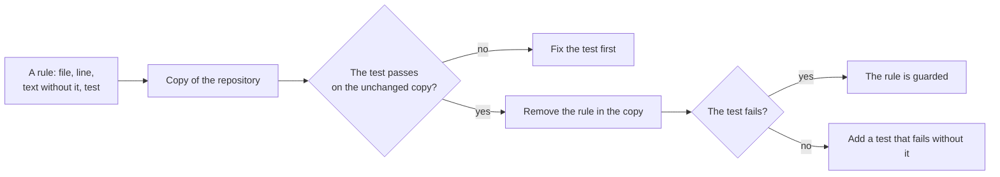
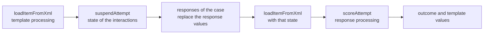

# Evidence

How the runtime is tested and where the expected values come from. The claim that these tests support is stated in
[Supported](supported.md).



## Citations

A rule cites its source by an ID and a section, such as `INFO section 2.11.3.37`.

| ID   | Document                                                    | Version                                           | Address                                                                      |
| ---- | ----------------------------------------------------------- | ------------------------------------------------- | ---------------------------------------------------------------------------- |
| OVW  | QTI 3.0 Overview                                            | Final Release, 1 May 2022                         | https://www.imsglobal.org/spec/qti/v3p0/oview/                               |
| INFO | QTI 3.0 ASI Information Model                               | Final Release v1.0, 1 May 2022                    | https://www.imsglobal.org/spec/qti/v3p0/info/                                |
| BIND | QTI 3.0 ASI XML Binding                                     | Final Release, May 2022                           | https://www.imsglobal.org/spec/qti/v3p0/bind/                                |
| BPIG | QTI 3.0 Best Practices and Implementation Guide             | specification 3.0.1, document 2.0, 1 October 2024 | https://www.imsglobal.org/spec/qti/v3p0/impl/                                |
| MD   | QTI 3.0 Metadata Information Model and XSD Binding          | Final Release v1.0, 1 May 2022                    | https://www.imsglobal.org/spec/qti/v3p0/md-bind/                             |
| RR   | QTI 3.0 Results Reporting Information Model and XSD Binding | Candidate Final Public v1.0, 1 November 2022      | https://www.imsglobal.org/sites/default/files/spec/qti/v3/rr-bind/index.html |
| UD   | QTI 3.0 Usage Data and Item Statistics                      | Candidate Final Public v1.0, 2 February 2022      | https://www.imsglobal.org/sites/default/files/spec/qti/v3/ud-bind/index.html |
| CERT | QTI 3.0 Conformance and Certification                       | Final Release, document 2.0, 15 March 2022        | https://www.imsglobal.org/spec/qti/v3p0/conf/                                |
| TERM | QTI 3.0 Terms and Definitions                               | Final Release, 1 May 2022                         | https://www.imsglobal.org/node/199091                                        |
| CAT  | 1EdTech Computer Adaptive Testing (CAT) 1.0                 | Candidate Final Public, 9 November 2020           | https://www.imsglobal.org/spec/cat/v1p0/impl/                                |
| PCI  | Portable Custom Interactions 1.0, cited by INFO section 1.1 | Candidate Final, March 2020                       | not retrievable                                                              |
| RPT  | The six standard response processing templates              | QTI 3.0                                           | https://purl.imsglobal.org/spec/qti/v3p0/rptemplates/                        |
| XSD  | The schemas of the specifications                           | ASI 3.0.1 and 3.0.0                               | https://purl.imsglobal.org/spec/qti/v3p0/schema/xsd/                         |
| EX   | The examples of 1EdTech, `qtiv3-examples/`                  | public repository, no license file                | https://github.com/1EdTech/qti-examples                                      |
| LS   | Longsight `qti3-core`, the differential oracle for items    | `@longsightgroup/qti3-core` 0.13.3, MIT           | https://github.com/LongsightGroup/qti3                                       |
| AU   | Amp-up `qti3-item-player`, the second oracle for items      | `qti3-item-player` 1.1.20, MIT                    | https://github.com/amp-up-io/qti3-item-player                                |

The overview gives addresses for RR, UD, CERT and TERM that return 404; the table gives the addresses that serve them. PCI 1.0
itself is not retrievable: the requirements of the runtime's `pci` module come from BPIG section 3.7.12 and its Appendices C and D, which
restate them.

## Completeness

What must be covered is derived from the specifications, not from a list that the repository keeps. Each test fails when the
source has something that the runtime does not read, write, validate or run.

| Source                                                                                                                                     | Test                                                                                                                                                                                                              |
| ------------------------------------------------------------------------------------------------------------------------------------------ | ----------------------------------------------------------------------------------------------------------------------------------------------------------------------------------------------------------------- |
| The element table of `asi`, generated from the ASI schema (it also lists the MathML and SSML elements it allows)                           | `asi.xsd.test.ts`: documents that fast-check generates and worked documents use every element and attribute, are valid, and read back                                                                             |
| The schemas of Results Reporting, usage data, PNP, content packaging, QTI metadata, curriculum standards and the accessibility description | `results.xsd.test.ts`, `usage.xsd.test.ts`, `pnp.xsd.test.ts`, `package.xsd.test.ts`, `metadata.xsd.test.ts`: written documents use every element and attribute that the schema declares, validate, and read back |
| The LOM schema, which the runtime keeps as XML                                                                                             | `metadata.xsd.test.ts`: a LOM with every element of the schema is kept                                                                                                                                            |
| The expressions of the ASI schema                                                                                                          | `processing.test.ts`: `OPERATOR_SIGNATURES` has a signature for each, and each evaluates to the type its signature states                                                                                         |
| The interactions of the ASI schema                                                                                                         | `interactions.test.ts`: each has a descriptor with its bindings                                                                                                                                                   |
| The Schematron rule sets of the ASI schema                                                                                                 | `validate.xsd.test.ts`: each is reported by the validator under its identifier                                                                                                                                    |
| The packages of the 1EdTech examples                                                                                                       | `examples.corpus.test.ts`: each is read, validated, and its tests run to their end; the other `*.corpus.test.ts` files read the items, results and usage data                                                     |
| The feature IDs of Appendix A of CERT, in `scripts/conformance-features.json`                                                              | `scripts/test/conformance.test.ts`: each has a row of [Conformance](conformance.md) with a guide and a test that exist and run                                                                                    |

A schema that changes fails these tests until the table is generated again (`pnpm asi-table`) and the writer covers what is new.

## Tests that read the corpus

The corpus is public material that the repository does not contain: the 1EdTech examples have no license file, and
the W3C test suite is large. `scripts/corpus.lock.json` pins each source to a commit and to the SHA-256 of the archive that
GitHub serves for it.

| Source         | Repository             | Files                                                                                                     |
| -------------- | ---------------------- | --------------------------------------------------------------------------------------------------------- |
| `qti-examples` | `1EdTech/qti-examples` | `qtiv3-examples/`: items, tests, packages, the CAT and PCI examples, results, usage data                  |
| `xsdtests`     | `w3c/xsdtests`         | `msData/regex/` and `msMeta/Regex_w3c.xml`: the regular expression tests of the W3C XML Schema test suite |

`pnpm corpus` downloads the sources into `.cache/corpus/<source>/` unless they were extracted from the pinned archive, and
fails without writing when the archive has another hash. `pnpm test:corpus` runs the tests in files named `*.corpus.test.ts`,
which `pnpm test` leaves out so that it runs offline. A corpus
test calls `requireCorpus` of `scripts/corpus.ts`, which fails with an instruction when the corpus is missing.

The regular expression tests (`packages/runtime/test/values.corpus.test.ts`) apply the patterns of `msData/regex/` to the
instances that `msMeta/Regex_w3c.xml` names. They follow XML Schema 1.0, which INFO cites, and Unicode 6.0.0 where the
suite's result depends on the Unicode version. Tests that the suite marks as queried and tests of other base types than
string are left out.

To move a source to another commit, run `pnpm corpus:pin <source> [commit]`: it downloads the commit (the head of the
default branch when none is given), hashes its archive and writes the lock.

## Tests that validate against the schemas

The XSDs of QTI 3.0 are 1EdTech and W3C files with their own license, so the repository does not contain them.
`packages/runtime/src/node/schema-files.json` pins each schema to its address and SHA-256 (it is `SCHEMA_FILES` of
the `node` module). `pnpm schemas` downloads the files into `.cache/schemas` unless the files there already match their
hashes, and fails without writing a file whose hash differs. `pnpm schemas:pin` downloads every file and writes the hashes
that it finds, for the day a schema changes.

Tests that validate against the schemas are in files named `*.xsd.test.ts`, which `pnpm test` leaves out so that it runs
offline. `pnpm test:xsd` runs them: it needs `pnpm schemas`, and `pnpm corpus` when a test reads the examples. A file loads
one `SchemaSet` with `loadSchemaSet` in `beforeAll` and closes it in `afterAll`; compiling the ASI schema takes about 2
seconds, and each schema is compiled once per set. Every test of a writer passes the output to `validateXmlFiles`
([node](node.md) lists the evidence on the schemas). `cli.xsd.test.ts` runs the command line on the examples of 1EdTech and
compares its report with the issues of the libraries it composes; its tests of `assesskit schemas fetch` serve the files of
`.cache/schemas` from a server on `127.0.0.1` and download them into a temporary directory, so that no test uses the network.
`pnpm schemas` runs the code of `assesskit schemas fetch` (`packages/runtime/src/cli/fetch-schemas.ts`), which `cli.test.ts` tests
against a server of small files.

`packages/runtime/src/asi/element-table.ts` is generated from the pinned ASI schema by `scripts/asi-table.ts` (`pnpm asi-table`).
`asi.xsd.test.ts` generates the table again and fails when the committed file differs, and compares its elements with those that
the schema declares. The same file validates documents that fast-check generates from the table, and checks that they use every
element and attribute of the table. Worked items, one for each family of interactions, for feedback, catalogs, companion
materials, HTML, MathML and SSML, are written and validated too, and so is a document for every term of every vocabulary of
the content, next to the terms that the pinned schema itself lists.

## Generators

`packages/runtime/test/arbitraries/` holds the fast-check generators of the models that have a reader and a writer, one file
for each module: values (`values.ts`), results, usage data, PNP profiles and records, metadata and packages, with the
elements of an unknown namespace for the extensions (`xml.ts`). A generated model is what a reader returns for the
document the writer writes, so the properties check `read(write(m))` against `m`, and the XSD tests validate a fixed
sample of the written documents. A generator with `extensions: false` leaves out the elements of an unknown namespace,
which a schema with a strict wildcard rejects. The generators of `asi` (`asi.ts`) are driven by its element table instead.

## Fuzzing

The readers of documents and archives, the compiler of patterns and the interpreter of expressions are fuzzed with fast-check
for the security controls of the module (SECURITY.md). The result of a run is one of these, and anything
else is a defect: an uncaught exception, a result that breaks an invariant, or a run that does not end.

| Target                                                                              | Input                                                                                         | Allowed result                                                               |
| ----------------------------------------------------------------------------------- | --------------------------------------------------------------------------------------------- | ---------------------------------------------------------------------------- |
| `parseXml`                                                                          | Text and bytes of written trees, mutated; small limits                                        | A tree that `serializeXml` writes back, `ReadError`, `SecurityError`         |
| `resolveIncludes`                                                                   | Documents of hostile includes: loops, outside paths, missing targets, fallbacks, small limits | A tree without includes within the limits, `ReadError`, `SecurityError`      |
| `readAsi`, `readManifest`, `readLtiLink`, `readResults`, `readUsageData`, `readPnp` | Text and bytes of written documents, mutated; a DOCTYPE before the root                       | A model, `ReadError`, `SecurityError` (`doctype` for the DOCTYPE)            |
| `readPackage`, `file`                                                               | Archives with hostile headers; archives of the fixtures and of `writePackage`, mutated        | Files within the limits and inside the package, `ReadError`, `SecurityError` |
| `document`, `packageResolvers`                                                      | An item and a file it includes, mutated                                                       | A document, `ReadError`, `SecurityError`                                     |
| `compileXsdRegex`                                                                   | Patterns, mutated, with the delimiters of the dialect; small limits                           | A pattern that matches any text, `DataError`                                 |
| `evaluate`                                                                          | Expressions over operators, literals at the edges of each base type and small limits          | A value that `normalizeValue` keeps, `ProcessingError`, `SecurityError`      |

`mutations` of `test/arbitraries/xml.ts` deletes, inserts, overwrites, duplicates and truncates, and inserts fragments that
break the rules of XML (a DOCTYPE, entities, forbidden characters, namespace declarations, includes). The runs are
deterministic: `FUZZ` of `test/fuzz.ts` sets the seed and 300 runs. `FUZZ_SEED` and `FUZZ_RUNS` set more, with a longer
test timeout:

```bash
FUZZ_SEED=7 FUZZ_RUNS=50000 pnpm exec vitest run --project runtime --testTimeout=600000 -t "mutated"
```

A defect that fuzzing finds is fixed with a test that names the input that exposed it.

## Mutation of the limits

A limit or a check that SECURITY.md lists is correct only if a test fails when it is gone. `pnpm check:rules` holds each of them as a rule: the file, the line that implements it, the text that stands in its place without it (the condition becomes `false`, the `throw` is removed) and the test file that must then fail. It runs the test file on a copy of the code without the rule, and fails when the test still passes.



| Group                | What is removed                                                                                                                                                                               | Test file                                                            |
| -------------------- | --------------------------------------------------------------------------------------------------------------------------------------------------------------------------------------------- | -------------------------------------------------------------------- |
| Archives             | Names that leave the package, duplicates, encryption, links, the entry count in the end record and in the directory, the declared sizes, the ratio, the bytes counted while an entry inflates | `package.test.ts`                                                    |
| Package directories  | Links while listing and again when a file is read, a real path outside the directory, the sizes at listing and at reading, the entry count                                                    | `node.test.ts`                                                       |
| XML                  | The DOCTYPE, `maxBytes`, `maxDepth`, `maxAttributes`, `maxNodes`, and the same limits of a document with its includes, `maxIncludeDepth`, loops and `xpointer`                                | `xml.test.ts`                                                        |
| Patterns and formats | `maxStates`, the nesting of a pattern, the width of a printed variable                                                                                                                        | `values.test.ts`, `content.test.ts`                                  |
| Processing and plans | `maxContainerSize`, `maxPlanNodes` for a plan, a selection and a stage of an adaptive section, the depth of JSON                                                                              | `processing.test.ts`, `delivery.test.ts`, `delivery-pending.test.ts` |
| Actions of a client  | `maxActionSize`, `maxPciStateLength`, the refusal of the actions of the host                                                                                                                  | `delivery.test.ts`                                                   |
| Member-only material | The refusal of a directory inside the repository by `pnpm conformance`                                                                                                                        | `scripts/test/conformance.test.ts`                                   |

The rules for the player's server, protocol, frames and `cat-rest` are in the same list ([the player's evidence](../player/evidence.md)).

**Why not a mutation tool.** A generic tool such as StrykerJS makes a mutant for every operator and branch and reports the survivors. A person must then decide for each survivor whether it is equivalent, harmless or a missing test, and the removal of a limit is one survivor among them. The rules name the mutants that matter, each written so that the code stays valid, so a survivor always means a missing test. The cost is that a new limit needs its rule: `check:rules` passes only for the rules it lists, and review asks for the rule when a limit is added.

The text to find occurs once in its file, which `scripts/test/check-rules.test.ts` checks, so a refactor that moves the line fails that test and not silently.

## Test sessions

No independent implementation of a QTI 3 test session was found, so test sessions are not compared with another
implementation: their evidence is tests whose expected values are statements and worked examples of the specifications,
properties checked with random input, and the 1EdTech examples. The properties in `delivery.test.ts` generate tests (linear and nonlinear parts, individual and simultaneous
submission, time limits with and without late submission) and sequences of actions stamped by `stamp`, and check after
every step:

- the state given is unchanged, and a refusal is never `clock-regression`;
- `numAttempts` never decreases, a closed item takes no responses, and an item closed at a time limit takes none either;
- the current item never goes back in a linear part;
- the time of the test is the time the session ran, without suspended time, and no maximum time is left behind the step;
- `deserializeState(serializeState(state))` equals the state;
- the accepted actions replayed from the seed, also through the JSON form, give the same states and events.

`delivery.corpus.test.ts` plays tests of the examples to their end with the correct responses and compares the scores
with the `MAXSCORE` their authors declared, delivers the links to tools of `testWithLti`, and delivers alone every
example item that the static checks accept.

## Candidate view

No answer key reaches the view; the evidence is a property and a structure check:

- `delivery.test.ts` runs random actions, time included, on a test whose item holds a correct response and a mapping of a
  text, an outcome and a template value that nothing prints, feedback, modal feedback, template content and a choice that
  the variables hide, and rubric for the scorer and the author, each with a mark. After every step the JSON text of the view
  holds no mark, except the mark of the correct response in the solution state of an item whose control shows the solution.
  The property fails when the view takes the rubric of another view or the correct responses.
- At every step of generated tests, the view reads back equal from its JSON text and from a state read back; an action that
  reaches the engine through `actionToJson`, the JSON text, `parseCandidateAction` and `stamp` gives the step that the same
  action gives on the device; the engine refuses every action type the view leaves out, and meets no refusal of the state
  in a type it lists, except the two actions that change nothing, `next-attempt` during an attempt and `resume` of a running
  session.
- `delivery.corpus.test.ts` shows every example item that the static checks accept, checks that no view holds a property
  that names a key or processing, and reads each view back from its JSON text along the plays of the example tests.

## Differential tests

The runtime is compared with Longsight `qti3-core` (`@longsightgroup/qti3-core`, a development dependency pinned to one
version), which processes items. The harness is in `packages/runtime/test/differential/`, and `differential.test.ts` and
`differential.corpus.test.ts` run it. A case is an item document, responses and a seed; an `Implementation` runs it and
reports the outcome and template values as `Observed` values. `longsight` is the oracle and `runtime` the subject: the
runtime's run gives the responses as the first attempt of a session (`numAttempts` 1, `completionStatus` `unknown`, defaults
for the responses a case leaves out), and draws from `longsightRandom`, the oracle's generator, so that both draw the same
template values by the draw procedures they share. `compare` runs two implementations on a list of cases and reports

- the cases both accept, whose variables it compares;
- the cases both reject;
- the differences, including an item that only one accepts.

`corpusCases` builds cases from the item documents below a directory of the corpus, named by their paths: each item
without responses, and with the correct responses the oracle reads from it.

An `Implementation` also plays item sessions. A session case is an item, its turns and a seed; a turn gives responses
and submits them, or ends the attempt with an end attempt interaction. The runtime plays it with `startItemSession`,
`presentItem` and `applyItemAction` for an item delivered alone without a limit on attempts, as the oracle has none, and a
processing failure, which the runtime reports as data, makes the case one that the runtime does not accept. `compareSessions` compares
the turns: whether each is accepted, the outcome values, `numAttempts`, and whether the session closed. `sessionCases`
gives four turns to each corpus item with interactions that choose identifiers, with choices from the oracle's generator
and a hint in the second turn when the item has an end attempt interaction; `differential.test.ts` also plays adaptive and
non-adaptive items with generated turns, and compares items that fast-check generates for arithmetic, rounding, tolerances,
logic, containers, mapping and random draws.

A difference that the specification settles goes into the list in `differential/accepted.ts`: a sentence that says what
differs, the items it shows in and, when only one variable differs, the variable. The report counts it as accepted and not
as a difference, and the corpus test fails when a listed item no longer shows its difference.

The oracle also reads interactions. `differential.test.ts` compares the validity of generated responses (choices, order,
associations, inline choices) and the record of numeric text, and `differential.corpus.test.ts` the interactions of the
corpus items: response variables, shuffling and choices. They agree, apart from the integer value of a number that ends in
its point (`5.`), which the information model gives and the oracle does not; the test states it.

### The second oracle

Longsight is not certified by 1EdTech. Amp-up `qti3-item-player` (AU) is a Vue 2 component that the Amp-up test player, certified
by 1EdTech at Basic and Advanced delivery, is built on. `differential/amp-up.ts` runs it in jsdom, a window without a screen,
as a scoring system uses it: the player loads the item, its interactions make their state, and the responses of the case
replace the response values of that state, which the player restores and scores with `scoreAttempt`.



The player has no seed: it draws with `Math.random`, which the window takes from `longsightRandom`. A case is outside what the
player supports when the item holds a `qti-` element that it does not know, and it is left out: 50 of the 505 cases are the documents of
tests and the items with an associate, drawing, graphic associate, graphic order, position object, slider or upload
interaction. `compare` runs the 455 others against the runtime: 442 are accepted by both and compared, 2 are rejected by
both, and 11 are accepted by one. Nothing differs but what `differential/accepted-amp-up.ts` pins, each with its reason:

| Difference                                                                                                                   | Cases | The cause                                                                                                                                                                                                   |
| ---------------------------------------------------------------------------------------------------------------------------- | ----- | ----------------------------------------------------------------------------------------------------------------------------------------------------------------------------------------------------------- |
| `completionStatus` is `not_attempted` after the attempt, where the runtime says `unknown`                                    | 217   | The player never sets `unknown`; INFO section 2.2.2.2 sets it when the first attempt begins                                                                                                                 |
| `SCORE` and `MAXSCORE` are 0 in an item that does not declare them                                                           | 220   | The player declares both in every item; the specification declares only `completionStatus`                                                                                                                  |
| Template values differ in 11 items                                                                                           | 61    | `qti-random-integer` shuffles every integer of the range and takes the first, `qti-random` shuffles the container; the specification does not say how to draw                                               |
| `SCORE` of `template_image.xml` with its correct responses                                                                   | 1     | The correct response follows from the draw of the runtime, which the player's draw does not give                                                                                                            |
| `FEEDBACK` stays NULL in the two items of `CC2_map_response`                                                                 | 2     | The player reads a template by the end of its name, so `CC2_map_response` runs as `map_response`                                                                                                            |
| The player throws a TypeError in `QuizBowl-multi-geometry.xml` and `multi-input.xml`                                         | 3     | An operand of `qti-substring` is NULL, and the statement that logs the result reads the value of the NULL operand                                                                                           |
| The player throws a TypeError in `feedback_adaptive.xml`                                                                     | 1     | It fails in the item's `qti-member`, whose operands are a container and then a single value                                                                                                                 |
| The runtime refuses `SineRule-001.xml`                                                                                       | 2     | The custom operator `org.qtitools.mathassess.CasProcess` is not registered; the player goes on, as Longsight does                                                                                           |
| The runtime refuses `choice_ruby.xml`, `data-attributes.xml`, `fractions1.xml`, `fractions_deps.xml`, `fractions_deps_2.xml` | 5     | The documents are invalid (a float set to an integer variable, a rubric block without `use`, a correct response that is not an identifier, an attribute the schema does not allow); the player renders them |

`differential.corpus.test.ts` fails when a difference is not pinned, and when a pinned item no longer shows its difference.

`differential.test.ts` runs with `pnpm test`; `differential.corpus.test.ts` needs `pnpm corpus` first and runs with
`pnpm test:corpus`.

## Fixtures from oracles

Expected values come from an oracle, never from the code under test. The scripts that write them are in `validation/` of
the repository and use the standard library of Python 3.12 or later:

| Script        | Fixture                                        | Oracle                                                                                                                                                                                                                                                                                     |
| ------------- | ---------------------------------------------- | ------------------------------------------------------------------------------------------------------------------------------------------------------------------------------------------------------------------------------------------------------------------------------------------ |
| `printf.py`   | `packages/runtime/test/fixtures/printf.json`   | Python's `%` operator, for `e E f g G d i o x X` with flags, width and precision; `content` formats every case                                                                                                                                                                             |
| `rounding.py` | `packages/runtime/test/fixtures/rounding.json` | Python's `decimal` module with `ROUND_HALF_UP`, for `qti-round-to` and `qti-equal-rounded`                                                                                                                                                                                                 |
| `zip.py`      | `packages/runtime/test/fixtures/zip/`          | Python's `zipfile`, which writes the archives (stored and deflated entries, UTF-8 names, directories, data descriptors, a zip-slip, an absolute path, a backslash, a symbolic link, two names that normalize alike, a zip bomb) and reads back the ZIP64 archive that the script assembles |

Python and C differ in a few printf cases, which the printf script leaves out: the alternate form of `o`; the alternate
form and precision 0 of the integer conversions at the value 0; the flag `0` together with a precision on an integer
conversion; the flags `+` and space, and negative values, on the unsigned conversions `o`, `x` and `X`. Every case that
remains gives the same string with the C library's `printf`.

`zips.json` lists the files of each valid archive with the size and SHA-256 that `zipfile` read from it. The tests that need an
archive no tool writes, such as an encrypted entry, a header that understates a size, or a local header that names another
file, build it byte by byte (`test/zip-builder.ts`): their expected result is the rule, not an oracle.

The scripts use a fixed seed for their random samples and write the same files every time. Run them from the repository root
and commit the result.

### States of earlier releases

`packages/runtime/test/fixtures/state-1.json` is the one fixture that no script writes: the first release wrote it, for the
format version 1 and the `englishBasicLevelV2` example, and nothing writes it again. It holds the actions, a state suspended
in the middle of the test and the state at its end. `delivery.corpus.test.ts` reads both, goes on from the first with the
remaining actions, and compares every step with a replay from the seed ([State across
releases](delivery.md#state-across-releases)). A format version that changes the meaning of a field adds a file of its own and
keeps this one.
