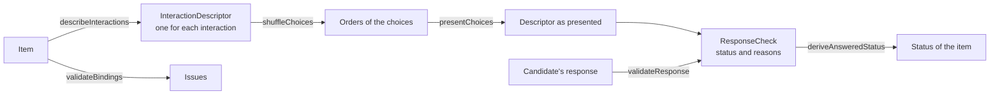

# Interactions

`interactions` describes the interactions of an item for the delivery engine and the player, checks that their response variables
suit them, decides whether a response is valid, draws the order of the choices, and reads the numbers that a candidate types. It
imports `values` and `asi` and runs in any JavaScript runtime. It does not render an interaction: the content of the choices stays
in the body of the item.



| Function                                       | Does                                                                                                |
| ---------------------------------------------- | --------------------------------------------------------------------------------------------------- |
| `describeInteractions(item)`                   | Returns the `InteractionDescriptor` of each interaction of the item, in document order              |
| `validateBindings(item)`                       | Returns `Issue`s for response variables that the interactions do not accept                         |
| `validateResponse(descriptor, response)`       | Returns the `ResponseStatus` of a response and the `ResponseViolation`s it has                      |
| `deriveAnsweredStatus(descriptors, responses)` | Returns the status of an item from the responses to all its interactions                            |
| `deriveInitialResponse(descriptor, default)`   | Returns the response an interaction starts with, given the default value of its variable            |
| `shuffleChoices(descriptor, random)`           | Returns the initial order of the choices, one list of identifiers for each set of choices           |
| `presentChoices(descriptor, orders)`           | Returns the descriptor with the choices in the given orders, and without those the orders leave out |
| `readNumericRecord(text, options?)`            | Returns the record that a text interaction bound to a record gives for the text a candidate typed   |

The types are `InteractionKind` (the 22 kinds of interaction, such as `"choice-interaction"`), `Binding`, `ChoiceDescriptor`,
`InteractionConstraints`, `InteractionDescriptor`, `ResponseCheck`, `ResponseStatus` and `ResponseViolation`.

```ts
import { createRandom } from "@assesskit/runtime";
import { readAsi } from "@assesskit/runtime/asi";
import {
  validateResponse,
  describeInteractions,
  presentChoices,
  shuffleChoices,
} from "@assesskit/runtime/interactions";
import { buildContainer } from "@assesskit/runtime/values";

const { item } = readAsi(`<qti-assessment-item xmlns="http://www.imsglobal.org/xsd/imsqtiasi_v3p0"
    identifier="capital" title="Capital" time-dependent="false">
  <qti-response-declaration identifier="RESPONSE" cardinality="multiple" base-type="identifier"/>
  <qti-item-body>
    <qti-choice-interaction response-identifier="RESPONSE" shuffle="true" min-choices="1" max-choices="2">
      <qti-simple-choice identifier="Paris">Paris</qti-simple-choice>
      <qti-simple-choice identifier="Lyon" fixed="true">Lyon</qti-simple-choice>
      <qti-simple-choice identifier="Nice">Nice</qti-simple-choice>
      <qti-simple-choice identifier="Metz">Metz</qti-simple-choice>
    </qti-choice-interaction>
  </qti-item-body>
</qti-assessment-item>`);
const [descriptor] = describeInteractions(item);
descriptor.constraints; // => { minChoices: 1, maxChoices: 2 }
descriptor.bindings; // => [{ cardinality: "multiple", baseTypes: ["identifier"] }]
const orders = shuffleChoices(descriptor, createRandom(42));
orders; // => [["Metz", "Lyon", "Paris", "Nice"]]
presentChoices(descriptor, [orders[0].filter((identifier) => identifier !== "Nice")]).choices.map(
  ({ identifier }) => identifier,
);
// => ["Metz", "Lyon", "Paris"]
validateResponse(descriptor, buildContainer("multiple", "identifier", ["Paris", "Nice", "Metz"]));
// => { status: "attempted", reasons: ["max-choices"] }
validateResponse(descriptor, buildContainer("multiple", "identifier", ["Paris"])); // => { status: "answered", reasons: [] }
validateResponse(descriptor, null); // => { status: "presented", reasons: ["min-choices"] }
```

## Descriptors

`describeInteractions` reads the body of the item, including feedback, tables and the position object stage, and gives one
descriptor for each interaction. The descriptor holds what the rules of validity, shuffling and visibility read; the prompt, the
images and the content of the choices stay in the `BodyNode`s.

| Field                | Meaning                                                                                                        |
| -------------------- | -------------------------------------------------------------------------------------------------------------- |
| `kind`               | The kind of interaction                                                                                        |
| `responseIdentifier` | The response variable it binds                                                                                 |
| `declaration`        | The declared cardinality and base type of that variable; absent when the item does not declare it              |
| `bindings`           | The bindings the interaction accepts, narrowed by its attributes                                               |
| `choices`            | Every choice in document order; a match interaction lists the first set, then the second                       |
| `matchSets`          | The two sets that a response pairs, as directed pairs from the first to the second; absent for the other kinds |
| `constraints`        | What a valid response needs                                                                                    |
| `shuffle`            | Whether the initial order is random                                                                            |
| `stringIdentifier`   | The second response variable of a text interaction that keeps the text as typed                                |

A `ChoiceDescriptor` has the `identifier`, `fixed`, `templateIdentifier` and `showHide` (which hide the choice when a template
variable says so), and for the choices that take associations `matchMax`, `matchMin` and `matchGroup`, and for a gap `required`.
A maximum of 0, which means no restriction, and a minimum of 0 are left out.

| Kind                                                           | `choices`                               | `matchSets`                   |
| -------------------------------------------------------------- | --------------------------------------- | ----------------------------- |
| `choice`, `order`, `inline-choice`, `hotspot`, `graphic-order` | The choices, hotspots or inline choices | Absent                        |
| `hottext`                                                      | The hot texts in the running text       | Absent                        |
| `associate`, `graphic-associate`                               | The associable choices or hotspots      | Absent                        |
| `match`                                                        | Both sets                               | The two sets                  |
| `gap-match`                                                    | The gap choices, then the gaps          | The gap choices, the gaps     |
| `graphic-gap-match`                                            | The gap choices, then the hotspots      | The gap choices, the hotspots |
| The others                                                     | None                                    | Absent                        |

## Bindings

A record has no base type, so its list of base types is empty.

| Kind                              | Accepts                                                       |
| --------------------------------- | ------------------------------------------------------------- |
| `choice`, `hottext`, `hotspot`    | Single or multiple identifier                                 |
| `order`, `graphic-order`          | Ordered identifier                                            |
| `inline-choice`                   | Single identifier                                             |
| `associate`, `graphic-associate`  | Single or multiple pair                                       |
| `match`, `gap-match`              | Single or multiple directed pair                              |
| `graphic-gap-match`               | Multiple directed pair                                        |
| `select-point`, `position-object` | Single or multiple point                                      |
| `text-entry`                      | Single float, integer or string, or a record                  |
| `extended-text`                   | The same, and multiple or ordered when `max-strings` is given |
| `slider`                          | Single float or integer                                       |
| `media`                           | Single integer (the number of plays)                          |
| `drawing`, `upload`               | Single file                                                   |
| `end-attempt`                     | Single boolean                                                |
| `custom`, `portable-custom`       | Any cardinality with any base type                            |

A single value is accepted only when the interaction takes at most one value: `max-choices` or `max-associations` above 1 or 0
needs a container, and so do several gaps. A gap match or graphic gap match interaction without `max-associations` has no limit,
where the schema's default is 1 (see [spec gaps](spec-gaps.md)): the examples of 1EdTech leave it out with several gaps, and each
gap takes one choice.

`validateBindings(item)` returns an `Issue` for each violation:

| Rule                                          | Reported when                                                                           |
| --------------------------------------------- | --------------------------------------------------------------------------------------- |
| `assesskit/interactions/response-undeclared`  | an interaction names a response variable that the item does not declare                 |
| `assesskit/interactions/binding`              | the variable has a cardinality or base type that the interaction does not accept        |
| `assesskit/interactions/response-bound-twice` | a variable is bound to more than one interaction, including through `string-identifier` |
| `assesskit/interactions/string-identifier`    | `string-identifier` names a variable that is not declared as a single string            |

## Validity

`validateResponse` applies the rules of validity to the descriptor of the interaction as it is presented: give it the descriptor that
`presentChoices` returns, so that hidden choices are not demanded.

| Reason             | The response ...                                                                      |
| ------------------ | ------------------------------------------------------------------------------------- |
| `binding`          | has a cardinality or base type that the interaction or the declaration does not allow |
| `unknown-choice`   | names an identifier that is not a choice, or pairs choices that cannot be paired      |
| `repeated-choice`  | names a choice twice where it can be given once                                       |
| `min-choices`      | has fewer choices, hotspots or points than `min-choices`                              |
| `max-choices`      | has more than `max-choices`                                                           |
| `min-associations` | has fewer associations than `min-associations`                                        |
| `max-associations` | has more than `max-associations`                                                      |
| `match-min`        | uses a choice fewer times than its `match-min`                                        |
| `match-max`        | uses a choice more times than its `match-max`, or a gap more than once                |
| `match-group`      | pairs a choice with one that its `match-group` leaves out                             |
| `required`         | leaves out a choice that is `required`, or a gap that must be filled                  |
| `min-strings`      | has fewer non-empty strings than `min-strings`                                        |
| `max-strings`      | has more than `max-strings`                                                           |
| `pattern-mask`     | has a string that the `pattern-mask` does not match                                   |
| `bounds`           | is outside the bounds of a slider                                                     |
| `step`             | is not on a step of a slider                                                          |
| `min-plays`        | counts fewer plays than `min-plays`                                                   |
| `max-plays`        | counts more plays than `max-plays`                                                    |
| `mime-type`        | is a file of a type that an upload does not accept                                    |

- An order interaction without `min-choices` needs every choice in the response, and its `max-choices` is ignored; with
  `min-choices` it needs between that and `max-choices`, up to all.
- The `pattern-mask` is a pattern of XML Schema's regular expressions and runs on the linear-time automaton of `values`. A text
  bound to a number is not checked against it, because the text is not in the value.
- A slider bound to an integer rounds its lower bound down and its upper bound up, and steps by 1 unless `step` says otherwise.
- A MIME type is compared without its parameters and without regard to case.

| Status      | When                                                                                                                 |
| ----------- | -------------------------------------------------------------------------------------------------------------------- |
| `presented` | The response is NULL, even when that breaks a rule such as `min-choices`; for an item, no interaction has a response |
| `attempted` | The response breaks a rule; for an item, a response exists and an interaction's response is invalid                  |
| `answered`  | The response breaks no rule; for an item, it has a response and every interaction is valid                           |

`deriveAnsweredStatus` gives the item's status. A blank optional interaction is valid, and the end attempt interaction does not count.
`notpresented`, for an item that was never shown, is the engine's to report.

`deriveInitialResponse` gives the response an interaction starts with: the default value, except for a choice interaction, which starts
with nothing selected, and an end attempt interaction, which ignores its default. The default of an order interaction overrides
the initial order of its choices, so shuffle the choices of an order only when its default is NULL.

## Shuffling

`shuffleChoices` returns one list of identifiers for each set of choices: the one set of most interactions, the two sets of a match
interaction, and the gap choices and the gaps or hotspots of a gap match and a graphic gap match interaction. Only the choices are
shuffled in the last two, and each set of a match interaction on its own.

| Rule              | Statement                                                                                                                          |
| ----------------- | ---------------------------------------------------------------------------------------------------------------------------------- |
| Draw procedure    | Fisher-Yates from the last index: for a set of n movable choices, one draw `floor(uniform() × (i + 1))` for i from n − 1 down to 1 |
| Fixed choices     | A choice with `fixed` keeps its position among all the choices of its set                                                          |
| Hidden choices    | Choices that a template variable hides are shuffled with the others and dropped afterward, so that fixed positions hold            |
| Without `shuffle` | The order of the document, and no draw                                                                                             |

Changing the draw procedure is a breaking change. `presentChoices` drops the choices that an order leaves out, and the orders the
engine stores give the same descriptor again when a session resumes.

## Numeric text

`readNumericRecord(text, options?)` reads a typed number into the fields of a record. The option `base` is 2 to 36 and 10 when omitted.

| Field          | Value                                                                                               |
| -------------- | --------------------------------------------------------------------------------------------------- |
| `stringValue`  | The text, as typed                                                                                  |
| `floatValue`   | The number                                                                                          |
| `integerValue` | The number, when the text has no fractional digits and no exponent and the number is a safe integer |
| `leftDigits`   | The digits left of the point, as typed                                                              |
| `rightDigits`  | The digits right of the point, as typed                                                             |
| `ndp`          | `rightDigits` less the exponent, never below 0                                                      |
| `nsf`          | The digits from the first that is not 0 to the last, at least 1                                     |
| `exponent`     | The exponent, when the text has one                                                                 |

White space around the number is ignored. In base 10 the text is a decimal with sign, point and exponent; in another base it is an
integer. Text that is no number has `stringValue` only, and the empty string is NULL.

A fraction typed as `1/2` is such a text: QTI has no fraction, so it has no numeric value in processing. An item that takes
fractions has one of three shapes: a `string` response that lists the accepted spellings (`qti-map-response` or `qti-match`
with `1/2` and `2/4`, say), two boxes for the numerator and the denominator, or a custom operator that reads the fraction.

```ts
import { readNumericRecord } from "@assesskit/runtime/interactions";

[...readNumericRecord("12.50e-3").fields].map(([name, field]) => [name, field.value]);
// => [["stringValue", "12.50e-3"], ["floatValue", 0.0125], ["leftDigits", 2], ["rightDigits", 2], ["ndp", 5], ["nsf", 4], ["exponent", -3]]
[...readNumericRecord("1/2").fields].map(([name, field]) => [name, field.value]); // => [["stringValue", "1/2"]]
readNumericRecord(""); // => null
```

## Errors

| Situation                                                             | Result                                                 |
| --------------------------------------------------------------------- | ------------------------------------------------------ |
| An argument of the wrong type, such as a descriptor that is no object | `DataError` that names the argument and what was found |
| A random source that returns anything but a number in [0, 1)          | `DataError`                                            |
| Orders that do not name the choices of the sets                       | `DataError`                                            |
| A `base` that is not an integer from 2 to 36                          | `DataError`                                            |
| A response that breaks a rule of validity                             | `ResponseCheck` with the reasons; no error             |
| A response variable that the interactions do not accept               | `Issue`s from `validateBindings`                       |

## Not included

| Not included                                             | Why                                                         |
| -------------------------------------------------------- | ----------------------------------------------------------- |
| Rendering an interaction, and the content of its choices | The player draws; the content stays in the body of the item |
| The status `notpresented`                                | Only the engine knows that an item was never shown          |
| Evaluating a response against the correct response       | Response processing does, in `processing`                   |

## Files

| File                                                                          | Concept                                                        |
| ----------------------------------------------------------------------------- | -------------------------------------------------------------- |
| `descriptor.ts`, `describe.ts`, `check-descriptor.ts`, `interaction-kinds.ts` | The descriptor, reading it from an item, and checking it       |
| `bindings.ts`, `check-bindings.ts`                                            | What each interaction accepts, and checking an item            |
| `response-check.ts`, `response-status.ts`, `answered-status.ts`               | The validity of a response, and the status it gives            |
| `initial-response.ts`, `shuffle.ts`, `numeric-record.ts`                      | The starting response, the order of choices, and typed numbers |
| `internal.ts`                                                                 | The helpers that `delivery` shares                             |

## References

| Topic                                                     | Specification                                                                                             |
| --------------------------------------------------------- | --------------------------------------------------------------------------------------------------------- |
| Interactions, bindings, validity, shuffling, numeric text | [QTI 3.0 ASI Information Model](https://www.imsglobal.org/spec/qti/v3p0/info/)                            |
| Answered status                                           | [QTI 3.0 Results Reporting](https://www.imsglobal.org/sites/default/files/spec/qti/v3/rr-bind/index.html) |
| MIME types                                                | [RFC 2045](https://www.rfc-editor.org/rfc/rfc2045)                                                        |
| Places where the specifications differ                    | [Spec gaps](spec-gaps.md)                                                                                 |
