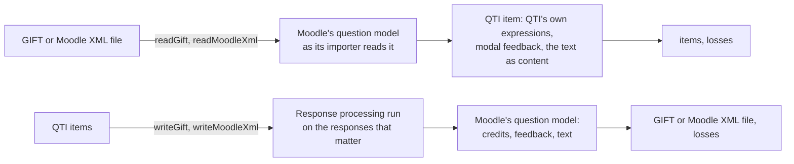

# GIFT and Moodle XML

`item-formats` converts QTI items to and from the item formats of another platform: GIFT, the text format of Moodle's
question bank, and Moodle XML, its full format. A reader takes a file and gives QTI items that score each response as Moodle grades it; a writer takes items
and gives a file that Moodle imports with the same credits and feedback. A conversion is lossy: everything that does not
convert, an item left out or a part of one, is in the result's `losses`, each with its reason. It imports `xml`, `values`,
`asi`, `processing` and `content`, and parse5 for the HTML of a question; it runs in any JavaScript runtime.



| Function or type                                                 | Is                                                                                 |
| ---------------------------------------------------------------- | ---------------------------------------------------------------------------------- |
| `readGift(input, options?)`                                      | The items of a GIFT file, with their categories and tags, and the losses.          |
| `writeGift(items, options?)`                                     | A GIFT file of items, and the losses.                                              |
| `readMoodleXml(input, options?)`                                 | The items of a Moodle XML file, the files its texts embed, and the losses.         |
| `writeMoodleXml(items, options?)`                                | A Moodle XML file of items, with the files their content names, and the losses.    |
| `BankItem`                                                       | An item with its category path and tags, what a reader gives and a writer takes.   |
| `ConversionLoss`, `LossReason`                                   | What does not convert: the item, its position, whether it is left out, the reason. |
| `ImportedItems`, `ExportedItems`                                 | The results of a reader and of a writer.                                           |
| `ReadItemsOptions`, `WriteItemsOptions`, `WriteMoodleXmlOptions` | The options.                                                                       |
| `DEFAULT_ITEM_FORMAT_LIMITS`, `ItemFormatLimits`                 | The limits of a file.                                                              |

## Quick start

```ts
import { readAsi } from "@assesskit/runtime/asi";
import { readGift, writeGift } from "@assesskit/runtime/item-formats";

const { items, losses } = readGift(`// [id:capital] [tag:geography]
::Capital::The capital of Indonesia is {=Jakarta =%50%Batavia#Its old name.}.

::Order::Put the steps in order.{~%50%Plan ~%50%Do ~%-100%Skip}`);
items.map(({ item, tags = [] }) => [item.identifier, item.title, tags]);
// => [["capital", "Capital", ["geography"]], ["item-2", "Order", []]]
losses; // => []

writeGift(items).text;
// => "// [id:capital] [tag:geography]\n::Capital::[html]<div>The capital of Indonesia is {\n\t=Jakarta\n\t=%50%Batavia#Its old name.\n}.</div>\n\n// [id:item-2]\n::Order::[html]<div>Put the steps in order.</div>{\n\t~%50%Plan\n\t~%50%Do\n\t~%-100%Skip\n}\n\n"

const order = readAsi(`<qti-assessment-item xmlns="http://www.imsglobal.org/xsd/imsqtiasi_v3p0" identifier="steps"
    title="Steps" adaptive="false" time-dependent="false">
  <qti-response-declaration identifier="RESPONSE" cardinality="ordered" base-type="identifier"/>
  <qti-item-body><qti-order-interaction response-identifier="RESPONSE">
    <qti-simple-choice identifier="A">Plan</qti-simple-choice><qti-simple-choice identifier="B">Do</qti-simple-choice>
  </qti-order-interaction></qti-item-body>
</qti-assessment-item>`).item;
writeGift([{ item: order }]).losses.map(({ item, omitted, reason }) => [item, omitted, reason]);
// => [["steps", true, "item"]]
```

```ts
import { readGift, readMoodleXml, writeMoodleXml } from "@assesskit/runtime/item-formats";

const { items } = readGift("::Capital::The capital of Indonesia is {=Jakarta =%50%Batavia#Its old name.}.");
const xml = writeMoodleXml(items).text;
xml.includes("<usecase>0</usecase>"); // => true
readMoodleXml(xml).items.map(({ item }) => item.title); // => ["Capital"]
```

The short answer of the first question stands at its place in the text, GIFT's missing word, and becomes an inline text entry;
the second, whose credits add up, a choice of several answers. A writer learns the credits of an item by running its response
processing, so the order interaction, which no question type of GIFT holds, is left out with its reason.

## Questions and items

| Moodle's question type      | GIFT                                      | QTI                                                                                          |
| --------------------------- | ----------------------------------------- | -------------------------------------------------------------------------------------------- |
| Multiple choice, one answer | `{=right ~wrong ~%50%half}`               | `qti-choice-interaction`, `max-choices` 1; `qti-inline-choice-interaction` at a missing word |
| Multiple choice, several    | `{~%50%a ~%50%b ~%-100%c}`, no `=`        | `qti-choice-interaction`, `max-choices` 0, a response of cardinality `multiple`              |
| True or false               | `{T}`, `{FALSE#wrong#right}`              | `qti-choice-interaction` of the choices `true` and `false`, labeled by `trueFalseLabels`     |
| Short answer                | `{=answer =%50%other}`, `*` for any text  | `qti-text-entry-interaction` of a `string`, at a missing word or in a `div` after the text   |
| Numerical                   | `{#value:tolerance}`, `{#min..max}`, `~#` | `qti-text-entry-interaction` of a `float`                                                    |
| Matching                    | `{=stem -> answer = -> extra}`            | `qti-match-interaction`: the stems, then the answers, each answer for any number of stems    |
| Essay                       | `{}`                                      | `qti-extended-text-interaction`, `SCORE` externally scored by a person                       |
| Description                 | no braces                                 | an item without an interaction                                                               |

Moodle XML names each type (`multichoice`, `truefalse`, `shortanswer`, `numerical`, `matching`, `essay`, `description`), and its
`category` elements name the category of the questions that follow. It holds what GIFT does not:

| Moodle XML                                                            | QTI                                                                                            |
| --------------------------------------------------------------------- | ---------------------------------------------------------------------------------------------- |
| `defaultgrade`, the mark                                              | `MAXSCORE` and the `normal-maximum` of `SCORE`; the credits scale it                           |
| `single`, `shuffleanswers`                                            | The cardinality of the response, `max-choices`, `shuffle`                                      |
| `usecase` of a short answer                                           | Each letter of the patterns in one case or in both                                             |
| `correctfeedback`, `partiallycorrectfeedback`, `incorrectfeedback`    | Modal feedback that `FEEDBACK` shows by Moodle's states                                        |
| An essay's `responseformat`, `responsefieldlines`, `responsetemplate` | `format`, `expected-lines` and the response's default value of `qti-extended-text-interaction` |
| An essay's `graderinfo`                                               | A `qti-rubric-block` for scorers                                                               |
| A `file` of a text, which `@@PLUGINFILE@@/` names                     | A file of `files`, `files/<item>/` and its path, which the content names                       |
| `_____` in a question's text, where Moodle shows GIFT's missing word  | The place of an inline interaction                                                             |

The hints of Moodle's interactive modes, the units of a numerical question, an essay's limits of words and attachments, and a
question of a type that no QTI item here holds (`cloze`, `calculated`, the drag-and-drop types) are losses; so is a file that the
content of an item names and `files` of `writeMoodleXml` does not hold. A reader reads a file with the runtime's XML reader and
its limits, so a file with a DOCTYPE is refused.

A writer takes the interaction of an item by the same table, read the other way: a choice interaction is a multiple choice, or
a true-false question when its two choices are `true` and `false` and it scores one of them; a text entry is a short answer or
a numerical question by the base type of its response; an extended text is an essay. An item of another interaction, of more
than one interaction, or of template variables is left out with the reason `item`.

## Scoring

A reader writes each question's grading in QTI's own expressions, so that any engine scores the item as Moodle grades the
question. `SCORE` is the question's credit times its mark, 1 in GIFT, and `MAXSCORE` the mark.

| Question                    | Response processing                                                                                                                                                                                                                      |
| --------------------------- | ---------------------------------------------------------------------------------------------------------------------------------------------------------------------------------------------------------------------------------------- |
| Multiple choice, one answer | `qti-map-response` of each answer's credit, negative ones included                                                                                                                                                                       |
| Several answers             | `qti-map-response` with `lower-bound` 0 and `upper-bound` the mark: the sum of the chosen answers' credits, floored and capped, as Moodle                                                                                                |
| True or false               | `qti-map-response` of the right choice                                                                                                                                                                                                   |
| Short answer                | A condition for each answer in order, the first that matches giving its credit: `qti-pattern-match` of the answer between optional spaces, which Moodle trims, `*` as `.*`, and each letter in both cases unless the question keeps case |
| Numerical                   | A condition for each answer in order: `qti-equal` with the answer's tolerance, absolute; `*` for any other number                                                                                                                        |
| Matching                    | `qti-map-response` of 1 for each right pair, times the mark, divided by the stems: each right stem earns an equal share                                                                                                                  |

A writer runs the item's response processing on the responses that tell Moodle's rule apart, as a delivery engine would: each
choice alone, and, for several answers, every set of choices up to 10 choices and past them the sets around the choices of
credit; each text and number that the item's declaration and processing name, its case swapped, the bounds of its tolerance and
a response that matches none; each pair of a match. Moodle's credit of an answer is what it earns alone, as a share of the
mark: `MAXSCORE`, else the `normal-maximum` of `SCORE`, else the best score. A credit is then one of Moodle's grades, the list
that its importer accepts (p/q for q up to 6, p/10, 1/q for q up to 10, 1/20, and their negatives); another is written as the
nearest grade, with a loss. When the scores of sets of choices are not the sums of their credits, as an all-or-nothing rule's
are, each right answer of the correct response earns an equal share and a wrong one takes 100%, with a loss that names a set
that differs.

## Feedback

A reader writes each feedback of a question as a `qti-modal-feedback` that the outcome `FEEDBACK` shows, of cardinality
`multiple`:

| Moodle's feedback                    | `FEEDBACK` holds                                                      |
| ------------------------------------ | --------------------------------------------------------------------- |
| Of an answer of a multiple choice    | The identifier of each chosen choice                                  |
| Of an answer of a short or numerical | `answer-<n>` of the first answer that matches                         |
| General, to every response           | `general`                                                             |
| Combined, by how right a response is | `correct`, `partially-correct` or `incorrect`, by Moodle's thresholds |

A writer sorts any feedback of an item, modal or in its body, by the responses that show it when it runs them: shown for every
response, it is general; for the responses of one answer, that answer's; for right, partly right or wrong scores, the combined
feedback of that state. Feedback shown for no response, or for responses that none of these singles out, such as a blank
response, is a loss. GIFT holds no combined feedback and no feedback of a stem of a match.

## Text and content

A question's text is in a format, which GIFT names in brackets at its start: `[moodle]`, the default, `[html]`, `[plain]` or
`[markdown]`. A reader makes the HTML that Moodle shows of it, as `format_text` does: HTML as it is; Moodle's auto-format with
line breaks as `<br />`; plain text escaped. That HTML is parsed as a browser parses it (parse5), and an element of QTI's
content keeps the attributes that QTI gives it with a valid value and its `data-*` attributes. Another element gives its
content to its parent, code (`script`, `style`, `iframe` and forms) is left out with what it holds, and text where QTI takes
blocks alone is held by a `div`. Each of these is a loss, as is Markdown, which Moodle formats and a reader keeps as plain text.
Content that still does not form a valid item keeps its texts as plain text, with a loss. A character that XML does not allow,
which a GIFT file may hold (a control character, U+FFFE, U+FFFF), is U+FFFD in the item, with a loss; a text given as a string
is read as its UTF-8 would be, so a lone surrogate is U+FFFD.

A writer writes the item's body as the question's text, in HTML: QTI's elements as HTML, MathML with its namespace, the
interaction's prompt in its place, and an inline interaction as GIFT's missing word when text follows it. The content of a
rubric block for candidates is part of the text; feedback is placed as above; other elements of QTI's own, such as a printed
variable, are left out with a loss. A choice's content is its answer's HTML; the answers of a match are plain text in Moodle.

## Losses

| Reason     | What does not convert                                                                                                                                      |
| ---------- | ---------------------------------------------------------------------------------------------------------------------------------------------------------- |
| `item`     | The whole item, left out: an interaction without a question type, several interactions, template variables, a question Moodle refuses or QTI does not hold |
| `scoring`  | Credit the other side cannot express: a rule that is not a sum of credits, a credit outside Moodle's grades, case in GIFT, open bounds                     |
| `feedback` | Feedback that has no place on the other side                                                                                                               |
| `content`  | Content without a place: elements and attributes outside QTI's content, characters outside XML, Markdown, content after a block interaction                |
| `setting`  | A setting without a place: the mark in GIFT, shuffling, limits of choices, an essay's options, the hints of Moodle's interactive modes                     |

A loss gives `index`, the position of the item in the list a writer takes or of the question in the file, `item`, its
identifier or name, `omitted`, and a `message` that says what the result holds instead.

## Options

| Option            | Of                      | Does                                                                                                                         | Default                              |
| ----------------- | ----------------------- | ---------------------------------------------------------------------------------------------------------------------------- | ------------------------------------ |
| `trueFalseLabels` | the readers             | The labels of the choices of a true-false question, which Moodle draws in its user's language                                | `{ true: "True", false: "False" }`   |
| `customOperators` | the writers             | The custom operators that the items' processing calls: `createScoringOperators()` for the items that `compileScoring` writes | none                                 |
| `files`           | `writeMoodleXml`        | The files that the items' content names, by the reference as written, which the questions embed                              | none: a reference stays, with a loss |
| `limits`          | the readers and writers | The limits below, each replacing its default; a writer takes `maxAnswers` alone and refuses any other                        | `DEFAULT_ITEM_FORMAT_LIMITS`         |

## Limits

| What                                                           | Bound          | Default         | When exceeded                                 |
| -------------------------------------------------------------- | -------------- | --------------- | --------------------------------------------- |
| Bytes of a file, as UTF-8                                      | `maxBytes`     | 10,485,760      | `SecurityError` with `limit` `maxBytes`       |
| Questions of a file, categories included                       | `maxQuestions` | 10,000          | `SecurityError` with `limit` `maxQuestions`   |
| Answers of a question; choices of an interaction a writer runs | `maxAnswers`   | 100             | `SecurityError`; a writer leaves the item out |
| Elements of the items of a file                                | `maxNodes`     | 100,000         | `SecurityError` with `limit` `maxNodes`       |
| Tags of one text, before it is parsed                          | `maxTextTags`  | 4,096           | `SecurityError` with `limit` `maxTextTags`    |
| Levels of HTML elements in a text                              | `maxDepth`     | 64, at most 256 | `SecurityError` with `limit` `maxDepth`       |

A Moodle XML file is read by `parseXml` with `maxBytes` of these limits and the other limits of `DEFAULT_XML_LIMITS`: 300,000
nodes, 256 levels and 256 attributes of an element.

A file of the most elements, 813 questions of 100 answers, reads in a heap of 72 MiB at most on Node.js 22, 24 and 26, and a
Moodle XML file of the most nodes of its tree and the most elements of its items in 96 MiB; essays
of the most tags to the limit of elements, in 48 MiB, and in 88 ms on a laptop. The parser of HTML moves the children of an
element one by one when it mends tags that close out of order, in time that grows with their square, which `maxTextTags` bounds. A writer runs
an item's processing on at most 1,023 sets of choices, every set of 10 choices, and beside each choice of no credit on at most
64 sets of choices of credit; on as many texts and numbers as the item names, at most `maxAnswers`; and on each pair of a match,
at most `maxAnswers` squared.

## Errors

| Situation                                                                                                                                | Result                                                   |
| ---------------------------------------------------------------------------------------------------------------------------------------- | -------------------------------------------------------- |
| An input that is neither text nor bytes; options of the wrong type, an unknown limit                                                     | `DataError`                                              |
| Bytes that are not UTF-8, which Moodle refuses as a file                                                                                 | `ReadError`                                              |
| Moodle XML that is not well-formed, or whose root is not `quiz`                                                                          | `ReadError`                                              |
| Moodle XML with a DOCTYPE                                                                                                                | `SecurityError` with `limit` `doctype`                   |
| A file past a limit                                                                                                                      | `SecurityError` with `limit` and `maximum`               |
| A question that Moodle refuses: braces that do not match, too few answers, a pair without `->`, a weight or a bound that is not a number | A loss `item`, the question left out; the reader goes on |
| A question whose item QTI does not hold, such as an essay of 1.5 lines                                                                   | A loss `item`, the question left out; the reader goes on |
| Items that are not an array of objects with an item of the model                                                                         | `DataError`                                              |
| An item whose response processing fails on the runtime, such as one that calls an operator not registered                                | A loss `item`, the item left out                         |

## Not included

| Not included                                          | Why                                                                                                                                        |
| ----------------------------------------------------- | ------------------------------------------------------------------------------------------------------------------------------------------ |
| An item of several interactions, and cloze questions  | A GIFT question holds one answer block; Moodle's cloze questions, which hold several, are a format of their own inside the question's text |
| Calculated questions, and items of template variables | Moodle's calculated questions draw their values from datasets of their own, which QTI's template processing does not read or write         |
| Drag and drop, select missing words, ordering         | Question types of Moodle that GIFT does not hold                                                                                           |
| Markdown rendered as Moodle renders it                | Moodle uses a PHP library of Markdown Extra, whose rules no JavaScript library follows; the text is kept as plain text, with a loss        |
| Media files in GIFT                                   | GIFT holds no files; a reference stays as written, with a loss; Moodle XML embeds them                                                     |
| The penalties of Moodle's tries                       | A setting of Moodle's interactive and adaptive behaviors, which score a question over several tries; a QTI item scores each attempt        |
| Units of a numerical question                         | Moodle's own grammar of a number and a unit; a QTI float response is a number, and the units are a loss                                    |
| Aiken                                                 | A subset of GIFT for one-answer choices, which GIFT already carries                                                                        |

## Differences from the references

| Case                                                                                                                                                                                                                                         | Resolution                                                                                                                                   |
| -------------------------------------------------------------------------------------------------------------------------------------------------------------------------------------------------------------------------------------------- | -------------------------------------------------------------------------------------------------------------------------------------------- |
| A question at which Moodle 5.3 stops: in GIFT a weight such as `%--50%`, fewer answers than its type needs, a numerical answer without a number; in Moodle XML a credit, a mark or a number that is not one, a multiple choice of one answer | Moodle stops the import of the whole file, and may undo it; the reader leaves that question out and goes on                                  |
| A credit outside Moodle's grades, such as 35%                                                                                                                                                                                                | Moodle refuses the question; the reader reads it as written, which QTI holds                                                                 |
| A response with leading or trailing spaces, which Moodle trims                                                                                                                                                                               | A short answer read from GIFT trims too; a writer does not list an item whose own scoring does not trim                                      |
| Unicode normalization: Moodle compares short answers in form C                                                                                                                                                                               | The reader's patterns hold the answer in form C; a response is matched as the candidate types it                                             |
| A number at the bound of a tolerance, which Moodle widens by 10^-14 of the larger of the value and the tolerance                                                                                                                             | The item compares in doubles without the widening, so a response that rounding puts at the bound can differ in the last bit                  |
| A numerical response with a thousands separator or a unit, which Moodle's answer processor reads                                                                                                                                             | A QTI float response is a number alone                                                                                                       |
| The name of a GIFT question without one                                                                                                                                                                                                      | The start of its text, cut as Moodle's `shorten_text` cuts it; `shorten_text` counts an HTML entity as one character, the reader its letters |
| A Moodle XML question without a name, which Moodle reports and imports with an empty one                                                                                                                                                     | The reader titles the item by its identifier                                                                                                 |
| Moodle's export of an answer `*` of full credit, `~#`                                                                                                                                                                                        | Moodle writes no answer then, and its own importer refuses the file; so does the reader                                                      |
| A short answer without an answer of 100%, which Moodle refuses and stops its import at                                                                                                                                                       | The reader reads it as written; a writer leaves such an item out                                                                             |
| Moodle XML with a DOCTYPE, whose entities Moodle's parser expands                                                                                                                                                                            | Refused, as every XML reader of the runtime refuses one                                                                                      |

## Build or adopt

| Need               | Candidates                                                                                                                                                                                       | Decision                                                                                                                                                                                                                                                                                                                                                                                                                                                                                                                                                                                                                                                                                                                                                                                                                                                                                                           |
| ------------------ | ------------------------------------------------------------------------------------------------------------------------------------------------------------------------------------------------ | ------------------------------------------------------------------------------------------------------------------------------------------------------------------------------------------------------------------------------------------------------------------------------------------------------------------------------------------------------------------------------------------------------------------------------------------------------------------------------------------------------------------------------------------------------------------------------------------------------------------------------------------------------------------------------------------------------------------------------------------------------------------------------------------------------------------------------------------------------------------------------------------------------------------ |
| Reading GIFT       | gift-pegjs 1.0.2 (MIT, 396 kB with pegjs 0.10)                                                                                                                                                   | Built. Its last release is of 2024-09 (a beta of 2025-01), it is CommonJS, and its grammar is its own: on the edge cases that Moodle read it reads 13 of 19 blocks as Moodle does, and it stops a whole file at the first question it refuses. The reader follows Moodle's importer step by step, the reference that decides what a file means                                                                                                                                                                                                                                                                                                                                                                                                                                                                                                                                                                     |
| Writing GIFT       | none from QTI                                                                                                                                                                                    | Built, as Moodle's exporter writes                                                                                                                                                                                                                                                                                                                                                                                                                                                                                                                                                                                                                                                                                                                                                                                                                                                                                 |
| Writing Moodle XML | `@longsightgroup/qti3-transcoder` 0.13.3 (MIT; QTI 3 to QTI 1.2, 2.x, Canvas and, as `moodle-xml@1`, Moodle XML; first released 2026-07-24, latest 2026-10-09, 30 downloads a week, no advisory) | Built. Run from a scratch folder, not as a dependency, on the 14 items of the writer's tests (2026-11-06): it writes a file for 10 and refuses 4: the item with no interaction, and the three whose scoring is one of the runtime's operators (a text by operator, a number with a tolerance, matching pairs). The runtime's reader, which Moodle's grades validate, scores its files as the original item for 24 of 30 responses, and the writer's files for 29: it rebuilds a choice's credit, so the partial credit of a mapping and the penalty of a wrong answer are lost (reported as lossy), it drops the feedback of an item and of its answers, writes a number as a short answer, a true/false as a multiple choice and an answer's markup as plain text, and keeps one accepted text of a mapping. It is a young package with little use, so it is revisited when its profile keeps credit and feedback |
| Moodle XML         | the runtime's XML reader and writer                                                                                                                                                              | `parseXml` and `serializeXml`, with their limits; the questions follow Moodle's importer and exporter                                                                                                                                                                                                                                                                                                                                                                                                                                                                                                                                                                                                                                                                                                                                                                                                              |
| HTML of a question | parse5 8.0.1 (MIT, 229 million downloads a week, released 2026-04-19, no advisory)                                                                                                               | Adopted: the HTML parsing of the WHATWG standard, as a browser that shows the question parses it                                                                                                                                                                                                                                                                                                                                                                                                                                                                                                                                                                                                                                                                                                                                                                                                                   |
| Scoring of an item | the runtime's own processing                                                                                                                                                                     | `runResponseProcessing`, so that any rule the runtime runs converts the same way                                                                                                                                                                                                                                                                                                                                                                                                                                                                                                                                                                                                                                                                                                                                                                                                                                   |

## Evidence

Moodle 5.3.0 itself is the reference. `validation/moodle.py` starts Moodle and its database in containers, and
`validation/moodle/questions.php` imports each file of the cases with Moodle's own GIFT or XML importer, as "Import" in its question bank
does; it records what Moodle stored, grades each response of the case with each question's own `grade_response`, and exports
each question with Moodle's own GIFT and XML exporters. The fixture `item-formats-moodle.json` holds the cases and Moodle's
results, and `item-formats.test.ts` compares:

| What                                          | Cases                                                                                                                                                                                                                                                  | Agreement                                                                                |
| --------------------------------------------- | ------------------------------------------------------------------------------------------------------------------------------------------------------------------------------------------------------------------------------------------------------ | ---------------------------------------------------------------------------------------- |
| A reader's items on Moodle's grades           | The files that `writeGift` and `writeMoodleXml` write of 14 items, edge cases of each format, and those edge cases written back, files included                                                                                                        | Every response within 1e-9                                                               |
| A reader's items of Moodle's own export       | The GIFT and the XML that Moodle exports of each question it kept                                                                                                                                                                                      | Every response within 1e-9; Moodle's GIFT of a question that keeps case reads without it |
| A writer's file on the original item's scores | The 14 items, in each format                                                                                                                                                                                                                           | Equal, except where a loss of scoring says why                                           |
| The questions that Moodle refuses or stops at | Broken braces, a pair without `->`, a credit off its grades, four questions of each format that stop the import                                                                                                                                        | As in Differences                                                                        |
| The oddities that Moodle reads past           | Questions without names, a byte order mark, lines ended by carriage returns alone, the formats `wiki_like` and an unknown one, a tolerance that is not a number, base64 with other characters, an essay's unknown response format, a match of one pair | Names, files and grades as Moodle's; every response within 1e-9                          |

The items that a reader writes from every file and export of the fixture pass the published QTI 3.0 schema
(`item-formats.xsd.test.ts`). Property tests write and read back any text, GIFT's reserved marks and HTML's included, and any
credits of Moodle's list; a fuzz test reads mutated files and any text, which a reader reads or refuses with a `SecurityError`.
Items of one rule each (`item-formats-rules.ts`) pin what each writer lists of them; three of those items are read back and
scored against the original.

## Files

| File                    | Concept                                                                                  |
| ----------------------- | ---------------------------------------------------------------------------------------- |
| `gift-parse.ts`         | `readGift`, and the frame of a GIFT question: its lines, comments, name and braces       |
| `gift-answers.ts`       | The answers of a GIFT question by type, its escapes and weights                          |
| `gift-write.ts`         | `writeGift`, as Moodle's exporter writes                                                 |
| `moodle-xml-read.ts`    | `readMoodleXml`, each question element by its type as Moodle's importer reads it         |
| `moodle-xml-write.ts`   | `writeMoodleXml`, as Moodle's exporter writes, with embedded files                       |
| `file-references.ts`    | The files that the HTML of a question names                                              |
| `question.ts`           | Moodle's question model, between the files and QTI                                       |
| `import-items.ts`       | The reading of a file's text, the options of the readers, and the items of a file        |
| `item-build.ts`         | The QTI item of a question                                                               |
| `html-content.ts`       | The HTML of a question as QTI content                                                    |
| `qti-elements.ts`       | Builders of the QTI elements that a reader writes                                        |
| `export-items.ts`       | The options of the writers and the conversion of their items                             |
| `item-convert.ts`       | An item as a question: its interaction, text and feedback                                |
| `item-view.ts`          | What the writer knows of an item, the samples of its processing, the feedback each shows |
| `convert-choices.ts`    | A choice interaction as a multiple choice or a true-false question                       |
| `convert-text.ts`       | A text entry of a string as a short answer                                               |
| `convert-number.ts`     | A text entry of a number as a numerical question                                         |
| `convert-match.ts`      | A match interaction as a matching question                                               |
| `convert-essay.ts`      | An extended text as an essay                                                             |
| `body-html.ts`          | QTI content as HTML                                                                      |
| `probe.ts`              | The run of an item's response processing on one response                                 |
| `grades.ts`             | Moodle's grades                                                                          |
| `php-strings.ts`        | PHP's string functions, as the importer calls them                                       |
| `limits.ts`, `model.ts` | The limits, and the types of the results and options                                     |

## References

| Topic                         | Reference                                                                                                 |
| ----------------------------- | --------------------------------------------------------------------------------------------------------- |
| GIFT                          | Moodle Docs, GIFT format; Moodle 5.3.0, `question/format/gift/format.php`                                 |
| Moodle XML                    | Moodle Docs, Moodle XML format; Moodle 5.3.0, `question/format/xml/format.php`                            |
| Grading of each question type | Moodle 5.3.0, `question/type/{multichoice,truefalse,shortanswer,numerical,match}/question.php`            |
| Grades and their matching     | Moodle 5.3.0, `question_bank::fraction_options_full` and `match_grade_options`                            |
| Text formats                  | Moodle 5.3.0, `format_text` and `text_to_html`                                                            |
| HTML parsing                  | WHATWG HTML Living Standard, parsing HTML fragments, as parse5 implements it                              |
| QTI                           | QTI 3.0 ASI Information Model: `qti-map-response`, `qti-pattern-match`, `qti-equal`, `qti-modal-feedback` |
