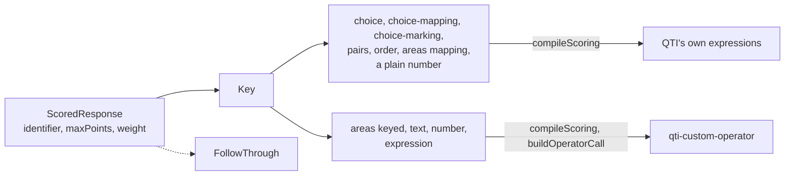

# Answer keys

`keys` holds the key model of an item's responses: what is right for a choice, pairs, an order, areas, a text, a number or an
expression, how a response scores against it, and the limits of a key. A key is plain data, as an author or a generator
writes it and JSON carries it. `compileScoring` of [scoring](scoring.md) writes every kind into response processing, with
QTI's own expressions where they score it exactly, and the [operators](operators.md) read the kinds that they cannot. The
module holds types and one constant, and imports nothing.



| Type or constant                                 | Is                                                                                             |
| ------------------------------------------------ | ---------------------------------------------------------------------------------------------- |
| `Key`                                            | The union of the nine kinds below, told apart by `kind`.                                       |
| `ScoredResponse`                                 | A response of an item: its identifier, its key, its points, its weight and its follow-through. |
| `FollowThrough`                                  | Credit for an answer that follows from an earlier response.                                    |
| `Area`, `Tolerance`, `Interval`, `TextAnswer`, … | The parts of a key.                                                                            |
| `DEFAULT_KEY_LIMITS`, `KeyLimits`                | The limits of a key: responses an item, entries a key, characters a pattern.                   |

## Quick start

A key is an object; [scoring](scoring.md) compiles it and the operators read it.

```ts
import { DEFAULT_KEY_LIMITS } from "@assesskit/runtime/keys";
import { compileScoring } from "@assesskit/runtime/scoring";

const responses = [
  { identifier: "CAPITAL", key: { kind: "text", answers: [{ texts: ["Jakarta"] }] } },
  { identifier: "LARGEST", key: { kind: "choice", keys: ["B"] }, maxPoints: 2 },
];
compileScoring(responses).responseDeclarations.map(({ identifier, baseType }) => `${identifier} ${baseType}`);
// => ["CAPITAL string", "LARGEST identifier"]
DEFAULT_KEY_LIMITS; // => { responses: 256, entries: 1000, patternLength: 1000 }
```

## Kinds

Each kind's share is of the key's own maximum: 1 for a key right or wrong, the best sum for a key of points. A response that
gives `maxPoints` scales the share to them.

| Kind             | Fields, defaults in brackets                                                                                                                                                                                                                                                                                                                      | Share                                                                                                                                                                                                          |
| ---------------- | ------------------------------------------------------------------------------------------------------------------------------------------------------------------------------------------------------------------------------------------------------------------------------------------------------------------------------------------------- | -------------------------------------------------------------------------------------------------------------------------------------------------------------------------------------------------------------- |
| `choice`         | `keys`; `scheme` (`all-or-nothing`), `partial` or `per-key`; `maxChoices` (the count of keys)                                                                                                                                                                                                                                                     | `all-or-nothing`: 1 when the selection equals the keys. `partial`: a point a key selected less a point an other option selected, floored at 0. `per-key`: a point a key selected                               |
| `choice-mapping` | `points` of each option; `maxChoices` (1, as QTI's `max-choices`)                                                                                                                                                                                                                                                                                 | The sum of the points of the options selected, floored at 0, of the best sum within `maxChoices`                                                                                                               |
| `choice-marking` | `keys`, `correct` (above 0), `wrong`; `blank` (0), at most what the right selection earns; `maxChoices` (the count of keys)                                                                                                                                                                                                                       | `blank` with nothing selected, else `correct` a key and `wrong` an other option selected; not floored, so a negative mark stays                                                                                |
| `pairs`          | `pairs` of a source and a target; `directed` (true); `scheme` (`all-or-nothing`), `per-pair` or `mapping` with `points` a pair; `maxPairs` (the count of pairs); `maxPerSource` (unlimited); `maxPerTarget` (1, unlimited with `reuse`); `reuse` (false); `surplus` (0); `none`, the target that answers "none", which any number of sources take | `all-or-nothing`: 1 when the pairs equal the key's. `per-pair`: a point a key pair made. `mapping`: its points. Less `surplus` for each pair past the count of the key's, floored at 0                         |
| `order`          | `order`; `scheme` (`all-or-nothing`), `per-position` or `adjacent-pairs`                                                                                                                                                                                                                                                                          | `all-or-nothing`: 1 when the order equals the key's. `per-position`: a point a position right. `adjacent-pairs`: a point a pair of the key's neighbors standing next to each other in that order               |
| `areas`          | `areas`, each with `id`, `shape` (`rect`, `circle` or `poly`), `coords` and `points` (1); `scheme`, `mapping` or `keyed`; `select` (the count of areas)                                                                                                                                                                                           | `mapping`: the points of the areas hit, each point counting for the first area that holds it and each area once, of the best sum within `select`. `keyed`: areas matched one to one with points, over `select` |
| `text`           | `answers`, each with `texts`, `patterns` and `points` (1); `count` (1); `scheme` (`forms`) or `words`; `normalization`; `spelling` (`exact`); `numericEquivalence` (false); `credit` tiers by edit distance; `length` rule                                                                                                                        | The points of the answers matched over the points of the `count` best ([texts](operators.md#texts))                                                                                                            |
| `number`         | `value`; `tolerance`; `decimalSeparator` (`.`); `units`; `fractions` (false); `significantFigures`; `credit` tiers; `intervals`; `components`                                                                                                                                                                                                     | 1 within the tolerance, else the share of a tier ([numbers](operators.md#numbers))                                                                                                                             |
| `expression`     | `expression`; `form` (`expression`), `equation` or `solution-set`; `variables` and their ranges; `decimalSeparator` (`.`)                                                                                                                                                                                                                         | 1 when equivalent ([expressions](operators.md#expressions))                                                                                                                                                    |

A `ScoredResponse` has an `identifier`, a QTI identifier; its `key`; `maxPoints`, its points (the key's own maximum);
`weight`, the factor of its points in the item's score (1); and `followThrough`, on a `number` or `expression` key, the
identifier of an earlier response (`from`), an `expression` in `variable` (`r`), which the earlier response replaces. The
response earns the credit when it matches the key or that value.

## Limits

| What                                                                                                                       | Bound                              | Default | When exceeded                                |
| -------------------------------------------------------------------------------------------------------------------------- | ---------------------------------- | ------: | -------------------------------------------- |
| Responses of an item                                                                                                       | `responses`                        |     256 | `SecurityError` with `limit` `responses`     |
| Entries of a key: keys, options, pairs, choices, areas and coordinates in fours, answers, texts and patterns, units, tiers | `entries`                          |   1,000 | `SecurityError` with `limit` `entries`       |
| Characters of a pattern                                                                                                    | `patternLength`, UTF-16 code units |   1,000 | `SecurityError` with `limit` `patternLength` |

An operator reads its key within these limits, so that every scorer of an item reads the same items, and `compileScoring` holds
an item to them ([scoring](scoring.md#limits)). The patterns of a `text` key together have at most the 100,000 states that
`maxStates` of `DEFAULT_XSD_REGEX_LIMITS` allows one pattern ([operators](operators.md#limits)).

## Errors

None: the module holds types and a constant. `compileScoring` and the operators read keys and refuse them
([scoring](scoring.md#errors), [operators](operators.md#errors)).

## Not included

| Not included                                     | Why                                                                                                                                              |
| ------------------------------------------------ | ------------------------------------------------------------------------------------------------------------------------------------------------ |
| A key of a response that a person rates          | A rated response is scored by a rubric, `ScoringRubric` of [asi](asi.md), and its outcome is externally scored                                   |
| A spelling rule that finds variants by itself    | No source defines which variants count: the sources list each accepted variant, which an answer's `texts` hold; `spelling` takes `"exact"` alone |
| Other distances between orders, as Kendall's tau | The sources score an order whole, per position or by its adjacent pairs, as PTE's reordering does                                                |

## Differences from the references

None: the model is the runtime's own. [Scoring](scoring.md#differences-from-the-references) says where a compiled key departs
from a reference.

## Files

| File        | Concept                                      |
| ----------- | -------------------------------------------- |
| `model.ts`  | The kinds of keys, their parts and responses |
| `limits.ts` | The limits of a key                          |
