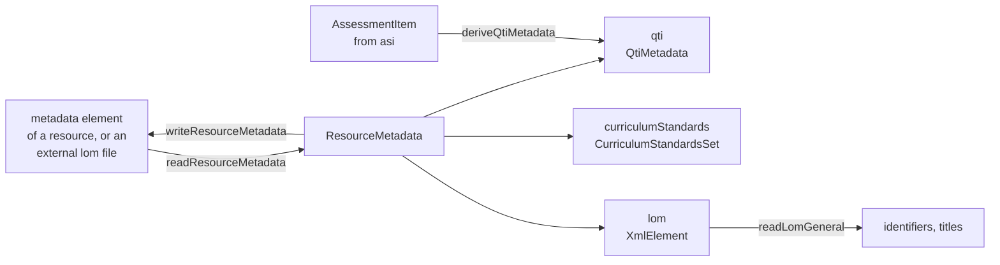

# Resource metadata

`metadata` reads and writes the metadata of a resource in a QTI content package: QTI metadata, IEEE LOM, curriculum
standards and the accessibility description of a variant. It builds on `xml` and `asi`, uses no platform API and runs in any
JavaScript runtime. [package](package.md) builds on it, and the manifest carries the metadata of each resource.



| Export                                                                   | Purpose                                                                                             |
| ------------------------------------------------------------------------ | --------------------------------------------------------------------------------------------------- |
| `readResourceMetadata(element, options?)`, `writeResourceMetadata`       | The metadata of a resource: `lom`, `qti` and `curriculumStandards` (`ResourceMetadata`).            |
| `readQtiMetadata`, `writeQtiMetadata`, `checkQtiMetadata`, `QtiMetadata` | The `qtiMetadata` element.                                                                          |
| `readCurriculumStandardsSet`, `writeCurriculumStandardsSet`              | The `curriculumStandardsMetadataSet` element.                                                       |
| `readAccessForAllResource`, `writeAccessForAllResource`                  | The `accessForAllResource` element.                                                                 |
| `readLomGeneral(lom)`                                                    | The identifiers and titles of the LOM category `general`.                                           |
| `deriveQtiMetadata(item)`                                                | The `QtiMetadata` that an item from `asi` shows.                                                    |
| `INTERACTION_TYPES`, `FEEDBACK_TYPES`, `SCORING_MODES`                   | The vocabularies of QTI metadata. The DRD vocabularies are `ACCESS_MODES`, `DRD_HAZARDS` and so on. |
| `*_NAMESPACE`                                                            | The namespaces of QTI metadata, LOM, curriculum standards, the DRD and content packaging.           |

Readers take a parsed `XmlElement` (`parseXml` of [xml](xml.md)); writers return one, and `serializeXml` writes it. The option `path` of a reader
names the document in the issues of a `ReadError`.

## Quick start

```ts
import { readLomGeneral, readResourceMetadata } from "@assesskit/runtime/metadata";
import { parseXml } from "@assesskit/runtime/xml";

const metadata = readResourceMetadata(
  parseXml(`<metadata xmlns="http://www.imsglobal.org/xsd/qti/qtiv3p0/imscp_v1p1"
    xmlns:qmd="http://www.imsglobal.org/xsd/imsqti_metadata_v3p0" xmlns:lom="http://ltsc.ieee.org/xsd/LOM">
  <qmd:qtiMetadata>
    <qmd:timeDependent>false</qmd:timeDependent>
    <qmd:interactionType>choiceInteraction</qmd:interactionType>
    <qmd:feedbackType>nonadaptive</qmd:feedbackType>
    <qmd:solutionAvailable>true</qmd:solutionAvailable>
  </qmd:qtiMetadata>
  <lom:lom><lom:general>
    <lom:identifier><lom:entry>capital</lom:entry></lom:identifier>
    <lom:title><lom:string language="en">Capital city</lom:string></lom:title>
  </lom:general></lom:lom>
</metadata>`),
);
metadata.qti?.interactionTypes; // => ["choiceInteraction"]
metadata.qti?.feedbackType; // => "nonadaptive"
metadata.qti?.solutionAvailable; // => true
metadata.lom && readLomGeneral(metadata.lom);
// => { identifiers: ["capital"], titles: [{ language: "en", text: "Capital city" }] }
```

## Resource metadata

`readResourceMetadata` reads one of two elements:

- The `metadata` element of a resource in a manifest. It may contain one each of `qmd:qtiMetadata`,
  `csmd:curriculumStandardsMetadataSet` and `lom:lom`, in that order. Another element is a `ReadError`.
- The root `lom` element of an external metadata file (resource type `resourcemetadata/xml`), which holds the QTI
  metadata and the curriculum standards among the LOM elements. The result's `lom` is that element without the two.

`writeResourceMetadata` writes the first form, in the namespace of content packaging, with the children in the order of the CP
schema: QTI metadata, curriculum standards, LOM.

## QTI metadata

`QtiMetadata` has the fields of the `qtiMetadata` element. A field that the document omits is `undefined`; the two lists are empty.

| Field                                        | Type                                          | Meaning                                                             |
| -------------------------------------------- | --------------------------------------------- | ------------------------------------------------------------------- |
| `itemTemplate`, `timeDependent`, `composite` | `boolean`                                     | An item template, a time dependent item, more than one interaction. |
| `interactionTypes`                           | `InteractionType[]`                           | The 22 terms of `InteractionType`, such as `choiceInteraction`.     |
| `portableCustomInteractionContext`           | `{ customTypeIdentifier?, interactionKind? }` | The context of a portable custom interaction.                       |
| `feedbackType`                               | `"adaptive" \| "nonadaptive" \| "none"`       | The kind of feedback the item has.                                  |
| `solutionAvailable`                          | `boolean`                                     | The item declares a correct response.                               |
| `scoringModes`                               | `ScoringMode[]`                               | `human`, `externalmachine`, `responseprocessing`.                   |
| `toolName`, `toolVersion`, `toolVendor`      | `string`                                      | At most 256 characters each.                                        |

Booleans are `true`, `false`, `1` or `0`, with white space around them ignored. `customTypeIdentifier` and `interactionKind`
are `xs:normalizedString`: a tab, line feed or carriage return reads as a space. The writer writes the children in the order of
the schema, whatever the order of the fields.

`checkQtiMetadata(value)` throws a `DataError` unless the value is valid QTI metadata: the types of the fields, the terms of
the vocabularies and the length of the tool strings. `writeQtiMetadata` and `cat.buildCatMetadata` check their input with it.

## Derived metadata

`deriveQtiMetadata(item)` takes an item from `readAsi` and returns the `QtiMetadata` that the item shows:

```ts
import { readAsi } from "@assesskit/runtime/asi";
import { deriveQtiMetadata } from "@assesskit/runtime/metadata";

const document =
  readAsi(`<qti-assessment-item xmlns="http://www.imsglobal.org/xsd/imsqtiasi_v3p0" identifier="capital" title="Capital" adaptive="false" time-dependent="false">
  <qti-response-declaration identifier="RESPONSE" cardinality="single" base-type="identifier">
    <qti-correct-response><qti-value>paris</qti-value></qti-correct-response>
  </qti-response-declaration>
  <qti-item-body>
    <qti-choice-interaction response-identifier="RESPONSE" max-choices="1">
      <qti-simple-choice identifier="paris">Paris</qti-simple-choice>
      <qti-simple-choice identifier="rome">Rome</qti-simple-choice>
    </qti-choice-interaction>
  </qti-item-body>
</qti-assessment-item>`);
const derived = document.kind === "item" ? deriveQtiMetadata(document.item) : undefined;
derived?.interactionTypes; // => ["choiceInteraction"]
derived?.feedbackType; // => "none"
derived?.solutionAvailable; // => true
```

| Field                              | Derived as                                                                                                                                                                           |
| ---------------------------------- | ------------------------------------------------------------------------------------------------------------------------------------------------------------------------------------ |
| `itemTemplate`                     | True when the item has template processing.                                                                                                                                          |
| `timeDependent`                    | The attribute `time-dependent`.                                                                                                                                                      |
| `composite`                        | True when the body has more than one interaction.                                                                                                                                    |
| `interactionTypes`                 | The type of each interaction in the body, found at any depth, each type once, in the order of the model: document order, except that the places of one element come in schema order. |
| `portableCustomInteractionContext` | For a portable custom interaction, `customTypeIdentifier` of the first one. The item does not have `interactionKind`.                                                                |
| `feedbackType`                     | `none` without `qti-modal-feedback`, `qti-feedback-block` and `qti-feedback-inline`; otherwise `adaptive` for an item with `adaptive="true"` and `nonadaptive` for any other.        |
| `solutionAvailable`                | True when the item declares a response and every declared response has a correct response, in its declaration or set by `qti-set-correct-response` in the template processing.       |
| `scoringModes`                     | `human` and `externalmachine` for the outcomes with `external-scored`, and `responseprocessing` when the item has response processing, in the order of the vocabulary.               |
| `toolName`, `toolVersion`          | The attributes `tool-name` and `tool-version`, when they have at most 256 characters. `toolVendor` is not in the item.                                                               |

The metadata that an author wrote in a manifest can differ from what the item shows. In the 32 example items that have both, the
derived values agree on every field but twelve: authors wrote `nonadaptive` for items without feedback, `extendedTextInteraction`
for items with a text entry, no solution for items that declare correct responses, and a solution for an item that declares correct
responses for one of its two responses ([Evidence](evidence.md)).

## LOM

The LOM stays XML. `ResourceMetadata.lom` is the `lom:lom` element with all its categories (`general`, `lifeCycle`,
`metaMetadata`, `technical`, `educational`, `rights`, `relation`, `annotation`, `classification`), and
`readLomGeneral(lom)` returns what the package needs of `general`:

| Field         | Content                                                                                                |
| ------------- | ------------------------------------------------------------------------------------------------------ |
| `identifiers` | The `entry` of each `identifier`, in document order. An identifier with only a `catalog` is left out.  |
| `titles`      | The `string` elements of `title`, with `language` from the attribute `language` or `xml:lang`, if any. |

The writer declares the namespaces that a kept subtree uses, so a subtree read from a document whose root declared them can be
written elsewhere.

## Curriculum standards

`CurriculumStandardsSet` mirrors the CSM schema: `resourceLabel`, `resourcePartId` and a list of `standards`
(`providerId`, `guidSets`); a `GuidSet` has `region`, `version` and `labelledGuids`, and a `LabelledGuid` has `label`,
`caseItemUri` (kept as a string) and `guid`, which is required. The lists in the schema have at least one item, so the
writer throws a `DataError` for an empty one; the reader accepts what the document has.

## Accessibility description

`AccessForAllResource` has one field per element of the DRD schema, with the name of the element: ten fields with a vocabulary,
`atInteroperable`, `educationalLevelOfAdaptation`, `languageOfAdaptation` and the four lists of URIs (`hasAdaptation`,
`isAdaptationOf`, `isFullAdaptationOf`, `isPartialAdaptationOf`). The lists are empty when the element does not occur;
`atInteroperable` and `educationalComplexityOfAdaptation` are `undefined`.

| Field                                                               | Terms                                                                                    |
| ------------------------------------------------------------------- | ---------------------------------------------------------------------------------------- |
| `accessMode`, `accessModeAdapted`                                   | `ACCESS_MODES`: 10 terms, such as `auditory`, `visual`, `textual`.                       |
| `adaptationDetail`, `adaptationMediaType`, `adaptationType`         | `ADAPTATION_DETAILS`, `ADAPTATION_MEDIA_TYPES`, `ADAPTATION_TYPES`.                      |
| `apiInteroperable`, `controlFlexibility`, `displayTransformability` | `API_INTEROPERABLE`, `CONTROL_FLEXIBILITY`, `DISPLAY_TRANSFORMABILITY`.                  |
| `educationalComplexityOfAdaptation`                                 | `COMPLEXITY_OF_ADAPTATION`: `enriched`, `simplified`.                                    |
| `hazard`                                                            | `DRD_HAZARDS`: `flashing`, `sound`, `olfactoryHazard`, `motionSimulation` (`DrdHazard`). |

Each vocabulary also takes an extension term, `ext:` and letters, digits, spaces, `.`, `_` and `|` (`ExtensionTerm`). Any other
term is a `ReadError`, or a `DataError` in the writer. The elements come in the order of the DRD schema, in the reader and the writer. `extensions` holds the elements of other namespaces that the schema allows after the DRD elements.

## Errors

| Rule                                                         | Class       | Meaning                                                                                           |
| ------------------------------------------------------------ | ----------- | ------------------------------------------------------------------------------------------------- |
| `assesskit/metadata/invalid-text`                            | `ReadError` | A boolean, term or string that its element does not allow.                                        |
| `assesskit/metadata/unexpected-element`                      | `ReadError` | An element that the schema does not allow at that place: not declared, repeated, or out of order. |
| `assesskit/metadata/missing-element`                         | `ReadError` | An element that the schema requires, such as a `GUID`.                                            |
| `assesskit/metadata/unexpected-attribute`, `unexpected-text` | `ReadError` | An attribute the schema does not declare, or text in an element that has elements only.           |
| `assesskit/metadata/duplicate-element`                       | `ReadError` | An external metadata file has the QTI metadata or the curriculum standards twice.                 |

A `ReadError` has one issue with its rule and place: fix the document there. The readers throw `DataError` for an argument
of the wrong type and the writers for a model that is not valid, with a message that names the field: pass what the types of
this module describe. A text or bytes above a limit of `parseXml` is a `SecurityError` ([xml](xml.md#limits)).

## Not included

| Not included                                           | Why                                                                                        |
| ------------------------------------------------------ | ------------------------------------------------------------------------------------------ |
| A typed model of the LOM beyond `general`              | The package needs the identifiers and titles; the rest of the LOM stays XML, kept as it is |
| Resolving a CASE item URI                              | `caseItemUri` is kept as a string; fetching it is a network concern                        |
| Checking terms against an external registry            | The vocabularies are the lists of the schemas, and an extension term is open               |
| Metadata that an author wrote and the item contradicts | `deriveQtiMetadata` gives what the item shows; the author's value is kept as read          |

## Differences from the references

| Case                                                                                 | Resolution                                                                                       |
| ------------------------------------------------------------------------------------ | ------------------------------------------------------------------------------------------------ |
| The namespaces in the samples of the specifications differ from those of the schemas | The schemas decide, and the namespaces of metadata are strict ([G12](spec-gaps.md))              |
| The lists of the curriculum standards schema have at least one item                  | The reader accepts what the document has; the writer throws a `DataError` for an empty list      |
| The LOM has nine categories                                                          | The LOM stays XML, kept as it is; only `general` is interpreted, which is what the package needs |

## Files

Each file of `src/metadata/` holds one concept.

| File                                       | Concept                                               |
| ------------------------------------------ | ----------------------------------------------------- |
| `resource-metadata.ts`                     | The metadata of a resource and its two forms          |
| `qti-metadata.ts`, `derive.ts`             | QTI metadata, and deriving it from an item            |
| `curriculum-standards.ts`                  | Curriculum standards                                  |
| `access-for-all.ts`                        | The accessibility description of a resource           |
| `lom.ts`                                   | The LOM category `general`                            |
| `namespaces.ts`, `qualified-name.ts`       | The namespaces and the prefixes the writers give them |
| `lexical.ts`, `extension-term.ts`          | Strings, booleans and open vocabularies               |
| `element-reading.ts`, `element-writing.ts` | Reading and building elements                         |

## References

| Topic                                  | Specification                                                                                    |
| -------------------------------------- | ------------------------------------------------------------------------------------------------ |
| QTI metadata, vocabularies, LOM        | [QTI 3.0 Metadata Binding](https://www.imsglobal.org/spec/qti/v3p0/md-bind/)                     |
| The `metadata` element of a resource   | [QTI 3.0 ASI XML Binding](https://www.imsglobal.org/spec/qti/v3p0/bind/)                         |
| External metadata files                | [QTI 3.0 Best Practices and Implementation Guide](https://www.imsglobal.org/spec/qti/v3p0/impl/) |
| Places where the specifications differ | [Spec gaps](spec-gaps.md)                                                                        |
