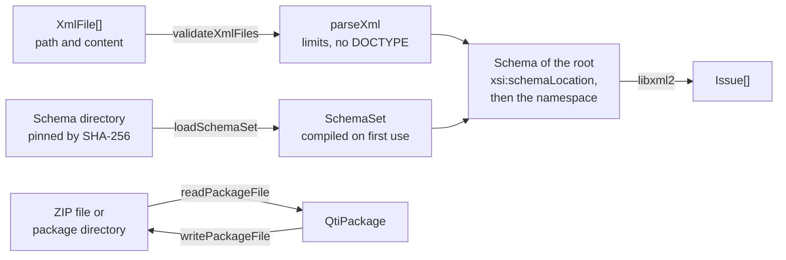

# Node

`node` is for Node.js 22 and later. It validates XML documents against the published XSD schemas of QTI 3.0 and the
specifications it references, and reads and writes QTI content packages as files. The schemas are 1EdTech and W3C files that
the runtime does not ship (they are copyrighted); the module pins them by SHA-256 and compiles them with libxml2 in WebAssembly.



| Export                                       | Purpose                                                                                                                                                                                |
| -------------------------------------------- | -------------------------------------------------------------------------------------------------------------------------------------------------------------------------------------- |
| `SCHEMA_FILES`, `SchemaFile`                 | The pinned list: URL, file name and SHA-256 of every schema.                                                                                                                           |
| `defaultSchemaDirectory()`                   | The directory that `assesskit schemas fetch` writes the schemas to and `assesskit validate` reads them from: `loadSchemaSet(defaultSchemaDirectory())` loads what the command fetched. |
| `loadSchemaSet(directory)`                   | Checks the files of `SCHEMA_FILES` in a directory and returns a `SchemaSet`.                                                                                                           |
| `SchemaSet`                                  | The schemas of a directory, compiled when first needed and reused; `close()` frees them.                                                                                               |
| `validateXmlFiles(schemas, files, options?)` | Parses each document with `parseXml`, then validates it; returns `Issue`s, at most `maxFindings` (1,000 by default) over all the files.                                                |
| `XmlFile`                                    | A document: `path` and `content` (text or bytes).                                                                                                                                      |
| `readPackageFile(path, options?)`            | Reads a package from a ZIP file or an unpacked directory.                                                                                                                              |
| `writePackageFile(path, manifest, files)`    | Writes a package as a ZIP file.                                                                                                                                                        |

## Quick start

```ts
import { readFile } from "node:fs/promises";
import { loadSchemaSet, validateXmlFiles } from "@assesskit/runtime/node";

const schemas = await loadSchemaSet("./schemas"); // the directory the schemas are in
const content = await readFile("items/capital.xml");
const issues = await validateXmlFiles(schemas, [{ path: "items/capital.xml", content }]);
issues.map((issue) => issue.rule); // => ["assesskit/node/xsd-invalid"]
issues[0]?.message.includes("The attribute 'time-dependent' is required but missing."); // => true
issues[0]?.location; // => { path: "items/capital.xml", line: 1 }
schemas.close(); // frees the compiled schemas
```

## Package files

`readPackageFile(path, options?)` returns a `QtiPackage` (see [package](package.md)) and takes the options of `readPackage`: `limits`
(`ZipLimits`) and `xmlLimits`. What the path is decides how it reads:

| Path        | Reading                                                                                                                                                                                                                                                                                                                                       |
| ----------- | --------------------------------------------------------------------------------------------------------------------------------------------------------------------------------------------------------------------------------------------------------------------------------------------------------------------------------------------- |
| A file      | Read by ranges as `readPackage` reads an archive: the end of the file and its central directory when it opens, and the bytes of an entry when `file(path)` or `document(path)` asks for it, so that the memory follows the directory and the largest entry opened. A file larger than `maxTotalBytes` is a `SecurityError` before it is read. |
| A directory | The directory is listed once; each file is read when `file(path)` asks for it. `paths` are sorted, with `/` as separator.                                                                                                                                                                                                                     |

A directory is read with these rules:

- Listing checks every entry with `lstat`. A symbolic link anywhere below the directory is a `SecurityError` with `limit` `"symlink"`,
  also a link to a file inside the directory; a socket, device or pipe has `limit` `"special-file"`; a name that is not allowed in a
  package (a backslash, a control character) has `limit` `"path"`.
- Reading a file checks again with `lstat` and `realpath` that it is a regular file below the directory, so that a file replaced by a
  link after the listing is not followed. The check and the read are two calls: a directory that another process changes while the runtime
  reads it is not protected against a race, and a package directory should not be writable by untrusted users.
- `maxEntries`, `maxEntryBytes` and `maxTotalBytes` apply to the files and directories, by their size on disk.
- The path given to `readPackageFile` may itself be a link; the runtime resolves it once and reads below the result.

`writePackageFile(path, manifest, files)` writes what `writePackage` returns to a ZIP file and replaces a file that is there. It
does not write unpacked directories. Both functions throw a `DataError` for a path that cannot be read or written.

## Getting the schemas

Download each `url` of `SCHEMA_FILES` into one directory under its `file` name. `assesskit schemas fetch` of the [command line](cli.md)
does that into the user cache directory, which `defaultSchemaDirectory()` returns, and checks every hash; in this repository, `pnpm schemas` runs the same code
into `.cache/schemas` (the files are about 140 MB); `pnpm schemas:pin` writes new hashes into
`packages/runtime/src/node/schema-files.json` when a schema changes. `loadSchemaSet` throws a `DataError` that lists every file
that is missing, unreadable or has another hash. The files read during a compilation are checked again, so a file changed
after loading is never compiled.

`SCHEMA_FILES` holds, with the 3.0.1 and 3.0.0 versions of the ASI schemas:

| Schemas                                                                                                             | Files |
| ------------------------------------------------------------------------------------------------------------------- | ----- |
| ASI: every document type, and one schema each for items, tests, sections, stimuli, outcomes and response processing | 14    |
| Results Reporting, usage data, QTI metadata, LOM                                                                    | 4     |
| Content package, its extension, curriculum standards, accessibility resource, PNP                                   | 5     |
| Imported: XML, XInclude, XLink, MathML (5 files), SSML (2 files)                                                    | 10    |

## Choosing the schema

`validateXmlFiles` chooses the schema of a document from its root element:

1. If the root's `xsi:schemaLocation` pairs the root's namespace with the address of a pinned schema, that schema is used.
   This is how a document selects the 3.0.0 ASI schema or a single-document schema.
2. Otherwise the primary schema of the root's namespace:

| Root namespace                                                 | Schema                              |
| -------------------------------------------------------------- | ----------------------------------- |
| `http://www.imsglobal.org/xsd/imsqtiasi_v3p0`                  | `imsqti_asiv3p0p1_v1p0.xsd` (3.0.1) |
| `http://www.imsglobal.org/xsd/imsqti_result_v3p0`              | `imsqti_resultv3p0_v1p0.xsd`        |
| `http://www.imsglobal.org/xsd/imsqti_usagedata_v3p0`           | `imsqti_usagedatav3p0_v1p0.xsd`     |
| `http://www.imsglobal.org/xsd/imsqti_metadata_v3p0`            | `imsqti_metadatav3p0_v1p0.xsd`      |
| `http://ltsc.ieee.org/xsd/LOM`                                 | `imsmd_loose_v1p3p2.xsd`            |
| `http://www.imsglobal.org/xsd/qti/qtiv3p0/imscp_v1p1`          | `imsqtiv3p0_imscpv1p2_v1p0.xsd`     |
| `http://www.imsglobal.org/xsd/qti/qtiv3p0/imscp_extensionv1p2` | `imsqtiv3p0_cpextv1p2_v1p0.xsd`     |
| `http://www.imsglobal.org/xsd/qti/qtiv3p0/imscsmd_v1p1`        | `imsqtiv3p0_csmv1p1_v1p0.xsd`       |
| `http://www.imsglobal.org/xsd/qti/qtiv3p0/imsafa3p0drd_v1p0`   | `imsqtiv3p0_afa3p0drd_v1p0.xsd`     |
| `http://www.imsglobal.org/xsd/qti/qtiv3p0/imsafa3p0pnp_v1p0`   | `imsqtiv3p0_afa3p0pnp_v1p0.xsd`     |

## Issues

`validateXmlFiles` does not throw for a bad document. It returns issues, in the order of the files:

| Rule                                                                               | When                                                                                        | `source`                                                          |
| ---------------------------------------------------------------------------------- | ------------------------------------------------------------------------------------------- | ----------------------------------------------------------------- |
| `assesskit/xml/not-well-formed`, `assesskit/xml/version`, `assesskit/xml/encoding` | `parseXml` rejects the document (the issues of its `ReadError`).                            | as in [xml](xml.md#errors)                                        |
| `assesskit/xml/security`                                                           | `parseXml` throws a `SecurityError`: a DOCTYPE, or a limit exceeded.                        | The best practices guide for a DOCTYPE, `SECURITY.md` for a limit |
| `assesskit/node/no-schema`                                                         | The root is in a namespace with no schema in the table above.                               | `SCHEMA_FILES`                                                    |
| `assesskit/node/xsd-invalid`                                                       | The schema rejects the document. One issue per message of libxml2.                          | The schema file that reported it                                  |
| `assesskit/node/xml-rejected`                                                      | libxml2 cannot parse a document that the runtime parsed (for example an encoding it lacks). | The schema file                                                   |

The list keeps the first `maxFindings` issues of all the files, 1,000 unless the option says otherwise, and ends with the error
`assesskit/validate/findings-stopped` when there were more, as the lists of [validate](validate.md#issues) do. libxml2 still
reports every violation to the runtime, at about half a millisecond each, so a document at the size limit of `parseXml` that
breaks the schema at every element takes minutes to validate.

A document goes through `parseXml` first, with the default limits, so a DOCTYPE, a document over a limit and one that is not
well-formed never reach libxml2. libxml2 also runs with network access and external entities off. It throws `DataError` for
arguments of the wrong type and for a `SchemaSet` that is closed or that `loadSchemaSet` did not return.

## Compiled once

A schema is compiled the first time a document needs it, and the compiled schema stays in the `SchemaSet` for every later call.
Compiling an ASI schema takes about 2 seconds and adds about 120 MB of memory; every schema of another specification compiles in
under 10 ms. After that a document validates in well under a millisecond. Keep one `SchemaSet` per process or per test run, and call
`close()` when done: libxml2-wasm needs the compiled schemas disposed explicitly.

libxml2-wasm keeps its input providers (how it reads the schemas that a schema imports) in one table for the process. The runtime
registers a provider only while it compiles, then removes every provider, so a program that registers its own libxml2-wasm
providers should do so after compiling.

## Engine

Two npm packages compile libxml2 to WebAssembly. The runtime uses `libxml2-wasm`; the measurements that decided it are below
(one run each on macOS with Node.js 26.8.1; the ratios matter more than the values). The schema is `imsqti_asiv3p0p1_v1p0.xsd`,
18.8 MB with 9 imported files.

| Measure                                            | `libxml2-wasm` 0.7.2 (libxml2 2.15.1)           | `xmllint-wasm` 5.3.0 (libxml2 2.13.8)                                                   |
| -------------------------------------------------- | ----------------------------------------------- | --------------------------------------------------------------------------------------- |
| Compile the ASI schema                             | 2.0 s, once per `SchemaSet`                     | 1.6 to 1.8 s on every call                                                              |
| Validate the 58 example items                      | 11 ms after the compile                         | 1.9 s in one call; 5 items in 5 calls take 8.8 s                                        |
| Peak resident memory for the process               | 173 MB                                          | 790 to 885 MB                                                                           |
| Memory limit                                       | grows as needed                                 | the default 16 MiB aborts the compile; 64 MiB fails, 128 MiB works                      |
| Schemas that import others                         | an input provider serves them by URL from bytes | every `schemaLocation` in the 18.8 MB schema must be rewritten to a preloaded file name |
| `XInclude.xsd` (UTF-16 with a byte order mark)     | read from bytes                                 | contents are strings: the file must be transcoded and its declaration rewritten         |
| Each other schema (usage data, manifest, PNP, ...) | 3 to 8 ms, once                                 | about 30 ms per call                                                                    |

`xmllint-wasm` runs the `xmllint` program in a worker for every call, so it compiles the schema again each time and cannot
keep it. `libxml2-wasm` compiles an `XsdValidator` and reuses it. Its risks: its README marks XSD `import` and `include` support experimental, and `xmlRegisterInputProvider` is marked alpha and
is process-wide. Both are covered by the tests, which compile each primary schema and the schemas it imports.

## Evidence

`pnpm test:xsd` (run `pnpm schemas` and `pnpm corpus` first) validates on this engine:

| Document                                                                                                                                | Result                                                              |
| --------------------------------------------------------------------------------------------------------------------------------------- | ------------------------------------------------------------------- |
| 1EdTech items `choice.xml`, `adaptive_template.xml`, `Example03-feedbackBlock-solution-random.xml`, `associate.xml`, test `rtest01.xml` | valid under the ASI schema, 3.0.0 and 3.0.1                         |
| `choice.xml` without `time-dependent`                                                                                                   | rejected: "The attribute 'time-dependent' is required but missing." |
| `results/report.xml`, `results/conformance-use-case-1.xml`                                                                              | valid under the Results Reporting schema                            |
| `results/full-example.xml`                                                                                                              | not well-formed (a second root element)                             |
| `usageData/example.xml`                                                                                                                 | valid under the usage data schema                                   |
| `packaging/simple/imsmanifest.xml`                                                                                                      | valid under the content package schema                              |
| An item with `xi:include` and `xi:fallback`                                                                                             | valid; an include with `parse="binary"` is rejected                 |

## Errors

| Situation                                                                              | Result                                                        | What to do                                                                         |
| -------------------------------------------------------------------------------------- | ------------------------------------------------------------- | ---------------------------------------------------------------------------------- |
| `loadSchemaSet` meets a file that is missing, unreadable or has another hash           | `DataError` that lists every such file                        | Download the schemas again with `assesskit schemas fetch`                          |
| A schema file changes after the set is loaded and before it is compiled                | `DataError`: a compilation checks each file again             | Restore the file, or load the set again                                            |
| libxml2-wasm has no room for another input provider                                    | `AssesskitError`                                              | Remove the providers that your program registered                                  |
| An argument of the wrong type, a set that `loadSchemaSet` did not return, a closed set | `DataError` that says what is wrong and what is expected      | Pass the set that `loadSchemaSet` returned, and call `close()` only when done      |
| A document is not well-formed, has a DOCTYPE or is over a limit of `parseXml`          | An `Issue` in the result of `validateXmlFiles`, never a throw | Fix the document where the issue says, or raise the limit for a document you trust |
| `readPackageFile` cannot read the path                                                 | `DataError` that names the path and the reason                | Check the path and the permissions                                                 |
| A package or a directory breaks a rule of the security model                           | `SecurityError`, `limit` names the limit or the rule          | Do not read it; for a package you trust, raise the option `limits`                 |
| The archive or the manifest cannot be read as a package                                | `ReadError` as `readPackage` gives it                         | See the [errors of package](package.md#errors)                                     |
| `writePackageFile` cannot write the file                                               | `DataError` that names the path and the reason                | Check the path and the permissions                                                 |

## Not included

| Not included                                                 | Why                                                                                                                  |
| ------------------------------------------------------------ | -------------------------------------------------------------------------------------------------------------------- |
| The schemas themselves                                       | They are copyrighted files of 1EdTech and W3C; the module pins and verifies them, and a script fetches them          |
| Writing unpacked package directories                         | `writePackageFile` writes ZIP files, which is the form that packages are exchanged in                                |
| Protection against a directory that changes while it is read | A race between the check and the read needs the host to keep the directory private                                   |
| Validation in a browser                                      | The compiled libxml2 and the schema files are Node.js concerns; the runtime core validates the model with `validate` |
| Business rules                                               | XSD checks structure; [validate](validate.md) checks what the schemas cannot express                                 |

## Differences from the references

None. The schemas of 1EdTech and W3C are the reference, and libxml2 applies them: the module changes no verdict of a schema, except that a document goes through `parseXml` first, so that a DOCTYPE or a document over a limit is refused whatever the schema says ([xml](xml.md#security)). What the schemas cannot express is the work of [validate](validate.md), which lists its own differences.

## Files

Each file of `src/node/` holds one concept.

| File                                                      | Concept                                                                             |
| --------------------------------------------------------- | ----------------------------------------------------------------------------------- |
| `schema-files.ts`, `schema-files.json`                    | The pinned list of schemas                                                          |
| `schema-set.ts`                                           | Loading, verifying and compiling a set of schemas                                   |
| `schema-directory.ts`                                     | Where the schemas live by default: the user cache directory and the version         |
| `select-schema.ts`                                        | Choosing the schema of a document                                                   |
| `validate-xml-files.ts`                                   | Validating documents and reporting issues                                           |
| `package-file.ts`, `directory-files.ts`, `file-source.ts` | Reading and writing packages as files and directories, and the ranges of a ZIP file |
| `internal.ts`                                             | What other modules and the tests use and the package does not export                |

## References

| Topic                          | Specification                                                                                    |
| ------------------------------ | ------------------------------------------------------------------------------------------------ |
| The schemas and their versions | [QTI 3.0 Best Practices and Implementation Guide](https://www.imsglobal.org/spec/qti/v3p0/impl/) |
| `xsi:schemaLocation`           | [XML Schema Part 1, structures](https://www.w3.org/TR/xmlschema-1/)                              |
| Packages as files              | [package](package.md)                                                                            |
