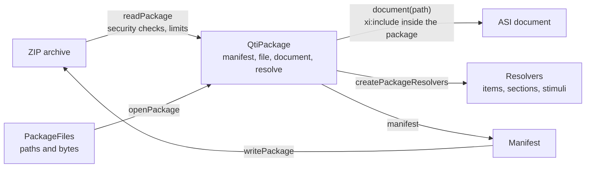

# Content packages

`package` reads and writes QTI content packages: the manifest, the ZIP archive, the documents inside, the resolvers that the
delivery engine uses, LTI link documents and the dependency closure. It builds on `xml`, `values`, `asi` and `metadata`,
uses no platform API and runs in any JavaScript runtime. [node](node.md) adds reading from files and directories.



| Export                                              | Purpose                                                                          |
| --------------------------------------------------- | -------------------------------------------------------------------------------- |
| `readPackage(zip, options?)`                        | Reads a ZIP archive into a `QtiPackage`.                                         |
| `openPackage(files, options?)`                      | Builds a `QtiPackage` from any `PackageFiles`: an archive, a directory, a store. |
| `QtiPackage`                                        | `manifest`, `paths`, `file(path)`, `document(path)`, `resolve(base, href)`.      |
| `writePackage(manifest, files)`                     | Writes a manifest and files as a ZIP archive.                                    |
| `readManifest(input, options?)`, `writeManifest`    | The manifest, `Manifest`, `Resource`, `ResourceFile` and `Variant`.              |
| `resolveResourcePath(manifest, resource, options?)` | The path in the package that an href of a resource names.                        |
| `resolveReference(base, href)`                      | `resolve` of a `QtiPackage` without the package.                                 |
| `listDependencies(manifest, identifier)`            | A resource with the resources it depends on.                                     |
| `createPackageResolvers(pkg)`                       | The `Resolvers` of the engine: items with their variants, sections and stimuli.  |
| `readLtiLink(input, options?)`, `LtiLink`           | The `cartridge_basiclti_link` document of an LTI resource.                       |
| `resolveLaunchUrl(link)`                            | The URL that launches the tool of a link.                                        |
| `DEFAULT_ZIP_LIMITS`, `ZipLimits`                   | The limits on archives and directories.                                          |
| `RESOURCE_TYPES`, `MANIFEST_SCHEMAS`                | The vocabularies of the manifest.                                                |

## Quick start

```ts
import {
  listDependencies,
  createPackageResolvers,
  readManifest,
  readPackage,
  writePackage,
} from "@assesskit/runtime/package";

const manifest = readManifest(`<manifest xmlns="http://www.imsglobal.org/xsd/qti/qtiv3p0/imscp_v1p1" identifier="demo">
  <metadata><schema>QTI Package</schema><schemaversion>3.0.0</schemaversion></metadata>
  <organizations/>
  <resources>
    <resource identifier="test" type="imsqti_test_xmlv3p0" href="test.xml">
      <file href="test.xml"/><dependency identifierref="capital"/>
    </resource>
    <resource identifier="capital" type="imsqti_item_xmlv3p0" href="items/capital.xml">
      <file href="items/capital.xml"/><file href="media/map.png"/>
    </resource>
  </resources>
</manifest>`);
listDependencies(manifest, "test").map(({ identifier }) => identifier); // => ["test", "capital"]

const text = new TextEncoder();
const zip = writePackage(
  manifest,
  new Map([
    [
      "test.xml",
      text.encode(
        '<qti-assessment-test xmlns="http://www.imsglobal.org/xsd/imsqtiasi_v3p0" identifier="t" title="T"/>',
      ),
    ],
    [
      "items/capital.xml",
      text.encode(
        '<qti-assessment-item xmlns="http://www.imsglobal.org/xsd/imsqtiasi_v3p0" identifier="capital" title="Capital" adaptive="false" time-dependent="false"/>',
      ),
    ],
    ["media/map.png", new Uint8Array([137, 80, 78, 71])],
  ]),
);

const pkg = readPackage(zip);
pkg.paths; // => ["imsmanifest.xml", "test.xml", "items/capital.xml", "media/map.png"]
pkg.resolve("items/capital.xml", "../media/map.png"); // => "media/map.png"
pkg.resolve("items/capital.xml", "http://example.com/x.png"); // => undefined
createPackageResolvers(pkg).items("items/capital.xml", "test.xml").deliverable.kind; // => "qti"
```

## The manifest

`readManifest` accepts text, bytes or a parsed root element, and takes the options of `parseXml` (`path`, `limits`). The root must
be `manifest` in `http://www.imsglobal.org/xsd/qti/qtiv3p0/imscp_v1p1`; the namespace of IMS Content Packaging 1.1 that some
samples use is a `ReadError` ([spec gaps](spec-gaps.md): namespaces of the samples). The reader follows the CP schema for the structure and rejects what the model cannot hold:

| Requirement                                                                                                                                                                                                    | Rule                                                    |
| -------------------------------------------------------------------------------------------------------------------------------------------------------------------------------------------------------------- | ------------------------------------------------------- |
| The root is a `manifest` of the content package namespace.                                                                                                                                                     | `assesskit/package/not-a-manifest`                      |
| `metadata/schema` is one of `MANIFEST_SCHEMAS`, and `schemaversion` is `3.0.0`.                                                                                                                                | `assesskit/package/invalid-text`                        |
| A resource `type` is one of the 19 of `RESOURCE_TYPES`. `imslti_xmlv1p1`, which the XML binding lists and the CP schema does not, is read as `imsbasiclti_xmlv1p3`, because 1EdTech's own LTI examples use it. | `assesskit/package/invalid-attribute`                   |
| `organizations` is empty or absent: the profile prohibits `cp:organization`, `cp:item` and nested manifests.                                                                                                   | `assesskit/package/organizations`, `unexpected-element` |
| Identifiers are declared once, among the manifest, the resources and the variants.                                                                                                                             | `assesskit/package/duplicate-identifier`                |
| Every `dependency` and `variant` `identifierref` names a resource.                                                                                                                                             | `assesskit/package/dangling-reference`                  |
| The elements come in the order of the schema, required ones and attributes are there, and nothing is outside the schema.                                                                                       | `assesskit/package/*`                                   |

The `ReadError` of the identifiers lists the first 1,000 problems, and its message counts them all.

The reader does not check that files exist; the manifest of a package can list a file that the archive lacks (the 1EdTech `pci`
example does), and `file(path)` then returns `undefined`.

The model differs from the XML in three places. `organizations` is not kept, and `writeManifest` always writes it empty.
`schemaversion` is not kept, and is always `3.0.0`. `resourcesBase` holds the `xml:base` of the `resources` element, next to
`base` of the manifest and of each resource. `writeManifest` throws a `DataError` for a manifest that the CP schema would reject:
an identifier that is not an XML name or is declared twice, a vocabulary term outside its list, a resource with no file, a
`dependency` or `variant` that names no resource. It declares the namespaces of QTI metadata, curriculum standards, the DRD and the
manifest extension once, on the root.

## Paths

Every path in a package is relative to the root, uses `/`, and is normalized: no empty or `.` segment, no `..`. `resolve(base, href)`
resolves a reference against the path of the file that holds it as RFC 3986 resolves a reference, applied to package paths. A `base` that ends in `/`
stands for a directory, as an `xml:base` does. The query and fragment are dropped, and percent-encoded octets are decoded as UTF-8
(`my%20file.png` names `my file.png`).

```ts
import { resolveReference } from "@assesskit/runtime/package";

resolveReference("b/c/d;p", "../g"); // => "b/g"
resolveReference("items/", "my%20file.png?v=2#top"); // => "items/my file.png"
resolveReference("items/", "../../x"); // => undefined
resolveReference("items/a.xml", "https://example.com/x"); // => undefined
```

| Base          | Reference        | Result        |
| ------------- | ---------------- | ------------- |
| `b/c/d;p`     | `g`, `./g`       | `b/c/g`       |
| `b/c/d;p`     | `../g`           | `b/g`         |
| `b/c/d;p`     | `../../g`        | `g`           |
| `b/c/d;p`     | `g?y#s`          | `b/c/g`       |
| `items/`      | `a.xml`          | `items/a.xml` |
| `items/a.xml` | `../media/x.png` | `media/x.png` |
| `items/`      | `../../x`        | `undefined`   |
| `items/`      | `//host/x`       | `undefined`   |

The result is `undefined` for a reference outside the package: one with a scheme (`http:`, `data:`, `file:`), one that starts with
`/` or `//`, one that leaves the root with `..`, and one with a backslash, a drive letter, a control character (NUL included) or an
invalid percent-encoding in a segment. It does not say whether the file exists.

`resolveResourcePath(manifest, resource, options?)` resolves the `href` of a resource, or the option `href` (such as one of its files),
against the `xml:base` of the manifest, of `resources` and of the resource, each against the one before.

## Archives

`readPackage(zip, options?)` takes the bytes of a ZIP archive. It reads the central directory and the manifest, and inflates
a file when `file(path)` asks for it; a package of 10,000 items costs the manifest and the items a session touches. Options:

| Option      | Default              | Meaning                                                        |
| ----------- | -------------------- | -------------------------------------------------------------- |
| `limits`    | `DEFAULT_ZIP_LIMITS` | Limits that replace the defaults, field by field.              |
| `xmlLimits` | `DEFAULT_XML_LIMITS` | XML limits for the manifest and every document of the package. |

The reader supports stored and deflated entries, UTF-8 names, directory entries (left out of `paths`), data descriptors, archive
comments and ZIP64 (the ZIP64 end of central directory record and locator, and the 64-bit values in the extra field). It does not
read archives in several parts, other compression methods, or encrypted entries. `writePackage` writes the classic format only:
it throws a `DataError` for more than 65,534 files or an archive of 4 GiB or more. It writes the manifest first, then the files in the order of the map, deflated when that makes them smaller, with one fixed
time stamp, so that equal input gives equal bytes.

### Why the reader is written here

The reader reads the central directory itself and uses `fflate` for the inflater only. The `unzip` of `fflate` 0.8.3 reads the
number of entries that the end record states, a 16-bit field: an archive of 70,002 entries without ZIP64 gives 4,466, while
Python's `zipfile` and `unzip` read all of them. It returns names such as `../evil.txt` and `/abs.txt` as they are, and leaves
sizes and ratios to a filter of the caller. The [security checks](#security-checks) run on every entry before any of it is
inflated, so the reader owns the directory. The inflater is the library's, fed in steps of 8 KiB, so that the reader counts the
output as it comes.

`@zip.js/zip.js` 2.24.0, which interopkit's `course-launch` reads cmi5 packages with, recovers a count that wrapped past
65,535, but its reader is asynchronous: the entries and the bytes of each come through promises. `readPackage` is synchronous
(`package.ts`), and so are the resolvers that `createPackageResolvers` builds over `file(path)` (`Resolvers`), which the engine calls
inside `start` and `apply`: the engine is a synchronous reducer, and an asynchronous reader would make every step of it
asynchronous. The reader stays, with the inflater of `fflate`.

### Security checks

| Threat                                | Control                                                                                                                                                                  | Error                                          |
| ------------------------------------- | ------------------------------------------------------------------------------------------------------------------------------------------------------------------------ | ---------------------------------------------- |
| Zip-slip, absolute paths              | An entry name that is absolute, leaves the root with `..`, or has a backslash, a drive letter or a control character rejects the archive. A directory entry too.         | `SecurityError`, `limit` `"path"`              |
| Two names for one file                | Two entries with the same normalized name (`a.xml` and `./a.xml`) reject the archive.                                                                                    | `SecurityError`, `limit` `"duplicate-path"`    |
| Symbolic links                        | An entry made on Unix or OS X (host 3 or 19) whose mode is a symbolic link rejects the archive.                                                                          | `SecurityError`, `limit` `"symlink"`           |
| Encrypted entries                     | General purpose bit 0, 6 or 13 rejects the archive.                                                                                                                      | `SecurityError`, `limit` `"encrypted"`         |
| Too many entries                      | The reader counts the entries of the central directory against `maxEntries` as it reads them, and a count above it in the end record fails before the directory is read. | `SecurityError`, `limit` `"maxEntries"`        |
| A count that hides entries            | The size of the central directory ends the reading, not the count of the end record. The count must equal the entries found, modulo 65,536 in a classic record.          | `ReadError`, rule `assesskit/package/zip`      |
| A central directory too long to keep  | The directory is read whole, so its size is checked before it is read: at most 512 bytes for each entry that `maxEntries` allows, 51,200,000 bytes by default.           | `SecurityError`, `limit` `"maxDirectoryBytes"` |
| Large entries and archives, zip bombs | Declared sizes in the central directory are checked against `maxEntryBytes`, `maxTotalBytes` and `maxRatio`; an entry of at most 102,400 bytes is exempt from the ratio. | `SecurityError`, `limit` the limit's name      |
| Headers that lie                      | While an entry inflates, the output is counted in 8 KiB steps of input and stops at the size the header declares.                                                        | `SecurityError`, `limit` `"declaredBytes"`     |
| Corrupt or mismatched data            | Each entry's local header must name the file the central directory names; the size and CRC-32 must match; truncation is detected.                                        | `ReadError`, rule `assesskit/package/zip`      |

`file(path)` returns a copy of the bytes. An archive is read by ranges: the end of the archive and its central directory when the
package opens, and the bytes of one entry when `file(path)` asks for it, so a source that reads by ranges, such as the ZIP file of
`readPackageFile` ([node](node.md#package-files)), is never read whole. `ZipLimits`:

| Limit           | Default       | Unit    | Applies to                                                                                 |
| --------------- | ------------- | ------- | ------------------------------------------------------------------------------------------ |
| `maxEntries`    | 100,000       | entries | Entries of an archive, directories included; files and directories of a package directory. |
| `maxEntryBytes` | 67,108,864    | bytes   | The uncompressed bytes of one file.                                                        |
| `maxTotalBytes` | 2,147,483,648 | bytes   | The uncompressed bytes of all files.                                                       |
| `maxRatio`      | 250           | ratio   | Uncompressed over compressed size of an entry above 102,400 bytes.                         |

The largest package of the 1EdTech QTI 3.0 examples has 99 entries, an entry of 5.0 MiB and 11.0 MB uncompressed; its largest ratio
is 27.9, on a 7.5 KB entry, and 3.6 on the entries above 102,400 bytes. The defaults are about 1,000, 13, 200 and 9 times those.
`file` inflates a deflated entry with its pieces and the joined bytes in memory at once, so an entry of `maxEntryBytes` raises the
resident memory of the process by up to 215 MiB, under the budget of 256 MiB ([SECURITY.md](../../SECURITY.md#peak-memory)); a host
that packs larger files raises the limit, at two to three and a half times the file. `maxTotalBytes` costs no memory: it bounds the
size of the archive file and the work of a host that reads every file.

## Documents

`pkg.document(path)` parses the file at the path once and keeps the result. It resolves `xi:include` elements with `resolveIncludes`:
a target is read from the package only; a target outside it is a `SecurityError` (`limit` `"path"`) that no `xi:fallback`
hides; a missing target uses its fallback or is a `ReadError`. A file that several includes name is read and parsed once for
the document, or fails once, so that a document cannot make the reader repeat the work of a large file. Then it reads the tree
with `readAsi` of [asi](asi.md). The manifest and the documents use the `xmlLimits`.

## Resolvers

`createPackageResolvers(pkg)` returns the three functions that the delivery engine takes. Each takes the `href` as written and the path of
the document that holds it.

| Function               | Resolves to                                                                             |
| ---------------------- | --------------------------------------------------------------------------------------- |
| `items(href, base)`    | A `ResolvedItem`: `resource` (the identifier), `deliverable`, `hazards` and `variants`. |
| `sections(href, base)` | The `AssessmentSection` at the path.                                                    |
| `stimuli(href, base)`  | The `AssessmentStimulus` at the path.                                                   |

An item reference names a file. It resolves to the resource of type `imsqti_item_xmlv3p0` or `imsbasiclti_xmlv1p3` whose main
file is that file: its `href`, or its only file when it has no `href`. The `deliverable` is `{ kind: "qti", item }` for a QTI item,
and `{ kind: "lti", identifier, link }` for an LTI link, read with `readLtiLink`. The variants are resolved the same
way and keep the DRD of their link, so that the engine can choose among them at the first presentation:

| Field      | Content                                                                                                                                 |
| ---------- | --------------------------------------------------------------------------------------------------------------------------------------- |
| `variants` | One entry for each `cpx:variant` of the resource: `resource` (the variant's identifier), `deliverable` and `drd`.                       |
| `hazards`  | The hazards of `DRD_HAZARDS` that the DRD of the variant links pointing at this resource name, once each. Extension terms are left out. |

The resolvers choose nothing. They throw a `ReadError` for a reference outside the package (`assesskit/package/outside-package`), one that
no item resource names (`assesskit/package/unknown-resource`), a missing file (`assesskit/package/missing-file`), a document of another kind
(`assesskit/package/document-kind`), and a variant whose resource has no main file inside the package (`assesskit/package/resource-href`).
They are synchronous, as the package holds its files; a resolver that a host writes returns its value and never a promise.

## Dependencies

`listDependencies(manifest, identifier)` returns the resource, then each resource it depends on once, depth first in the order of
the `dependency` elements; a cycle ends where it closes. A test depends on its items, an item on a shared stimulus, an item on
a separate outcome declaration or response processing template resource. Variants are not part of the closure.

## LTI links

`readLtiLink(input, options?)` reads the `cartridge_basiclti_link` document of a resource of type `imsbasiclti_xmlv1p3`:
`title`, `description`, `launchUrl`, `secureLaunchUrl`, `custom` (a `Map`), `extensions` (a platform and a `Map`)
and `vendor`. Text is read without the white space around it. The root is accepted in `http://www.imsglobal.org/xsd/imslticc_v1p0`
and in the relative namespace `/xsd/imslticc_v1p0` that the 1EdTech examples declare. A document without a title, a property
without a name or with a repeated name, or a vendor without a code is a `ReadError` (`assesskit/package/lti-link`,
`assesskit/package/lti-property`). Launching the tool belongs to the host, through the player's port `LtiLogin`.

`resolveLaunchUrl(link)` returns the URL that launches the tool: the `secureLaunchUrl` when the link has one, else the `launchUrl`
(BPIG section 6.2.9). A link that names only a vendor has neither, and the function throws `DataError`: the platform could
only look the tool up, which no QTI rule describes. The URL is not checked further; whether it must be `https` is the rule of the
platform that launches it.

## Errors

| Class           | Thrown when                                                                                                                                                                                        |
| --------------- | -------------------------------------------------------------------------------------------------------------------------------------------------------------------------------------------------- |
| `DataError`     | An argument has the wrong type, a limit is not a positive integer, the paths of `PackageFiles` are not normalized and unique, or `writeManifest` and `writePackage` get a model that is not valid. |
| `ReadError`     | The data is not a ZIP archive or is cut off; a manifest, document or link cannot be read; a reference cannot be resolved. `issues` names the rule.                                                 |
| `SecurityError` | The input breaks a rule or limit of the table above, or an XML limit.                                                                                                                              |

## Not included

| Not included                                             | Why                                                                                                                                   |
| -------------------------------------------------------- | ------------------------------------------------------------------------------------------------------------------------------------- |
| Reading files and directories                            | [node](node.md) reads them; `openPackage` takes any `PackageFiles`                                                                    |
| Organizations in the manifest                            | The QTI profile of content packaging prohibits them                                                                                   |
| Archives in several parts, other compression, encryption | Content packages do not use them, and encrypted entries are refused                                                                   |
| ZIP64 when writing                                       | `writePackage` writes the classic format, which holds 65,534 files and 4 GiB; the reader accepts larger packages up to its limits     |
| Choosing a variant                                       | The resolvers return the variants; the delivery engine chooses                                                                        |
| Launching an LTI tool                                    | Launching belongs to the host, through the player's `LtiLogin`; `readLtiLink` reads the document and `resolveLaunchUrl` names the URL |

## Differences from the references

| Case                                                                                                             | Resolution                                                                                                                    |
| ---------------------------------------------------------------------------------------------------------------- | ----------------------------------------------------------------------------------------------------------------------------- |
| The namespace of IMS Content Packaging 1.1 in the samples of the specifications and two 1EdTech example archives | The schemas decide: the manifest is in the namespace of the QTI profile, and any other is a `ReadError` ([G12](spec-gaps.md)) |
| The root of an LTI link in a relative namespace, `/xsd/imslticc_v1p0`, which the 1EdTech examples declare        | Accepted, besides `http://www.imsglobal.org/xsd/imslticc_v1p0`                                                                |
| `organizations` and `schemaversion` of the manifest                                                              | Not kept: the QTI profile prohibits organizations, and `schemaversion` is always `3.0.0`                                      |
| A link that names only a vendor                                                                                  | `resolveLaunchUrl` throws: a platform could only look the tool up, which no QTI rule describes                                |

## Files

Each file of `src/package/` holds one concept.

| File                                                   | Concept                                                              |
| ------------------------------------------------------ | -------------------------------------------------------------------- |
| `manifest.ts`, `read-manifest.ts`, `write-manifest.ts` | The manifest model, its reader and its writer                        |
| `resource-index.ts`, `resource-path.ts`, `closure.ts`  | Finding resources, their paths and their dependencies                |
| `paths.ts`                                             | Normalizing and resolving package paths                              |
| `package.ts`, `package-files.ts`                       | The opened package and the files it reads                            |
| `resolvers.ts`, `lti-link.ts`                          | The resolvers of the engine, and LTI link documents                  |
| `zip-limits.ts`, `zip-reader.ts`, `crc32.ts`           | Reading archives under limits                                        |
| `zip-writer.ts`, `write-package.ts`                    | Writing archives                                                     |
| `internal.ts`                                          | What other modules and the tests use and the package does not export |

## References

| Topic                                  | Specification                                                                                          |
| -------------------------------------- | ------------------------------------------------------------------------------------------------------ |
| Manifest, resources, variants          | [QTI 3.0 ASI XML Binding](https://www.imsglobal.org/spec/qti/v3p0/bind/), content packages             |
| Packaging rules, LTI links, security   | [QTI 3.0 Best Practices and Implementation Guide](https://www.imsglobal.org/spec/qti/v3p0/impl/)       |
| References between files               | [RFC 3986, Uniform Resource Identifier](https://www.rfc-editor.org/rfc/rfc3986)                        |
| ZIP format                             | [ZIP File Format Specification (APPNOTE)](https://pkware.cachefly.net/webdocs/casestudies/APPNOTE.TXT) |
| Places where the specifications differ | [Spec gaps](spec-gaps.md)                                                                              |
