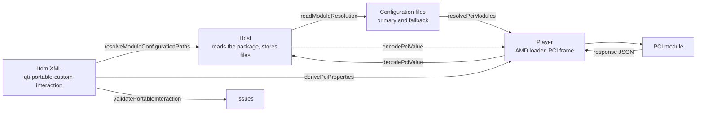

# Portable custom interactions

`pci` holds what a delivery engine and a player need of a portable custom interaction (PCI) besides the interaction's own
code: the JSON in which variables travel to and from the module, the files that say where its modules are, the properties it
receives, and checks of the interaction. It imports `values` and `asi` and runs in any JavaScript runtime.



| Function                                                  | Does                                                                                                |
| --------------------------------------------------------- | --------------------------------------------------------------------------------------------------- |
| `encodePciValue(value, declaration, files)`               | Writes a value as the JSON of a PCI; the bytes of a file value come from `files.load`               |
| `decodePciValue(json, declaration, files)`                | Reads the JSON a module gives as a value; the bytes of a file go to `files.store`                   |
| `readModuleResolution(text)`                              | Reads a module resolution configuration file as a `ModuleResolution`                                |
| `resolveModuleConfigurationPaths(interaction)`            | Gives the package paths of the two configuration files of an interaction, with their defaults       |
| `resolvePciModules(interaction, configuration)`           | Lists the modules of an interaction and where each is, as `PciModule`s                              |
| `isPackageRelative(location)`                             | Tells whether a module location is a path in the package                                            |
| `derivePciProperties(interaction)`                        | Gives the `data-*` attributes as the properties a module receives                                   |
| `validatePortableInteraction(interaction, configuration)` | Returns `Issue`s for modules that no configuration locates and for a type identifier that is no URN |

The types are `PciFileLoader`, `PciFileStore`, `ModuleResolution`, `ModuleConfigurationPaths`, `PciModule` and
`PciModuleConfiguration`.

## Quick start

Write a value as the JSON that a module receives, and read the JSON that it gives back:

```ts
import { decodePciValue, encodePciValue } from "@assesskit/runtime/pci";
import { buildContainer } from "@assesskit/runtime/values";

const numbers = buildContainer("multiple", "integer", [3, 4]);
encodePciValue(numbers, { cardinality: "multiple", baseType: "integer" }, { load: () => "" }); // => { list: { integer: [3, 4] } }
decodePciValue(
  { base: { file: { data: "cGxlYXN1cmUu", mime: "text/plain", name: "helloworld.txt" } } },
  { cardinality: "single", baseType: "file" },
  { store: () => "file-1" },
);
// => { cardinality: "single", baseType: "file", value: { reference: "file-1", mimeType: "text/plain", fileName: "helloworld.txt" } }
```

## The JSON of variables

`encodePciValue` and `decodePciValue` read and write the plain binding of the best practices guide: `{ "base": ... }` for a
single value, `{ "list": ... }` for `multiple` and `ordered`, `{ "record": ... }` for a record, and `null` inside each for NULL. A
PCI receives its template variables, its context variables and its response in this form, and gives its response back in it.
The binding has these forms:

| Case                       | Form                                                                                                            |
| -------------------------- | --------------------------------------------------------------------------------------------------------------- |
| File                       | `{ "data": <base64>, "mime", "name"? }`; a file value holds a reference, so the host's callbacks move the bytes |
| Duration                   | `PT<seconds>S`; one with years or months is a `DataError`                                                       |
| `intOrIdentifier`          | The declared base type; in a record an integer for a number and an identifier for a string                      |
| NULL field of a record     | Left out of the record                                                                                          |
| `NaN`, `INF`, `-INF`, `-0` | The string with that spelling                                                                                   |

`files.load(reference)` returns the bytes as base64 for each file that `encodePciValue` writes, and
`files.store(data, mimeType, fileName?)` returns the reference of each file that `decodePciValue` reads. Both callbacks are
synchronous: a host with asynchronous storage fetches the bytes before it encodes and uploads them after it decodes. Neither is
called for a value without a file. A message from a module is untrusted until it has gone through `decodePciValue`.

## Modules

A module resolution file is JSON with `waitSeconds` and `paths`. `readModuleResolution` reads it and ignores other properties,
but refuses one named `__proto__`, `prototype` or `constructor`; in `paths`, such a name is a module id like any other. A
path has no `.js` extension; a path with a protocol is fetched from there, and any other is a path from the root of the package,
whichever folder holds the item. The same holds for the configuration files and for `primary-path`.

`resolvePciModules` lists the modules in this order: the module of the `module` attribute, the `qti-interaction-module`s in
document order, then the modules that only the configuration files name, which are the dependencies of the PCI's modules. Each
module id appears once. The locations of a module come from these sources:

| Source                                          | Primary location                     | Fallback location                     |
| ----------------------------------------------- | ------------------------------------ | ------------------------------------- |
| `primary-path` or `fallback-path` of the module | Wins                                 | Wins                                  |
| The configuration files                         | `paths` of the primary configuration | `paths` of the fallback configuration |

`packageRelative` tells whether the first location to load, the primary one or else the fallback, is a path in the package. The
host requires the module of the `module` attribute or, when there is none, those of `qti-interaction-modules`, and gives the
others to its loader as paths, with `waitSeconds` of the primary configuration as the timeout. The host also decides which
package paths it may serve.

```ts
import { readAsi } from "@assesskit/runtime/asi";
import {
  isPackageRelative,
  resolveModuleConfigurationPaths,
  readModuleResolution,
  resolvePciModules,
} from "@assesskit/runtime/pci";

const primary = readModuleResolution(
  '{"waitSeconds": 15, "paths": {"likert": "modules/likert", "handlebars": "https://cdn.example/handlebars"}}',
);
primary.waitSeconds; // => 15
isPackageRelative("modules/likert"); // => true
isPackageRelative("https://cdn.example/handlebars"); // => false
const document = readAsi(`<qti-assessment-item xmlns="http://www.imsglobal.org/xsd/imsqtiasi_v3p0"
    identifier="pci" title="Likert" time-dependent="false">
  <qti-item-body>
    <qti-portable-custom-interaction response-identifier="RESPONSE" module="likert"
        custom-interaction-type-identifier="urn:fdc:example.com:2024:pci:likert">
      <qti-interaction-markup/>
    </qti-portable-custom-interaction>
  </qti-item-body>
</qti-assessment-item>`);
const interaction = document.item.body.children[0];
resolveModuleConfigurationPaths(interaction); // => { primary: "modules/module_resolution.js", fallback: "modules/fallback_module_resolution.js" }
resolvePciModules(interaction, { primary });
// => [{ id: "likert", primary: "modules/likert", packageRelative: true }, { id: "handlebars", primary: "https://cdn.example/handlebars", packageRelative: false }]
```

## Properties

`derivePciProperties` gives the custom `data-*` attributes of the interaction, named as `element.dataset` names them: the prefix goes,
and a hyphen followed by a lowercase letter becomes that letter in capitals. `data-catalog-idref` and `data-qti-suppress-tts` are
QTI's own and are not properties.

| Attribute                  | Property            |
| -------------------------- | ------------------- |
| `data-max-choices-message` | `maxChoicesMessage` |
| `data-label-min`           | `labelMin`          |
| `data-selected_color`      | `selected_color`    |

## Checks

`validatePortableInteraction` returns `Issue`s:

| Rule                                  | Severity | Reported when                                                                                     |
| ------------------------------------- | -------- | ------------------------------------------------------------------------------------------------- |
| `assesskit/pci/no-module`             | error    | the interaction has neither a `module` attribute nor `qti-interaction-modules`                    |
| `assesskit/pci/module-not-configured` | error    | the `module` or a `qti-interaction-module` has no location in the configurations or its own paths |
| `assesskit/pci/type-identifier`       | warning  | `custom-interaction-type-identifier` is not a Federated Content URN (`urn:fdc:`)                  |

## Defaults

| Name                      | Default                                 | Meaning                                                                           |
| ------------------------- | --------------------------------------- | --------------------------------------------------------------------------------- |
| `waitSeconds`             | 7 (`DEFAULT_WAIT_SECONDS`), seconds     | The timeout for a script when a configuration file gives none; 0 means no timeout |
| `primary-configuration`   | `modules/module_resolution.js`          | The primary configuration file when `qti-interaction-modules` names none          |
| `secondary-configuration` | `modules/fallback_module_resolution.js` | The fallback configuration file when `qti-interaction-modules` names none         |

## Errors

| Situation                                                                       | Result                                                 |
| ------------------------------------------------------------------------------- | ------------------------------------------------------ |
| An argument of the wrong type, such as `null` for the callbacks                 | `DataError` that names the argument and what was found |
| JSON that is not the JSON of a value of the declaration                         | `DataError` that names the path of the first problem   |
| A file that is not `{ data, mime, name }` with strings                          | `DataError`                                            |
| A callback that returns anything but a string                                   | `DataError`                                            |
| A module resolution file that is not JSON or has a bad `waitSeconds` or `paths` | `DataError`                                            |
| A module resolution file longer than 65,536 characters, before it is parsed     | `SecurityError`, `limit` `"maxModuleResolutionLength"` |

## Not included

| Not included                                                                   | Why                                                                       |
| ------------------------------------------------------------------------------ | ------------------------------------------------------------------------- |
| Loading and running the module: the AMD loader, timeouts, fallback and sandbox | They need a browser, so they belong to the player's PCI frame             |
| Asynchronous file callbacks                                                    | The engine is synchronous; the host moves the bytes around the call       |
| The text of the Portable Custom Interactions 1.0 specification                 | It is not retrievable; the best practices guide restates its requirements |

## Differences from the references

| Case                                                                                                                                                                | Resolution                                                                                                                                  |
| ------------------------------------------------------------------------------------------------------------------------------------------------------------------- | ------------------------------------------------------------------------------------------------------------------------------------------- |
| The JSON binding of the best practices guide: a duration with years or months, a record field of `"base": null`, `intOrIdentifier` and the lexical form of a `file` | As [the forms above](#the-json-of-variables) say, each for the reason in [values](values.md#json) ([G10, G14, G37, G38, G39](spec-gaps.md)) |

## Files

| File                                           | Concept                                               |
| ---------------------------------------------- | ----------------------------------------------------- |
| `pci-json.ts`, `convert-files.ts`              | The JSON of a PCI, and the walk over the files in it  |
| `encode.ts`, `decode.ts`, `file-callbacks.ts`  | Writing and reading a value, and the host's callbacks |
| `module-resolution.ts`, `package-relative.ts`  | A configuration file, and a location in the package   |
| `configuration-paths.ts`, `resolve-modules.ts` | The files an interaction names, and its modules       |
| `properties.ts`, `check.ts`                    | The properties of a module, and the checks of a PCI   |

## References

| Topic                                  | Specification                                                                                    |
| -------------------------------------- | ------------------------------------------------------------------------------------------------ |
| JSON binding, modules, properties      | [QTI 3.0 Best Practices and Implementation Guide](https://www.imsglobal.org/spec/qti/v3p0/impl/) |
| Federated Content URNs                 | [RFC 4198](https://www.rfc-editor.org/rfc/rfc4198)                                               |
| Places where the specifications differ | [Spec gaps](spec-gaps.md)                                                                        |
