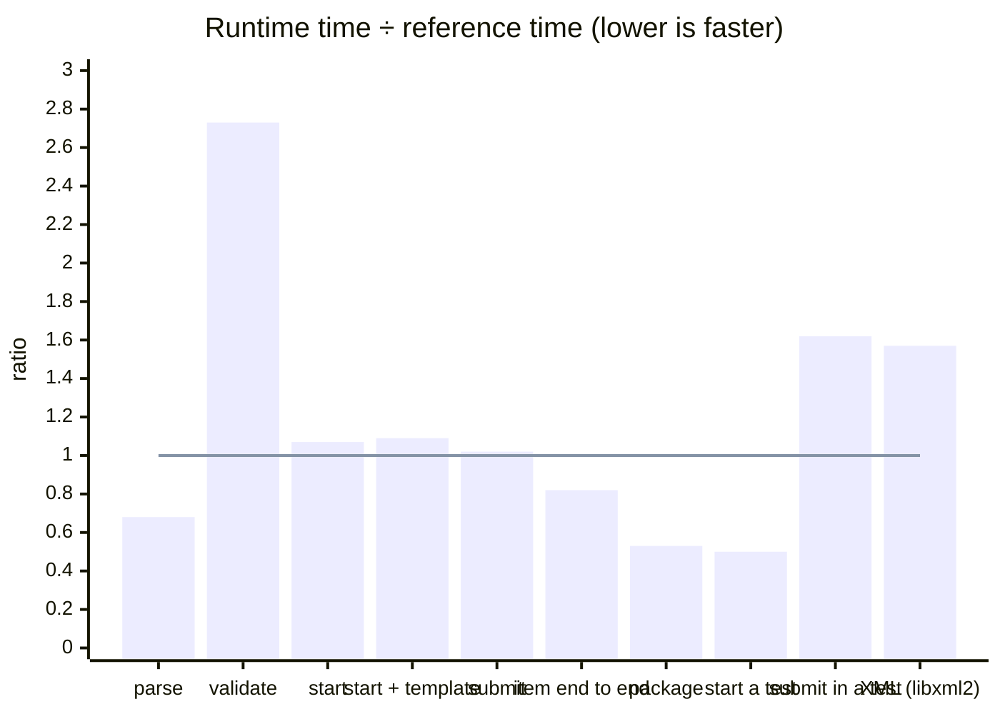
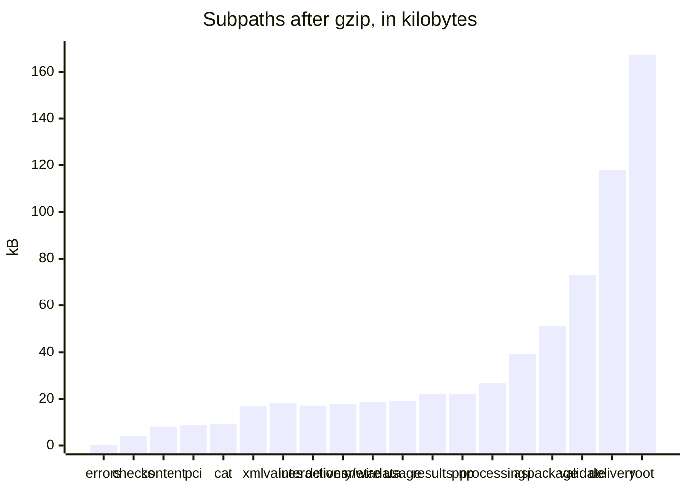

# Performance

The runtime is timed against Longsight `qti3-core` and libxml2 on the work each does with it, and against budgets on the
work only it does; the player is timed against the Amp-up player in [size](../player/size.md#mount-time). The target is
parity: a ratio of 1 on every row. A budget fails the `bench` job of CI when the runtime slows down. The ratio budgets sit
above parity by the headroom of a shared host, and above the measured ratio where the runtime does work that the reference
does not, which the list under the table names.

## Against the references

Time of the runtime divided by time of the reference, on the same input. Below the line at 1 the runtime is faster.

| Row              | The runtime                                                                                          | The reference                                                                         | Runtime  | Reference | Ratio | Budget (time, ratio) |
| ---------------- | ---------------------------------------------------------------------------------------------------- | ------------------------------------------------------------------------------------- | -------- | --------- | ----- | -------------------- |
| parse            | `readAsi` on the 215 example items that both read                                                    | Longsight: `parseQtiXml` on the same items                                            | 13.63 ms | 20.05 ms  | 0.68  | 500 ms, 1.5          |
| validate         | `validateAsi` of each                                                                                | Longsight: `validateAssessmentItem` of each                                           | 5.06 ms  | 1.85 ms   | 2.73  | 60 ms, 4.5           |
| start            | `startItemSession` and `presentItem` for each: variables, template processing, first attempt         | Longsight: `createItemSession` for each                                               | 0.374 ms | 0.351 ms  | 1.07  | 7 ms, 2              |
| start + template | the same for the 8 items with template processing, 20 times each                                     | Longsight: the same                                                                   | 1.833 ms | 1.685 ms  | 1.09  | 40 ms, 2             |
| submit           | `set-responses` and `submit` of the correct responses in presented sessions                          | Longsight: `respond` for each response, then `score`                                  | 0.615 ms | 0.605 ms  | 1.02  | 20 ms, 2             |
| item end to end  | `readAsi`, start, present, set the responses and submit                                              | Longsight: `parseQtiXml`, `createItemSession`, `respond`, `score`                     | 16.18 ms | 19.84 ms  | 0.82  | 400 ms, 1.5          |
| package          | `readPackage` of 200 generated items, then each item through `createPackageResolvers`                | Longsight: `parseQtiPackage`, with the inflation of fflate that the runtime uses      | 75.2 ms  | 141.4 ms  | 0.53  | 800 ms, 1            |
| start a test     | `start` of a test of 10 sections of 10 choice items, 100 times                                       | Longsight: `startQtiTest` and `createItemSession` of its first item, 100 times        | 0.206 ms | 0.412 ms  | 0.50  | 3 ms, 1              |
| submit in a test | `apply` of `submit` for the 51st of 100 items, 100 times: response processing, the sum of the scores | Longsight: `score` of the item, then `submitQtiTestAnswer` with the 50 earlier scores | 1.10 ms  | 0.680 ms  | 1.62  | 20 ms, 3             |
| XML (libxml2)    | `parseXml` of the bytes of the 325 XML files of the examples that both read                          | libxml2-wasm: `XmlDocument.fromBuffer` with the options of `validateXmlFiles`         | 14.94 ms | 9.53 ms   | 1.57  | 200 ms, 2.5          |

The times are those of a laptop with an Apple M5 and Node.js 26.8, where both sides of a row run in one process. The inputs
are the 1EdTech examples that both implementations read and score (`pnpm corpus`), with the correct responses the oracle
reports, a test of 10 sections of 10 choice items with the sum of the scores as its outcome, and a package of generated items.
A sample is the whole row: every item of it, once; the rows of a test start or submit 100 times, so that a sample lasts
milliseconds. Both sides run warm, after a warm-up, on a runtime built as it ships; each side prepares its sessions outside
the time. The two sides take turns in five rounds of a fifth of the window each, so that a stretch of a busy host falls on
both and not on whichever ran then; the fastest sample of each side is the fastest of its rounds. The ratio compares those
fastest samples, and a gate compares the runtime with both its time and its ratio. `pnpm bench` runs the rows.

A ratio budget is the measured ratio with headroom for the noise of a shared host, so that a slowdown of the runtime by half
again fails the gate. What each side does besides the work in the table, where the runtime is above parity or its budget
allows for more:

- **Reading (parse, item end to end; budget 1.5).** The runtime reads every attribute value against the type of the ASI
  schema, refuses a DOCTYPE and enforces limits on size, depth and nodes. Longsight collects diagnostics and validates in a
  separate call that the row does not make.
- **Validating (validate; budget 4.5).** The runtime walks every element against the element table of the schema and runs
  the rule sets of BIND section 5, the static types of response and template processing, the formats of identifiers and ids,
  the references of attributes and content, unreachable content and scoring rubrics. Longsight checks the declarations, the
  interactions and the references of processing on the model that its parser made. The walk alone is about a sixth of the
  runtime's time; the rest is the checks.
- **Submitting a response (submit; budget 2).** The runtime checks each response against its declaration and the rules of
  its interaction. Longsight stores a copy of the value it is given.
- **Reading a package (package).** Longsight parses every item as it reads the package; the runtime reads the manifest and
  parses an item at its first use, so the row asks for every item.
- **Starting a test (start a test).** A test whose sections neither select nor shuffle has one plan for every session, which
  the engine makes at the first start and shares, with the indexes of the plan that the steps make. The engine starts the
  session of the first item with the test, and the row has Longsight start that item too.
- **A test (submit in a test; budget 3).** Longsight takes the score of an item as a number and adds the 50 scores that it
  holds. The runtime evaluates the outcome processing of the test over the 100 instances of the plan, those not yet presented
  included (`qti-test-variables` reads the variables of each), which is about half of the step. The rest of the step scores
  the item, settles the time limits and the scoring requests and returns the state, in less time than all of Longsight's
  step. The row compares one `apply` with the score of an item and `submitQtiTestAnswer`, which is the smallest operation of
  each that submits an item of a test.
- **Parsing XML (XML; budget 2.5).** libxml2 is C compiled to WebAssembly and builds its tree in its own memory. The runtime
  reads with saxes, a parser in JavaScript, which takes about half of the time of `parseXml` on these documents, and builds a
  tree of JavaScript objects whose names, namespaces and limits it checks as it goes; the readers of the runtime take that tree.

The times of the budget column are five times the fastest sample that the CI runner took in the last four green runs of `bench`
on main, rounded up to one significant digit: 11.2 ms for validate, 146 ms for package, 0.42 ms for start a test and 28.1 ms
for XML. The ratios stay between 2.6 and 3.0 for validate, 0.50 and 0.53 for package, 0.55 and 0.61 for start a test and 1.8
and 1.9 for XML.

## Budgets

`pnpm bench` runs the benchmarks of `packages/runtime/test/*.bench.ts` with Vitest, on inputs that the arbitraries and builders
of the tests generate with a fixed seed. A benchmark fails when its fastest sample is above its budget. The budgets are in
`packages/runtime/test/budgets.ts`.

| Benchmark                               | Input                                                                                                                       | Fastest on the CI runner | Budget        |
| --------------------------------------- | --------------------------------------------------------------------------------------------------------------------------- | ------------------------ | ------------- |
| `readPackage`                           | 1,000 generated items of 7.6 MB, an archive of 2.7 MB, and the manifest with generated metadata for each resource           | 92.2 ms                  | 500 ms        |
| First use of 3 items                    | The resolvers of `createPackageResolvers` on a package that has parsed none                                                 | 2.97 ms                  | 20 ms         |
| `start` of a test of 100 sections       | 100 sections of 10 items, each selecting 8 and shuffling: 800 instances                                                     | 1.16 ms                  | 6 ms          |
| `submit` with outcome processing        | The same test halfway through its session, with 101 rules that read item sessions                                           | 18.4 ms                  | 100 ms        |
| Replay of 1,000 actions                 | `deserializeState` of a stored state, then `apply` of 250 items times 4 actions on a test of 10 sections and 11 rules       | 264 ms                   | 2,000 ms      |
| `serializeState` and `deserializeState` | The state of a session of 100 items, all answered                                                                           | 4.81 ms                  | 30 ms         |
| Rescoring a report                      | `readTestInputs` and `runOutcomeProcessing` on the report of 200 items, all answered, with 21 rules that read item sessions | 1.40 ms                  | 7 ms          |
| Size of that state                      | The same state as JSON text                                                                                                 | 118,699 bytes            | 150,000 bytes |

The replay also checks that the replayed state equals the state of the session. The peak memory of the readers is a test, not a
benchmark: [SECURITY.md](../../SECURITY.md#default-limits) lists it.

A benchmark takes at least 10 samples, and the gate is the fastest of them, which the other work of a shared machine affects
least. The rule of the budgets is the one of measurekit and of the rest of the family: **a time is five times the fastest
sample, rounded up to one significant digit, and a size is 1.25 times the size.** The sample is the one that the CI runner
took, because the gate runs there. The runner took 3 to 6 times as long as a laptop with an Apple M5 and Node.js 26.8 (`parse`
85 ms against 14 ms), so a change must make a path several times slower than it is on the runner before it fails a time. The
factor allows for the noise of a shared host and for a runner that is slower on another day. It is far below the cost of the
changes that the budgets exist to catch: a reader that parsed every item would take about ten times as long. A budget changes
only with the reason in the commit that changes it.

Which budgets hold on a machine other than the runner:

| Budget                        | What it compares                                           | Holds                                                                                       |
| ----------------------------- | ---------------------------------------------------------- | ------------------------------------------------------------------------------------------- |
| The ratio against a reference | Two samples of one run, which a slow machine slows equally | On any machine, within the noise of a shared one                                            |
| The size of a state           | Bytes                                                      | On any machine                                                                              |
| A time                        | One sample against a fixed number of milliseconds          | On a machine up to five times slower than the runner; on a slower one only the ratios apply |

Vitest counts the export getters that a benchmark reads, which makes the benchmarks of the engine two to three times slower,
so the project turns the counting off (`suppressExportGetterWarnings`). The benchmarks against budgets import the sources,
which run through Vite; the rows against Longsight and libxml2 time the build by name, the engine of the test rows
included, which `pnpm bench` makes first, because Vite's rewrite of the imports makes the sources about 1.7 times slower than
the code that ships, and the references load natively from `node_modules`.

## Outcome processing

Outcome processing runs after every submission in individual mode (INFO section 2.9). The expressions that read item sessions
(`qti-number-*`, `qti-outcome-minimum`, `qti-outcome-maximum` and `qti-test-variables`) visit every instance of the plan,
keep the ones that their `section-identifier`, `include-category` and `exclude-category` select, and read each one kept. The
cost of a submission is therefore the rules that read item sessions times the matching items, and no less than the size of the
plan for each such rule. The benchmark has 101 such rules over 800 instances, one for each of 100 sections and one for the
test. The session looks the items presented up in a map made once for the step, so the cost grows with the rules times the
instances of the plan.

## Rescoring

`readTestInputs` and `runOutcomeProcessing` on the stored report of a session of 200 items take 1.5 times the outcome step of the
engine on the same session (`apply` of the last submission), 1.40 ms against 0.96 ms on the CI runner: the budget is 2. No outside library rescores a stored report, so the
engine is the reference. Reading the report back builds the variables of each of the 200 results, which the engine keeps in its
state, and the outcome processing is the same work over the same plan.

## Entry points

What a host's bundler adds for each subpath of the runtime imported alone: esbuild with code splitting, minified, for the
browsers of the [player's baseline](../player/baseline.md) (Node.js 22 for `node` and `cli`). No subpath of the runtime loads
anything with `import()`, so each is one chunk.
`size.test.ts` of the player bundles every subpath that the `exports` of the manifest name, and fails when one is above its
budget after gzip or holds a module that its row below does not name, so that an import which pulls one module into another
shows in the change that makes it. The player's entry points are in [size](../player/size.md).

| Subpath         | Bytes     | Gzip    | Budget  | Holds besides its own code, `errors`, `checks` and valibot                                                                                                               |
| --------------- | --------- | ------- | ------- | ------------------------------------------------------------------------------------------------------------------------------------------------------------------------ |
| `.`             | 664,638   | 167,471 | 208,000 | Every module but `node` and `cli`; fflate, saxes, xmlchars                                                                                                               |
| `asi`           | 235,113   | 39,319  | 49,000  | `values`, `xml`; saxes, xmlchars                                                                                                                                         |
| `cat`           | 28,642    | 9,252   | 12,000  | `metadata`, `results`, `values`                                                                                                                                          |
| `checks`        | 13,522    | 4,006   | 5,500   | Nothing                                                                                                                                                                  |
| `content`       | 23,276    | 8,241   | 10,500  | `asi`, `values`                                                                                                                                                          |
| `delivery`      | 503,363   | 117,997 | 140,500 | `asi`, `cat`, `content`, `interactions`, `package`, `pnp`, `processing`, `random`, `validate`, `values`, `xml`; xmlchars                                                 |
| `delivery/wire` | 57,252    | 17,791  | 22,500  | `interactions`, `pnp`, `values`, `xml`; xmlchars                                                                                                                         |
| `errors`        | 477       | 225     | 500     | Nothing                                                                                                                                                                  |
| `interactions`  | 54,608    | 17,198  | 21,500  | `asi`, `random`, `values`                                                                                                                                                |
| `pci`           | 26,986    | 8,726   | 11,000  | `values`                                                                                                                                                                 |
| `pnp`           | 74,124    | 22,090  | 27,500  | `xml`; saxes, xmlchars                                                                                                                                                   |
| `results`       | 72,631    | 22,028  | 27,500  | `values`, `xml`; saxes, xmlchars                                                                                                                                         |
| `usage`         | 62,966    | 19,218  | 24,000  | `values`, `xml`; saxes, xmlchars                                                                                                                                         |
| `validate`      | 355,320   | 72,905  | 91,000  | `asi`, `interactions`, `metadata`, `package`, `pci`, `pnp`, `processing`, `results`, `values`, `xml`; saxes, xmlchars                                                    |
| `metadata`      | 62,685    | 18,789  | 23,500  | `asi`, `xml`; saxes, xmlchars                                                                                                                                            |
| `package`       | 265,369   | 51,160  | 64,000  | `asi`, `metadata`, `values`, `xml`; fflate, saxes, xmlchars                                                                                                              |
| `processing`    | 87,333    | 26,601  | 33,500  | `asi`, `random`, `values`                                                                                                                                                |
| `values`        | 57,813    | 18,412  | 23,500  | Nothing                                                                                                                                                                  |
| `xml`           | 56,307    | 16,871  | 21,000  | saxes, xmlchars                                                                                                                                                          |
| `node`          | 1,615,533 | 500,784 | 626,000 | `asi`, `metadata`, `package`, `validate`, `values`, `xml`; fflate, libxml2-wasm, saxes, xmlchars                                                                         |
| `cli`           | 1,773,113 | 546,076 | 682,500 | `asi`, `interactions`, `metadata`, `node`, `package`, `pci`, `pnp`, `processing`, `results`, `usage`, `validate`, `values`, `xml`; fflate, libxml2-wasm, saxes, xmlchars |

`errors` holds nothing else, and `checks` holds only `errors` and valibot. A module that reads XML holds the parser (`xml`,
saxes and xmlchars). A module that walks the model of a document (`asi`, `package`, `validate`, `delivery`) holds the element
table of `asi`, which is most of its 234 kB; `content`, `interactions` and `processing` hold a few hundred bytes of `asi`, its
guards and constants. `delivery/wire` is the wire forms of `delivery` alone (`writeView`, `readView`, `writeCandidateAction`,
`readCandidateAction`), which `delivery` re-exports: no file of the engine is reachable from it, so a client that imports it
and also loads the engine with `import()` keeps the engine out of its first load
([size](../player/size.md#the-first-load-of-a-client)). The engine of `delivery` holds the static gate of the content
(`validate`) and processing, and builds
the test of an item delivered alone and the item of a link to a tool as models, so that it holds no XML parser. libxml2-wasm
holds libxml2 compiled to WebAssembly, 963 kB of `node` and `cli`.
