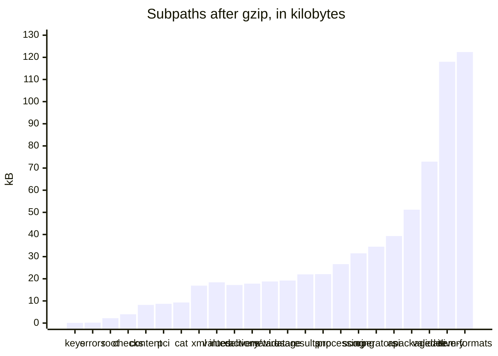

# Performance of the runtime

Benchmarks guard the speed of the runtime, and the docs publish no measured time: a time differs on every machine and goes
stale with each change. `pnpm bench` runs the benchmarks of `packages/runtime/test/*.bench.ts`, the `bench` job of CI fails
when one is above its budget in `packages/runtime/test/budgets.ts`, and a user measures their own machine by running
`pnpm bench`. The runtime is timed against Longsight `qti3-core` and libxml2 on the work each does with it, and against
budgets on the work only it does; the player is timed against the Amp-up player in [size](../player/size.md#mount-time). The
target is parity or better on every row. The ratio budgets sit above parity by the headroom of a shared host, and above the
measured ratio where the runtime does work that the reference does not, which the list under the table names.

## Against the references

Each row is a benchmark in which the runtime and the reference run on the same input, and the gate compares their times.

| Row              | The runtime                                                                                                                   | The reference                                                                         |
| ---------------- | ----------------------------------------------------------------------------------------------------------------------------- | ------------------------------------------------------------------------------------- |
| parse            | `readAsi` on the 215 example items that both read                                                                             | Longsight: `parseQtiXml` on the same items                                            |
| validate         | `validateAsi` of each                                                                                                         | Longsight: `validateAssessmentItem` of each                                           |
| start            | `startItemSession` and `presentItem`, the steps that the engine runs, for each: variables, template processing, first attempt | Longsight: `createItemSession` for each                                               |
| start + template | the same for the 8 items with template processing, 20 times each                                                              | Longsight: the same                                                                   |
| submit           | `set-responses` and `submit` of the correct responses in presented sessions                                                   | Longsight: `respond` for each response, then `score`                                  |
| item end to end  | `readAsi`, start, present, set the responses and submit                                                                       | Longsight: `parseQtiXml`, `createItemSession`, `respond`, `score`                     |
| package          | `readPackage` of 200 generated items, then each item through `createPackageResolvers`                                         | Longsight: `parseQtiPackage`, with the inflation of fflate that the runtime uses      |
| start a test     | `start` of a test of 10 sections of 10 choice items, 100 times                                                                | Longsight: `startQtiTest` and `createItemSession` of its first item, 100 times        |
| submit in a test | `apply` of `submit` for the 51st of 100 items, 100 times: response processing, the sum of the scores                          | Longsight: `score` of the item, then `submitQtiTestAnswer` with the 50 earlier scores |
| XML (libxml2)    | `parseXml` of the bytes of the 325 XML files of the examples that both read                                                   | libxml2-wasm: `XmlDocument.fromBuffer` with the options of `validateXmlFiles`         |

The inputs are the 1EdTech examples that both implementations read and score (`pnpm corpus`), with the correct responses the
oracle reports, a test of 10 sections of 10 choice items with the sum of the scores as its outcome, and a package of
generated items. A sample is the whole row: every item of it, once; the rows of a test start or submit 100 times, so that a
sample is long enough to time. Both sides run warm, after a warm-up, in one process, on a runtime built as it ships; each
side prepares its sessions outside the time. The two sides take turns in five rounds of a fifth of the window each, so that a
stretch of a busy host falls on both and not on whichever ran then; the fastest sample of each side is the fastest of its
rounds. The ratio compares those fastest samples, and a gate compares the runtime with both its time and its ratio.

A ratio budget ([Budgets](#budgets)) fails a path that becomes about twice as slow against its reference, and not the noise of
a shared host. What each side does besides the work in the table, where the runtime is above parity or its budget allows for
more:

- **Reading (parse, item end to end).** The runtime reads every attribute value against the type of the ASI schema, refuses
  a DOCTYPE and enforces limits on size, depth and nodes. Longsight collects diagnostics and validates in a separate call
  that the row does not make.
- **Validating (validate).** The runtime walks every element against the element table of the schema and runs the rule
  sets of BIND section 5, the static types of response and template processing, the formats of identifiers and ids, the
  references of attributes and content, unreachable content and scoring rubrics. Longsight checks the declarations, the
  interactions and the references of processing on the model that its parser made.
- **Submitting a response (submit).** The runtime checks each response against its declaration and the rules of its
  interaction. Longsight stores a copy of the value it is given.
- **Reading a package (package).** Longsight parses every item as it reads the package; the runtime reads the manifest and
  parses an item at its first use, so the row asks for every item.
- **Starting a test (start a test).** A test whose sections neither select nor shuffle has one plan for every session, which
  the engine makes at the first start and shares, with the indexes of the plan that the steps make. The engine starts the
  session of the first item with the test, and the row has Longsight start that item too.
- **A test (submit in a test).** Longsight takes the score of an item as a number and adds the 50 scores that it holds. The
  runtime evaluates the outcome processing of the test over the 100 instances of the plan, those not yet presented included
  (`qti-test-variables` reads the variables of each). The rest of the step scores the item, settles the time limits and the
  scoring requests and returns the state. The row compares one `apply` with the score of an item and `submitQtiTestAnswer`,
  which is the smallest operation of each that submits an item of a test.
- **Parsing XML (XML).** libxml2 is C compiled to WebAssembly and builds its tree in its own memory. The runtime reads with
  saxes, a parser in JavaScript, and builds a tree of JavaScript objects whose names, namespaces and limits it checks as it
  goes; the readers of the runtime take that tree.

## Budgets

`pnpm bench` runs the benchmarks of `packages/runtime/test/*.bench.ts` with Vitest, on inputs that the arbitraries and builders
of the tests generate with a fixed seed. A benchmark fails when its fastest sample is above its budget. The budgets are in
`packages/runtime/test/budgets.ts`.

| Benchmark                               | Input                                                                                                                       |
| --------------------------------------- | --------------------------------------------------------------------------------------------------------------------------- |
| `readPackage`                           | 1,000 generated items of 7.6 MB, an archive of 2.7 MB, and the manifest with generated metadata for each resource           |
| First use of 3 items                    | The resolvers of `createPackageResolvers` on a package that has parsed none                                                 |
| `start` of a test of 100 sections       | 100 sections of 10 items, each selecting 8 and shuffling: 800 instances                                                     |
| `submit` with outcome processing        | The same test halfway through its session, with 101 rules that read item sessions                                           |
| Replay of 1,000 actions                 | `deserializeState` of a stored state, then `apply` of 250 items times 4 actions on a test of 10 sections and 11 rules       |
| `serializeState` and `deserializeState` | The state of a session of 100 items, all answered                                                                           |
| Rescoring a report                      | `readTestInputs` and `runOutcomeProcessing` on the report of 200 items, all answered, with 21 rules that read item sessions |
| `expression-equivalent`                 | A key and a response that are equal, `\frac{x^2-1}{x-1}` and `x+1`, the options read on the call                            |
| The longest expressions                 | A key and a response of 2,000 characters, sums of 1,000 terms                                                               |
| `number-equivalent`                     | `1 1/4 km` against a key with units, fractions, a tolerance and a credit tier                                               |
| `text-equivalent`                       | A response of 200 words against 50 answers with a credit tier by edit distance                                              |
| `compareMathSteps`                      | 60 lines of equations                                                                                                       |
| `compileScoring` of an item             | A choice, pairs, an order and a text                                                                                        |
| `compileScoring` at the limits          | 256 orders of 1,000 choices scored per position, a condition for each choice                                                |
| `readGift`                              | The edge cases of GIFT that Moodle read: 18 items and two questions that Moodle refuses                                     |
| `writeGift`                             | The 14 items that Moodle read, each response processing run on the responses that tell its credits apart                    |
| `readGift` at the limits                | 47 essays of 4,096 tags of HTML each, to the limit of elements                                                              |
| `readMoodleXml`                         | The edge cases of Moodle XML that Moodle read: 9 items and a cloze question that does not convert                           |
| `writeMoodleXml`                        | The 14 items that Moodle read, with an image embedded                                                                       |

The replay also checks that the replayed state equals the state of the session, and one more benchmark holds the size of
that state: the state of the session of 100 items, all answered, is 118,699 bytes as JSON text, against a budget of 150,000
bytes. The peak memory of the readers is a test, not a benchmark: [SECURITY.md](../../SECURITY.md#default-limits) lists it.

A benchmark takes at least 10 samples, and the gate is the fastest of them, which the other work of a shared machine affects
least. The rule of the budgets is the one of measurekit and of the rest of the family: **a time is five times the fastest
sample, rounded up to one significant digit, a size is 1.25 times the size, and a ratio to a reference is twice the highest
ratio measured, rounded up to one significant digit.** The sample is the one that the CI runner took, because the gate runs
there, over at least five runs. The runner is slower than a developer's laptop and one run of it is slower than another, so a
change must make a path several times slower than it is on the runner before it fails a time. The factor allows for the noise
of a shared host and for a runner that is slower on another day. It is far below the cost of the changes that the budgets
exist to catch: a reader that parsed every item would take about ten times as long. A budget changes only with the reason in
the commit that changes it.

Which budgets hold on a machine other than the runner:

| Budget                        | What it compares                                           | Holds                                                                                       |
| ----------------------------- | ---------------------------------------------------------- | ------------------------------------------------------------------------------------------- |
| The ratio against a reference | Two samples of one run, which a slow machine slows equally | On any machine, within the noise of a shared one                                            |
| The size of a state           | Bytes                                                      | On any machine                                                                              |
| A time                        | One sample against a fixed number of milliseconds          | On a machine up to five times slower than the runner; on a slower one only the ratios apply |

Vitest counts the export getters that a benchmark reads, which makes the benchmarks of the engine two to three times slower,
so the project turns the counting off (`suppressExportGetterWarnings`). Every benchmark times the build by name, which `pnpm bench`
makes first, because Vite's rewrite of the imports makes the sources up to about 1.7 times slower than the code that ships,
and the references load natively from `node_modules`.

## Outcome processing

Outcome processing runs after every submission in individual mode (INFO section 2.9). The expressions that read item sessions
(`qti-number-*`, `qti-outcome-minimum`, `qti-outcome-maximum` and `qti-test-variables`) visit every instance of the plan,
keep the ones that their `section-identifier`, `include-category` and `exclude-category` select, and read each one kept. The
cost of a submission is therefore the rules that read item sessions times the matching items, and no less than the size of the
plan for each such rule. The benchmark has 101 such rules over 800 instances, one for each of 100 sections and one for the
test. The session looks the items presented up in a map made once for the step, so the cost grows with the rules times the
instances of the plan.

## Rescoring

`readTestInputs` and `runOutcomeProcessing` on the stored report of a session of 200 items take a little more than the outcome
step of the engine on the same session (`apply` of the last submission), and a ratio budget holds them there. No outside
library rescores a stored report, so the engine is the reference. Reading the report back builds the variables of each of the
200 results, which the engine keeps in its state, and the outcome processing is the same work over the same plan.

## Entry points

What a host's bundler adds for each subpath of the runtime imported alone: esbuild with code splitting, minified, for the
browsers of the [player's baseline](../player/baseline.md) (Node.js 22 for `node` and `cli`). No subpath of the runtime loads
anything with `import()`, so each is one chunk.
`size.test.ts` of the player bundles every subpath that the `exports` of the manifest name, and fails when one is above its
budget after gzip or holds a module that its row below does not name, so that an import which pulls one module into another
shows in the change that makes it. The player's entry points are in [size](../player/size.md).

| Subpath         | Bytes     | Gzip    | Budget  | Holds besides its own code, `errors`, `checks` and valibot                                                                                                               |
| --------------- | --------- | ------- | ------- | ------------------------------------------------------------------------------------------------------------------------------------------------------------------------ |
| `.`             | 5,981     | 2,235   | 3,500   | Nothing                                                                                                                                                                  |
| `asi`           | 235,113   | 39,319  | 50,000  | `values`, `xml`; saxes, xmlchars                                                                                                                                         |
| `cat`           | 28,642    | 9,252   | 14,500  | `metadata`, `results`, `values`                                                                                                                                          |
| `checks`        | 13,522    | 4,006   | 6,000   | Nothing                                                                                                                                                                  |
| `content`       | 23,276    | 8,241   | 12,500  | `asi`, `values`                                                                                                                                                          |
| `delivery`      | 503,363   | 117,997 | 147,000 | `asi`, `cat`, `content`, `interactions`, `package`, `pnp`, `processing`, `random`, `validate`, `values`, `xml`; xmlchars                                                 |
| `delivery/wire` | 57,252    | 17,791  | 23,500  | `interactions`, `pnp`, `values`, `xml`; xmlchars                                                                                                                         |
| `errors`        | 477       | 225     | 500     | Nothing                                                                                                                                                                  |
| `interactions`  | 54,608    | 17,198  | 23,000  | `asi`, `random`, `values`                                                                                                                                                |
| `item-formats`  | 517,474   | 122,382 | 161,000 | `asi`, `content`, `processing`, `random`, `values`, `xml`; entities, parse5, saxes, xmlchars                                                                             |
| `keys`          | 99        | 117     | 500     | Nothing                                                                                                                                                                  |
| `pci`           | 26,986    | 8,726   | 12,000  | `values`                                                                                                                                                                 |
| `pnp`           | 74,124    | 22,090  | 30,500  | `xml`; saxes, xmlchars                                                                                                                                                   |
| `results`       | 72,631    | 22,028  | 30,000  | `values`, `xml`; saxes, xmlchars                                                                                                                                         |
| `usage`         | 62,966    | 19,218  | 27,000  | `values`, `xml`; saxes, xmlchars                                                                                                                                         |
| `validate`      | 355,320   | 72,905  | 93,000  | `asi`, `interactions`, `metadata`, `package`, `pci`, `pnp`, `processing`, `results`, `values`, `xml`; saxes, xmlchars                                                    |
| `metadata`      | 62,685    | 18,789  | 26,500  | `asi`, `xml`; saxes, xmlchars                                                                                                                                            |
| `operators`     | 108,641   | 34,474  | 43,500  | `asi`, `keys`, `processing`, `random`, `values`                                                                                                                          |
| `package`       | 265,369   | 51,160  | 69,000  | `asi`, `metadata`, `values`, `xml`; fflate, saxes, xmlchars                                                                                                              |
| `processing`    | 87,333    | 26,601  | 36,000  | `asi`, `random`, `values`                                                                                                                                                |
| `scoring`       | 99,579    | 31,517  | 39,500  | `asi`, `keys`, `operators`, `processing`, `random`, `values`                                                                                                             |
| `values`        | 57,813    | 18,412  | 24,000  | Nothing                                                                                                                                                                  |
| `xml`           | 56,307    | 16,871  | 22,000  | saxes, xmlchars                                                                                                                                                          |
| `node`          | 1,615,533 | 500,784 | 622,500 | `asi`, `metadata`, `package`, `validate`, `values`, `xml`; fflate, libxml2-wasm, saxes, xmlchars                                                                         |
| `cli`           | 1,773,113 | 546,076 | 686,500 | `asi`, `interactions`, `metadata`, `node`, `package`, `pci`, `pnp`, `processing`, `results`, `usage`, `validate`, `values`, `xml`; fflate, libxml2-wasm, saxes, xmlchars |

`operators` holds the regular expressions of `values` for the patterns of a text key, with their Unicode tables, and the hit
test of `processing`; its own code is the reader of the LaTeX subset, its arithmetic and comparator, exact rationals, the
grapheme table of Unicode 17.0.0 and the schemas of the keys. `scoring` holds of `operators` what writes and checks a call, not
the operators that score; `keys` is the frozen limits of a key, its types leaving no code. `errors` holds nothing else, and `checks` holds only `errors` and valibot. A module that reads XML holds the parser (`xml`,
saxes and xmlchars). A module that walks the model of a document (`asi`, `package`, `validate`, `delivery`) holds the element
table of `asi`, which is most of its 234 kB; `content`, `interactions` and `processing` hold a few hundred bytes of `asi`, its
guards and constants. `delivery/wire` is the wire forms of the candidate side (`writeView`, `readView`, `writeCandidateAction`,
`readCandidateAction`), which `delivery` does not export: no file of the engine is reachable from it, so a client that imports it
and also loads the engine with `import()` keeps the engine out of its first load
([size](../player/size.md#the-first-load-of-a-client)). The engine of `delivery` holds the static gate of the content
(`validate`) and processing, and builds
the test of an item delivered alone and the item of a link to a tool as models, so that it holds no XML parser. libxml2-wasm
holds libxml2 compiled to WebAssembly, 963 kB of `node` and `cli`.
