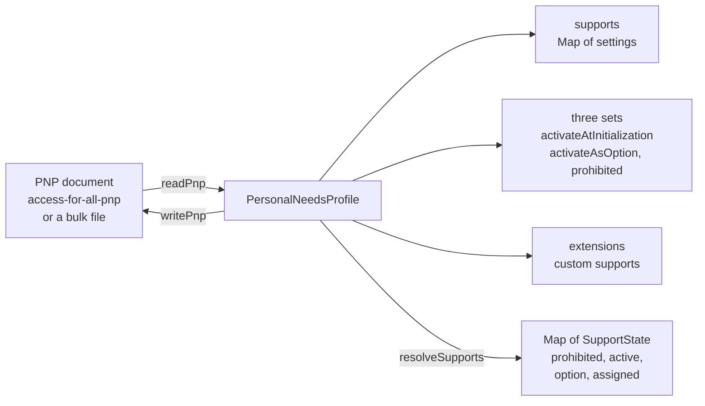

# Personal needs and preferences

`pnp` reads and writes the Personal Needs and Preferences (PNP) profile of a candidate in the QTI profile of PNP 3.0: the
supports a candidate needs, such as extra time, reading aloud or magnification. It also resolves what a profile asks for.
It imports `xml` only and runs in any JavaScript runtime. Deciding which candidate gets which support belongs to the
system that registers candidates; the runtime reads the decision.



| Export                                                                                                                                                                                                                                                                                                    | Purpose                                                                                                           |
| --------------------------------------------------------------------------------------------------------------------------------------------------------------------------------------------------------------------------------------------------------------------------------------------------------- | ----------------------------------------------------------------------------------------------------------------- |
| `readPnp(input)`                                                                                                                                                                                                                                                                                          | Reads text, bytes or a parsed element into a `PersonalNeedsProfile`, or a bulk file into `PnpRecord[]`.           |
| `writePnp(profileOrRecords)`                                                                                                                                                                                                                                                                              | Writes a profile, or a bulk file of records, as a document that the PNP schema accepts.                           |
| `resolveSupports(profile)`                                                                                                                                                                                                                                                                                | Returns the `SupportState` of each support the profile mentions.                                                  |
| `SUPPORT_NAMES`, `isSupportName`, `isSetSupportName`, `deriveExtensionName`, `isColorTheme`                                                                                                                                                                                                               | The 40 predefined supports, the names of supports, and the check of a color theme.                                |
| `PNP_NAMESPACE`, `PNP_ALTERNATE_NAMESPACES`                                                                                                                                                                                                                                                               | The schema's namespace and the two others that are read.                                                          |
| `PersonalNeedsProfile`, `PnpRecord`, `PersonSourcedId`, `SupportState`                                                                                                                                                                                                                                    | The model.                                                                                                        |
| `SupportSetting` and its members, `SupportName`, `PredefinedSupportName`, `SetSupportName`                                                                                                                                                                                                                | The supports and their settings.                                                                                  |
| `REPLACING_SUPPORTS`, `LANGUAGE_SUPPORTS`, `TOOL_SUPPORTS`, `OTHER_SUPPORTS`                                                                                                                                                                                                                              | The names of the supports by shape.                                                                               |
| `PNP_ACCESS_MODES`, `PNP_HAZARDS`, `PNP_INPUT_REQUIREMENTS`, `PNP_READING_TYPES`, `PNP_RESTRICTION_TYPES`, `PNP_LINK_INDICATIONS`, `PNP_TYPING_ECHOES`, `PNP_BRAILLE_DELIVERY_MODES`, `PNP_BRAILLE_TYPES`, `PNP_BRAILLE_MATH_TYPES`, `PNP_GENERIC_FONT_FACES`, `PNP_CALCULATOR_TYPES`, `PNP_COLOR_THEMES` | The terms of the vocabularies; the type of the same meaning has no prefix, such as `HazardTerm` and `ColorTheme`. |

## Quick start

```ts
import { readPnp, resolveSupports, writePnp } from "@assesskit/runtime/pnp";

const profile = readPnp(`<access-for-all-pnp xmlns="http://www.imsglobal.org/xsd/qti/qtiv3p0/imsafa3p0pnp_v1p0">
  <spoken><reading-type>screen-reader</reading-type></spoken>
  <additional-testing-time><time-multiplier>1.5</time-multiplier></additional-testing-time>
  <activate-at-initialization-set><spoken/></activate-at-initialization-set>
  <prohibit-set><magnification/></prohibit-set>
</access-for-all-pnp>`);

"supports" in profile && profile.supports.get("additional-testing-time");
// => { name: "additional-testing-time", replaceAccessModes: [], time: { kind: "time-multiplier", multiplier: 1.5 } }
"supports" in profile && [...resolveSupports(profile)];
// => [["spoken", "active"], ["additional-testing-time", "assigned"], ["magnification", "prohibited"]]
writePnp(profile).includes('xmlns="http://www.imsglobal.org/xsd/qti/qtiv3p0/imsafa3p0pnp_v1p0"'); // => true
```

## Model

| Type                   | Fields                                                                                                                                                                                   |
| ---------------------- | ---------------------------------------------------------------------------------------------------------------------------------------------------------------------------------------- |
| `PersonalNeedsProfile` | `supports`: a `Map` from the name of a predefined support to its setting, in document order; `activateAsOption`, `activateAtInitialization`, `prohibited`: `Set`s of names; `extensions` |
| `PnpRecord`            | `personSourcedId`: `{ sourceSystem, id }`, `appointmentIds`, `profile`                                                                                                                   |
| `SupportState`         | `prohibited`, `active`, `option` or `assigned`                                                                                                                                           |

A setting has the `name` of its support, which is also its key in `supports`, and the parameters of that support.
`readPnp` returns a profile for `access-for-all-pnp` and an array of records for `access-for-all-pnp-records`;
`"supports" in result` tells them apart.

## Supports

Every support but the on-screen tools replaces content of some access modes: `replaceAccessModes` lists them, from
`auditory`, `color`, `item-size`, `olfactory`, `orientation`, `position`, `tactile`, `text-on-image`, `textual` and `visual`.

| Setting                 | Supports                                                                                                                                                                                                                                                                                                   | Parameters                                                                                                                                                                        |
| ----------------------- | ---------------------------------------------------------------------------------------------------------------------------------------------------------------------------------------------------------------------------------------------------------------------------------------------------------- | --------------------------------------------------------------------------------------------------------------------------------------------------------------------------------- |
| `ReplacingSupport`      | `linguistic-guidance`, `keyword-emphasis`, `simplified-language-portions`, `simplified-graphics`, `encouragement`, `tactile`, `answer-masking`, `keyboard-directions`, `additional-directions`, `captions`, `transcript`, `alternative-text`, `audio-description`, `high-contrast`, `layout-single-column` | none                                                                                                                                                                              |
| `LanguageSupport`       | `keyword-translation`, `item-translation`, `sign-language`                                                                                                                                                                                                                                                 | `language` (`xml:lang`, required)                                                                                                                                                 |
| `LanguageOfInterface`   | `language-of-interface`                                                                                                                                                                                                                                                                                    | `languages`: one entry for each element, each with `language` and `replaceAccessModes`                                                                                            |
| `HazardAvoidance`       | `hazard-avoidance`                                                                                                                                                                                                                                                                                         | `hazards`: one entry for each element: `flashing`, `sound`, `olfactory-hazard`, `motion-simulation` or an extension term                                                          |
| `InputRequirements`     | `input-requirements`                                                                                                                                                                                                                                                                                       | `requirement`: `full-keyboard-control`, `full-mouse-control` or an extension term                                                                                                 |
| `AdditionalTestingTime` | `additional-testing-time`                                                                                                                                                                                                                                                                                  | `time`: `{ kind: "time-multiplier", multiplier }`, `{ kind: "fixed-minutes", minutes }` or `{ kind: "unlimited" }`                                                                |
| `LineReader`            | `line-reader`                                                                                                                                                                                                                                                                                              | `highlightColor?`                                                                                                                                                                 |
| `InvertDisplayPolarity` | `invert-display-polarity`                                                                                                                                                                                                                                                                                  | `foreground?`, `background?`                                                                                                                                                      |
| `Magnification`         | `magnification`                                                                                                                                                                                                                                                                                            | `allContent?`, or `text?` and `nonText?`: each `{ zoomAmount? }`                                                                                                                  |
| `Spoken`                | `spoken`                                                                                                                                                                                                                                                                                                   | `readingType?`, `restrictionTypes`, `speechRate?`, `pitch?`, `volume?` (at most 1), `linkIndication?`, `typingEcho?`                                                              |
| `Braille`               | `braille`                                                                                                                                                                                                                                                                                                  | `language?`, `deliveryMode?`, `grade?` (1, 2 or 3), `brailleType?`, `mathType?`                                                                                                   |
| `LongDescription`       | `long-description`                                                                                                                                                                                                                                                                                         | `hideVisually?`; absent means true                                                                                                                                                |
| `Environment`           | `environment`                                                                                                                                                                                                                                                                                              | `description?`, `medical?`, `software?`, `hardware?`, `breaks?`                                                                                                                   |
| `TextAppearance`        | `text-appearance`                                                                                                                                                                                                                                                                                          | `colorTheme?`, `backgroundColor?`, `fontColor?`, `fontSize?`, `fontFace?`, `lineSpacing?`, `lineHeight?`, `letterSpacing?`, `uniformFontSizing?`, `wordSpacing?`, `wordWrapping?` |
| `CalculatorOnScreen`    | `calculator-on-screen`                                                                                                                                                                                                                                                                                     | `calculatorType?`: `basic`, `standard`, `scientific`, `graphing` or an extension term                                                                                             |
| `ToolSupport`           | `dictionary-on-screen`, `glossary-on-screen`, `thesaurus-on-screen`, `homophone-checker-on-screen`, `note-taking-on-screen`, `visual-organizer-on-screen`, `outliner-on-screen`, `peer-interaction-on-screen`, `spell-checker-on-screen`                                                                   | none                                                                                                                                                                              |

- Colors are `#RGB` or `#RRGGBB`. Numbers are finite decimals; `speechRate`, `minutes` and the grade are integers.
- An extension term is `ext:` and letters, `|`, `.` or `_`: the pattern of the PNP schema. The best practices guide
  writes `ext:iowa-reading`, which the schema's pattern does not allow because of the hyphen; the runtime follows the schema.
- `uniformFontSizing` and `wordWrapping` are empty elements, so the only value is `true`.
- An empty parameter that the schema types, such as `<font-size/>`, is a `ReadError`, though the guide requests a preference that
  way; `<text-appearance/>` asks for the changes in general ([spec gaps](spec-gaps.md), G50).
- A support occurs once in a document. `hazard-avoidance` and `language-of-interface` occur once for each hazard and each
  language, and `readPnp` joins the elements into one setting. Any other repeat is a `ReadError`.

## The color theme

The best practices guide has `color-theme` under `text-appearance`, and the PNP schema does not ([spec gaps](spec-gaps.md), G49).

| Step                 | What happens                                                                                                                                            |
| -------------------- | ------------------------------------------------------------------------------------------------------------------------------------------------------- |
| `readPnp`            | `colorTheme` is a term of `PNP_COLOR_THEMES`, or `ext:` and at most 256 characters. An empty element only asks for the choice, so it reads as `default` |
| `writePnp`           | Checks it and leaves it out, so that the output passes the schema. A profile that goes through a write loses the theme                                  |
| `validatePnp`        | The warning `assesskit/validate/pnp-color-theme`                                                                                                        |
| `assesskit validate` | Also the schema error of a document with the element, which the validator of 1EdTech would report as well                                               |

The first of a pair of colors is the text, as in `yellow-blue`. `isColorTheme(value)` tells whether a value is a theme. The player
draws the themes and offers the choice, which the candidate makes with a `support-settings` action
([supports](../player/supports.md#the-color-theme)).

## Sets

`activateAsOption`, `activateAtInitialization` and `prohibited` list supports by name alone; the parameters are in
`supports`. A set can list 38 supports, all but `hazard-avoidance` and `environment` (`SetSupportName`). A
set that is empty is not written.

`resolveSupports(profile)` returns a `Map` from each support the profile mentions to its state:

| State        | When                                                                                                       |
| ------------ | ---------------------------------------------------------------------------------------------------------- |
| `prohibited` | The support is in `prohibited`, even if the profile also assigns it: a prohibited support is not assigned. |
| `active`     | In `activateAtInitialization`: available as soon as the session starts.                                    |
| `option`     | In `activateAsOption`: available, and on only when the candidate asks.                                     |
| `assigned`   | The profile assigns it outside the sets, or it is a custom support: the delivery system provides it.       |

The first state that applies in this order wins. The map lists assigned supports first, then custom ones, then those that
only a set lists. A support the profile does not mention is not in the map.

## Custom supports

An element of another namespace as a child of the profile is a custom support. `extensions` keeps it as an
`XmlElement`, and its name for catalogs and for the engine is `ext:` and its local name (`deriveExtensionName`): the element
`kxz:kxztesting-illustrated-glossary-on-screen` is the support `ext:kxztesting-illustrated-glossary-on-screen`. The
schema's wildcard (`##other`) requires a namespace, so an element in none is a `ReadError`. A set lists predefined
supports only; an element of another namespace in a set is a `ReadError`.

## Namespaces

`readPnp` reads the schema's namespace and the two others that 1EdTech's own documents use: the examples of the best
practices guide and the XML binding. `PNP_ALTERNATE_NAMESPACES` lists them. `writePnp` writes the schema's namespace and
names the schema in `xsi:schemaLocation`. `assesskit validate` reports a document in another namespace as an error
([spec gaps](spec-gaps.md): namespaces of the samples).

## Bulk files

`access-for-all-pnp-records` holds one record for each candidate and assignment. A `PnpRecord` has the
`personSourcedId` with its required `source-system`, the `appointmentIds` that the profile is for, and the profile. The
schema allows several appointments; none means every assignment of the candidate. A bulk file needs at least one record.

## Errors

`readPnp` throws `ReadError` with one issue; `writePnp` and `resolveSupports` throw `DataError` for a model that is not a
profile: a field of the wrong type, a key that differs from the name of its setting, a name that no set can list, a
parameter outside its vocabulary, a list that must not be empty, or text with a character that XML 1.0 does not allow.
Input that is not text, bytes or an element is a `DataError`, and text or bytes that break a limit of `parseXml` are a
`SecurityError`. The rules are those of [results](results.md#errors) with the module `pnp`:

| Rule                                                                                                      | Meaning                                                                           |
| --------------------------------------------------------------------------------------------------------- | --------------------------------------------------------------------------------- |
| `assesskit/pnp/not-pnp`                                                                                   | The root is neither `access-for-all-pnp` nor `access-for-all-pnp-records`.        |
| `assesskit/pnp/missing-attribute`                                                                         | A required attribute is missing: `xml:lang` or `source-system`.                   |
| `assesskit/pnp/invalid-attribute`, `assesskit/pnp/invalid-text`                                           | An attribute or a text is not valid: a number, a color, a language tag or a term. |
| `assesskit/pnp/unexpected-attribute`, `assesskit/pnp/unexpected-element`, `assesskit/pnp/unexpected-text` | An attribute, element or text that the schema does not allow at that place.       |
| `assesskit/pnp/missing-element`                                                                           | A required element is missing, such as a time in `additional-testing-time`.       |
| `assesskit/pnp/repeated-element`                                                                          | A support, set or parameter that occurs twice.                                    |

## Not included

| Not included                                  | Why                                                                                                                             |
| --------------------------------------------- | ------------------------------------------------------------------------------------------------------------------------------- |
| Deciding which candidate gets which support   | The system that registers candidates decides; the runtime reads the decision                                                    |
| Applying a support to what a candidate sees   | The player presents; the runtime resolves what the profile asks for                                                             |
| The namespace of QTI 2.x documents            | It is not a PNP namespace of QTI 3.0, and the reader refuses it                                                                 |
| Extension terms with a hyphen                 | The schema's pattern for an extension term does not allow one; an extension of `color-theme`, which the schema lacks, takes one |
| Writing `color-theme`                         | The schema has no such element, and the output of `writePnp` passes the schema                                                  |
| Elements of other namespaces inside a support | The schema allows custom supports only as children of the profile                                                               |

## Differences from the references

| Case                                                                                                        | Resolution                                                                                                                                                                                                                                     |
| ----------------------------------------------------------------------------------------------------------- | ---------------------------------------------------------------------------------------------------------------------------------------------------------------------------------------------------------------------------------------------- |
| The namespaces in the samples of the specifications differ from those of the schemas                        | The schemas decide. `readPnp` also reads the two namespaces that 1EdTech's own documents use, `writePnp` writes the schema's, and `validate` reports the others as errors ([G12](spec-gaps.md))                                                |
| The best practices guide lists `color-theme` under `text-appearance`; the PNP schema has no such element    | `readPnp` reads it into `colorTheme`, `writePnp` never writes it, and `validatePnp` warns ([G49](spec-gaps.md))                                                                                                                                |
| The guide requests a preference with an empty element, such as `<font-size/>`; the schema gives it a number | The schema decides: an empty element of a type is a `ReadError`; `<text-appearance/>` asks for the changes in general ([G50](spec-gaps.md))                                                                                                    |
| The time of a test under `fixed-minutes` and `unlimited`, with nested time limits                           | The engine applies it, not this module: a multiplier applies to every maximum, fixed minutes extend the outermost maximum, and `unlimited` removes the maximums ([G41](spec-gaps.md), [delivery](delivery.md#differences-from-the-references)) |

## Files

Each file of `src/pnp/` holds one concept.

| File                                                     | Concept                                                         |
| -------------------------------------------------------- | --------------------------------------------------------------- |
| `model.ts`, `settings.ts`                                | The profile and the settings of each support                    |
| `vocabularies.ts`, `support-names.ts`                    | The terms of the parameters, and the names of the supports      |
| `lexical.ts`                                             | Reading and writing the numbers, colors and terms of parameters |
| `read-pnp.ts`, `read-supports.ts`                        | Reading a document, and the element of each support             |
| `write-pnp.ts`, `write-supports.ts`, `profile-checks.ts` | Writing a document, and checking a profile                      |
| `resolve-supports.ts`                                    | The state of each support                                       |
| `namespace.ts`                                           | The namespaces and the schema location                          |

## References

| Topic                         | Specification                                                                                                                    |
| ----------------------------- | -------------------------------------------------------------------------------------------------------------------------------- |
| Profile, sets, bulk files     | [QTI 3.0 Best Practices and Implementation Guide](https://www.imsglobal.org/spec/qti/v3p0/impl/), Personal Needs and Preferences |
| Names and types of the schema | The PNP schema, `imsqtiv3p0_afa3p0pnp_v1p0.xsd`                                                                                  |
| Places where the specs differ | [Spec gaps](spec-gaps.md)                                                                                                        |
