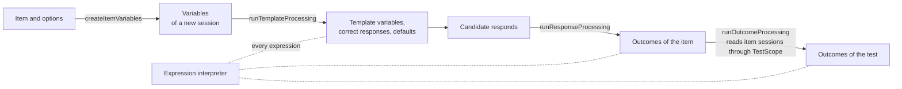

# Response and outcome processing

`processing` runs the template, response and outcome processing of QTI 3.0: a tree interpreter for every expression and rule,
the variables of an item session, the six standard response processing templates and custom operators. It imports `values` and `asi` and runs in any JavaScript runtime. The delivery engine decides when
each processing runs; these functions run it.



| Function or constant                                    | Does                                                                                                                                                    |
| ------------------------------------------------------- | ------------------------------------------------------------------------------------------------------------------------------------------------------- |
| `createItemVariables(item, options?)`                   | The variables of a new item session, before template processing.                                                                                        |
| `runTemplateProcessing(item, variables, context)`       | Template processing, with the constraint loop.                                                                                                          |
| `runResponseProcessing(item, variables, context)`       | Response processing, from the item's rules or its template.                                                                                             |
| `runOutcomeProcessing(test, outcomes, scope, context)`  | Outcome processing of a test.                                                                                                                           |
| `ItemVariables`, `CreateItemVariablesOptions`           | The six maps of an item session's variables, and the context values of a new session.                                                                   |
| `ProcessingContext`, `CustomOperator`, …                | The random source, custom operators, template resolver and limits that every run takes.                                                                 |
| `TestScope`, `ItemSessionView`, `ItemSessionFilter`     | What outcome processing reads from the delivery engine: item sessions and the test's variables.                                                         |
| `DEFAULT_PROCESSING_LIMITS`, `ProcessingLimits`         | The limit on the size of containers that expressions build.                                                                                             |
| `fitsBaseType(valueType, variableType)`, `VariableType` | Whether a value of a base type fits a variable of another, with the promotion of an integer, and the type of a variable.                                |
| `describeType(type)`                                    | A type as text for a message.                                                                                                                           |
| `isInsideShape(shape, coords, point)`                   | Whether a point lies in an area of a hotspot or an area mapping, its edge included: the test of `qti-inside`, for a scorer of the points of a response. |
| `QTI_CONTEXT`                                           | The name of the built-in context variable `QTI_CONTEXT`, which the option `context` of a session sets.                                                  |

## Quick start

```ts
import { createRandom } from "@assesskit/runtime";
import { readAsi } from "@assesskit/runtime/asi";
import { createItemVariables, runResponseProcessing, runTemplateProcessing } from "@assesskit/runtime/processing";
import { buildSingle } from "@assesskit/runtime/values";

const { item } = readAsi(`<qti-assessment-item xmlns="http://www.imsglobal.org/xsd/imsqtiasi_v3p0"
    identifier="sum" title="Sum" time-dependent="false">
  <qti-response-declaration identifier="RESPONSE" cardinality="single" base-type="integer"/>
  <qti-outcome-declaration identifier="SCORE" cardinality="single" base-type="float"/>
  <qti-template-declaration identifier="A" cardinality="single" base-type="integer"/>
  <qti-template-declaration identifier="B" cardinality="single" base-type="integer"/>
  <qti-template-processing>
    <qti-set-template-value identifier="A"><qti-random-integer min="1" max="9"/></qti-set-template-value>
    <qti-set-template-value identifier="B"><qti-random-integer min="1" max="9"/></qti-set-template-value>
    <qti-template-constraint>
      <qti-not><qti-match><qti-variable identifier="A"/><qti-variable identifier="B"/></qti-match></qti-not>
    </qti-template-constraint>
    <qti-set-correct-response identifier="RESPONSE">
      <qti-sum><qti-variable identifier="A"/><qti-variable identifier="B"/></qti-sum>
    </qti-set-correct-response>
  </qti-template-processing>
  <qti-item-body><p>What is <qti-printed-variable identifier="A"/> + <qti-printed-variable identifier="B"/>?</p></qti-item-body>
  <qti-response-processing template="https://purl.imsglobal.org/spec/qti/v3p0/rptemplates/match_correct"/>
</qti-assessment-item>`);
const context = { random: createRandom(42) };
const instance = runTemplateProcessing(item, createItemVariables(item), context);
instance.templates.get("A"); // => { cardinality: "single", baseType: "integer", value: 6 }
instance.correctResponses.get("RESPONSE"); // => { cardinality: "single", baseType: "integer", value: 8 }
const submitted = { ...instance, responses: new Map(instance.responses).set("RESPONSE", buildSingle("integer", 8)) };
runResponseProcessing(item, submitted, context).outcomes.get("SCORE"); // => { cardinality: "single", baseType: "float", value: 1 }
```

## Variables

`ItemVariables` holds six `Map`s from identifier to value, NULL as `null`. The processing functions never change the
variables they are given; they return new ones.

| Map                | Holds                                                                                          |
| ------------------ | ---------------------------------------------------------------------------------------------- |
| `contexts`         | Context variables and the built-in `QTI_CONTEXT`.                                              |
| `responses`        | Response variables, the last submitted values, and the built-ins `numAttempts` and `duration`. |
| `outcomes`         | Outcomes and the built-in `completionStatus`.                                                  |
| `templates`        | Template variables.                                                                            |
| `correctResponses` | The correct response of each response variable, as declared or set by template processing.     |
| `defaults`         | The default value of each declared variable, as declared or set by template processing.        |

`createItemVariables` starts a session:

| Variable           | Start                                                                                                                                        |
| ------------------ | -------------------------------------------------------------------------------------------------------------------------------------------- |
| Response           | NULL; the engine applies the default value at the start of the first attempt.                                                                |
| Outcome            | Its default value, else 0 for a single integer or float, else NULL.                                                                          |
| Template           | Its default value, else NULL.                                                                                                                |
| Context            | The value of the option `context`, else its default value, else NULL.                                                                        |
| `numAttempts`      | 0, a single integer.                                                                                                                         |
| `duration`         | 0, a single duration in seconds: the base type the duration operators and Results Reporting use.                                             |
| `completionStatus` | `not_attempted`, a single identifier.                                                                                                        |
| `QTI_CONTEXT`      | NULL unless the option `context` gives a record; its fields `testIdentifier`, `candidateIdentifier` and `environmentIdentifier` are strings. |

## Processing

| Function                | Behavior                                                                                                                                                                                                                                                                                                                                                                                                                                |
| ----------------------- | --------------------------------------------------------------------------------------------------------------------------------------------------------------------------------------------------------------------------------------------------------------------------------------------------------------------------------------------------------------------------------------------------------------------------------------- |
| `runTemplateProcessing` | Template variables start from `variables.defaults`, so a test's template defaults apply when the caller puts them there. A false or NULL `qti-template-constraint` starts again from the start, at most 100 runs in all; after the last, the template variables keep their defaults and processing goes on after the constraint. An outcome whose default is set takes it as its value. Rules read only template and context variables. |
| `runResponseProcessing` | Runs the item's own rules, which win over a template; else the standard template its `template` names; else the rules that `resolveTemplate` returns for its `template-location`, or its `template`. An empty `template` names none. Outcomes start as given: the engine resets them for non-adaptive items.                                                                                                                            |
| `runOutcomeProcessing`  | Outcomes start from the values given, and the others from their defaults, else 0 or NULL; the specification resets test outcomes before each run, so the engine gives only the values a reset keeps, such as supplied external scores.                                                                                                                                                                                                  |

A condition runs the rules of its first true branch: a NULL or false expression skips its branch. A fragment runs its
rules, and an exit rule ends the run. An assignment checks the cardinality and base type of the value against the
variable, and promotes an integer to a float or duration.

## Expressions

The interpreter checks the operands of each operator against the signatures of the 64 expressions, NULL operands excepted, and raises a
`ProcessingError` for an operand of the wrong type. NULL, empty strings and empty containers are `null`.

| Topic                                                   | Rule                                                                                                                                                                                                                                                                                                             |
| ------------------------------------------------------- | ---------------------------------------------------------------------------------------------------------------------------------------------------------------------------------------------------------------------------------------------------------------------------------------------------------------- |
| NULL                                                    | An operator with a NULL operand gives NULL, except `qti-is-null` (true), `qti-container-size` (0), `qti-multiple`, `qti-ordered` and `qti-repeat` (left out), and `qti-and`, `qti-or`, `qti-any-n` (three-valued logic).                                                                                         |
| Integers                                                | Safe integers, computed exactly; a result outside them is NULL. `qti-sum`, `qti-product`, `qti-subtract`, `qti-min` and `qti-max` give an integer only when every operand is one.                                                                                                                                |
| Floats                                                  | `qti-divide` and `qti-power` give NULL for a zero divisor and a result that is not finite.                                                                                                                                                                                                                       |
| `qti-round`, `qti-truncate`                             | n for x in [n − 0.5, n + 0.5), and toward zero; NULL for NaN and ±INF.                                                                                                                                                                                                                                           |
| `qti-round-to`, `qti-equal-rounded`                     | By the deciding digit of the shortest decimal of the number, half away from zero: 2.675 rounds to 2.68. `qti-equal-rounded` compares the rounded decimals.                                                                                                                                                       |
| `qti-math-operator`                                     | Every function of Table 8.21. NULL outside a function's domain, for NaN, for `ln` and `log` of 0, and for a reciprocal function of 0; a finite argument whose result overflows is NULL, an infinite argument keeps the infinite results of the table. `signum`, `floor` and `ceil` give integers, NULL for ±INF. |
| `qti-stats-operator`                                    | Mean, and sample and population variance and standard deviation; NULL for NaN, and for a variance or deviation of one value.                                                                                                                                                                                     |
| `qti-equal`                                             | Exact, absolute or relative, the bounds included unless excluded; a relative range for a negative x lies between its two ends.                                                                                                                                                                                   |
| `qti-match`, `qti-member`, `qti-delete`, `qti-contains` | Equality of `matchValues`: a pair is unordered. Durations are refused. An ordered container contains another as a contiguous run.                                                                                                                                                                                |
| `qti-lookup-outcome-value`                              | A match table takes the first entry whose `source-value` is the integer. An interpolation table takes the first entry whose `source-value` is at most the number, so its entries run downward: listed upward, the lowest shadows the rest. No entry gives `default-value`, else NULL.                            |
| `qti-map-response`                                      | The distinct values of a container are each mapped once, by the first entry with an equal key, else `default-value`; `lower-bound` and `upper-bound` apply to containers. String keys compare case-insensitively unless the entry is `case-sensitive`.                                                           |
| `qti-map-response-point`                                | Each point counts for the first area that holds it; each area counts once; a point in no area adds `default-value`.                                                                                                                                                                                              |
| `qti-inside`, areas                                     | `rect`, `circle`, `ellipse`, `poly` and `default`, edges included. A percentage coordinate is a `ProcessingError`: it needs the size of the image.                                                                                                                                                               |
| `qti-pattern-match`                                     | XML Schema regular expressions on the linear-time automaton of `values`, matching the whole string.                                                                                                                                                                                                              |
| `qti-string-match`, `qti-substring`                     | Case-insensitive comparison folds case with `toLowerCase`, independent of locale.                                                                                                                                                                                                                                |
| Random operators                                        | An index in [0, n) is `floor(uniform() × n)`; `qti-random-integer` draws an index over its admissible values, and `qti-random-float` is `min + uniform() × (max − min)`, in [min, max).                                                                                                                          |
| Outcome processing only                                 | `qti-number-*`, `qti-outcome-minimum`, `qti-outcome-maximum` and `qti-test-variables` raise a `ProcessingError` in an item.                                                                                                                                                                                      |

An attribute that names a variable reads a template variable, or an outcome outside template processing:
integer and float attributes and `tolerance` items take the bare identifier, and `pattern` takes `{identifier}`, which
is the pattern itself when there is no such variable. A NULL variable makes the operator NULL.

## Areas

`isInsideShape(shape, coords, point)` is the test that `qti-inside` and `qti-map-response-point` make, for a host or a scorer that matches the points of a response to areas by its own rules. The coordinates are the numbers of the `coords` attribute, in the units of the image.

| Shape     | Coordinates                                     | The area                                         |
| --------- | ----------------------------------------------- | ------------------------------------------------ |
| `rect`    | left-x, top-y, right-x, bottom-y                | The rectangle; the corners may come in any order |
| `circle`  | center-x, center-y, radius                      | The disc                                         |
| `ellipse` | center-x, center-y, h-radius, v-radius          | The ellipse and its inside                       |
| `poly`    | x1, y1, x2, y2, and so on, three points or more | The polygon, closed, by an even-odd ray cast     |
| `default` | none                                            | The whole image                                  |

The edge is inside. A percentage is a length relative to an image that the function does not know, so a caller converts it first.

```ts
import { isInsideShape } from "@assesskit/runtime/processing";

isInsideShape("rect", [10, 10, 20, 30], [10, 30]); // => true
isInsideShape("circle", [10, 10, 5], [14, 14]); // => false
isInsideShape("poly", [0, 0, 10, 0, 0, 10], [5, 5]); // => true
```

## Standard templates

The six standard templates are `match_correct`, `map_response`, `map_response_point`, `CC2_match`, `CC2_match_basic` and
`CC2_map_response`, held as the models of the published files and keyed by
`https://purl.imsglobal.org/spec/qti/v3p0/rptemplates/<name>.xml`. `runResponseProcessing` runs the template that an item names
for `http` or `https`, `purl.imsglobal.org/spec/qti/v3p0/rptemplates/` or `www.imsglobal.org/question/qti_v3p0/rptemplates/`,
with `.xml` or without; a QTI 2.0, 2.1 or 2.2 URI names the template of the same algorithm.

## Context

Every run takes a `ProcessingContext`.

| Field             | Default                     | Meaning                                                                                                                                                                                                           |
| ----------------- | --------------------------- | ----------------------------------------------------------------------------------------------------------------------------------------------------------------------------------------------------------------- |
| `random`          | none, required              | The source of draws, such as `createRandom(seed)`: equal seeds give equal template values                                                                                                                         |
| `customOperators` | none                        | Functions by the `definition` of a `qti-custom-operator`, else by its `class`; an operator that is not registered, or that throws, is a `ProcessingError`, and what an operator returns is checked like any input |
| `resolveTemplate` | none                        | Returns the response processing of a template that is not standard                                                                                                                                                |
| `limits`          | `DEFAULT_PROCESSING_LIMITS` | `maxContainerSize`: the most values a container that an expression builds may hold, 10,000 by default; see [Limits](#limits)                                                                                      |

## Limits

Processing runs documents that authors wrote and values that candidates supplied, so each way it can grow has a bound.

| What                                            | Bound                                                         | Default | When exceeded                                                                                                                                                                              |
| ----------------------------------------------- | ------------------------------------------------------------- | ------- | ------------------------------------------------------------------------------------------------------------------------------------------------------------------------------------------ |
| Values in a container that an expression builds | `limits.maxContainerSize`, in values                          | 10,000  | `SecurityError` with `limit` `maxContainerSize`: `qti-multiple`, `qti-ordered`, `qti-repeat`, `qti-custom-operator`, `qti-outcome-minimum`, `qti-outcome-maximum` and `qti-test-variables` |
| Runs of template processing for its constraints | fixed                                                         | 100     | None: after the last run the template variables keep their defaults and processing goes on                                                                                                 |
| Nesting of expressions and rules                | `maxDepth` of [xml](xml.md#limits), when the document is read | 256     | `SecurityError` with `limit` `maxDepth`, from the reader; the interpreter recurses no deeper than the document                                                                             |
| Automaton of a `qti-pattern-match` pattern      | `maxStates` of [`compileXsdRegex`](values.md#limits)          | 100,000 | `ProcessingError` with the message of the compiler                                                                                                                                         |
| Nesting of a `qti-pattern-match` pattern        | `maxDepth` of `compileXsdRegex`                               | 100     | `ProcessingError` with the message of the compiler                                                                                                                                         |

`maxContainerSize` counts the values an expression builds, not the values it reads: the containers of variables are as large as the
caller made them, and the delivery engine bounds those when it accepts a response. A `qti-repeat` of NULL is NULL however many
repeats it names, and `qti-repeat` checks its size before it builds anything. The regular expressions run in time linear in the
text (see [values](values.md#limits)), so no pattern is a limit on the text.

## Test scope

Outcome processing reads the item sessions of a test through a `TestScope`, which the delivery engine implements over a session and
`readTestInputs` over a stored report ([Rescoring a stored report](delivery.md#rescoring-a-stored-report)).

| Method                              | Returns                                                                                                                                                  |
| ----------------------------------- | -------------------------------------------------------------------------------------------------------------------------------------------------------- |
| `itemSessions(filter)`              | The sessions of the selected item instances in a section and its sub-sections, with or without categories.                                               |
| `itemSession(identifier, instance)` | The session of `ITEM` or `ITEM.n` in `ITEM.VAR` and `ITEM.n.VAR`.                                                                                        |
| `variable(identifier)`              | A variable of the test that is not an outcome: a context variable, `duration`, `PART.duration`, or NULL for a variable of an item ref without a session. |

An `ItemSessionView` gives the item ref, the item and its variables. Item variables read through it take the names of
the ref's variable mappings, and its weights scale integer and float values into floats, 1 when the weight is missing.

| Expression                        | Counts or collects                                                                                                                                                 |
| --------------------------------- | ------------------------------------------------------------------------------------------------------------------------------------------------------------------ |
| `qti-number-selected`             | Every session.                                                                                                                                                     |
| `qti-number-presented`            | Sessions with at least one attempt.                                                                                                                                |
| `qti-number-responded`            | Sessions with an attempt and a response other than its declared default.                                                                                           |
| `qti-number-correct`              | Sessions whose responses all match their correct responses.                                                                                                        |
| `qti-number-incorrect`            | Sessions with an attempt and a response that does not match.                                                                                                       |
| `qti-outcome-minimum`, `-maximum` | The weighted `normal-minimum` or `normal-maximum` of a single outcome; items without a minimum are left out, and an item without a maximum makes the maximum NULL. |
| `qti-test-variables`              | The single values of a variable, NULL left out, as a multiple container.                                                                                           |

Correct and incorrect counts leave out items without response variables and items with one that has no correct response.

## Differences from the references

Where the specifications are silent or contradict themselves, [spec gaps](spec-gaps.md) gives the reasons.

| Case                                                                                   | Resolution                                                         |
| -------------------------------------------------------------------------------------- | ------------------------------------------------------------------ |
| `qti-round`, `qti-truncate`, `floor` and `ceil` of ±INF                                | NULL                                                               |
| Assigning an integer to a float or duration variable                                   | The integer is promoted; any other mismatch is a `ProcessingError` |
| A relative tolerance with a negative x                                                 | The range between its two ends                                     |
| `qti-map-response` of NULL                                                             | NULL; the bounds apply to containers only                          |
| Case-insensitive comparison                                                            | `toLowerCase`, independent of locale                               |
| A custom operator that is not registered, or that throws                               | A `ProcessingError`                                                |
| A population variance or standard deviation of one value                               | NULL                                                               |
| `qti-random-float`                                                                     | Draws from [min, max), a deviation of measure zero                 |
| A template that is neither standard nor resolved                                       | A `ProcessingError`                                                |
| `ln` and `log` of 0                                                                    | NULL: the text of the operator wins over the table of functions    |
| An ordered `qti-contains`                                                              | Looks for a contiguous run                                         |
| `qti-index` with n ≤ 0                                                                 | NULL                                                               |
| `qti-random-integer` with min > max or step ≤ 0, and `qti-random-float` with min > max | NULL                                                               |
| `tolerance` items that are not numbers                                                 | Name variables                                                     |
| `qti-test-variables` with a weight and `base-type="integer"`                           | The weight is ignored                                              |
| QTI 2.x template URIs                                                                  | Name the template of the same algorithm                            |

An attribute out of its range at run time (`figures`, a negative tolerance) makes the operator NULL, as `qti-index` does for n ≤ 0;
"not a numerical value" for `qti-min`, `qti-max` and `qti-stats-operator` is NaN; `qti-any-n` with min > max is false; a result of
`qti-round-to` beyond the floats is NULL; and `qti-test-variables` and the outcome bounds leave out items without the variable.

## Errors

| Situation                                                            | Result                                                                      |
| -------------------------------------------------------------------- | --------------------------------------------------------------------------- |
| An argument of the wrong type, as plain JavaScript or JSON passes it | `DataError` that says what is wrong and what is expected                    |
| An expression that reads a variable the item does not declare        | `ProcessingError`                                                           |
| An operand of the wrong cardinality or base type                     | `ProcessingError` that names the operator and what it takes                 |
| A custom operator that throws                                        | `ProcessingError` that names the operator, with the thrown value as `cause` |
| A value that does not fit the variable it is assigned to             | `ProcessingError`                                                           |
| A text that is not in the lexical form of its base type              | `ProcessingError`                                                           |
| A container above `maxContainerSize`                                 | `SecurityError` with `limit` `maxContainerSize`                             |
| A response processing template that cannot be found                  | `ProcessingError`                                                           |

## Not included

| Not included                                                      | Why                                                            |
| ----------------------------------------------------------------- | -------------------------------------------------------------- |
| When each processing runs, and the reset of outcomes before a run | The delivery engine decides                                    |
| The item sessions of a test                                       | `delivery` implements `TestScope`; processing reads them       |
| A percentage coordinate in `qti-inside`                           | It needs the size of the image, which processing does not have |
| Evaluating a document that failed validation                      | Static checks are `validate`'s                                 |

## Files

| File                                                                                                                                                                                                                  | Concept                                                    |
| --------------------------------------------------------------------------------------------------------------------------------------------------------------------------------------------------------------------- | ---------------------------------------------------------- |
| `evaluate.ts`, `operands.ts`, `signatures.ts`, `check-operands.ts`, `references.ts`                                                                                                                                   | The interpreter, its operands and their signatures         |
| `arithmetic.ts`, `comparison.ts`, `containers.ts`, `logic.ts`, `strings.ts`, `rounding.ts`, `math-operator.ts`, `stats-operator.ts`, `shapes.ts`, `mapping.ts`, `lookup.ts`, `random-values.ts`, `custom-operator.ts` | One family of operators in each file                       |
| `scope.ts`, `item-scope.ts`, `outcome-scope.ts`, `test-scope.ts`, `test-expressions.ts`, `item-session.ts`                                                                                                            | What expressions read, in an item and in a test            |
| `variables.ts`, `assign.ts`, `built-ins.ts`, `declared-value.ts`, `limits.ts`, `context.ts`                                                                                                                           | Variables, their types and the context of a run            |
| `template-processing.ts`, `response-processing.ts`, `outcome-processing.ts`, `outcome-rules.ts`, `conditions.ts`, `standard-templates.ts`                                                                             | Template, response and outcome processing, and their rules |
| `internal.ts`                                                                                                                                                                                                         | The helpers that `delivery` shares                         |

## References

| Topic                                     | Specification                                                                          |
| ----------------------------------------- | -------------------------------------------------------------------------------------- |
| Variables, expressions, rules, processing | [QTI 3.0 ASI Information Model](https://www.imsglobal.org/spec/qti/v3p0/info/)         |
| Standard response processing templates    | [Response processing templates](https://purl.imsglobal.org/spec/qti/v3p0/rptemplates/) |
| Regular expressions                       | [XML Schema Part 2](https://www.w3.org/TR/xmlschema-2/#regexs)                         |
| Places where the specifications differ    | [Spec gaps](spec-gaps.md)                                                              |
