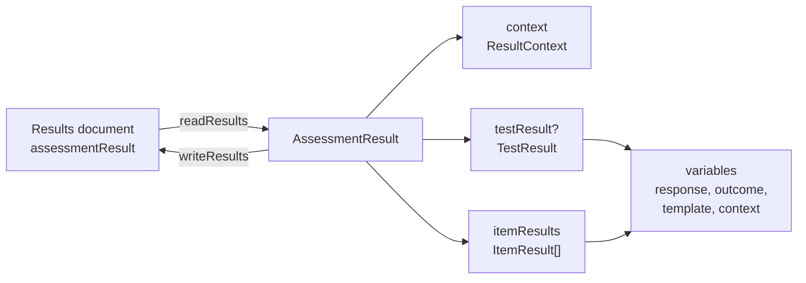

# Results

`results` reads and writes Results Reporting: the report on a candidate's session, with the test result, the result of each
item instance and every variable. It imports `xml` and `values` and runs in any JavaScript runtime.



| Export                                                                                                                  | Purpose                                                                                                                                                   |
| ----------------------------------------------------------------------------------------------------------------------- | --------------------------------------------------------------------------------------------------------------------------------------------------------- |
| `readResults(input)`                                                                                                    | Reads text, bytes or a parsed element into an `AssessmentResult`.                                                                                         |
| `writeResults(result)`                                                                                                  | Writes an `AssessmentResult` as a document that the RR schema accepts.                                                                                    |
| `RESULTS_NAMESPACE`                                                                                                     | The namespace of the RR schema.                                                                                                                           |
| `AssessmentResult`, `ResultContext`, `TestResult`, `ItemResult`, `SessionIdentifier`, `SupportUse`                      | The model.                                                                                                                                                |
| `ResultVariable`, `ResponseVariable`, `OutcomeVariable`, `TemplateVariable`, `ContextVariable`, `ResultCorrectResponse` | The variables.                                                                                                                                            |
| `SessionStatus`, `AnsweredStatus`, `ScoreStatus`, `SupportAssignment`, `OutcomeView`, `OutcomeScorer`                   | The vocabularies, with the lists `SESSION_STATUSES`, `ANSWERED_STATUSES`, `SCORE_STATUSES`, `SUPPORT_ASSIGNMENTS`, `OUTCOME_VIEWS` and `OUTCOME_SCORERS`. |

## Example

```ts
import { readResults, writeResults } from "@assesskit/runtime/results";

const result = readResults(`<assessmentResult xmlns="http://www.imsglobal.org/xsd/imsqti_result_v3p0">
  <context sourcedId="johnsmith1"/>
  <itemResult identifier="Q01" sequenceIndex="1" datestamp="2020-08-25T18:18:40" sessionStatus="final">
    <responseVariable identifier="RESPONSE" cardinality="single" baseType="identifier" choiceSequence="D B C A">
      <correctResponse><value>A</value></correctResponse>
      <candidateResponse><value>B</value></candidateResponse>
    </responseVariable>
    <outcomeVariable identifier="SCORE" cardinality="single" baseType="float"><value>0</value></outcomeVariable>
  </itemResult>
</assessmentResult>`);

result.context; // => { sourcedId: "johnsmith1", sessionIdentifiers: [] }
result.itemResults[0]?.sessionStatus; // => "final"
result.itemResults[0]?.variables.map((variable) => variable.kind); // => ["response", "outcome"]
result.itemResults[0]?.variables[0]?.candidateResponse; // => { cardinality: "single", baseType: "identifier", value: "B" }

writeResults({ context: { sessionIdentifiers: [] }, itemResults: [] });
// => '<?xml version="1.0" encoding="UTF-8"?>\n<assessmentResult xsi:schemaLocation="http://www.imsglobal.org/xsd/imsqti_result_v3p0 https://purl.imsglobal.org/spec/qti/v3p0/schema/xsd/imsqti_resultv3p0_v1p0.xsd" xmlns="http://www.imsglobal.org/xsd/imsqti_result_v3p0" xmlns:xsi="http://www.w3.org/2001/XMLSchema-instance"><context/></assessmentResult>'
```

## Model

| Type                                  | Fields                                                                                                                                                                                                                                           |
| ------------------------------------- | ------------------------------------------------------------------------------------------------------------------------------------------------------------------------------------------------------------------------------------------------ |
| `AssessmentResult`                    | `context`, `testResult?`, `itemResults`                                                                                                                                                                                                          |
| `ResultContext`                       | `sourcedId?`, `sessionIdentifiers`: `{ sourceId, identifier }[]`                                                                                                                                                                                 |
| `TestResult`                          | `identifier`, `datestamp`, `variables`, `supports`                                                                                                                                                                                               |
| `ItemResult`                          | `identifier`, `sequenceIndex?`, `datestamp`, `sessionStatus`, `variables`, `candidateComment?`, `supports`                                                                                                                                       |
| `SupportUse`                          | `name`, `assignment`, `value?`, `language?`                                                                                                                                                                                                      |
| `ResponseVariable`                    | `kind: "response"`, `identifier`, `cardinality`, `baseType?`, `correctResponse?`, `candidateResponse`, `choiceSequence?`, `scoreStatus?`, `answeredStatus?`, `extensions`                                                                        |
| `OutcomeVariable`                     | `kind: "outcome"`, `identifier`, `cardinality`, `baseType?`, `value`, `view?`, `interpretation?`, `longInterpretation?`, `normalMaximum?`, `normalMinimum?`, `masteryValue?`, `externalScored?`, `variableIdentifierRef?`, `outcomeInformation?` |
| `TemplateVariable`, `ContextVariable` | `kind: "template"` or `"context"`, `identifier`, `cardinality`, `baseType?`, `value`                                                                                                                                                             |

- A value is a `Value` of [values](values.md), or `null` for NULL. `candidateResponse` and `value` are never `undefined`.
- The variables of a result keep the order of the document, because the schema lets the four kinds mix.
- An optional field the document leaves out is absent from the model, never `undefined`.
- `datestamp` is an `xs:dateTime` with a four-digit year, such as `2020-08-25T18:19:20`; assesskit never reads a clock, so
  the caller supplies it. The delivery engine writes `2026-10-30T12:00:00.000Z`, RFC 3339 with the offset that the JSON
  binding of CAT 1.0 requires ([delivery](delivery.md#results) builds the report of a session).
- `extensions` and `outcomeInformation` hold elements of other namespaces as `XmlElement`s, the only places the schema
  allows them. An element read by `parseXml` keeps its `line` and `column`.

## Rules

| Rule                                                                                                                                                                                        | Source                                                       |
| ------------------------------------------------------------------------------------------------------------------------------------------------------------------------------------------- | ------------------------------------------------------------ |
| `context` is required, so `writeResults` always writes it, empty when nothing is known. A report is never placed in a package.                                                              | Results Reporting, `assessmentResult`; ASI XML Binding       |
| A variable has a `cardinality` and, except for a record, a `baseType`. A record's `value` elements name their field and base type; any other `value` has neither.                           | Results Reporting, variables and `value`                     |
| A value is read and written in the lexical form of its base type ([values](values.md)). No `value` element is NULL, and so is an empty `string`. A single variable has at most one `value`. | ASI Information Model, base types and values                 |
| A `file` is written as its reference alone and reads back with the content type `application/octet-stream`; the host keeps the bytes.                                                       | [Spec gaps](spec-gaps.md): the lexical form of `file` values |
| A `duration` is written as seconds. It is read as seconds, or as an ISO 8601 duration without years and months, which 1EdTech's `conformance-use-case-1.xml` writes.                        | [Spec gaps](spec-gaps.md): ISO 8601 durations with years     |
| A `value` is an `xs:normalizedString`: the runtime writes it as given, so a consumer that applies the schema reads a newline in an essay as a space.                                        | [Spec gaps](spec-gaps.md): `value` as a normalized string    |
| An integer outside the safe integers is a `ReadError`.                                                                                                                                      | [Spec gaps](spec-gaps.md): the range of integers             |
| The namespace is strict: a root in another namespace is a `ReadError`. The writer names the schema in `xsi:schemaLocation`.                                                                 | [Spec gaps](spec-gaps.md): namespaces of the samples         |
| The reader refuses an attribute, element or text that the schema does not define at that place, so nothing in a document is dropped without notice.                                         | The RR schema                                                |

## Vocabularies

| Type                | List                  | Terms                                                                                          |
| ------------------- | --------------------- | ---------------------------------------------------------------------------------------------- |
| `SessionStatus`     | `SESSION_STATUSES`    | `initial`, `pendingSubmission`, `pendingResponseProcessing`, `pendingExternalScoring`, `final` |
| `AnsweredStatus`    | `ANSWERED_STATUSES`   | `answered`, `attempted`, `presented`, `notpresented`                                           |
| `ScoreStatus`       | `SCORE_STATUSES`      | `notscored`, `scored`                                                                          |
| `SupportAssignment` | `SUPPORT_ASSIGNMENTS` | `assigned`, `inherit`, `prohibited`, `universal`                                               |
| `OutcomeView`       | `OUTCOME_VIEWS`       | `author`, `candidate`, `proctor`, `scorer`, `testConstructor`, `tutor`                         |
| `OutcomeScorer`     | `OUTCOME_SCORERS`     | `externalMachine`, `human`                                                                     |

## Errors

`readResults` throws `ReadError`; its `issues` hold one issue with the code, the rule, the line and column, and the element
path, such as `assessmentResult/itemResult`. `writeResults` throws `DataError` for a model that is not a result: a field of
the wrong type, an identifier that is not one, a date that is not an `xs:dateTime`, a value that is not of the type its
variable declares, a term outside its vocabulary, or text with a character that XML 1.0 does not allow. Input that is not
text, bytes or an element is a `DataError`, and text or bytes that break a limit of `parseXml` are a `SecurityError`.

| Code                                     | Meaning                                                                               |
| ---------------------------------------- | ------------------------------------------------------------------------------------- |
| `assesskit/results/not-results`          | The root is not `assessmentResult` of the RR namespace.                               |
| `assesskit/results/missing-attribute`    | A required attribute is missing, such as `datestamp`, or `baseType` outside a record. |
| `assesskit/results/invalid-attribute`    | An attribute is not valid: an identifier, a date, a number or a term.                 |
| `assesskit/results/unexpected-attribute` | An attribute that the schema does not define at that element.                         |
| `assesskit/results/missing-element`      | A required element is missing, such as `context` or `candidateResponse`.              |
| `assesskit/results/unexpected-element`   | An element that the schema does not allow at that place.                              |
| `assesskit/results/repeated-element`     | Several values for a single variable.                                                 |
| `assesskit/results/unexpected-text`      | Text in an element that contains elements only.                                       |
| `assesskit/results/invalid-value`        | A `value` that is not of its base type, or a record that repeats a field.             |

## Not included

| Not included                                    | Why                                                                                      |
| ----------------------------------------------- | ---------------------------------------------------------------------------------------- |
| Building a report from a session                | The [delivery](delivery.md#results) engine knows the session; `results` holds the format |
| Placing a report in a content package           | A report is a document of its own, and a package holds items, tests and their resources  |
| Reading a clock for `datestamp`                 | The runtime reads no clock; the caller supplies the time                                 |
| The bytes of a `file` value                     | The XML form of a file is its reference, and the host stores the bytes                   |
| Years and months in a duration                  | They have no length in seconds                                                           |
| Elements of other namespaces outside two places | The schema allows them only after the candidate response and in `outcomeInformation`     |

## Files

Each file of `src/results/` holds one concept.

| File                | Concept                                                |
| ------------------- | ------------------------------------------------------ |
| `model.ts`          | The model of a report and its variables                |
| `vocabularies.ts`   | The terms of the enumerations of the schema            |
| `namespace.ts`      | The namespace and the schema location                  |
| `value-elements.ts` | Reading and writing the `value` elements of a variable |
| `read-results.ts`   | Reading a document into the model                      |
| `write-results.ts`  | Writing the model as a document                        |

## References

| Topic                         | Specification                                                                                             |
| ----------------------------- | --------------------------------------------------------------------------------------------------------- |
| The report and its variables  | [QTI 3.0 Results Reporting](https://www.imsglobal.org/sites/default/files/spec/qti/v3/rr-bind/index.html) |
| Base types and their forms    | [QTI 3.0 ASI Information Model](https://www.imsglobal.org/spec/qti/v3p0/info/)                            |
| Places where the specs differ | [Spec gaps](spec-gaps.md)                                                                                 |
