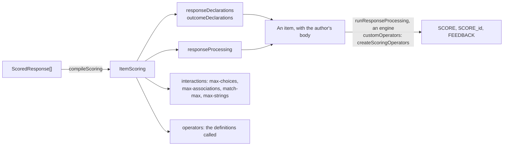

# Compiling keys into scoring

`scoring` compiles the [keys](keys.md) of an item's responses into its QTI scoring: a response declaration for each response,
with its correct response and its mapping where the key has them; the outcomes `SCORE`, `MAXSCORE`, the score of each
response and `FEEDBACK`; and the response processing that sets them. It writes QTI's own expressions wherever they score a key
exactly, and an [operator](operators.md) by `buildOperatorCall` where they cannot, so that an engine without the operators
scores every key that QTI can. It imports `values`, `asi`, `processing`, `keys` and `operators`, and runs in any JavaScript
runtime.



| Function or type                      | Does                                                                                    |
| ------------------------------------- | --------------------------------------------------------------------------------------- |
| `compileScoring(responses, options?)` | The scoring of an item: its declarations, outcomes, response processing and attributes. |
| `ItemScoring`                         | What `compileScoring` returns, as models of the runtime's ASI model.                    |
| `CompileScoringOptions`               | The portable form, the floor and all parts.                                             |
| `InteractionAttributes`, `MatchMax`   | The attributes that the interaction of each response needs for its key.                 |

## Quick start

```ts
import { createRandom } from "@assesskit/runtime";
import { readAsi } from "@assesskit/runtime/asi";
import { createScoringOperators } from "@assesskit/runtime/operators";
import { createItemVariables, runResponseProcessing } from "@assesskit/runtime/processing";
import { compileScoring } from "@assesskit/runtime/scoring";
import { buildContainer, buildSingle } from "@assesskit/runtime/values";

const scoring = compileScoring([
  { identifier: "CAPITAL", key: { kind: "text", answers: [{ texts: ["Jakarta"] }] } },
  { identifier: "STEPS", key: { kind: "order", order: ["A", "B", "C", "D"], scheme: "adjacent-pairs" } },
]);
scoring.outcomeDeclarations.map(({ identifier }) => identifier);
// => ["SCORE", "MAXSCORE", "SCORE_CAPITAL", "SCORE_STEPS", "FEEDBACK"]
scoring.operators; // => ["urn:uuid:02d09ea0-c251-49b1-95b2-96e4f3b9b540"]

const { item } = readAsi(`<qti-assessment-item xmlns="http://www.imsglobal.org/xsd/imsqtiasi_v3p0"
    identifier="quiz" title="Quiz" time-dependent="false"/>`);
const { responseDeclarations, outcomeDeclarations, responseProcessing } = scoring;
const scored = { ...item, responseDeclarations, outcomeDeclarations, responseProcessing };
const variables = createItemVariables(scored);
const answered = {
  ...variables,
  responses: new Map(variables.responses)
    .set("CAPITAL", buildSingle("string", " jakarta "))
    .set("STEPS", buildContainer("ordered", "identifier", ["A", "B", "D", "C"])),
};
const context = { random: createRandom(1), customOperators: createScoringOperators() };
const { outcomes } = runResponseProcessing(scored, answered, context);
outcomes.get("SCORE").value; // => 2
outcomes.get("MAXSCORE").value; // => 4
outcomes.get("FEEDBACK").values; // => ["CAPITAL-correct", "STEPS-partial"]
```

The item takes the declarations and the response processing as they are; the author's body binds each response to its
interaction, with the attributes of `interactions`. `writeAsi` writes the item, and the operators' namespace with it.

## Keys in QTI

Each key compiles to QTI's own expressions where they score it exactly; the rest call an operator.

| Key and scheme                            | Response                                                                | Response processing                                                                                                                     | Key's own maximum                      |
| ----------------------------------------- | ----------------------------------------------------------------------- | --------------------------------------------------------------------------------------------------------------------------------------- | -------------------------------------- |
| `choice`, `all-or-nothing`                | `identifier`, `single` when `maxChoices` is 1, else `multiple`          | `qti-match` of the response and its correct response, the keys                                                                          | 1                                      |
| `choice`, `partial` or `per-key`          | As above                                                                | `qti-map-response` of a mapping of each key to 1 and the others to −1 or 0, floored at 0 by `qti-max`                                   | The keys, at most `maxChoices`         |
| `choice-mapping`                          | As above                                                                | `qti-map-response` of the points, floored at 0                                                                                          | The best sum within `maxChoices`       |
| `choice-marking`                          | As above                                                                | `blank` where the response is NULL, else `qti-map-response` of `correct` for each key and `wrong` for the others                        | `correct` × the keys                   |
| `pairs`, `all-or-nothing`                 | `directedPair`, or `pair` when not `directed`, `multiple`               | `qti-match` with the key's pairs                                                                                                        | 1                                      |
| `pairs`, `per-pair` or `mapping`          | As above                                                                | `qti-map-response` of the pairs' points, less `surplus` × the pairs past the key's count by `qti-container-size`, floored at 0          | The best sum within `maxPairs`         |
| `order`, `all-or-nothing`                 | `identifier`, `ordered`                                                 | `qti-match` with the key's order                                                                                                        | 1                                      |
| `order`, `per-position`                   | As above                                                                | A condition for each position: `qti-match` of its `qti-index` and the key's choice                                                      | The positions                          |
| `order`, `adjacent-pairs`                 | As above                                                                | A condition for each pair of the key's neighbors: `qti-contains` of the response and the ordered pair, which holds for a contiguous run | The positions less 1                   |
| `areas`, `mapping`                        | `point`, `multiple`                                                     | `qti-map-response-point` of an area mapping: each point counts for the first area that holds it, edges inside, and each area once       | The best sum within `select`           |
| `areas`, `keyed`                          | `point`, `single` when `select` is 1, else `multiple`                   | `hotspot-matching`                                                                                                                      | `select`                               |
| `number` of a value and a tolerance alone | `float`, `single`                                                       | `qti-equal` of the value and the response: `exact`, or `absolute` and `relative` (in percent), or both joined by `qti-or`               | 1                                      |
| `number`, any other                       | `string`, `single`, or `ordered` for `components`                       | `number-equivalent`                                                                                                                     | 1                                      |
| `text`                                    | `string`, `multiple` for a `count` above 1 under `forms`, else `single` | `text-equivalent`: every normalization changes some strings, which QTI's string match cannot                                            | The points of the `count` best answers |
| `expression`                              | `string`, `single`                                                      | `expression-equivalent`                                                                                                                 | 1                                      |

A declaration holds the correct response where a response earns the key's maximum: the keys, the pairs and the order; the best
options and pairs of a mapping; the value of a number, written with its decimal mark, or its components; the first text of each
of the best answers of a text, when each has a text; the expression of an expression key. An area holds none.

## Points and totals

A response earns the key's share of its own maximum, scaled to `maxPoints` and times `weight`. A share that an operator gives
is a float from 0 to 1, or NULL for a blank, unreadable or undecided response, which scores 0. With one response its points are
`SCORE`; with several, each response has `SCORE_<identifier>` and `SCORE` is their sum. `MAXSCORE` is the sum of the maxima, its
default value.

| Rule       | Response processing                                                                                                                                |
| ---------- | -------------------------------------------------------------------------------------------------------------------------------------------------- |
| Scaling    | The key's points times `maxPoints` × `weight`, over the key's own maximum: `qti-divide` of a `qti-product`, one rounding                           |
| A blank    | NULL, as `qti-is-null` finds it; scores 0, or `blank` of a `choice-marking` key                                                                    |
| `allParts` | `SCORE` is `MAXSCORE` when every response earns its own maximum, else 0; the score of each response stays                                          |
| `floor`    | `SCORE` is at least the floor, by `qti-max`, after all parts                                                                                       |
| Outcomes   | `SCORE` and each `SCORE_<identifier>` are floats with `normal-maximum` their maximum, and `normal-minimum` where a negative mark can reach below 0 |

A response earns its maximum when its points are within 1e-12 of it, so that a sum of a mapping's floats that falls short in
its last bits still counts as full.

```ts
import { compileScoring } from "@assesskit/runtime/scoring";

const marked = compileScoring(
  [
    { identifier: "Q1", key: { kind: "choice-marking", keys: ["A"], correct: 4, wrong: -1 } },
    { identifier: "Q2", key: { kind: "choice", keys: ["C", "D"], scheme: "partial", maxChoices: 4 }, weight: 2 },
  ],
  { floor: 0 },
);
marked.outcomeDeclarations.map(({ identifier, normalMaximum, normalMinimum }) => [
  identifier,
  normalMaximum,
  normalMinimum,
]);
// => [["SCORE", 8, undefined], ["MAXSCORE", undefined, undefined], ["SCORE_Q1", 4, -1], ["SCORE_Q2", 4, undefined], ["FEEDBACK", undefined, undefined]]
marked.interactions.get("Q2"); // => { maxChoices: 4 }
```

## Feedback

The outcome `FEEDBACK` of cardinality `multiple` holds one value for each response, which the
item's feedback shows by `qti-feedback-inline`, `qti-feedback-block` or `qti-modal-feedback`:

| Value                    | When                                   |
| ------------------------ | -------------------------------------- |
| `<identifier>-blank`     | The response is NULL                   |
| `<identifier>-correct`   | It earns its maximum                   |
| `<identifier>-partial`   | It earns points, less than its maximum |
| `<identifier>-incorrect` | It earns 0 or less                     |

## The portable form

With `portable`, each outcome that an operator would score is externally scored by a machine (`external-scored="externalMachine"`)
and no rule sets it, so that an engine without the operators delivers the item and asks its host for the score. The keys that
QTI scores keep their rules. With several responses `SCORE` is externally scored too, since response processing does not run
again when a score is supplied ([spec gaps](spec-gaps.md), G25): the host supplies it as the sum of the responses' scores, with
`allParts` and `floor` applied. `FEEDBACK` of an externally scored response holds `-blank` alone, and `operators` is empty.

```ts
import { compileScoring } from "@assesskit/runtime/scoring";

const portable = compileScoring(
  [
    { identifier: "WORD", key: { kind: "text", answers: [{ texts: ["photosynthesis"] }] } },
    { identifier: "CHOICE", key: { kind: "choice", keys: ["B"] } },
  ],
  { portable: true },
);
portable.outcomeDeclarations.filter(({ externalScored }) => externalScored).map(({ identifier }) => identifier);
// => ["SCORE", "SCORE_WORD"]
portable.operators; // => []
```

## Interactions

`interactions` gives, by response identifier, the attributes that the response's interaction needs for its key; the author's
body sets them:

| Attribute         | From                                                                                                                                                      |
| ----------------- | --------------------------------------------------------------------------------------------------------------------------------------------------------- |
| `maxChoices`      | `maxChoices` of a choice, `select` of areas                                                                                                               |
| `maxAssociations` | `maxPairs` of pairs                                                                                                                                       |
| `matchMax`        | The `match-max` of each source (`maxPerSource`, 0 for unlimited), of each target (`maxPerTarget`, else 1, or 0 with `reuse`) and of the `none` target (0) |
| `maxStrings`      | `count` of a text of several strings, the count of `components` of a number                                                                               |

## Options

| Option     | Does                                                                         | Default |
| ---------- | ---------------------------------------------------------------------------- | ------- |
| `portable` | Leaves each score that an operator would give to the host, externally scored | `false` |
| `floor`    | The least score of the item, at most its maximum                             | none    |
| `allParts` | The item earns its maximum only when every response earns its own, else 0    | `false` |

## Limits

| What                                        | Bound           | Limit | When exceeded                                |
| ------------------------------------------- | --------------- | ----: | -------------------------------------------- |
| Responses of an item                        | `responses`     |   256 | `SecurityError` with `limit` `responses`     |
| Entries of a key, counted before it is read | `entries`       | 1,000 | `SecurityError` with `limit` `entries`       |
| Characters of a pattern                     | `patternLength` | 1,000 | `SecurityError` with `limit` `patternLength` |

The limits are `DEFAULT_KEY_LIMITS` of [keys](keys.md), which an operator reads its key within as well. Compiling is linear in
the entries. The worst item within them, 256 orders of 1,000 choices scored per position, a condition for each choice, compiles
in a heap of 224 MiB at most on Node.js 22, 24 and 26. Its XML holds about 14 nodes for each choice: such
an item has more nodes than the 300,000 that `DEFAULT_XML_LIMITS` lets a reader take, and a host that compiles keys this large
reads its items with raised XML limits ([xml](xml.md#limits)).

## Errors

| Situation                                                                                                                                                                                                                                                                                                    | Result                                                         |
| ------------------------------------------------------------------------------------------------------------------------------------------------------------------------------------------------------------------------------------------------------------------------------------------------------------ | -------------------------------------------------------------- |
| A key that its scheme refuses: a selection of the keys that `maxChoices` cannot hold, no response that earns points, a `blank` above what the right selection earns, a pair of one choice or given twice, `points` without `mapping`, an order of one choice with `adjacent-pairs`, `select` above the areas | `DataError` that names the response and the path in its key    |
| A key that its operator refuses ([operators](operators.md#errors))                                                                                                                                                                                                                                           | `DataError` that names the response, the operator and the path |
| A response identifier that is not a QTI identifier, is taken twice, names `SCORE`, `MAXSCORE`, `FEEDBACK`, a built-in variable or the outcome of another response, or has more than 26 characters beside other responses                                                                                     | `DataError`                                                    |
| A follow-through on a key that is not a number or an expression, from a response that is not earlier, or from a key whose response reads as no expression: a number with units or components                                                                                                                 | `DataError`                                                    |
| A floor above the item's maximum; options or responses that do not parse                                                                                                                                                                                                                                     | `DataError` that names the path                                |
| More responses, entries or characters of a pattern than the limits                                                                                                                                                                                                                                           | `SecurityError` with `limit` and `maximum`                     |

## Not included

| Not included                                         | Why                                                                                                                                          |
| ---------------------------------------------------- | -------------------------------------------------------------------------------------------------------------------------------------------- |
| The item's body and its interactions                 | The author's: `interactions` gives the attributes that a key needs                                                                           |
| Responses that a person rates                        | Scored by a rubric of [asi](asi.md) and externally scored; `compileScoring` writes the keys that a machine scores                            |
| The response processing templates of QTI             | A template scores one response; the compiler writes the rules, which score several and total them                                            |
| A text key in QTI's own string match                 | Each normalization of the key model changes some strings, as NFKC and the collapse of white space do, which `qti-string-match` cannot follow |
| A decimal comma in the numeric equivalence of a text | `1,500` is a thousand and a half in the sources' notation; a `number` key reads the comma with `decimalSeparator`                            |

## Differences from the references

| Case                                                                         | Resolution                                                                                                                                                                           |
| ---------------------------------------------------------------------------- | ------------------------------------------------------------------------------------------------------------------------------------------------------------------------------------ |
| A plain number: `qti-equal` computes in doubles, `number-equivalent` exactly | A response at a bound of the tolerance can differ in the last bit; the response is a QTI float, read by the interaction, where `number-equivalent` reads the text with its own rules |
| The bounds of a mapping, which QTI applies to a container                    | A share that can fall below 0 is also floored by `qti-max`, so that a response of one value, which the bounds do not reach, keeps the same floor                                     |

## Build or adopt

No library writes QTI response processing from keys: the QTI libraries that the runtime is compared with, Longsight
`qti3-core` and Amp-up `qti3-item-player`, deliver and score items that hold their processing already. The compiler is built
on the runtime's own ASI models, so that `writeAsi` writes its output and the published schemas check it.

## Files

| File                 | Concept                                                                  |
| -------------------- | ------------------------------------------------------------------------ |
| `compile-scoring.ts` | The compiler: responses, scaling, totals, feedback and the portable form |
| `schemes.ts`         | Each kind and scheme of key in QTI or an operator                        |
| `schemas.ts`         | The schemas of the options, a response and the keys that QTI scores      |
| `qti.ts`             | Builders of the expressions and rules                                    |
| `item-scoring.ts`    | The types of the result and the options                                  |

## References

| Topic                                   | Reference                                                                                                                          |
| --------------------------------------- | ---------------------------------------------------------------------------------------------------------------------------------- |
| Response processing and its expressions | QTI 3.0 ASI Information Model: `qti-match`, `qti-map-response`, `qti-map-response-point`, `qti-index`, `qti-contains`, `qti-equal` |
| `SCORE` and `MAXSCORE`                  | QTI 3.0 Best Practices and Implementation Guide                                                                                    |
| Adjacent pairs of an order              | Pearson, PTE Academic score guide: reorder paragraphs earn a point for each pair in the right order                                |
| The scores of the reference             | `validation/scoring.py`, 600 items of the keys that QTI scores, computed from the rules above in exact fractions                   |
