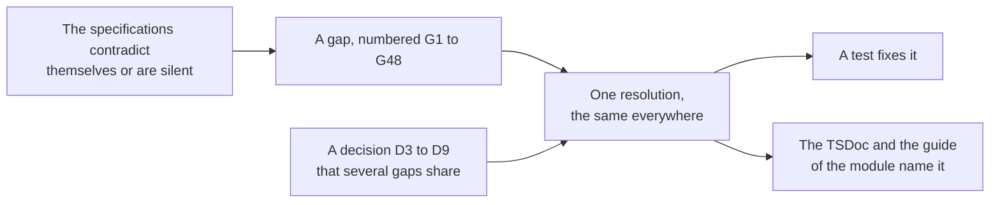

# Spec gaps

The specifications contradict themselves in places and say nothing in others. Each place is a gap, numbered `G1` to `G48`,
and the runtime resolves it the same way everywhere. Every gap has a test that fixes its
resolution, and the TSDoc and the guide of the module name it. A change to a resolution is a breaking change.

Citations use the IDs of [Evidence](evidence.md#citations). `D3` to `D9` are decisions that apply to several gaps; they are
listed below.

## Gaps

| #   | Gap                                                                                                                                                                 | Source                                        | Resolution                                                                                                                                                                                                                                                                       |
| --- | ------------------------------------------------------------------------------------------------------------------------------------------------------------------- | --------------------------------------------- | -------------------------------------------------------------------------------------------------------------------------------------------------------------------------------------------------------------------------------------------------------------------------------- |
| G1  | `round`, `truncate`, `floor` and `ceil` return integers, but "INF gives INF"                                                                                        | INFO section 2.11.3.37–38, Table 8.21         | NULL (D4).                                                                                                                                                                                                                                                                       |
| G2  | The base type integer maps to `xs:integer`, which is unbounded                                                                                                      | BIND section 2.9                              | Safe integers (D3).                                                                                                                                                                                                                                                              |
| G3  | The "effective base-type" of an assigned expression is not defined                                                                                                  | INFO section 5.130.2                          | An integer promotes to a float or duration on assignment (D5).                                                                                                                                                                                                                   |
| G4  | A relative tolerance with a negative x gives a lower bound above the upper bound                                                                                    | INFO section 5.46.2                           | The range between the two computed ends.                                                                                                                                                                                                                                         |
| G5  | `map-response` of a NULL response; the bounds are stated for containers only                                                                                        | INFO sections 2.11.1.5 and 5.88.1–2           | NULL gives NULL, by the general rule of operators. The bounds apply to containers only, as written.                                                                                                                                                                              |
| G6  | The method of case-insensitive comparison                                                                                                                           | INFO sections 5.138 and 5.139, section 7.21.3 | Unicode default case conversion, independent of locale (`toLowerCase`).                                                                                                                                                                                                          |
| G7  | The behavior for an unsupported custom operator                                                                                                                     | INFO section 2.11.3.2                         | A `ProcessingError`. `validate` reports an operator that no registered operator serves, when it is given the registered ones.                                                                                                                                                    |
| G8  | The probability distribution of a selection                                                                                                                         | INFO section 5.129                            | Without replacement: uniform over the admissible subsets that contain every required child. With replacement: each required child once, the other draws independent and uniform over all children. Ordering follows. The procedure is fixed ([delivery](delivery.md#selection)). |
| G9  | An item variable of an item selected with replacement is "undefined" in individual submission                                                                       | INFO section 2.11.1.2                         | `ITEM.VAR` reads the instance whose attempt ended last, in both submission modes; `ITEM.n.VAR` reads the instance `n`. `validate` warns about `ITEM.VAR` of an item reference that selection with replacement can repeat in a part that submits each item alone.                 |
| G10 | The lexical form of `file` values in XML                                                                                                                            | INFO section 8.13, RR section 2.6.6           | A reference everywhere (D7). Written as the reference alone; read with the content type `application/octet-stream`.                                                                                                                                                              |
| G11 | The 3.0.1 schema gives `normal-minimum` the default 0.0, while `outcome-minimum` ignores items with no minimum                                                      | INFO section 2.11.2.6, XSD                    | An absent `normal-minimum` stays absent: the information model is normative, and a schema default is binding detail.                                                                                                                                                             |
| G12 | The namespaces in the samples of the specifications differ from those of the schemas                                                                                | Specifications                                | The schemas decide. ASI, RR, usage data, packages and metadata are strict. `pnp` also reads the two namespaces that 1EdTech's own documents use, writes the schema's, and `validate` reports them as errors.                                                                     |
| G13 | The population variance and standard deviation need more than one value                                                                                             | INFO section 8.31                             | As written: one value gives NULL.                                                                                                                                                                                                                                                |
| G14 | An ISO 8601 duration with years or months has no length in seconds; the example `P10Y3M20DT4H30M25S` of BPIG Appendix C.1 has both                                  | BPIG App. C.1                                 | A `DataError` wherever such a duration is decoded, so the engine never sees one. The runtime writes durations as `PT<seconds>S`. The example shows the format only (G39).                                                                                                        |
| G15 | The range of `random-float` and the admissible values of `random-integer`                                                                                           | INFO sections 7.33 and 7.34                   | `random-float` draws from [min, max), a deviation of measure zero from [min, max]. `random-integer` draws among the values min + k × step ≤ max. Bad bounds: G32, G33.                                                                                                           |
| G16 | `count-attempt` is a boolean but is described as a number of attempts                                                                                               | INFO section 5.45.3                           | `false` leaves that attempt out of the `max-attempts` budget; `numAttempts` still counts it; absent means true (D8).                                                                                                                                                             |
| G17 | A template URI that is not standard, with no internal rules and no resolver                                                                                         | INFO section 4.6.1–2                          | A `ProcessingError`. `validate` reports it as an error for an item without rules.                                                                                                                                                                                                |
| G18 | `match` on floats "should not" be used                                                                                                                              | INFO section 2.11.3.28                        | Exact comparison, and a `validate` warning.                                                                                                                                                                                                                                      |
| G19 | Shuffling when a template variable hides choices                                                                                                                    | INFO sections 2.7.1 and 5.30.1                | All choices are shuffled, then the hidden ones are dropped; the positions of fixed choices hold.                                                                                                                                                                                 |
| G20 | The resolution of an item's duration ("at least 1 s, should be 0.1 s or smaller")                                                                                   | INFO section 2.2.2.2                          | Milliseconds from the times of the actions, truncated and never rounded.                                                                                                                                                                                                         |
| G21 | The OpenAPI 3.0 file that defines the field names of the Assessment Result of CAT is named by addresses that return 404                                             | CAT section 4.3, binding B1.2                 | The listing in Appendix B1.2 is the source; `cat` writes and reads its field names ([CAT](cat.md#json-binding)).                                                                                                                                                                 |
| G22 | What happens at a maximum time without late submission                                                                                                              | INFO sections 2.5 and 2.8.5, section 7.40.3   | The open attempts end with the drafts received before the deadline and the scope closes; later actions in it are refused `time-over`. With `allow-late-submission` the scope stays open (D9).                                                                                    |
| G23 | Whether time counts while the whole session is suspended                                                                                                            | INFO sections 2.2.2.2 and 2.8.5               | At no level, consistent with an item's duration excluding suspended time.                                                                                                                                                                                                        |
| G24 | Test outcomes are reset to their defaults before each outcome processing, which would erase supplied external scores                                                | INFO section 2.9                              | The supplied value is the reset value of the outcome. `validate` warns when outcome processing sets an externally scored outcome.                                                                                                                                                |
| G25 | Whether item response processing runs again when external scores arrive                                                                                             | INFO section 4.5.10, BPIG section 3.4.5       | No. The scorer sets the final value after the session closed; derive further values in the outcome processing of the test.                                                                                                                                                       |
| G26 | When a test-level external score can be requested                                                                                                                   | none                                          | When every covered instance is closed, or when the test ends. Covers never presented are listed with `presented: false`.                                                                                                                                                         |
| G27 | Action times that go backward                                                                                                                                       | none                                          | `stamp` is monotonic (the greater of the time now and the latest step). Only an unstamped device log is refused `clock-regression`.                                                                                                                                              |
| G28 | `ln` and `log` of 0: NULL in the text of the operator, −INF in Table 8.21                                                                                           | INFO section 2.11.3.39, Table 8.21            | NULL: the text of the operator wins over the vocabulary table.                                                                                                                                                                                                                   |
| G29 | `floor` and `ceil` of ±INF give INF but return integers                                                                                                             | INFO Table 8.21                               | NULL (D4).                                                                                                                                                                                                                                                                       |
| G30 | An ordered `contains`: a "strict sub-sequence", contiguous or not                                                                                                   | INFO section 2.11.3.17                        | Contiguous: the example [B, C] in [A, B, C], and the practice of QTI 2.1.                                                                                                                                                                                                        |
| G31 | `index` with n ≤ 0                                                                                                                                                  | INFO section 2.11.3.6                         | NULL.                                                                                                                                                                                                                                                                            |
| G32 | `random-integer` with min > max or step ≤ 0                                                                                                                         | INFO section 7.34                             | NULL at run time; a `validate` error when the bounds are constants.                                                                                                                                                                                                              |
| G33 | `random-float` with min > max                                                                                                                                       | INFO section 7.33                             | NULL at run time; a `validate` error when the bounds are constants.                                                                                                                                                                                                              |
| G34 | `tolerance` items may be variable references: a `ToleranceList` holds strings or doubles                                                                            | INFO section 5.46.2, XSD                      | An item that is not a number names a variable, bare or in braces, as for the other float attributes.                                                                                                                                                                             |
| G35 | `test-variables` with a weight and `base-type="integer"` is undefined                                                                                               | INFO section 7.39.5                           | A `validate` error. At run time the weight is ignored.                                                                                                                                                                                                                           |
| G36 | The RR `value` is an `xs:normalizedString`: a schema-aware consumer loses the newlines of an essay                                                                  | RR XSD                                        | Written as given. The exact string travels in scoring requests and in state.                                                                                                                                                                                                     |
| G37 | PCI JSON record fields may be `"base": null`, but the fields of a record are single values                                                                          | BPIG App. C.3                                 | A NULL field is left out of the record.                                                                                                                                                                                                                                          |
| G38 | The mapping of the PCI type `intOrIdentifier` to a value                                                                                                            | BPIG App. C.1                                 | By JSON type: a number is an integer, a string an identifier. In a variable, by its declared base type.                                                                                                                                                                          |
| G39 | The duration example of BPIG uses years and months                                                                                                                  | BPIG App. C.1                                 | As G14.                                                                                                                                                                                                                                                                          |
| G40 | `SCORE` and `MAXSCORE` must be floats and `PASSED` a boolean, yet content in the field varies                                                                       | INFO section 2.2.2.3, BPIG section 3.5        | A `validate` warning, not an error, so that such content still runs.                                                                                                                                                                                                             |
| G41 | PNP `fixed-minutes` and `unlimited` with nested time limits; BPIG speaks of the time of the test                                                                    | BPIG section 5.2.4                            | A multiplier applies to every maximum; fixed minutes extend the outermost maximum; `unlimited` removes the maximums. Minimums are unchanged.                                                                                                                                     |
| G42 | How the grade of an LTI-launched item maps to QTI outcomes                                                                                                          | BPIG section 6.2.9                            | `SCORE` and `MAXSCORE`, both externally scored by the tool; the host supplies them from the score that the tool gave (for LTI, `scoreGiven` and `scoreMaximum` of its AGS score).                                                                                                |
| G43 | QTI 2.x response processing template URIs in 3.0 content; BPIG gives the 3.0 URIs only                                                                              | BPIG section 2.5.1                            | They name the template of the same algorithm, and `validate` warns.                                                                                                                                                                                                              |
| G44 | `qtiMetadata` of a section is the base64 file of the implementation guide, a JSON file with a record for each item, and one QTI metadata record in the REST binding | CAT section 4.1; binding section 5.2.1        | Both exist in the model: `SectionData.qtiMetadata` is the file, and `qtiMetadataRecord` is the record that the REST binding carries ([CAT](cat.md#section-data)). The binding has no field for the file.                                                                         |
| G45 | The code minor for an engine that is busy is `server_busy` in the enumeration of the binding and `serverbusy` in B1.3 of the service specification                  | CAT binding section 7, service B1.3           | The wire follows the enumeration of the JSON schema, `server_busy`, which `createCatRestHandler` writes for the status 429 and 503.                                                                                                                                              |
| G46 | A text entry binds a response of cardinality single or record; rule 1Bb of the XML binding names a base type, which a record lacks                                  | INFO 2.4.2.2, 5.162; BIND section 5.3.4       | The information model decides: a record is allowed, and the base-type rule applies to the other cardinalities.                                                                                                                                                                   |
| G47 | A `ruby` has at most one `rp` and one `rt` or `rtc` in the XML binding, for each group in the information model; the schema limits none                             | BIND 5.1.2; INFO 5.125, 6.37; XSD `RubyDType` | The schema decides, as HTML5 does with an `rp` before and after the `rt`: `validate` limits no element of a `ruby`. A `figure` has no groups, so its `figcaption` stays limited.                                                                                                 |
| G48 | The order of the item results of a report: `sequenceIndex` says the place in the presentation, and nothing says the order of the elements                           | RR `AssessmentResultDType`                    | Plan order, with `sequenceIndex` as the specification defines it: the nth result of a reference is its instance `n`, and the last of equal datestamps the last instance, so a report reads as the session did (G9).                                                              |

## Decisions

| #   | Question                                    | Decision                                                                                                                                                                                                                                                                                                                                                            |
| --- | ------------------------------------------- | ------------------------------------------------------------------------------------------------------------------------------------------------------------------------------------------------------------------------------------------------------------------------------------------------------------------------------------------------------------------- |
| D3  | The range of integers                       | Safe integers. A larger integer in text is a `DataError` where a value is parsed, which a reader of documents reports as a `ReadError`; an out-of-range integer response of a candidate is a refusal `value-out-of-range`; an operation that leaves the range gives NULL.                                                                                           |
| D4  | Infinite inputs to integer-valued operators | `round`, `truncate`, `floor` and `ceil` of ±INF give NULL.                                                                                                                                                                                                                                                                                                          |
| D5  | The "effective base-type" on assignment     | An integer promotes to a float or a duration on assignment. Any other mismatch is caught by the static checks before a session starts (`createEngine`, `validate`), and is a `ProcessingError` only in direct calls of the library.                                                                                                                                 |
| D6  | Namespaces                                  | Strict for ASI, RR, usage data, packages and metadata. PNP also reads the two namespaces that 1EdTech's own documents use, writes the namespace of the schema, and `validate` reports the others as errors.                                                                                                                                                         |
| D7  | File values                                 | A `FileValue` is a reference everywhere: in state, views, results and actions. The host stores the bytes. The inline base64 of a PCI passes through host callbacks.                                                                                                                                                                                                 |
| D8  | `count-attempt`                             | `count-attempt="false"` leaves that attempt out of the `max-attempts` budget; `numAttempts` still increments (INFO section 2.2.2.2); absent means true.                                                                                                                                                                                                             |
| D9  | The time-out and late submission            | Without `allow-late-submission`, the deadline ends the open attempts with the responses received before it and closes the scope; later actions in it are refused `time-over`. With it, the deadline reports `time-limit-passed`, the scope stays open, later submissions are accepted with a `late-submission` event, and the candidate or the host ends the scope. |
