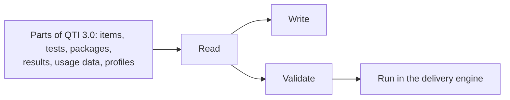

# Supported

What `@assesskit/runtime` reads, writes, validates and runs. A cell says Yes, Partly (the note says what is left out), No
(see Not included) or n/a where the operation makes no sense.

| Part                                                                       | Specification                                                | Read | Write                 | Validate | Run                                                                          |
| -------------------------------------------------------------------------- | ------------------------------------------------------------ | ---- | --------------------- | -------- | ---------------------------------------------------------------------------- |
| Items, stimuli, sections and tests, with their content                     | QTI 3.0.0 and 3.0.1; `writeAsi` names the 3.0.1 schema       | Yes  | Yes                   | Yes      | Yes: the delivery engine                                                     |
| Outcome declarations, response processing and outcome processing documents | QTI 3.0                                                      | Yes  | Yes                   | Yes      | Yes                                                                          |
| Template, response and outcome processing                                  | QTI 3.0, with its six standard response processing templates | Yes  | Yes                   | Yes      | Yes: 64 expressions and every rule                                           |
| Custom operators                                                           | QTI 3.0                                                      | Yes  | Yes                   | Partly   | The host registers each operator it uses; `operators` gives five for scoring |
| Keys compiled into response processing                                     | QTI 3.0                                                      | n/a  | Yes: `compileScoring` | Yes      | Yes: QTI's own expressions, and the operators where they cannot score a key  |
| Interactions                                                               | QTI 3.0, 22 interactions                                     | Yes  | Yes                   | Yes      | Yes: validity, shuffling and descriptors of all 22                           |
| Portable custom interactions                                               | QTI 3.0 best practices                                       | Yes  | Yes                   | Yes      | Variables and modules; the player runs the module                            |
| Content packages: manifest, ZIP archive, directory, LTI link documents     | The QTI 3.0 profile of IMS Content Packaging                 | Yes  | Yes                   | Yes      | The engine resolves items and tests from them                                |
| Results Reporting                                                          | 3.0                                                          | Yes  | Yes                   | Yes      | The engine produces them                                                     |
| Usage data                                                                 | 3.0                                                          | Yes  | Yes                   | Yes      | Pools of adaptive sections read them                                         |
| Personal needs and preferences, one profile or a bulk file                 | 3.0, the QTI profile                                         | Yes  | Yes                   | Yes      | The engine applies the supports                                              |
| QTI metadata, curriculum standards, accessibility metadata                 | 3.0                                                          | Yes  | Yes                   | Yes      | n/a                                                                          |
| LOM                                                                        | Loose binding 1.3.2                                          | Yes  | Yes                   | Partly   | n/a                                                                          |
| Adaptive selection                                                         | CAT 1.0                                                      | Yes  | Yes                   | Yes      | Through the host's `CatPort`                                                 |
| Candidate view, actions and state as JSON                                  | The runtime's own forms                                      | Yes  | Yes                   | Yes      | Yes: exams on a server, practice on a device                                 |

| Note                | Detail                                                                                                                                                                                                                                                                                                                       |
| ------------------- | ---------------------------------------------------------------------------------------------------------------------------------------------------------------------------------------------------------------------------------------------------------------------------------------------------------------------------- |
| LOM                 | Kept as XML; only the category `general` is interpreted.                                                                                                                                                                                                                                                                     |
| Packages            | Two example archives use the namespace of the base specification and are refused.                                                                                                                                                                                                                                            |
| The engine          | Navigation and submission modes, selection and ordering from a seeded generator, pre-conditions and branch rules, item session control, time limits with extra time, adaptive items, review and solution, suspension, variants, supports, rubric blocks, feedback, externally scored outcomes and the report of the session. |
| Profiles            | `color-theme`, which the best practices guide has and the PNP schema does not, is read and never written ([PNP](pnp.md#the-color-theme)).                                                                                                                                                                                    |
| JavaScript runtimes | Any that supports ECMAScript 2023. `node` and `cli` need Node.js 22 or later.                                                                                                                                                                                                                                                |

## Not included

| Not included                                                                                                                                                                               | Why                                                                                                                                                                                                                                                                                                                                          |
| ------------------------------------------------------------------------------------------------------------------------------------------------------------------------------------------ | -------------------------------------------------------------------------------------------------------------------------------------------------------------------------------------------------------------------------------------------------------------------------------------------------------------------------------------------- |
| Migration of QTI 1.x and 2.x content, and of APIP                                                                                                                                          | A dedicated library migrates it. The [tested example](../../examples/runtime/migrate-qti2/README.md) runs Longsight `qti3-migrator` on the 57 items of the 1EdTech examples of QTI 2.2: 21 migrate and assesskit runs 15 of them, 36 are refused with a reason, APIP is dropped without a word and a portable custom interaction is refused. |
| Down-conversion of QTI 3 content to QTI 1.2, 2.1 and 2.2, and to Canvas and Moodle formats                                                                                                 | A dedicated library converts it: Longsight's `@longsightgroup/qti3-transcoder` writes QTI 1.2, 2.1 and 2.2, Canvas Classic and New Quizzes and Moodle XML. A conversion down drops what QTI 3 adds, and its targets are the formats of other products, so it belongs beside migration and outside a QTI 3 runtime.                           |
| Community conformance profiles: the Smarter Balanced profile of the ASI schema, and those of New Meridian and of the Dutch and Australian communities that 1EdTech names as in development | They are profiles of other bodies and not part of QTI 3.0; the Smarter Balanced schema is served at 1EdTech's address but is not linked from the specification index. `assesskit validate --schemas` reads schemas by file name, so a host can put a profile schema in the directory in place of the base one; that has not been tried.      |
| Rendering, the user interface, timers on screen, wall clocks                                                                                                                               | These belong to the player. The runtime never renders and never reads a clock; the caller passes the time.                                                                                                                                                                                                                                   |
| CAT algorithms and the HTTP transport to a CAT engine                                                                                                                                      | The host implements `CatPort`, over any engine. The player has both sides of the REST binding of CAT 1.0.                                                                                                                                                                                                                                    |
| Item response theory and other psychometrics                                                                                                                                               | A psychometrics library does them. The runtime carries statistics as data.                                                                                                                                                                                                                                                                   |
| LTI, Caliper and other platform integrations                                                                                                                                               | A library of another family implements them; the player has the ports they plug into.                                                                                                                                                                                                                                                        |
| Storing packages, sessions, results and uploaded files                                                                                                                                     | The host application stores them. The engine is a reducer of state that the host keeps.                                                                                                                                                                                                                                                      |
| Machine and human scoring services                                                                                                                                                         | The engine asks for a score through pending work and takes the answer; the services are the host's.                                                                                                                                                                                                                                          |
| Authoring                                                                                                                                                                                  | The runtime reads and writes documents; it has no editor.                                                                                                                                                                                                                                                                                    |
| Deciding who gets which accommodation, rostering and proctoring                                                                                                                            | The system that administers the test decides; the runtime reads the decision from a profile.                                                                                                                                                                                                                                                 |
| A time extension granted during a session                                                                                                                                                  | QTI gives extra time through the PNP that `start` reads (`additional-testing-time`), so a session has one set of limits. A proctor covers a disruption with `suspend` and `resume`, which stop every clock ([suspension](delivery.md#suspension-supports-and-variants)).                                                                     |
| Fetching anything over a network while it runs: remote templates, schemas, modules, includes                                                                                               | The core uses no platform API. `assesskit schemas fetch` is the only code that downloads, and only the schemas.                                                                                                                                                                                                                              |
| The categories of LOM other than `general` as data                                                                                                                                         | LOM is large and the runtime needs only the identifier and title. The rest is kept as XML, unchanged.                                                                                                                                                                                                                                        |
| A file value's content type in Results Reporting                                                                                                                                           | The schema writes a file as its reference alone, so a file reads back as `application/octet-stream`.                                                                                                                                                                                                                                         |
| Certification by 1EdTech                                                                                                                                                                   | Certification is for products, with member-only test sets. [Conformance](conformance.md) says what is implemented, feature by feature.                                                                                                                                                                                                       |

## The claim

| Part                          | Evidence                                                                                                                                                                                                                                                                                                                                                                          |
| ----------------------------- | --------------------------------------------------------------------------------------------------------------------------------------------------------------------------------------------------------------------------------------------------------------------------------------------------------------------------------------------------------------------------------- |
| Items                         | Differentially tested: the outcome and template values of the 1EdTech example items and of generated items, and the turns of item sessions, agree with Longsight `qti3-core`, and those of the 1EdTech example items that Amp-up `qti3-item-player` supports agree with that player, apart from the [differences that the specifications settle](evidence.md#differential-tests). |
| Test sessions                 | Specification-tested: no independent implementation of a QTI 3 test session exists to compare with, so the expected values are statements and worked examples of the specifications, properties checked with random input, and the 1EdTech examples.                                                                                                                              |
| What a specification declares | Covered by tests that derive it from the specification: [Completeness](evidence.md#completeness).                                                                                                                                                                                                                                                                                 |
| Certification                 | None: 1EdTech grants it to products. [Conformance](conformance.md) maps each feature ID of its Appendix A to a guide and a test.                                                                                                                                                                                                                                                  |

Where the specifications contradict themselves or say nothing, the runtime chooses one answer and states it:
[Spec gaps](spec-gaps.md). The rules that QTI does not define are in [Conventions](conventions.md).
