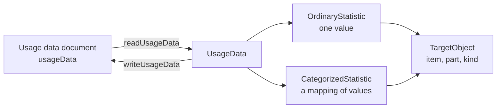

# Usage data

`usage` reads and writes usage data and item statistics: statistics about items, such as p-values and IRT parameters, that
always relate to a context in which they hold. It imports `xml` and `values` and runs in any JavaScript runtime. The runtime
carries the statistics as data; computing them is the work of a psychometrics library.



| Export                                                                                         | Purpose                                                                   |
| ---------------------------------------------------------------------------------------------- | ------------------------------------------------------------------------- |
| `readUsageData(input)`                                                                         | Reads text, bytes or a parsed element into `UsageData`.                   |
| `writeUsageData(data)`                                                                         | Writes `UsageData` as a document that the UD schema accepts.              |
| `USAGE_NAMESPACE`                                                                              | The namespace of the UD schema.                                           |
| `ITEM_STATISTICS`, `DISTRACTOR_STATISTICS`                                                     | The terms of the two external vocabularies for the `name` of a statistic. |
| `UsageData`, `ItemStatistic`, `OrdinaryStatistic`, `CategorizedStatistic`, `ItemStatisticBase` | The statistics.                                                           |
| `TargetObject`, `StatisticValue`, `StatisticMapping`, `StatisticMapEntry`                      | The parts of a statistic.                                                 |
| `ObjectType`, `STATISTIC_OBJECT_TYPES`                                                         | The kinds of object a statistic may be about, with the list of them.      |

## Quick start

```ts
import { readUsageData, writeUsageData } from "@assesskit/runtime/usage";

const data = readUsageData(`<usageData xmlns="http://www.imsglobal.org/xsd/imsqti_usagedata_v3p0">
  <ordinaryStatistic name="P-value" context="http://example.com/sample" caseCount="689325" lastUpdated="2004-07-04">
    <targetObject identifier="Item_VB123456"/>
    <value>0.647</value>
  </ordinaryStatistic>
</usageData>`);

data.statistics[0]?.kind; // => "ordinary"
data.statistics[0]?.targetObjects; // => [{ identifier: "Item_VB123456" }]
data.statistics[0]?.lastUpdated; // => "2004-07-04"

writeUsageData(data);
// => '<?xml version="1.0" encoding="UTF-8"?>\n<usageData xsi:schemaLocation="http://www.imsglobal.org/xsd/imsqti_usagedata_v3p0 https://purl.imsglobal.org/spec/qti/v3p0/schema/xsd/imsqti_usagedatav3p0_v1p0.xsd" xmlns="http://www.imsglobal.org/xsd/imsqti_usagedata_v3p0" xmlns:xsi="http://www.w3.org/2001/XMLSchema-instance"><ordinaryStatistic name="P-value" context="http://example.com/sample" caseCount="689325" lastUpdated="2004-07-04"><targetObject identifier="Item_VB123456"/><value>0.647</value></ordinaryStatistic></usageData>'
```

## Model

| Type                   | Fields                                                                                                      |
| ---------------------- | ----------------------------------------------------------------------------------------------------------- |
| `UsageData`            | `glossary?`, `statistics`: the two kinds in the order of the document                                       |
| `OrdinaryStatistic`    | `kind: "ordinary"`, the fields of `ItemStatisticBase`, `value`                                              |
| `CategorizedStatistic` | `kind: "categorized"`, the fields of `ItemStatisticBase`, `mapping`                                         |
| `ItemStatisticBase`    | `name`, `glossary?`, `context`, `caseCount?`, `stdError?`, `stdDeviation?`, `lastUpdated?`, `targetObjects` |
| `TargetObject`         | `identifier`, `partIdentifier?`, `objectType?`                                                              |
| `StatisticValue`       | `value`, `baseType?`, `fieldIdentifier?`                                                                    |
| `StatisticMapping`     | `lowerBound?`, `upperBound?`, `defaultValue?`, `entries`: `{ mapKey, mappedValue, caseSensitive? }[]`       |

An optional field the document leaves out is absent from the model, never `undefined`.

## Rules

| Rule                                                                                                                                                                              | Source                                                             |
| --------------------------------------------------------------------------------------------------------------------------------------------------------------------------------- | ------------------------------------------------------------------ |
| A statistic has at least one target object; a mapping has at least one entry. A categorized statistic has a `mapping`, an ordinary one a `value`.                                 | Usage Data, item statistics                                        |
| A `value` without a base type is a `float`, because an ordinary statistic is a numeric value. Any other value needs its `baseType`, and is read in the lexical form of that type. | Usage Data, `ordinaryStatistic`; ASI Information Model, base types |
| `lastUpdated` is `YYYY-MM-DD` with a four-digit year, a month and a day of that month, and no time zone: the pattern of `DateDType`.                                              | The UD schema                                                      |
| `name` is an identifier. The two vocabularies list common names; any other name is read and written, and its `glossary` defines it.                                               | Usage Data, external vocabularies                                  |
| `defaultValue` is absent when the document gives none; the schema's default is `0`.                                                                                               | The UD schema                                                      |
| The namespace is strict. The usage data of the packages of the 1EdTech examples are in the namespace of QTI 2.2, so `readUsageData` refuses them.                                 | [Spec gaps](spec-gaps.md): namespaces of the samples               |
| The reader refuses an attribute, element or text that the schema does not define at that place.                                                                                   | The UD schema                                                      |

## Vocabularies

| List                     | Terms                                                                                                          |
| ------------------------ | -------------------------------------------------------------------------------------------------------------- |
| `STATISTIC_OBJECT_TYPES` | The seven terms of `ObjectTypeEnum`: `test`, `testpart`, `section`, `item`, `outcome`, `interaction`, `choice` |
| `ITEM_STATISTICS`        | The sixteen terms of the "Item Statistics" vocabulary                                                          |
| `DISTRACTOR_STATISTICS`  | The four terms of the "Distractor Statistics" vocabulary                                                       |

## Errors

`readUsageData` throws `ReadError` with one issue; `writeUsageData` throws `DataError` for a model that is not usage data. Input
that is not text, bytes or an element is a `DataError`, and text or bytes that break a limit of `parseXml` are a `SecurityError`.
The rules are those of [results](results.md#errors) with the module `usage`:

| Rule                                                                                                             | Meaning                                                                                       |
| ---------------------------------------------------------------------------------------------------------------- | --------------------------------------------------------------------------------------------- |
| `assesskit/usage/not-usage-data`                                                                                 | The root is not `usageData` of the UD namespace.                                              |
| `assesskit/usage/missing-attribute`, `assesskit/usage/invalid-attribute`, `assesskit/usage/unexpected-attribute` | A required attribute is missing, an attribute is not valid, or the schema does not define it. |
| `assesskit/usage/missing-element`, `assesskit/usage/unexpected-element`, `assesskit/usage/unexpected-text`       | A required element is missing, or an element or text is not allowed at that place.            |
| `assesskit/usage/invalid-value`                                                                                  | A `value` that is not of its base type.                                                       |

## Not included

| Not included                        | Why                                                                          |
| ----------------------------------- | ---------------------------------------------------------------------------- |
| Computing the statistics            | A psychometrics library does that; `usage` carries the results as data       |
| Applying a mapping to a value       | A mapping is data about categories; processing owns the mapping of responses |
| Reading the usage data of a package | The 1EdTech packages use the namespace of QTI 2.2, which the reader refuses  |

## Differences from the references

| Case                                                                                  | Resolution                                                                                          |
| ------------------------------------------------------------------------------------- | --------------------------------------------------------------------------------------------------- |
| The usage data of the packages of the 1EdTech examples is in the namespace of QTI 2.2 | The schema decides, and the namespace is strict: `readUsageData` refuses them ([G12](spec-gaps.md)) |
| The schema gives `defaultValue` the default `0`                                       | An absent `defaultValue` stays absent: a document that gives none has none                          |
| An ordinary statistic whose `value` has no base type                                  | Read as a `float`, since an ordinary statistic is a numeric value                                   |

## Files

Each file of `src/usage/` holds one concept.

| File                  | Concept                                            |
| --------------------- | -------------------------------------------------- |
| `model.ts`            | The model of usage data and statistics             |
| `vocabularies.ts`     | The object types and the two external vocabularies |
| `namespace.ts`        | The namespace and the schema location              |
| `read-usage-data.ts`  | Reading a document into the model                  |
| `write-usage-data.ts` | Writing the model as a document                    |

## References

| Topic                         | Specification                                                                                      |
| ----------------------------- | -------------------------------------------------------------------------------------------------- |
| Usage data and statistics     | [QTI 3.0 Usage Data](https://www.imsglobal.org/sites/default/files/spec/qti/v3/ud-bind/index.html) |
| Base types and their forms    | [QTI 3.0 ASI Information Model](https://www.imsglobal.org/spec/qti/v3p0/info/)                     |
| Places where the specs differ | [Spec gaps](spec-gaps.md)                                                                          |
