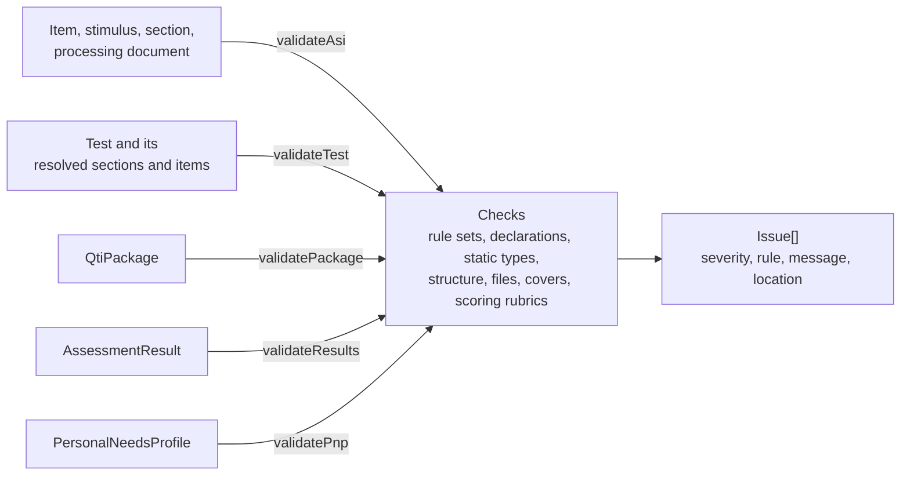

# The validator

`validate` finds what a schema cannot: the rule sets of the XML binding, the constraints of the Information Model, the static
types of processing, the structure of a test, the covers and scoring rubrics of externally scored outcomes, the files of a package, and the rules
of Results Reporting and personal needs profiles. It reports what would fail or misbehave when content runs, before it does.
It imports every module below it in the layers (`xml`, `values`, `asi`, `results`, `usage`, `pnp`, `metadata`, `processing`,
`interactions`, `pci`, `content`, `cat`, `package`) and runs in any JavaScript runtime. Validating a document against the published
XSD schemas is `validateXmlFiles` of [node](node.md); `assesskit validate` of the [command line](cli.md) runs both.



| Export                                          | Purpose                                                                                               |
| ----------------------------------------------- | ----------------------------------------------------------------------------------------------------- |
| `validateAsi(document, options?)`               | The issues of an item, test, section, stimulus, response processing or outcome declaration.           |
| `validateTest(test, base, resolvers, options?)` | The issues of a test and of every section, item and stimulus it names: the static gate of an engine.  |
| `validatePackage(pkg, options?)`                | The issues of a package: its files, its resources and every document in them.                         |
| `validateResults(result, options?)`             | The issues of a Results Reporting document.                                                           |
| `validatePnp(profile)`                          | The issues of the sets of a personal needs profile.                                                   |
| `validatePnpNamespace(root, options?)`          | The elements of a PNP document in a namespace other than the schema's.                                |
| `ValidateOptions`                               | The options of the first three; `maxFindings` alone for `validateResults` and `validatePnpNamespace`. |

Every function returns `readonly Issue[]` and none throws for content that is invalid; the order of the issues is the
order in which the checks found them. A wrong argument, or a model whose shape is not the one the schema gives it, is a
`DataError`. The functions are pure: they read the model and change nothing.

## Quick start

```ts
import { readAsi } from "@assesskit/runtime/asi";
import { validateAsi } from "@assesskit/runtime/validate";

const document = readAsi(`<qti-assessment-item xmlns="http://www.imsglobal.org/xsd/imsqtiasi_v3p0"
    identifier="capital" title="Capital" time-dependent="false">
  <qti-response-declaration identifier="RESPONSE" cardinality="single" base-type="identifier">
    <qti-correct-response><qti-value>paris</qti-value></qti-correct-response>
  </qti-response-declaration>
  <qti-outcome-declaration identifier="SCORE" cardinality="single" base-type="integer"/>
  <qti-item-body>
    <qti-choice-interaction response-identifier="RESPONSE" max-choices="1">
      <qti-simple-choice identifier="paris">Paris</qti-simple-choice>
      <qti-simple-choice identifier="rome">Rome</qti-simple-choice>
    </qti-choice-interaction>
  </qti-item-body>
  <qti-response-processing>
    <qti-response-condition>
      <qti-response-if>
        <qti-match><qti-variable identifier="RESPONSE"/><qti-correct identifier="ANSWER"/></qti-match>
        <qti-set-outcome-value identifier="SCORE"><qti-base-value base-type="float">1</qti-base-value></qti-set-outcome-value>
      </qti-response-if>
    </qti-response-condition>
  </qti-response-processing>
</qti-assessment-item>`);

const issues = validateAsi(document, { path: "capital.xml" });
issues.map(({ severity, rule }) => `${severity} ${rule}`);
// => ["warning assesskit/validate/standard-outcome", "error assesskit/validate/undeclared-variable", "error assesskit/validate/assignment-type"]
issues[1]?.message; // => 'The item declares no response variable "ANSWER", which an expression reads. Declare it with the declaration of its kind.'
issues[2]?.message; // => 'The variable "SCORE" is a single integer and cannot be set to a single float.'
issues[2]?.location?.element; // => "qti-assessment-item/qti-response-processing/qti-response-condition/qti-response-if/qti-set-outcome-value"
```

## Issues

An `Issue` has a `severity`, the `rule` it breaks, a `message` that says what is wrong and what is expected, and a `location` with
the `path` of the file and the `element` path.

- An `error` is content that breaks a rule or fails when it runs. A `warning` is content that runs but deviates from a
  recommendation or cannot do what it appears to.
- The `rule` of the rule sets of the XML binding is the identifier of the rule set, such as `RULE_SET_INTERACTION_02B`. The
  other rules are `assesskit/validate/<name>`, and `assesskit/covers/<name>` for the covers and `assesskit/scoring-rubric/<name>` for the scoring rubrics of external scores.
- `validateTest` and `validatePackage` check many documents. Each issue names its own file in `location.path`: a test
  is reported at the path `base`, its sections, items and stimuli at the paths the resolvers give, and the files and
  resources of a package at `imsmanifest.xml`.
- A reference that cannot be resolved, or a document that cannot be read, is one issue: the issues of a `ReadError`, or
  `assesskit/validate/unresolved-reference` for any other error of the runtime. What is left unresolved is not checked further.
- A validation lists at most `maxFindings` issues, over all the documents it checks. When the checks find more, the list
  ends with the error `assesskit/validate/findings-stopped`: an error because the content may hold more errors than the list
  shows. Content that is wrong at every element of a document at the size limit of `parseXml` makes close to a million
  issues, which would cost about 700 MB without the limit and close to a gigabyte for each such document of a package.

## Options

| Option            | Default | Effect                                                                                                                                                                                                                                                                 |
| ----------------- | ------- | ---------------------------------------------------------------------------------------------------------------------------------------------------------------------------------------------------------------------------------------------------------------------- |
| `path`            | none    | The path of the document, named in the location of its issues. Used by `validateAsi` only.                                                                                                                                                                             |
| `customOperators` | none    | A `Map` from the `definition` or `class` of a `qti-custom-operator` to its function. When given, an operator that no entry serves is an error; when absent, custom operators are not checked.                                                                          |
| `resolveTemplate` | none    | Returns the response processing for a template URI other than the six standard ones, called with the `template-location` of the item, else its `template`. When absent, only the standard templates are known. `validatePackage` adds the templates the package holds. |
| `maxFindings`     | `1000`  | The most issues to list, a positive integer. When the checks find more, the list ends with the error `assesskit/validate/findings-stopped`.                                                                                                                            |

## Rule sets of the XML binding

Each rule set is checked against the typed model, so `qti-label` (a QTI element) and `label` (HTML) are different
elements, as the schema says. A rule set with the suffix `A` forbids an interaction inside another, `B` checks the
attributes of the interaction and the base type of its response.

| Rule                                     | Reported when                                                                                                                                                                                       |
| ---------------------------------------- | --------------------------------------------------------------------------------------------------------------------------------------------------------------------------------------------------- |
| `assesskit/validate/figure-multiplicity` | A `figure` has more than one `figcaption`.                                                                                                                                                          |
| `RULE_SET_ARIA_ROLES_1`                  | A `source` has a `role`, or an `h1` has a `role` other than `heading`, `tab` or `presentation`.                                                                                                     |
| `RULE_SET_GENERAL_1`                     | `qti-outcome-minimum`, `qti-outcome-maximum` or `qti-test-variables` in response processing.                                                                                                        |
| `RULE_SET_INTERACTION_01A` to `20A`      | One of the 20 interactions inside another interaction, in the model or in the XML that it keeps (PCI, custom).                                                                                      |
| `RULE_SET_INTERACTION_01B` to `19B`      | A `max-choices`, `max-associations`, `max-plays` or `upper-bound` below its minimum; equal `string-identifier` and `response-identifier`; a response whose base type the interaction does not bind. |
| `RULE_SET_INTERACTION_20B`               | A context or template variable that a portable custom interaction passes and the item does not declare.                                                                                             |
| `RULE_SET_INTERACTION-RELATED_1` to `_4` | A `match-max` other than 0 below `match-min` on `qti-gap-text`, `qti-gap-img`, `qti-associable-hotspot` or `qti-simple-associable-choice`.                                                          |
| `RULE_SET_RUBRICBLOCK`                   | A `qti-rubric-block` inside a `qti-rubric-block`.                                                                                                                                                   |
| `RULE_SET_SPECIFIC_CLASS_OUTCOMEDEC`     | A `mastery-value` outside `normal-minimum` and `normal-maximum`.                                                                                                                                    |
| `RULE_SET_SPECIFIC_CLASS_RESPONSEDEC`    | A cardinality `single` response bound to a `qti-choice-interaction` with a `max-choices` other than 1.                                                                                              |
| `assesskit/validate/extension-attribute` | An attribute beyond the schema's on an element that allows them, not named `data-` and name characters.                                                                                             |

## Declarations and references

| Rule                                             | Reported when                                                                                                                                                     | Source                                  |
| ------------------------------------------------ | ----------------------------------------------------------------------------------------------------------------------------------------------------------------- | --------------------------------------- |
| `assesskit/validate/duplicate-identifier`        | A variable, test part, section or item reference identifier is declared twice; two variable mappings of an item reference share a target.                         | Information Model                       |
| `assesskit/validate/reserved-identifier`         | A declaration of a built-in variable: `numAttempts`, `duration`, `completionStatus`, `QTI_CONTEXT`.                                                               | Information Model                       |
| `assesskit/validate/base-type`                   | A variable with a cardinality other than record and no base type.                                                                                                 | Information Model                       |
| `assesskit/validate/declared-value`              | A default, correct response, map key or lookup table value that is not a value of the base type of its variable.                                                  | The lexical form of the base type       |
| `assesskit/validate/standard-outcome`            | `SCORE` or `MAXSCORE` that is not a float, or `PASSED` that is not a boolean. Warning.                                                                            | Information Model, Best Practices Guide |
| `assesskit/validate/undeclared-variable`         | An expression, rule, printed variable, feedback or template content, or PCI variable names a variable the item or test does not declare.                          | Information Model                       |
| `assesskit/validate/variable-out-of-reach`       | Template processing reads a response or outcome variable.                                                                                                         | Information Model                       |
| `assesskit/validate/reference-kind`              | An attribute names a variable of a kind it may not name, such as a response variable for `outcome-identifier`.                                                    | Information Model                       |
| `assesskit/validate/reference-type`              | An attribute names a variable of the wrong base type or cardinality, such as the `outcome-identifier` of feedback, which must be a single or multiple identifier. | Information Model                       |
| `assesskit/validate/duration-not-time-dependent` | `duration` is read in an item that is not `time-dependent`.                                                                                                       | Information Model                       |
| `assesskit/validate/unbound-response`            | A response declaration that no interaction binds. Warning.                                                                                                        | Information Model                       |
| `assesskit/validate/identifier-syntax`           | An attribute of the type `identifier` that does not start with a letter or `_` and contain only letters, digits, `_`, `-` and `.`.                                | Information Model                       |
| `assesskit/validate/identifier-style`            | An identifier that has a period or more than 32 characters. Warning.                                                                                              | Information Model                       |
| `assesskit/validate/duplicate-id`                | An `id` that two elements of a document share.                                                                                                                    | Information Model                       |
| `assesskit/validate/unresolved-reference`        | An `idref` that no element of the document has; a reference or a document that cannot be resolved or read.                                                        | Information Model, XML Binding          |
| `assesskit/validate/unresolved-include`          | An `xi:include` left in the document: resolve includes before validating.                                                                                         | Information Model                       |
| `assesskit/validate/rubric-interaction`          | An interaction inside a `qti-rubric-block`.                                                                                                                       | Information Model                       |
| `assesskit/validate/unreachable-content`         | Feedback or template content that shows or hides for an identifier its controlling variable can never take. Warning.                                              | Information Model                       |

## Static types of processing

A bottom-up inference gives every expression a cardinality and base type from the signatures of the operators and the
declarations. A type that is not known statically (a custom operator, a record field, a variable without a base type)
is unknown, and an unknown type passes every check, so a finding is a defect and never a guess.

| Rule                                            | Reported when                                                                                                                                             | Source                       |
| ----------------------------------------------- | --------------------------------------------------------------------------------------------------------------------------------------------------------- | ---------------------------- |
| `assesskit/validate/operand-count`              | An operator has more or fewer operands than its signature allows.                                                                                         | Information Model, operators |
| `assesskit/validate/operand-type`               | An operand has a base type or cardinality the operator does not take, or operands that must share a base type do not.                                     | Information Model, operators |
| `assesskit/validate/match-float`                | `qti-match` of floats. Warning.                                                                                                                           | Information Model            |
| `assesskit/validate/random-bounds`              | `qti-random-integer` or `qti-random-float` with `min` above `max`: the result is always NULL.                                                             | Information Model            |
| `assesskit/validate/weight-with-integer`        | `qti-test-variables` with a `weight-identifier` and `base-type` integer.                                                                                  | Information Model            |
| `assesskit/validate/weight-undefined`           | A weight that no `qti-weight` of the item reference defines, or one named in an item. Warning: the weight is 1.                                           | Information Model            |
| `assesskit/validate/item-variable-undefined`    | `ITEM.VAR` of an item reference that selection with replacement can repeat in a test part that submits each item alone. Warning.                          | Information Model            |
| `assesskit/validate/missing-mapping`            | `qti-map-response` of a variable without `qti-mapping`, or `qti-map-response-point` of one without `qti-area-mapping` or of a base type other than point. | Information Model            |
| `assesskit/validate/pattern`                    | A `qti-pattern-match` pattern or a `pattern-mask` that `compileXsdRegex` rejects.                                                                         | Information Model            |
| `assesskit/validate/outcome-only-expression`    | An expression that reads the item sessions of a test, such as `qti-number-correct`, outside outcome processing.                                           | Information Model            |
| `assesskit/validate/custom-operator`            | A `qti-custom-operator` that none of `customOperators` serves; only when the option is given.                                                             | Information Model            |
| `assesskit/validate/unknown-expression`         | A model with an expression kind that QTI 3.0 does not define.                                                                                             | Information Model            |
| `assesskit/validate/assignment-target`          | A rule sets a variable of a kind the rule may not set.                                                                                                    | Information Model, rules     |
| `assesskit/validate/assignment-type`            | A value that does not fit the variable it is set to, or the template default an item reference gives; an integer fits a float or duration variable.       | Information Model            |
| `assesskit/validate/condition-type`             | The expression of a condition, pre-condition, branch rule or template constraint is not a single boolean.                                                 | Information Model            |
| `assesskit/validate/completion-status`          | `completionStatus` set to a constant other than `not_attempted`, `unknown`, `incomplete` or `completed`.                                                  | Information Model            |
| `assesskit/validate/lookup-table`               | A lookup rule for an outcome that is not a single outcome with a lookup table.                                                                            | Information Model            |
| `assesskit/validate/lookup-source`              | The source of a lookup rule has a type the table of the outcome does not take (a match table needs integers).                                             | Information Model            |
| `assesskit/validate/template-constraint`        | A `qti-template-constraint` inside a condition.                                                                                                           | Information Model            |
| `assesskit/validate/constraint-without-default` | A template variable that a constraint reads has no default. Warning.                                                                                      | Information Model            |
| `assesskit/validate/external-score-assigned`    | Outcome processing sets an externally scored outcome, replacing the score supplied to it. Warning.                                                        | Information Model            |
| `assesskit/validate/unknown-template`           | A response processing template that is not standard and that `resolveTemplate` does not resolve, in an item without rules.                                | Information Model            |
| `assesskit/validate/legacy-template`            | A QTI 2.x template address. Warning: the standard template of the same algorithm applies.                                                                 | Best Practices Guide         |

## Test structure and covers

| Rule                                       | Reported when                                                                                                                                                                                                   | Source                                    |
| ------------------------------------------ | --------------------------------------------------------------------------------------------------------------------------------------------------------------------------------------------------------------- | ----------------------------------------- |
| `assesskit/validate/identifier-mismatch`   | A section reference whose identifier differs from its section's (error); an item reference whose identifier differs from its item's (warning).                                                                  | Information Model                         |
| `assesskit/validate/selection`             | A selection without replacement of more children than the section has, or fewer than it requires.                                                                                                               | Information Model                         |
| `assesskit/validate/adaptive-section`      | An adaptive section with a sub-section, or one that is not directly in a test part.                                                                                                                             | CAT                                       |
| `assesskit/validate/adaptive-simultaneous` | An adaptive item in a test part that submits simultaneously.                                                                                                                                                    | Information Model                         |
| `assesskit/validate/branch-target`         | A branch rule whose target is unknown, behind its source, or of a level the rule may not name.                                                                                                                  | Information Model                         |
| `assesskit/validate/branch-to-repeated`    | A branch rule that targets an item that selection with replacement can repeat.                                                                                                                                  | Information Model                         |
| `assesskit/validate/ignored-rule`          | A branch rule or pre-condition that is ignored: on a nonlinear part or in it, on an item of an adaptive section, or targeting one. Warning.                                                                     | Information Model, CAT                    |
| `assesskit/validate/unreachable`           | A test part or item that no path reaches because a branch rule that is always true jumps over it. Warning.                                                                                                      | Information Model                         |
| `assesskit/covers/undeclared-outcome`      | A covers block for an outcome the test does not declare.                                                                                                                                                        | The runtime convention                    |
| `assesskit/covers/not-external`            | A covers block for an outcome that is not `external-scored`.                                                                                                                                                    | Information Model                         |
| `assesskit/covers/unknown-item-ref`        | A cover that names an item reference the test does not have.                                                                                                                                                    | The runtime convention                    |
| `assesskit/covers/unknown-response`        | A cover that names a response the item does not declare.                                                                                                                                                        | The runtime convention                    |
| `assesskit/covers/duplicate`               | The same cover twice in a block, or two blocks for one outcome.                                                                                                                                                 | The runtime convention                    |
| `assesskit/covers/malformed`               | A block whose `view` lacks `scorer` or has `candidate`, or without `data-outcome-identifier`; an entry without both attributes. A block below the test with the class token is a warning: it is not recognized. | Information Model, the runtime convention |

Branch rules and pre-conditions are evaluated with the structure the test builds when its section references are
resolved (`validateTest`), so their targets can be checked across documents. `validateAsi` of a test checks the
document alone.

## Scoring rubrics

`validateAsi` of an item or a test checks each rubric block that carries the class token `external-scoring-rubric`
(the [convention](conventions.md#scoring-rubrics) of the runtime), whether or not the test can resolve its items. Every
rule of the convention is an error, and each issue names the outcome and the path of the rule that is broken, such as
`criteria[1].levels`.

| Rule                                          | Reported when                                                                                                                                                                                                                                                                                                                                                                                                                                             | Source             |
| --------------------------------------------- | --------------------------------------------------------------------------------------------------------------------------------------------------------------------------------------------------------------------------------------------------------------------------------------------------------------------------------------------------------------------------------------------------------------------------------------------------------- | ------------------ |
| `assesskit/scoring-rubric/malformed`          | A block whose `view` lacks `scorer` or has `candidate`; without `data-outcome-identifier`; with an unknown `data-rubric-kind`; with no criteria; a criterion without an identifier or a levels list; a level without `data-score`; a `data-weight` or `data-score` that is not a finite number in range; a block that has the class token of the covers too. A block with the class token in a test part or a section is a warning: it is not recognized. | Runtime convention |
| `assesskit/scoring-rubric/shape`              | The shape of the kind is broken: fewer than two levels, a holistic rubric with more than one criterion or a weight other than 1, a checklist criterion without two levels of which one scores 0, a single-point criterion without three levels of strictly ascending scores.                                                                                                                                                                              | Runtime convention |
| `assesskit/scoring-rubric/duplicate`          | Two blocks for one outcome; a criterion identifier twice; a score twice within a criterion.                                                                                                                                                                                                                                                                                                                                                               | Runtime convention |
| `assesskit/scoring-rubric/undeclared-outcome` | A block for an outcome that the item or test does not declare.                                                                                                                                                                                                                                                                                                                                                                                            | Runtime convention |
| `assesskit/scoring-rubric/not-external`       | A block for an outcome that is not `external-scored`.                                                                                                                                                                                                                                                                                                                                                                                                     | Information Model  |
| `assesskit/scoring-rubric/outcome-type`       | An outcome that is not single and integer or float; an integer outcome with a weight times score that is not a whole number.                                                                                                                                                                                                                                                                                                                              | Runtime convention |
| `assesskit/scoring-rubric/out-of-range`       | The highest sum of the rubric is above `normal-maximum`, or the lowest is below `normal-minimum`. Warning.                                                                                                                                                                                                                                                                                                                                                | Information Model  |

When the first block of an outcome is malformed, the outcome has no rubric for the engine, and a later valid block is reported as
a duplicate. A shape or duplicate rule is checked once every value of the block is well formed.

## Packages, results and profiles

| Rule                                                                         | Reported when                                                                                                                                     | Source                                 |
| ---------------------------------------------------------------------------- | ------------------------------------------------------------------------------------------------------------------------------------------------- | -------------------------------------- |
| `assesskit/validate/missing-file`                                            | A listed file, or a file that an adaptive section or a portable custom interaction names with a package-relative address, that the package lacks. | XML Binding, CAT, Best Practices Guide |
| `assesskit/validate/unlisted-file`                                           | A file of the package, or one that a document names, that the manifest does not list.                                                             | XML Binding, CAT                       |
| `assesskit/validate/outside-package`                                         | A listed `href` that leaves the package.                                                                                                          | XML Binding                            |
| `assesskit/validate/resource-type`                                           | A resource whose file holds another kind of document than its type says.                                                                          | XML Binding                            |
| `assesskit/validate/metadata-identifier`                                     | An item whose identifier differs from the one in the LOM metadata of its resource.                                                                | Information Model                      |
| `assesskit/validate/pnp-in-package`, `assesskit/validate/results-in-package` | A personal needs profile, or a results report, in a package.                                                                                      | XML Binding                            |
| `assesskit/validate/module-resolution`                                       | A module of a portable custom interaction that no present package-relative location serves.                                                       | Best Practices Guide                   |
| `assesskit/validate/sequence-index`                                          | An item result of a test result without `sequenceIndex`, or two item instances with one.                                                          | Results Reporting                      |
| `assesskit/validate/normal-maximum`                                          | An outcome with a `normal-maximum` of 0 or below.                                                                                                 | Results Reporting                      |
| `assesskit/validate/support-value`                                           | A prohibited support that reports a value.                                                                                                        | Results Reporting                      |
| `assesskit/validate/pnp-prohibited`                                          | A prohibited support that is also in an activate set (error), or also assigned (warning).                                                         | Best Practices Guide                   |
| `assesskit/validate/pnp-sets`                                                | A support in both activate sets. Warning.                                                                                                         | Best Practices Guide                   |
| `assesskit/validate/pnp-color-theme`                                         | A color theme in `text-appearance`, which the guide has and the PNP schema does not ([spec gaps](spec-gaps.md), G49). Warning.                    | Best Practices Guide                   |
| `assesskit/validate/pnp-namespace`                                           | An element of a PNP document in one of the two alternate namespaces.                                                                              | Best Practices Guide, XML Binding      |

`validatePackage` reads each resource through `package.document`, so the includes of a document are resolved, an item
is checked with the response processing templates the package holds, and a test is checked as `validateTest` checks it
with `createPackageResolvers`. Each document is checked once, however many tests name it.

## Errors

| Situation                                                                                                                 | Result                                                                                                        | What to do                                                                             |
| ------------------------------------------------------------------------------------------------------------------------- | ------------------------------------------------------------------------------------------------------------- | -------------------------------------------------------------------------------------- |
| Content that breaks a rule or fails when it runs                                                                          | An `Issue` with the severity `error` in the result, never a throw                                             | Fix the content where the issue says: its `location` has the path and the element path |
| Content that runs but deviates from a recommendation                                                                      | An `Issue` with the severity `warning`                                                                        | Fix it, or accept it knowing what the message says                                     |
| The checks find more issues than `maxFindings`                                                                            | The list ends with the error `assesskit/validate/findings-stopped`                                            | Fix the first issues and validate again, or raise `maxFindings`                        |
| A reference cannot be resolved, or a document cannot be read                                                              | One issue: those of the `ReadError`, or `assesskit/validate/unresolved-reference` for any other runtime error | Fix the reference or the document; what is unresolved is not checked further           |
| An argument of the wrong type, a model whose shape is not the schema's, or a `maxFindings` that is not a positive integer | `DataError` that says what is wrong and what is expected                                                      | Pass the model that a reader of the runtime returns                                    |
| A resolver or a custom operator of the host throws an error that is not one of the runtime's                              | The error itself: a defect of the host's code, not a finding                                                  | Fix the function that threw                                                            |

## Differences from the references

Where the specifications are silent or ambiguous, the validator reads them like this:

| Case                                                  | Resolution                                                                                                              |
| ----------------------------------------------------- | ----------------------------------------------------------------------------------------------------------------------- |
| A type that cannot be known statically                | It passes: custom operators, record fields and variables without a base type are never reported.                        |
| A standard outcome of another base type               | A warning, as content varies and still runs.                                                                            |
| A rule that sets an externally scored outcome         | A warning: it replaces the supplied score on every run.                                                                 |
| `ITEM.VAR` of a repeatable item reference             | In an individual part, a warning: its value is undefined.                                                               |
| A QTI 2.x template address                            | A warning; a template that is neither standard nor resolved is an error only for an item with no rules.                 |
| A weight with no definition                           | A warning, because the weight 1 applies.                                                                                |
| Content that never shows or hides                     | Reported only when every assignment to its controlling variable is a constant.                                          |
| Selection, adaptive sections, simultaneous submission | The errors those parts of the specifications name.                                                                      |
| `qti-custom-interaction` and its attributes           | It is constrained to `data-` attributes although its schema allows any: the XML binding lists it.                       |
| An interaction inside kept XML                        | Interactions in the XML that the model keeps (portable custom interactions) count as nested.                            |
| `RULE_SET_SPECIFIC_CLASS_RESPONSEDEC`                 | Its first rule is about a `max-choices` of `qti-inline-choice-interaction`, which has none, so it cannot apply.         |
| A text entry bound to a record                        | It passes: a record has no base type ([spec gaps](spec-gaps.md)).                                                       |
| A `ruby` and its `rp`, `rt` and `rtc`                 | No limit on their number: the schema decides ([spec gaps](spec-gaps.md)).                                               |
| Modules of a portable custom interaction              | A module is served when a location of it is in the package, read from its root; every location that is there is listed. |
| LOM identifier and item identifier                    | They are compared after the white space around them is removed.                                                         |
| An item reference with another identifier             | A warning, since the Information Model says it should be the same as the item's.                                        |
| Results of one item instance                          | Item results of one instance, such as attempts, share a `sequenceIndex`; two different items must not.                  |

Each decision is a place where the specifications differ; [Spec gaps](spec-gaps.md) lists them.

## Not included

| Not included                           | Why                                                                                         |
| -------------------------------------- | ------------------------------------------------------------------------------------------- |
| Validation against the XSD schemas     | [node](node.md) compiles the schemas with libxml2; `validate` is pure and runs everywhere   |
| Resolving `xi:include`                 | The caller resolves includes first; one left in the document is an error                    |
| Fixing content                         | The validator reports; it changes nothing                                                   |
| Checks that need a run                 | A static check cannot tell what a candidate answers; [processing](processing.md) runs rules |
| Rendering and accessibility of content | The player owns presentation                                                                |

## Files

Each file of `src/validate/` holds one concept.

| File                                                                                                    | Concept                                                              |
| ------------------------------------------------------------------------------------------------------- | -------------------------------------------------------------------- |
| `asi.ts`, `item.ts`, `test.ts`, `validate-test.ts`, `package.ts`, `results.ts`, `pnp.ts`                | The entry of each kind of content                                    |
| `options.ts`, `findings.ts`, `reports.ts`, `failures.ts`                                                | Options, and collecting issues by file                               |
| `bind-rule-sets.ts`, `formats.ts`, `document-checks.ts`, `generic-checks.ts`                            | The checks of every element of every document                        |
| `declarations.ts`, `standard-outcomes.ts`, `item-scope.ts`, `test-scope.ts`, `scope.ts`                 | Declarations and the variables in reach                              |
| `expressions.ts`, `static-type.ts`, `constant-values.ts`, `rules.ts`, `response-rules.ts`               | Static types, expressions and the rules of processing                |
| `template-constraints.ts`, `attribute-references.ts`, `content-references.ts`, `unreachable-content.ts` | References from attributes and content to variables                  |
| `test-structure.ts`, `test-structure-checks.ts`, `branch-rules.ts`, `covers.ts`                         | The structure of a test, branch rules and covers                     |
| `scoring-rubric.ts`                                                                                     | The scoring rubrics of an item or a test                             |
| `package-files.ts`, `package-references.ts`                                                             | The files of a package and the references to them                    |
| `model-access.ts`                                                                                       | Reading properties of a model that the checks share                  |
| `internal.ts`                                                                                           | What other modules and the tests use and the package does not export |

## References

| Topic                                          | Specification                                                                                             |
| ---------------------------------------------- | --------------------------------------------------------------------------------------------------------- |
| Constraints of the model, selection, branching | [QTI 3.0 ASI Information Model](https://www.imsglobal.org/spec/qti/v3p0/info/)                            |
| Rule sets, packages                            | [QTI 3.0 ASI XML Binding](https://www.imsglobal.org/spec/qti/v3p0/bind/)                                  |
| Personal needs profiles, security, templates   | [QTI 3.0 Best Practices and Implementation Guide](https://www.imsglobal.org/spec/qti/v3p0/impl/)          |
| Adaptive sections                              | [CAT 1.0](https://www.imsglobal.org/spec/cat/v1p0/impl/)                                                  |
| Results                                        | [QTI 3.0 Results Reporting](https://www.imsglobal.org/sites/default/files/spec/qti/v3/rr-bind/index.html) |
| Where the specifications differ                | [Spec gaps](spec-gaps.md)                                                                                 |
