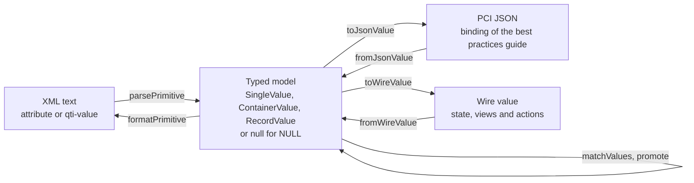

# Values

`values` holds the values of QTI variables and everything that reads, writes, compares and converts them. It imports no other
module and runs in any JavaScript runtime.



| Base type              | JavaScript                            | XML text                                  | JSON of a value                                         |
| ---------------------- | ------------------------------------- | ----------------------------------------- | ------------------------------------------------------- |
| `boolean`              | `boolean`                             | `true`, `false`, `1`, `0`                 | `true`                                                  |
| `integer`              | `number`, a safe integer; `-0` is `0` | `xs:integer` within the safe integers     | a number                                                |
| `float`                | `number`, any double                  | `xs:double`, with `INF`, `-INF` and `NaN` | a number; `"NaN"`, `"INF"`, `"-INF"` and `"-0"` as text |
| `duration`             | `number` of seconds, any double       | `xs:double` in seconds                    | `"PT90.5S"`                                             |
| `string`               | `string`; the empty string is NULL    | the text, with its whitespace             | a string                                                |
| `identifier`           | `string` that `isIdentifier` accepts  | an identifier                             | a string                                                |
| `uri`                  | `string`                              | the text                                  | a string                                                |
| `point`                | `[x, y]`, two safe integers           | `x y`, as in `118 184`                    | `[118, 184]`                                            |
| `pair`, `directedPair` | `[first, second]`, two identifiers    | `first second`, as in `W G1`              | `["W", "G1"]`                                           |
| `file`                 | `{ reference, mimeType, fileName? }`  | the reference alone                       | `{ "reference": ..., "mime": ..., "name": ... }`        |

| Cardinality | Value                                                                                                       | JSON of a value                                |
| ----------- | ----------------------------------------------------------------------------------------------------------- | ---------------------------------------------- |
| `single`    | One value of a base type                                                                                    | `{ "base": { "<base type>": ... } }`           |
| `multiple`  | A multiset: order does not matter, repeated values count                                                    | `{ "list": { "<base type>": [...] } }`         |
| `ordered`   | A sequence                                                                                                  | `{ "list": { "<base type>": [...] } }`         |
| `record`    | A `Map` from field identifier to a single value, each field with its own base type; insertion order is kept | `{ "record": [{ "name": ..., "base": ... }] }` |

## The model

A value is a `SingleValue`, a `ContainerValue` (cardinality `multiple` or `ordered`) or a `RecordValue`. NULL, the absence
of a value, is `null`: no `Value` is empty. Build values with `single`, `container` and `record`. They check their
arguments, copy them, and return `null` for what is NULL: the empty string, a container with no values and a record with no
fields.

```ts
import { container, matchValues, single } from "@assesskit/runtime/values";

const a = container("multiple", "identifier", ["A", "B", "B"]);
const b = container("multiple", "identifier", ["B", "A", "B"]);
a !== null && b !== null && matchValues(a, b); // => true
single("string", ""); // => null
```

| Function                      | Does                                                                                                               |
| ----------------------------- | ------------------------------------------------------------------------------------------------------------------ |
| `single(baseType, value)`     | Builds a single value, or `null` for the empty string                                                              |
| `container(cardinality, ...)` | Builds a `multiple` or `ordered` value of one base type, or `null` for no values                                   |
| `record(fields)`              | Builds a record from pairs of an identifier and a single value, or `null` for no fields                            |
| `normalizeValue(value)`       | Checks untrusted data deeply and returns a copy, for values that a host or a client passes in                      |
| `isBaseType`, `isCardinality` | Tell whether a string is a term of `BaseTypeEnum` or `CardinalityEnum`; `BASE_TYPES` and `CARDINALITIES` list them |
| `isIdentifier(text)`          | Tells whether text is an identifier: an `NCName`, compared case-sensitively                                        |

A container holds no empty string, because that is NULL. A record is a `Map`, so a field named `__proto__` is data.

## Forms of a value

### XML text

`parsePrimitive(text, baseType)` reads the text of a value as a document writes it, and `formatPrimitive(value, baseType)`
writes it. Whitespace around the text is dropped and runs of whitespace count as one space, except for a `string`, which
stays as it is. The table of base types above gives the forms.

```ts
import { formatPrimitive, parsePrimitive } from "@assesskit/runtime/values";

parsePrimitive("118 184", "point"); // => [118, 184]
parsePrimitive(" 12 ", "integer"); // => 12
formatPrimitive([118, 184], "point"); // => "118 184"
```

`parsePrimitive` returns the JavaScript type of the base type when you give it as a literal: a `number` for `"integer"`,
`"float"` and `"duration"`, a `boolean` for `"boolean"`, and so on. A `file` read from text has the content type
`application/octet-stream`, and a `file` written to text loses its content type and name, because the text is the reference.

### Dates, durations and lists in documents

Documents also write dates, durations and lists in forms that are not base types.

| Function                                                  | Form                                                                                                                                                                                              |
| --------------------------------------------------------- | ------------------------------------------------------------------------------------------------------------------------------------------------------------------------------------------------- |
| `isXsdDateTime(text)`                                     | `YYYY-MM-DDThh:mm:ss` with an optional fraction and time zone, a four-digit year from `0001`, a real day of that month, and `24:00:00` for the end of a day: the `datestamp` of results reporting |
| `isXsdDate(text)`                                         | `YYYY-MM-DD` with a four-digit year from `0001`, a real day of that month and no time zone: the `lastUpdated` of usage data                                                                       |
| `parseIsoDuration(text)`                                  | An ISO 8601 duration in seconds. Weeks, days, hours, minutes and seconds only; years and months are a `DataError`                                                                                 |
| `parseIdentifierList(text)`, `formatIdentifierList(list)` | An `IdentifierList`: identifiers separated by whitespace; an empty text is an empty list                                                                                                          |
| `parseIntegerList(text)`, `formatIntegerList(list)`       | An `IntegerList`: `xs:int` integers, from -2147483648 to 2147483647, separated by whitespace                                                                                                      |

```ts
import { isXsdDate, isXsdDateTime, parseIsoDuration } from "@assesskit/runtime/values";

isXsdDateTime("2020-08-25T18:19:20"); // => true
isXsdDateTime("2020-08-25"); // => false
isXsdDate("2004-07-04"); // => true
isXsdDate("2004-7-4"); // => false
parseIsoDuration("PT2M0.049722S"); // => 120.049722
```

### JSON

Portable custom interactions read and write values in the JSON binding of the best practices guide, and the runtime keeps
state, views and actions in a second form that adds the types. Both need the cardinality and base type of the variable to
write a NULL: they come from its declaration, a `ValueDeclaration` `{ cardinality, baseType }` with no base type for a
record.

| Functions                      | Form                                                                                                                     |
| ------------------------------ | ------------------------------------------------------------------------------------------------------------------------ |
| `toJsonValue`, `fromJsonValue` | The binding of the guide: `{ "base": ... }`, `{ "list": ... }`, `{ "record": ... }`. Reading needs the declaration       |
| `toWireValue`, `fromWireValue` | A `WireValue` `{ cardinality, baseType?, value }`, where `value` is that JSON, or `null` for NULL. Reading needs nothing |

A wire value decodes without a declaration and loses nothing through `JSON.stringify` and `JSON.parse`: it keeps `multiple`
apart from `ordered`, gives a NULL its type, and keeps `NaN`, infinities and `-0`. A record has no `baseType`.

```ts
import { fromJsonValue, single, toJsonValue, toWireValue } from "@assesskit/runtime/values";

toJsonValue(single("duration", 90.5), { cardinality: "single", baseType: "duration" });
// => { base: { duration: "PT90.5S" } }
fromJsonValue({ base: { duration: "PT90.5S" } }, { cardinality: "single", baseType: "duration" });
// => { cardinality: "single", baseType: "duration", value: 90.5 }
toWireValue(null, { cardinality: "ordered", baseType: "point" });
// => { cardinality: "ordered", baseType: "point", value: null }
```

The binding differs from the guide in these cases, each for a stated reason:

| Case                       | Runtime                                                                                                                                 | Reason                                                                                                 |
| -------------------------- | --------------------------------------------------------------------------------------------------------------------------------------- | ------------------------------------------------------------------------------------------------------ |
| `file`                     | `{ "reference", "mime", "name" }`; inline `data` is a `DataError`                                                                       | The host stores the bytes, and a value holds a reference                                               |
| `duration`                 | Written as `PT<seconds>S` with the shortest decimal. Read as weeks, days, hours, minutes and seconds; years or months are a `DataError` | Years and months have no length in seconds, so the guide's own example `P10Y3M20DT4H30M25S` is refused |
| `NaN`, `INF`, `-INF`, `-0` | A `float` or `duration` with one is the string `"NaN"`, `"INF"`, `"-INF"` or `"-0"`                                                     | JSON cannot carry them                                                                                 |
| NULL fields of a record    | Left out when read                                                                                                                      | A record holds no NULL                                                                                 |
| `intOrIdentifier`          | Read as the declared `integer` or `identifier`; in a record by JSON type: a number is an integer, a string an identifier. Never written | The name stands for two base types                                                                     |
| Empty list, empty string   | Read as NULL                                                                                                                            | NULL has no empty form                                                                                 |

## Comparing and converting

`matchValues(a, b)` is the meaning of `qti-match` once neither value is NULL. `promote(value, "float")` turns a value of
base type `integer` into `float`, and `promote(value, "duration")` into `duration`.

| Rule                               | `matchValues`                                                         |
| ---------------------------------- | --------------------------------------------------------------------- |
| Different cardinality or base type | Never match                                                           |
| `multiple` containers              | Same values the same number of times, in any order                    |
| `ordered` containers               | Same values in the same order                                         |
| `record` values                    | Same field identifiers with matching single values                    |
| `pair` and `directedPair`          | A pair ignores the order of its identifiers; a directed pair does not |
| `float` and `duration`             | Compare as `SameValueZero`: `NaN` matches `NaN`, and `0` matches `-0` |
| `string` and `identifier`          | Compare case-sensitively                                              |
| `file`                             | Compare by reference, content type and name                           |

`promote` keeps the numbers and the cardinality, and returns a value that already has the target base type as it is. It is the
type promotion of weighted outcomes and of assigning an integer to a `float` or `duration` variable. Any other conversion is
a `DataError`.

```ts
import { promote, single } from "@assesskit/runtime/values";

promote(single("integer", 3), "float"); // => { cardinality: "single", baseType: "float", value: 3 }
```

## Base64

`encodeBase64` and `decodeBase64` convert bytes to and from base 64 with padding, the encoding of the files of CAT 1.0.
`encodeBase64Url` and `decodeBase64Url` use the URL and filename safe alphabet without padding, the form of the parts of a JWT.
The decoders return `undefined`, not an error, for a text that is not an encoding of bytes. Only the canonical encoding
decodes: a character outside the alphabet, wrong padding, a lone last digit, or bits after the last byte that are not zero
refuse the text, so that one byte string has one spelling.

```ts
import { decodeBase64, decodeBase64Url, encodeBase64, encodeBase64Url } from "@assesskit/runtime/values";

const bytes = new TextEncoder().encode("fo");
encodeBase64(bytes); // => "Zm8="
encodeBase64Url(bytes); // => "Zm8"
decodeBase64("Zm8="); // => Uint8Array.of(102, 111)
decodeBase64("Zm9="); // => undefined
decodeBase64Url("Zm8"); // => Uint8Array.of(102, 111)
```

`decodeBase64("Zm9=")` is `undefined` because the bits after the last byte are not zero.

## Regular expressions

`compileXsdRegex(pattern, options?)` compiles a pattern of the regular expressions of XML Schema, the dialect of
`qti-pattern-match` and `pattern-mask`. It returns an `XsdPattern` whose `matches(text)` tells whether the whole text matches.

```ts
import { compileXsdRegex } from "@assesskit/runtime/values";

const pattern = compileXsdRegex("\\d{3}-\\p{Lu}+");
pattern.matches("123-ABC"); // => true
pattern.matches("123-ABCd"); // => false
```

| Feature                 | Rule                                                                                                                                                                                          |
| ----------------------- | --------------------------------------------------------------------------------------------------------------------------------------------------------------------------------------------- |
| Match                   | The whole text; `^` and `$` are ordinary characters; `.` is any character but line feed and carriage return                                                                                   |
| Quantifiers             | `?`, `*`, `+`, `{n}`, `{n,}`, `{n,m}`                                                                                                                                                         |
| Classes                 | `[a-z]`, `[^a-z]`, subtraction `[a-z-[aeiou]]`; a `-` stands for itself only at the start or the end of a group                                                                               |
| Escapes                 | `\n \r \t` and `\` before `\ \| . - ^ ? * + { } ( ) [ ]`                                                                                                                                      |
| Multi-character escapes | `\s \S \d \D \w \W` and, for XML names, `\i \I \c \C` with the characters of XML 1.0, fifth edition                                                                                           |
| Categories              | `\p{L}` and the other six major classes, their 29 subcategories such as `\p{Lu}`, and `\P{...}`; there is no `Cs`; `\d` is `\p{Nd}`, `\w` is every character but `\p{P}`, `\p{Z}` and `\p{C}` |
| Blocks                  | `\p{IsBasicLatin}` and the other blocks of Unicode 3.1 under the names of XML Schema (`IsGreek`, not `IsGreekandCoptic`); an unknown block is a `DataError`                                   |

Categories are those of Unicode 17.0.0 (`UNICODE_VERSION`), held in tables of the package, so a pattern matches the same text
in every runtime whatever Unicode version the runtime has. The major class `\p{C}` also holds lone surrogates, which a
JavaScript string can contain. A surrogate pair is one character.

### Limits

No pattern can make a text expensive: the pattern becomes a Thompson automaton over code points, and `matches` runs a
deterministic automaton that it builds as the text needs it, in time linear in the text. Only the size of the pattern is
limited, at compile time, with `options.limits`; a limit left out keeps its default, and `DEFAULT_XSD_REGEX_LIMITS` holds them.

| Limit       | Default | Unit   | Meaning                                                                                                        |
| ----------- | ------- | ------ | -------------------------------------------------------------------------------------------------------------- |
| `maxStates` | 100,000 | states | The most states of the automaton once counted repeats are expanded: `a{100000}` is allowed, `a{100001}` is not |
| `maxDepth`  | 100     | levels | The most levels that groups and class subtractions may be nested; it bounds the recursion of the parser        |

A repeat of a node that has no state, such as `(){500000000}`, compiles at once, whatever its count. The tests run the regular
expression tests of the W3C XML Schema test suite and ReDoS fixtures such as `(a+)+$` on 100,000 characters.

### Why it is written here

The patterns come from documents and from templates, so they are untrusted. Two needs of that rule out the mature library of
this dialect, `xspattern` 3.1.0 (MIT):

| Need                                                   | Here                                                  | `xspattern` 3.1.0                                                                               |
| ------------------------------------------------------ | ----------------------------------------------------- | ----------------------------------------------------------------------------------------------- |
| Memory bounded by a limit, and time linear in the text | A deterministic automaton, `maxStates` and `maxDepth` | A matching automaton, but `compile` takes no limit and expands counted repeats into its program |
| The same match in every runtime                        | The tables of Unicode 17.0.0, held in the package     | The tables of Unicode 15.0.0                                                                    |

In a library of that kind, `a{99999999}` in a hostile pattern builds a program of about 10^8 instructions.

## Errors

Every function checks its arguments, as plain JavaScript and JSON can pass anything. None throws for NULL: `null` is a value
of the model.

| Situation                                                                                     | Result                                                                          |
| --------------------------------------------------------------------------------------------- | ------------------------------------------------------------------------------- |
| An argument of the wrong type, such as `null` for options or a number for text                | `DataError` that names the argument and what was found                          |
| A value outside its base type, such as an integer above the safe integers                     | `DataError` that says what the base type expects                                |
| Text that is not in the lexical form of its base type                                         | `DataError` that quotes the text and the form expected                          |
| JSON that is not the value of its declaration, with inline file data, or with years or months | `DataError` that names the path of the first problem                            |
| A pattern outside the dialect, or above a limit                                               | `DataError` that names the problem and its position in characters               |
| A limit that is not a positive integer                                                        | `DataError` whose message begins `The limit maxStates`, or `The limit maxDepth` |
| A text that is not base64                                                                     | `undefined` from the decoders                                                   |
| A text that is not a date or a date and time                                                  | `false` from `isXsdDate` and `isXsdDateTime`                                    |

## Not included

| Not included                                                     | Why                                                                        |
| ---------------------------------------------------------------- | -------------------------------------------------------------------------- |
| Years and months in durations                                    | They have no length in seconds                                             |
| The bytes of a file in a value                                   | The host stores the bytes; a value holds the reference                     |
| Arithmetic, and conversion between base types but `promote`      | Processing evaluates expressions; `values` holds and compares values       |
| Case-insensitive or locale-aware comparison                      | `matchValues` is exact; operators that fold case belong to processing      |
| Anchors, back-references, lookaround, lazy quantifiers and flags | The dialect of XML Schema has none, and without them matching stays linear |
| Unicode blocks after Unicode 3.1                                 | XML Schema names the blocks of Unicode 3.1                                 |
| The length of 32 characters and the period of an identifier      | They are style rules, which `isIdentifier` does not check                  |
| A date as a value                                                | QTI has no date base type; only the two forms of documents are checked     |

## Files

Each file of `src/values/` holds one concept.

| File                                                                              | Concept                                                          |
| --------------------------------------------------------------------------------- | ---------------------------------------------------------------- |
| `base-type.ts`, `cardinality.ts`                                                  | The terms of the two enumerations, with their checks and schemas |
| `primitive.ts`, `normalize-primitive.ts`                                          | The primitive of a base type, and checking and copying one       |
| `value.ts`                                                                        | The three kinds of value, and building them                      |
| `lexical.ts`, `lists.ts`, `xml-tokens.ts`                                         | Text forms: base types, lists, and the splitting of whitespace   |
| `xsd-date-time.ts`, `duration.ts`                                                 | The forms of dates and durations in documents                    |
| `identifier.ts`, `xml-names.ts`, `code-point-set.ts`                              | Identifiers, and the sets of code points they and patterns use   |
| `match.ts`, `primitive-key.ts`, `promote.ts`                                      | Equality, the key that identifies a primitive, and promotion     |
| `declaration.ts`, `json-value.ts`, `json-write.ts`, `json-read.ts`                | The JSON of a value, and the declaration it is read against      |
| `wire.ts`                                                                         | The wire value                                                   |
| `base64.ts`                                                                       | Base64 and base64url                                             |
| `xsd-regex.ts`, `xsd-regex-parser.ts`, `xsd-regex-nfa.ts`, `xsd-regex-matcher.ts` | Compiling, parsing, the automaton and the matcher of a pattern   |
| `general-categories.ts`, `unicode-categories.ts`, `unicode-blocks.ts`             | The Unicode data of `\p{...}`                                    |

`unicode-blocks.ts` and `unicode-categories.ts` are generated by `pnpm unicode` from `Blocks-4.txt` of Unicode 3.1 and
`UnicodeData.txt` of Unicode 17.0.0, each pinned by its SHA-256 in `scripts/unicode.ts`. The generator fails when a download
differs from its pin. [NOTICE](../../packages/runtime/NOTICE) states the license of the data.

## References

| Topic                                  | Specification                                                                                                                                                                                 |
| -------------------------------------- | --------------------------------------------------------------------------------------------------------------------------------------------------------------------------------------------- |
| Base types, cardinalities, NULL, match | [QTI 3.0 ASI Information Model](https://www.imsglobal.org/spec/qti/v3p0/info/)                                                                                                                |
| XML forms of base types and lists      | [QTI 3.0 ASI XML Binding](https://www.imsglobal.org/spec/qti/v3p0/bind/)                                                                                                                      |
| JSON of a value                        | [QTI 3.0 Best Practices and Implementation Guide](https://www.imsglobal.org/spec/qti/v3p0/impl/)                                                                                              |
| Dates of results and usage data        | [Results Reporting](https://www.imsglobal.org/sites/default/files/spec/qti/v3/rr-bind/index.html), [Usage Data](https://www.imsglobal.org/sites/default/files/spec/qti/v3/ud-bind/index.html) |
| Lexical forms, regular expressions     | [XML Schema Part 2, data types](https://www.w3.org/TR/xmlschema-2/)                                                                                                                           |
| Base64 and base64url                   | [RFC 4648](https://www.rfc-editor.org/rfc/rfc4648), [RFC 7515](https://www.rfc-editor.org/rfc/rfc7515) for the parts of a JWT                                                                 |
| Places where the specifications differ | [Spec gaps](spec-gaps.md)                                                                                                                                                                     |
