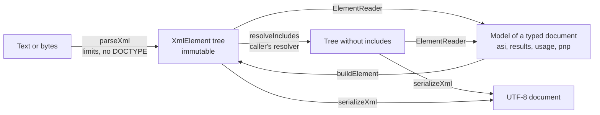

# XML reading and writing

`xml` reads XML 1.0 into an immutable tree, writes a tree back, replaces `xi:include` elements, and gives the readers of typed
documents the checks they share. It is the only XML parser in the runtime: every module that reads a document starts here.
It uses no platform API and runs in any JavaScript runtime. The reader is [saxes](https://github.com/lddubeau/saxes), a
namespace-aware parser that rejects documents that are not well-formed and reads no DTD.



| Export                                                                                         | Purpose                                                                    |
| ---------------------------------------------------------------------------------------------- | -------------------------------------------------------------------------- |
| `parseXml(input, options?)`                                                                    | Parses text or bytes into an `XmlElement`.                                 |
| `serializeXml(root)`                                                                           | Writes an `XmlElement` as a UTF-8 document.                                |
| `buildElement(namespace, name, options?)`, `ElementAttributes`                                 | Builds an element for a writer, and the type of its attributes.            |
| `resolveIncludes(root, base, resolve, options?)`                                               | Replaces each `xi:include` with the root element of the document it names. |
| `listChildElements(element)`, `findAttribute(element, name, options?)`, `collectText(element)` | The child elements, an attribute and the text of an element.               |
| `DEFAULT_XML_LIMITS`, `XmlLimits`                                                              | The limits on size, depth, attributes, nodes and include nesting.          |
| `XML_NAMESPACE`, `XINCLUDE_NAMESPACE`                                                          | Namespace URIs the reader and writer treat specially.                      |
| `XmlElement`, `XmlAttribute`, `XmlNode`, `XmlCharacterData`, `XmlInstruction`                  | The tree.                                                                  |

## Quick start

```ts
import { parseXml, resolveIncludes, serializeXml } from "@assesskit/runtime/xml";

const fragments = new Map([["parts/b.xml", '<b xmlns="urn:demo">included</b>']]);
const root = parseXml(
  '<a xmlns="urn:demo" xmlns:xi="http://www.w3.org/2001/XInclude"><xi:include href="parts/b.xml"/></a>',
  { path: "a.xml" },
);
[root.name, root.namespace, root.line, root.column]; // => ["a", "urn:demo", 1, 1]

const resolved = resolveIncludes(root, "a.xml", (href) => parseXml(fragments.get(href) ?? "", { path: href }));
serializeXml(resolved);
// => '<?xml version="1.0" encoding="UTF-8"?>\n<a xmlns="urn:demo" xmlns:xi="http://www.w3.org/2001/XInclude"><b xmlns="urn:demo">included</b></a>'
```

## The tree

| Node                         | Fields                                                                                                  |
| ---------------------------- | ------------------------------------------------------------------------------------------------------- |
| element                      | `kind: "element"`, `namespace`, `name` (local), `prefix?`, `attributes`, `children`, `line?`, `column?` |
| attribute                    | `namespace`, `name` (local), `prefix?`, `value`                                                         |
| text, CDATA section, comment | `kind: "text" \| "cdata" \| "comment"`, `value`                                                         |
| processing instruction       | `kind: "instruction"`, `target`, `data`                                                                 |

- A name in no namespace has the namespace `""`. `prefix` is absent when the name has none.
- Namespace declarations are attributes: `xmlns="u"` has the namespace `http://www.w3.org/2000/xmlns/`, the name `xmlns` and no prefix;
  `xmlns:p="u"` has the name `p` and the prefix `xmlns`.
- Children and attributes keep document order. Entity and character references are replaced, line ends are normalized to a
  line feed, and attribute values are normalized. Adjacent text is one node.
- The tree leaves out the XML declaration and whatever precedes and follows the root element.
- `line` and `column` (from 1, columns count characters) locate the start tag of an element that `parseXml` read.

```ts
import { findAttribute, listChildElements, parseXml, collectText } from "@assesskit/runtime/xml";

const root = parseXml('<a xmlns="urn:demo" id="x">one <b/><!--note-->two <![CDATA[<3]]></a>');
findAttribute(root, "id"); // => "x"
findAttribute(root, "id", { namespace: "urn:other" }); // => undefined
listChildElements(root).map((child) => child.name); // => ["b"]
collectText(root); // => "one two <3"
root.children.map((child) => child.kind); // => ["text", "element", "comment", "text", "cdata"]
```

## Reading

`parseXml(input, options?)` takes a string or a `Uint8Array` and these options:

| Option   | Default              | Meaning                                              |
| -------- | -------------------- | ---------------------------------------------------- |
| `path`   | none                 | The path of the document; errors and issues name it. |
| `limits` | `DEFAULT_XML_LIMITS` | Limits that replace the defaults field by field.     |

A string is taken as it is: the encoding it declares is ignored. Bytes are decoded as XML 1.0 says:

| Bytes begin with                     | Encoding                                                                                                                                                         |
| ------------------------------------ | ---------------------------------------------------------------------------------------------------------------------------------------------------------------- |
| a UTF-8 or UTF-16 byte order mark    | The mark's. A declaration that names another family is a `ReadError`.                                                                                            |
| no mark, and `encoding="x"` declared | `x`, when `TextDecoder` supports it; otherwise a `ReadError`. UTF-16 without a mark is a `ReadError`.                                                            |
| no mark, and `ISO-8859-1` declared   | Byte for byte: 0x80 to 0x9F are U+0080 to U+009F, as in XML 1.0. This covers `latin1`, `l1` and the other IANA names, which `TextDecoder` reads as windows-1252. |
| no mark and no declaration           | UTF-8. Bytes that are not valid UTF-8 are a `ReadError`.                                                                                                         |

A document that declares XML 1.1 is a `ReadError`. So is one that has what the parser lets through and a tree could not
keep or write: a lone surrogate in a string, a namespace declaration with white space at its start or end, and a qualified
name whose prefix or local part is not an `NCName`, such as `p:1` ([Differences from the references](#differences-from-the-references)).

## Limits

Every limit is a positive integer, and the defaults are about 300 times the largest document of the 1EdTech QTI 3.0
examples for size and node count (32 KiB, 1,126 nodes), 16 times its depth (16) and 20 times its attributes on an element (12).
`maxBytes` and `maxNodes` are as large as the memory allows: the worst document within both peaks at 200 MiB of heap or less in
every reader, under the budget of 256 MiB, and a host with more memory raises them together, at up to 20 MiB of heap for each
MiB of `maxBytes` with 30,000 `maxNodes` ([SECURITY.md](../../SECURITY.md#peak-memory)).

| Limit             | Default    | Unit       | Applies to                                                            |
| ----------------- | ---------- | ---------- | --------------------------------------------------------------------- |
| `maxBytes`        | 10,485,760 | bytes      | The bytes of a document (UTF-8 for a string).                         |
| `maxDepth`        | 256        | levels     | Nesting of elements; the root is depth 1.                             |
| `maxAttributes`   | 256        | attributes | Attributes on one element, namespace declarations included.           |
| `maxNodes`        | 300,000    | nodes      | Elements, text, CDATA sections, comments and processing instructions. |
| `maxIncludeDepth` | 8          | levels     | Nesting of includes (`resolveIncludes`).                              |

A limit that a document exceeds throws a `SecurityError` whose `limit` is the limit's name and `maximum` its value. The
limits are checked while the tree grows: the reader never builds a tree larger than a limit allows. A limit that is not a
positive integer is a `DataError` whose message begins `The limit maxBytes`, and so on for each name.

`maxDepth` also bounds the recursion of everything that walks a tree: the readers of [asi](asi.md), the writers,
`resolveIncludes` and the interpreter of [processing](processing.md), whose expressions are as deep as the document they were
read from. Node.js with its default stack reads, writes and evaluates trees of 1,000 levels, four times the default; raise
`maxDepth` only with a stack to match.

## Security

| Threat                                 | Control                                                                                                                                                       |
| -------------------------------------- | ------------------------------------------------------------------------------------------------------------------------------------------------------------- |
| XXE, entity expansion (billion laughs) | Any DOCTYPE throws a `SecurityError` with `limit` `"doctype"` before an entity is declared. Only the five predefined entities and character references exist. |
| Network and file access                | The reader and the writer read nothing. `resolveIncludes` calls only the resolver the caller passes.                                                          |
| Oversized, deep or wide documents      | The limits above.                                                                                                                                             |
| Prototype pollution                    | The tree is arrays of objects with fixed fields; a name such as `__proto__` is data.                                                                          |

## Writing

`serializeXml(root)` writes `<?xml version="1.0" encoding="UTF-8"?>`, a line feed and the element. It adds no white space.

```ts
import { buildElement, serializeXml } from "@assesskit/runtime/xml";

const item = buildElement("urn:demo", "item", {
  attributes: { id: "q1", note: undefined, "xml:lang": "en" },
  children: ["a < b", ""],
});
serializeXml(item);
// => '<?xml version="1.0" encoding="UTF-8"?>\n<item id="q1" xml:lang="en" xmlns="urn:demo">a &lt; b</item>'
```

- Text escapes `&`, `<`, `>` and the carriage return. Attribute values also escape the quote, the tab and the line feed.
- A CDATA section that contains `]]>` is split into two sections at that sequence.
- A carriage return in a CDATA section, comment or processing instruction is written as it is, and a parser reads it as a line feed.
- A namespace that the tree uses without declaring it in scope is declared on the element that uses it, including `xmlns=""`
  when an element in no namespace sits inside a default namespace. A tree from `parseXml` already has its declarations.
- It throws `DataError` for a tree that cannot be written as well-formed XML: a character XML 1.0 does not allow, a name that is not
  an NCName, a prefix without a namespace or a namespace without a prefix on an attribute, one prefix for two namespaces on an
  element, a repeated attribute, `--` in a comment, a processing instruction named `xml` or containing `?>`. The message names the element.

`buildElement` takes the `attributes` and the `children` as options. It leaves out an attribute whose value is `undefined`, writes a string child as text and drops an empty one; a name
with the prefix `xml:` or `xsi:` is in that namespace.

## How the runtime's readers map a document

`ElementReader` is what [results](results.md), [usage](usage.md), [pnp](pnp.md) and the other readers of the runtime read with.
It is not exported: a host that reads an extension element uses `listChildElements`, `findAttribute` and `collectText` (below),
and the readers of the runtime take it, `ReaderRules`, `createTermConverter`, `createReadError`, `locateElement`,
`isXmlLanguage` and the namespaces `XMLNS_NAMESPACE` and `XSI_NAMESPACE` from `xml/internal`. It is positioned on one
element and moves forward through its children; `done()` fails when an attribute, a child or text is left, so that no
part of a document is dropped without notice.

```ts
import { ElementReader } from "../xml/internal.js";

const rules = { module: "demo", namespaces: ["urn:demo"] };
const reader = ElementReader.open('<a xmlns="urn:demo" n="12"><b>5</b></a>', rules, "The demo");
reader.attribute("n", Number); // => 12
reader.require("b").leaf(Number); // => 5
reader.done(); // => undefined
```

| Member                                              | Purpose                                                                                                                                          |
| --------------------------------------------------- | ------------------------------------------------------------------------------------------------------------------------------------------------ |
| `ElementReader.open(input, rules, what, options?)`  | Opens a document: text and bytes through `parseXml` with its `options` (`path` names the document in the issues, `limits`), an element as it is. |
| `attribute(name, parse?)`, `required(name, parse?)` | The value of an attribute in no namespace, converted by `parse`; a `DataError` from `parse` becomes a `ReadError` that names the attribute.      |
| `term(name, terms)`, `requiredTerm(name, terms)`    | An attribute that must be one of some terms.                                                                                                     |
| `language()`, `requiredLanguage()`, `base()`        | `xml:lang`, which must be a language tag, and `xml:base`.                                                                                        |
| `take`, `takeAny`, `require`, `takeAll`             | Consume the next child, a run of children, or the next child that must be there.                                                                 |
| `next()`, `foreign`                                 | Consume the next child whatever it is, and tell an extension: an element outside the namespaces of the rules.                                    |
| `takeForeign()`, `extension()`                      | Consume the extensions, which must be in a namespace of their own.                                                                               |
| `text(parse?)`, `leaf(parse)`                       | The text of an element that has no child elements; `leaf` also finishes the element.                                                             |
| `fail(rule, message)`, `attempt(...)`               | Build a `ReadError` at the element; run a conversion and turn its `DataError` into one.                                                          |
| `done()`                                            | Fail on an attribute, child or text that was not read. Namespace declarations and `xsi:` attributes never count.                                 |

| `ReaderRules` field | Meaning                                                                                           |
| ------------------- | ------------------------------------------------------------------------------------------------- |
| `module`            | The module that reads; the rules of its issues are `assesskit/<module>/<name>`.                   |
| `namespaces`        | The namespaces of the schema's elements; an element in another namespace is an extension.         |
| `path`              | The path of the document, which the issues name. `open` takes it from its options. Default: none. |

`createTermConverter(terms, options?)` makes the conversion for `text` and `attribute` that accepts one of some terms; its option `label` names the text in the message. `isXmlLanguage(value)` tells whether a value is a language tag: those of `xs:language` and the empty string, which undoes an inherited language. `createReadError(rule, message, options?)` builds the `ReadError` of one problem and `locateElement(element, path, options?)` the location of an element. A reader takes the
children in the order of the schema. An issue has the line and column of the element and its path, such as
`assessmentResult/itemResult`.

| Rule of an issue       | Meaning                                                                                                         |
| ---------------------- | --------------------------------------------------------------------------------------------------------------- |
| `missing-attribute`    | A required attribute is not there.                                                                              |
| `invalid-attribute`    | An attribute cannot be converted, is not one of its terms, or is not a language tag.                            |
| `unexpected-attribute` | `done` found an attribute that was not read.                                                                    |
| `missing-element`      | `require` found another element or none.                                                                        |
| `unexpected-element`   | `done` found a child that was not taken, or an element where only text may be, or an extension in no namespace. |
| `unexpected-text`      | An element that holds elements only has text.                                                                   |
| `invalid-text`         | The text of an element cannot be converted.                                                                     |

## XInclude

`resolveIncludes(root, base, resolve, options?)` replaces each `xi:include` with the root element of the document its
`href` names, then does the same inside that document. `base` is the path of the document of `root`; `resolve(href, base)` is
the caller's function that returns the parsed root of the document, usually with `parseXml`. The runtime never fetches.

| Rule                                                                                                                                                                                               | Source                                                            |
| -------------------------------------------------------------------------------------------------------------------------------------------------------------------------------------------------- | ----------------------------------------------------------------- |
| Only `parse="xml"` (the default) is included. `parse="text"` is a `ReadError`.                                                                                                                     | ASI Information Model, XInclude                                   |
| `xpointer` is a `ReadError`.                                                                                                                                                                       | ASI Information Model, XInclude (the specification says MUST NOT) |
| `href` is required, not empty, and has no fragment identifier.                                                                                                                                     | XInclude 1.0, the `xi:include` element                            |
| An include has at most one `xi:fallback` child and no other element of the XInclude namespace; an `xi:fallback` elsewhere is a `ReadError`.                                                        | XInclude 1.0, the `xi:include` and `xi:fallback` elements         |
| If `resolve` throws, the `xi:fallback` takes the include's place (its content is expanded in turn). Without one, the failure is a `ReadError`. A `SecurityError` from `resolve` always propagates. | XInclude 1.0, resource errors                                     |
| An include of a document that is already being included is a `ReadError`. Paths are compared after `.` and `..` segments are resolved against `base`.                                              | XInclude 1.0, inclusion loops                                     |
| Includes nest at most `maxIncludeDepth` deep; the result has at most `maxDepth` levels and `maxNodes` nodes.                                                                                       | The limits of the runtime                                         |
| `encoding`, `accept` and `accept-language` are ignored; `xml:base` and `xml:lang` are not added to included roots.                                                                                 | XInclude 1.0 allows it                                            |

An include that is the root of the tree must be replaced by exactly one element.

## Reading a tree without mapping it

`listChildElements`, `findAttribute` and `collectText` read a tree you do not map completely, such as the parts of an element that a
model keeps as XML. `readLomGeneral` of [metadata](metadata.md) reads the title and identifiers of a LOM this way. They never
fail: an attribute or a child that is not there is `undefined` or left out. A reader that maps a whole document uses
`ElementReader`.

## Errors

| Rule                               | Class       | Meaning                                                                            |
| ---------------------------------- | ----------- | ---------------------------------------------------------------------------------- |
| `assesskit/xml/not-well-formed`    | `ReadError` | The document is not well-formed, has a lone surrogate or a bad qualified name.     |
| `assesskit/xml/version`            | `ReadError` | The document declares XML 1.1.                                                     |
| `assesskit/xml/encoding`           | `ReadError` | Bytes in an unsupported, contradicting or invalid encoding.                        |
| `assesskit/xml/namespace`          | `ReadError` | A namespace declaration with white space at its start or end.                      |
| `assesskit/xml/xinclude-attribute` | `ReadError` | An include has an `xpointer`, a `parse` other than `xml`, or a bad `href`.         |
| `assesskit/xml/xinclude-structure` | `ReadError` | Misplaced or repeated `xi:fallback`, or a root replaced by other than one element. |
| `assesskit/xml/xinclude-cycle`     | `ReadError` | Includes form a loop.                                                              |
| `assesskit/xml/xinclude-resource`  | `ReadError` | The resolver failed and the include has no fallback.                               |

`ReadError.issues` has one issue with the code, the path, and the line and column where the parser stopped: fix the document
there, or refuse it. Every function checks its arguments, as plain JavaScript and JSON can pass anything: a value of the wrong
type is a `DataError` that names the argument and what was found, so pass the type it asks for. A DOCTYPE or a document above
a limit is a `SecurityError` ([Limits](#limits)): refuse it, or raise the limit for a document you trust.

## Not included

| Not included                                           | Why                                                                                 |
| ------------------------------------------------------ | ----------------------------------------------------------------------------------- |
| DTDs, general entities and external entities           | A DOCTYPE is the vector of XXE and entity expansion; QTI documents need none        |
| XML 1.1                                                | QTI 3.0 documents are XML 1.0                                                       |
| `xi:include` with `parse="text"`, XPointer             | QTI forbids them, and `xml` is the only parsed form QTI uses                        |
| The fixup of `xml:base` and `xml:lang` by `xi:include` | XInclude makes it optional, and the readers of the runtime resolve paths themselves |
| Canonical XML, pretty printing                         | `serializeXml` adds no white space and keeps the tree as it is                      |
| Schema validation                                      | [node](node.md) validates files against the published XSDs                          |
| Streaming                                              | A tree is the form every reader needs, and the limits bound its size                |

## Differences from the references

| Case                                                             | Resolution                                                                                                                                          |
| ---------------------------------------------------------------- | --------------------------------------------------------------------------------------------------------------------------------------------------- |
| XML 1.0 allows a DOCTYPE, and the entities that it declares      | Any DOCTYPE is a `SecurityError`, so that no entity is declared, expanded or read; only the five predefined entities and character references exist |
| A lone surrogate in a string, and a qualified name such as `p:1` | A `ReadError`: the parser lets them through, and a tree could not keep or write them                                                                |
| A namespace declaration with white space at its start or end     | A `ReadError`: the parser strips it from the namespace of the elements and keeps it in the declaration                                              |

## Build or adopt

The reader is adopted: `saxes` 6.0.0 (ISC) parses, with the character and name tables of `xmlchars` 2.2.0 (MIT). Neither project is
active in the last year, which the trust rule asks: their last releases are of May 2022, and both repositories have been archived
since 2025-12-31. They stay, recorded as a deviation in `AGENTS.md`, because:

- They implement XML 1.0 (Fifth Edition, 2008) and Namespaces in XML 1.0 (Third Edition, 2009), standards that have not changed
  since, so a complete parser of them needs no new release.
- The GitHub Advisory Database lists no advisory for either (checked 2026-11-05), and the runtime reads no DTD and expands no
  entity but the five predefined ones in front of them ([Security](#security)).
- `saxes` is namespace-aware, gives the line and column of each tag, and sends events as it reads, so that `tree-builder.ts` holds
  each limit as the tree grows and stops a reading at the first one passed.

| Alternative               | License                                     | Why not                                                                                  |
| ------------------------- | ------------------------------------------- | ---------------------------------------------------------------------------------------- |
| `sax` 1.6.1               | BlueOak-1.0.0, outside the licenses allowed | `check:licenses` refuses it                                                              |
| `@rgrove/parse-xml` 5.1.0 | ISC, active                                 | Builds the whole tree, by design not streaming, so the limits apply only once it is read |
| `fast-xml-parser` 5.12.0  | MIT, active                                 | Parses a whole document into objects; reading by events is a separate package            |

## Files

Each file of `src/xml/` holds one concept.

| File                                                | Concept                                                      |
| --------------------------------------------------- | ------------------------------------------------------------ |
| `tree.ts`                                           | The nodes of the tree and the namespaces it treats specially |
| `limits.ts`                                         | The limits, their defaults and their checks                  |
| `encoding.ts`                                       | Decoding bytes by byte order mark and declaration            |
| `locator.ts`                                        | Line and column of an offset                                 |
| `tree-builder.ts`, `parse.ts`                       | Building the tree from parser events, and `parseXml`         |
| `serialize.ts`, `build-element.ts`                  | Writing a tree, and building elements to write               |
| `include.ts`                                        | XInclude                                                     |
| `element-reader.ts`, `read-error.ts`, `language.ts` | Mapping an element to a model, its errors, and language tags |
| `query.ts`                                          | Reading a tree without mapping it                            |

## References

| Topic                                  | Specification                                                                                    |
| -------------------------------------- | ------------------------------------------------------------------------------------------------ |
| XML syntax, encodings, `xml:lang`      | [Extensible Markup Language (XML) 1.0](https://www.w3.org/TR/xml/)                               |
| Namespaces and prefixes                | [Namespaces in XML 1.0](https://www.w3.org/TR/xml-names/)                                        |
| Inclusion                              | [XML Inclusions (XInclude) 1.0](https://www.w3.org/TR/xinclude/)                                 |
| Language tags                          | [XML Schema Part 2, data types](https://www.w3.org/TR/xmlschema-2/)                              |
| The `xsi:` attributes                  | [XML Schema Part 1, structures](https://www.w3.org/TR/xmlschema-1/)                              |
| XInclude in QTI                        | [QTI 3.0 ASI Information Model](https://www.imsglobal.org/spec/qti/v3p0/info/)                   |
| XML security                           | [QTI 3.0 Best Practices and Implementation Guide](https://www.imsglobal.org/spec/qti/v3p0/impl/) |
| Places where the specifications differ | [Spec gaps](spec-gaps.md)                                                                        |
