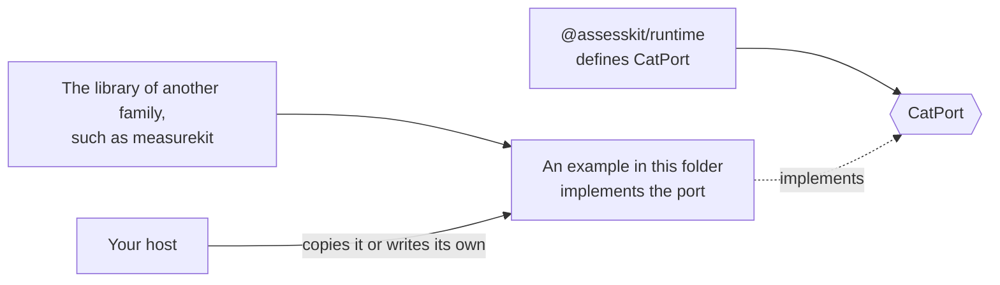

# Examples of the player

<!-- cspell:ignore measurekit -->

Each example is a package of its own, with the dependencies that only it needs, and a test that CI runs.

| Example                                              | Shows                                                                                                                    |
| ---------------------------------------------------- | ------------------------------------------------------------------------------------------------------------------------ |
| [cat-with-measurekit](cat-with-measurekit/README.md) | How to implement the runtime's `CatPort` with an engine of your own: an adaptive test and a multistage panel in process. |

The packages of assesskit do not import the libraries of other families. An adapter to such a library lives here, and a host
copies it or writes its own against the port.
