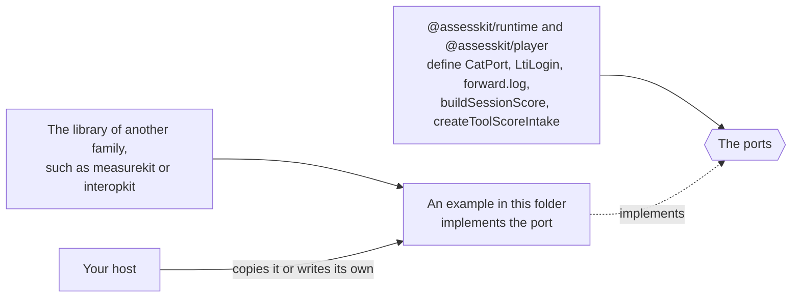

# Examples of the player

Each example is a package of its own, with the dependencies that only it needs, and a test that CI runs.

| Example                                              | Shows                                                                                                                                                     |
| ---------------------------------------------------- | --------------------------------------------------------------------------------------------------------------------------------------------------------- |
| [cat-with-measurekit](cat-with-measurekit/README.md) | How to implement the runtime's `CatPort` with an engine of your own, and serve it as a CAT 1.0 engine over REST: an adaptive test and a multistage panel. |
| [lms-integration](lms-integration/README.md)         | How to plug an LTI item, a grade for a learning platform and Caliper events into the ports of the player, over interopkit.                                |

The packages of assesskit do not import the libraries of other families. An adapter to such a library lives here, and a host
copies it or writes its own against the port. The libraries are linked from beside this repository until they are on npm:
measurekit from `../measurekit`, interopkit from `../interopkit`, each built with `pnpm install && pnpm build` in its own checkout.
