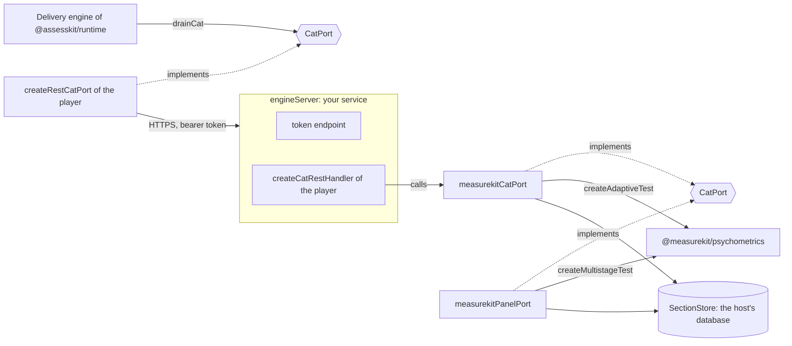

# CAT with measurekit

An engine of computer adaptive testing in process, as an implementation of the runtime's `CatPort` over
`@measurekit/psychometrics`, and a whole engine server around it: the token endpoint of OAuth 2.0 and the REST binding of CAT 1.0.
It shows how to plug an engine of your own into assesskit: `@assesskit/runtime` and `@assesskit/player` do not import
measurekit, and this directory does.



| What                                | Where                                                                                        |
| ----------------------------------- | -------------------------------------------------------------------------------------------- |
| The scenario that creates a section | `scenario.ts`: Create Section, Create Session, then Submit Results until the end             |
| An item-level adaptive engine       | `src/measurekit-cat-port.ts`: `measurekitCatPort`                                            |
| A calibrated multistage engine      | `src/measurekit-panel-port.ts`: `measurekitPanelPort`                                        |
| A whole engine server               | `src/engine-server.ts`: `engineServer`; `src/listen.ts`: `listen`; `src/demo-server.ts`      |
| The section and its storage         | `src/section.ts`, `src/section-data.ts`, `src/section-store.ts`, `src/memory-store.ts`       |
| Items, responses and the session    | `src/usage.ts`, `src/pool.ts`, `src/response.ts`, `src/session-state.ts`                     |
| The tests, which CI runs            | `test/scenario.test.ts`, `test/engine-server.test.ts` and `test/cat-with-measurekit.test.ts` |

To run the scenario, build the runtime in this repository and measurekit in its own, then start it. The scenario prints the
items that it presented, in order, first through the port in process and then through the REST binding and the engine server:

```sh
pnpm build
pnpm --filter @assesskit/example-cat-with-measurekit start
```

To serve the engine on a port of this machine (8080 unless the argument says another), and ask it for a token with the client
`demo` and the secret `demo-secret`:

```sh
pnpm --filter @assesskit/example-cat-with-measurekit serve 8080
curl -u demo:demo-secret -d 'grant_type=client_credentials&scope=https://purl.imsglobal.org/cat/v1p0/scope/api' http://127.0.0.1:8080/oauth2/token
```

The tests run with the rest of the repository (`pnpm test`), or alone with `pnpm exec vitest run --project examples`.
measurekit is a dependency of this example only, linked from `../measurekit` beside this repository.

## engineServer

`engineServer(options)` returns one function from a `Request` to a `Response`: `POST /oauth2/token` is the token endpoint, and
every other request goes to `createCatRestHandler` from `@assesskit/player/cat-rest`, which calls the engine. Deno, Bun and Workers serve
the function as it is; `listen(handler, port, host)` serves it on Node.js with `node:http`, and TLS goes in front of it.

| Option         | Default  | Meaning                                                                                           |
| -------------- | -------- | ------------------------------------------------------------------------------------------------- |
| `engine`       | required | Any `CatPort`: `measurekitCatPort`, `measurekitPanelPort` or one of your own.                     |
| `verifyClient` | required | `(clientId, clientSecret) => boolean \| Promise<boolean>`: compares with a hash in your database. |
| `newToken`     | required | Returns a token that cannot be guessed, such as 32 random bytes in base64url.                     |
| `now`          | required | Returns the milliseconds since the epoch; a token expires when it passes.                         |
| `tokenSeconds` | `3600`   | The seconds a token lives (the binding recommends 3600).                                          |

| Request                                                           | Answer                                                                                                                                                              |
| ----------------------------------------------------------------- | ------------------------------------------------------------------------------------------------------------------------------------------------------------------- |
| Token request with right credentials                              | 200 with a bearer token and the scopes asked for                                                                                                                    |
| Wrong or missing client credentials                               | 401 `invalid_client`                                                                                                                                                |
| Another grant, or an unknown scope                                | 400 `unsupported_grant_type` or `invalid_scope`                                                                                                                     |
| An operation without a valid token                                | 401: no token, or 401 with `error="invalid_token"` for an unknown or an expired one                                                                                 |
| An operation outside the token's scope                            | 403 with `error="insufficient_scope"`. `.../scope/configure` allows the section operations, `.../scope/deliver` the session operations, `.../scope/api` all of them |
| A section the store does not have, or that another client created | 404, because the ports throw a `ServiceError` with the status 404                                                                                                   |
| A request that the engine cannot read                             | 400 with a fixed text: the engine's `DataError`, `ReadError` and `SecurityError` become a `ServiceError` with the status 400                                        |

The tokens are kept in memory, so one process serves them. A host with several processes keeps them in a database, or signs
them as JWTs with a library, and answers the same `authorize`. The OAuth server is in the example because the binding needs
one beside the endpoints; the player does not include one.

## Sections

A section is the configuration of an adaptive selection. Both ports read the three files of its section data: the settings,
the usage data and the metadata.

| Part       | Behavior                                                                                                                                                                                                                                                                                                                        |
| ---------- | ------------------------------------------------------------------------------------------------------------------------------------------------------------------------------------------------------------------------------------------------------------------------------------------------------------------------------- |
| Identifier | The SHA-256, in lowercase hexadecimal, of the UTF-8 JSON array `[sectionConfiguration, qtiUsagedata, qtiMetadata]`, with `null` for a field that is absent. One section data has one identifier in every process and deployment, and creating it again changes nothing.                                                         |
| Store      | Create Section parses the files and puts the result in the host's `SectionStore`. A stored section is plain data that JSON serializes: the section data as received, the parameters of the usage data as the bank states them, and the settings. Both ports share one store, and any process that reads it answers any request. |
| End        | `endSection` does nothing: other deployments with the same section data share the section. The host prunes the store by its own retention.                                                                                                                                                                                      |
| Metadata   | The ports keep the metadata file and do not read it.                                                                                                                                                                                                                                                                            |

### Settings

The settings file is JSON. A property that is not listed is an error.

| Section  | Property           | Type                                  | Meaning                                                                   |
| -------- | ------------------ | ------------------------------------- | ------------------------------------------------------------------------- |
| adaptive | `length`           | positive integer, required            | The number of items after which the test ends.                            |
| adaptive | `contentTargets`   | object of area and number, optional   | The target proportion of each content area, for content balancing.        |
| adaptive | `enemies`          | array of arrays of item ids, optional | Sets of items that must not appear in one test.                           |
| panel    | `stages`           | array, required                       | The stages in order; the first has one module.                            |
| panel    | `stages[].modules` | array of `{ id, items }`              | The modules of a stage: an identifier and the identifiers of their items. |

### Usage data

The usage data gives the parameters of the items of a logistic model. Only ordinary statistics about a whole item are read;
other statistics, statistics of a part and categorized statistics are left alone.

| Statistic | Property | Default | Meaning                                                            |
| --------- | -------- | ------- | ------------------------------------------------------------------ |
| `B-Param` | `b`      | none    | The difficulty. An item needs it; an item without one is an error. |
| `A-Param` | `a`      | `1`     | The discrimination.                                                |
| `C-Param` | `c`      | `0`     | The lower asymptote (guessing).                                    |
| `D-Param` | `d`      | `1`     | The upper asymptote of the 4PL, not a scaling constant.            |

A parameter given twice for an item, or a value that is not a number, is a `DataError`. Every item is a measurekit
`fourParameterLogistic` item, which is the 1PL to the 3PL when the defaults apply.

### Scale

The models of measurekit are in the IRT form of mirt with D = 1. The usage data does not name its metric, so the host states
it with `scalingConstant`, which multiplies the discrimination `a` of every item of the usage data when a port reads it:

| Bank                                   | `scalingConstant` |
| -------------------------------------- | ----------------- |
| IRT form with D = 1 (mirt, measurekit) | `1` (the default) |
| Normal-ogive metric, D = 1.702         | `1.702`           |

With `1.702`, the logistic `c + (d - c) / (1 + exp(-1.702 a (θ - b)))` is within 0.01 of the normal ogive
`c + (d - c) Φ(a (θ - b))` for every θ (Haley, 1952). The stored section keeps `a` as the bank states it, because one section
data can be deployed on both scales. Items that the host adds through `pool` are measurekit items and are not scaled.

## measurekitCatPort

`measurekitCatPort(options)` returns a `CatPort` that keeps no session. The measurekit state of the candidate and the session
seed travel in the `sessionState` as the JSON `{ seed, state }`, which the runtime stores and returns.

| Option            | Default                 | Meaning                                                                                                |
| ----------------- | ----------------------- | ------------------------------------------------------------------------------------------------------ |
| `sections`        | required                | The `SectionStore`.                                                                                    |
| `seeds`           | required                | Returns the seed of a new session, an integer from 0 to 2³² − 1, from the host's source of randomness. |
| `pool`            | no items                | Returns the host's measurekit items for a section, by its identifier. See Pool below.                  |
| `category`        | the `SCORE` of the item | Maps `(item, outcomes)` to the response category of the item's model.                                  |
| `scalingConstant` | `1`                     | The factor for the discrimination of the usage data.                                                   |

| Request                  | Behavior                                                                                                                                                              |
| ------------------------ | --------------------------------------------------------------------------------------------------------------------------------------------------------------------- |
| Create Section           | Reads the settings and usage data, builds the measurekit test to check them, stores the section and returns its identifier. The `prefix` of every request is ignored. |
| Get Section              | Returns the stored section data and the pool as one stage.                                                                                                            |
| Create Session           | Calls `seeds` once, starts the test and returns a one-item stage. The session identifier is the seed in decimal.                                                      |
| Submit Results           | Reads the category of the presented item from its result, takes it as the response and returns the next one-item stage, or the empty stage when the test ends.        |
| End Session, End Section | Do nothing.                                                                                                                                                           |

| Topic      | Behavior                                                                                                                                                                                                                                                                                                                                                                                                                                                                |
| ---------- | ----------------------------------------------------------------------------------------------------------------------------------------------------------------------------------------------------------------------------------------------------------------------------------------------------------------------------------------------------------------------------------------------------------------------------------------------------------------------- |
| Stages     | A stage is one item, so the delivery engine submits after each item. The empty stage `{ itemIdentifiers: [], stageLength: 0 }` ends the session.                                                                                                                                                                                                                                                                                                                        |
| Randomness | The draws of a step come from the `createRandom` of measurekit, seeded with `seed × 2²¹ + n`, where `n` is the number of items administered. A repeated request gives the same answer, and no two steps of any two sessions share a seed.                                                                                                                                                                                                                               |
| Pool       | The pool of a section is the items of the usage data, then the items of `pool(section)`. A host item replaces the item with its identifier and keeps its place; a new identifier is added at the end. The host adds the models that usage data cannot state, such as the generalized partial credit model, and the attributes only measurekit has: `contentAreas` for `contentTargets` and `exposure` for Sympson-Hetter control. Items of the usage data have neither. |
| Response   | By default the `SCORE` of the item's result is its category. The category must be a whole number from 0 to one less than the categories of the item's model, else `DataError`. An item that the candidate submitted or skipped without a response is reported with the status `initial` and no `SCORE`; it is category 0, and `category` is not asked. Results of earlier items in the same request are ignored.                                                        |
| Selection  | The defaults of measurekit: maximum information, and the posterior mean of theta as the estimate.                                                                                                                                                                                                                                                                                                                                                                       |
| Outcomes   | The port returns no `assessmentResult`; the estimate is in the state.                                                                                                                                                                                                                                                                                                                                                                                                   |
| PNP        | The port reads none of the personal data of Create Session.                                                                                                                                                                                                                                                                                                                                                                                                             |

## measurekitPanelPort

`measurekitPanelPort(options)` returns a `CatPort` for a multistage panel with routing by the estimate of theta. Its stage is a
module: all its items, in order, with the module's length as the stage length. Routing draws no random number, so the port
takes no seeds. The `sessionState` is the JSON of the `MultistageTestState` of measurekit, and the session identifier is the
section's.

| Option            | Default  | Meaning                                                        |
| ----------------- | -------- | -------------------------------------------------------------- |
| `sections`        | required | The `SectionStore`.                                            |
| `panels`          | required | Returns the `PanelParameters` of a section, by its identifier. |
| `scalingConstant` | `1`      | The factor for the discrimination of the usage data.           |

`PanelParameters.cuts` maps the identifier of a module to its cut points on the theta scale: ascending, one fewer than the
modules of the next stage. A person goes to module j of the next stage, counting from 0, when exactly j cuts are at most the
estimate. Every item of a module needs parameters in the usage data, which Create Section checks.

## Errors

| Error                     | When                                                                                                                                        |
| ------------------------- | ------------------------------------------------------------------------------------------------------------------------------------------- |
| `DataError`               | An option or an argument has the wrong type, or section data or a `sessionState` is malformed.                                              |
| `ServiceError`            | The store has no section with the identifier: status 404, which `createCatRestHandler` answers as Unknown Object.                           |
| `DataError` of measurekit | A section cannot run, such as content targets without content areas or cut points that do not match the modules. Create Section reports it. |
