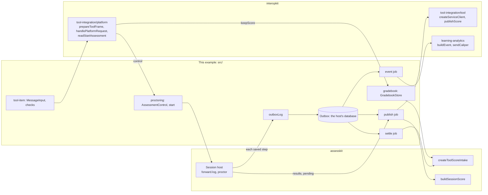

# LMS integration

A host's wiring of an LTI item, a grade for a learning platform, a proctoring tool and Caliper events to the ports of `@assesskit/player`, over
[interopkit](https://github.com/interopkit/interopkit). `@assesskit/runtime` and `@assesskit/player` do not import interopkit, and
this directory does. A host copies `src/` or writes its own against the ports; the two families never import each other.

| What                                                                   | Where                                                                                                         |
| ---------------------------------------------------------------------- | ------------------------------------------------------------------------------------------------------------- |
| The launch of a tool, the checks that bind it to a session             | `src/tool-item.ts`: `toolLaunch`, `checkSession`, `checkBrowser`, `itemId`, `parseItemId`, `toToolScore`      |
| The gradebook behind the grade services, over the score intake         | `src/gradebook.ts`: `createGradebook`                                                                         |
| The proctoring tool: the launch, the control of the attempt, the start | `src/proctoring.ts`: `proctoringLaunch`, `createProctoring`                                                   |
| The log that appends, and the port of the host's database              | `src/outbox.ts`: `outboxLog`, `Outbox`; `src/memory-outbox.ts` is one in memory                               |
| The jobs, which run outside any step                                   | `src/settle-job.ts`, `src/event-job.ts`, `src/publish-job.ts`                                                 |
| Delivery events to Caliper events                                      | `src/events.ts`: the rule table below; `src/entities.ts`, `src/grade.ts`, `src/build.ts`, `src/context.ts`    |
| The exchange of the whole exam, and the failures of each port          | `test/exchange.test.ts`, `test/publish-job.test.ts`, `test/event-job.test.ts`, `test/tool-item.test.ts`       |
| The rules of the gradebook and of the proctoring                       | `test/gradebook.test.ts`, `test/proctoring.test.ts`                                                           |
| A learning platform and two tools, written from the specifications     | `test/fake-platform.ts`, `test/fake-lms.ts`, `test/fake-tool.ts`, `test/rig.ts`, which wires them to the exam |

To run the tests, build interopkit in its own checkout beside this repository (`pnpm install && pnpm build` there), then run
`pnpm exec vitest run --project examples` here, or `pnpm test` for the whole repository. interopkit is a dependency of this
example only, linked from `../interopkit` beside this repository until it is on npm.

## The steps

| Step | Port of the player                    | What this example does                                                                                                                                                                                                               |
| ---- | ------------------------------------- | ------------------------------------------------------------------------------------------------------------------------------------------------------------------------------------------------------------------------------------ |
| 1    | `LtiLogin`                            | The host's route calls `toolLaunch` and `prepareToolFrame` with `checkSession` as the `check` of the login; `handlePlatformRequest` gets `checkBrowser` as `checkLaunch`, which reads whose session the browser's request belongs to |
| 2    | `createToolScoreIntake`               | `handlePlatformRequest` gets `createGradebook` as `services.gradebook`, which gives each score to `intake.onScore`; the settle job gives each step of the session to `intake.settle`                                                 |
| 3    | `forward.log` and `buildSessionScore` | `forward: { log: outboxLog(outbox) }`; the event job sends the Caliper events and the publish job sends the grade                                                                                                                    |
| 4    | `SessionHost.proctor`                 | With a proctoring tool, the host's route calls `Proctoring.start`, and `handlePlatformRequest` gets `Proctoring.control` as `services.control`                                                                                       |

The log only appends. Nothing in a step reaches the network, so an outage of the learning platform or of the Caliper endpoint
never delays a candidate and never reads as a failure of the CAT engine. A host's queue runs the three jobs after a step, for the
session of the step, and retries a job that fails.

## The gradebook

The context of a launch is the session and the line item is the item instance, so the path of a score carries both. A tool's token
says only which tool called, so the gradebook holds the rules that keep a tool to its own candidates. Only the line item and its
scores exist: the other methods of `GradebookStore` answer that they have nothing, which the platform makes 404.

| Method      | Rule                                                                                                                                                                      |
| ----------- | ------------------------------------------------------------------------------------------------------------------------------------------------------------------------- |
| `lineItem`  | Answers the name and the maximum that the host's `linkOf` gives, to the tool whose link the item holds; another tool, session or item gets `undefined`                    |
| `keepScore` | The same lookup, and the session must be bound to the `userId` of the score (`SessionHost.check`); then `intake.onScore` keeps the later score and supplies the final one |
| The others  | `undefined` and `false`: the host adds what it offers                                                                                                                     |

## The proctoring

The host launches `LtiStartProctoring` with `proctoringLaunch`, which offers the actions that it maps. The tool sends the candidate
back to the host's start assessment URL; `Proctoring.start` reads the message with `readStartAssessment`, starts the session
only when the user of the browser is the candidate that the sealed session data names, and records the attempt with the tool
that started it.

| Action      | `SessionHost.proctor` | Answer                                                                |
| ----------- | --------------------- | --------------------------------------------------------------------- |
| `pause`     | `suspend`             | `paused`                                                              |
| `resume`    | `resume`              | `running`                                                             |
| `terminate` | `end-test`            | `terminated`; an attempt that ended another way is `complete`         |
| `update`    | none                  | The status, for a tool that polls                                     |
| `flag`      | none                  | The status; the runtime has no flag, so the message does not offer it |

An action that the engine refuses leaves the session as it is and answers its status. An attempt that is unknown, or that another
tool started, is 404.

## The outbox

The outbox is the host's table of steps and of what its jobs did. `memoryOutbox` shows the rules; a host implements them in its
database.

| Method                                 | Rule                                                                                                                                                                  |
| -------------------------------------- | --------------------------------------------------------------------------------------------------------------------------------------------------------------------- |
| `append(step)`                         | Idempotent by session and step: appending a step again changes nothing                                                                                                |
| `steps(session)`, `unhandled(session)` | The steps in the order they were saved, and those whose events the event job has not handled                                                                          |
| `markHandled(session, step, refusal?)` | The event job sent the step, or refused it with a reason                                                                                                              |
| `nextAttempt(session, floor, covers)`  | Atomic. Returns the later of `floor` and one millisecond after the last attempt, whether or not that attempt succeeded, and records it **before** the request is sent |
| `markSent(session)`                    | The last attempt reached the learning platform: the steps it covered are published                                                                                    |
| `progress(session)`, `markFailed(...)` | How many steps are published, and why a session cannot be published                                                                                                   |
| `claim(session)`                       | Exclusive across the host's processes, such as a row lock or a lease. `undefined` when another job holds the session                                                  |

## Failures

Each row is a test.

| Job     | When it fails                                                                                                                                                                                                                                                              | When it hangs                                                                                    | When it runs again                                                                                                                                |
| ------- | -------------------------------------------------------------------------------------------------------------------------------------------------------------------------------------------------------------------------------------------------------------------------- | ------------------------------------------------------------------------------------------------ | ------------------------------------------------------------------------------------------------------------------------------------------------- |
| Settle  | `pending` or `apply` rejects: the kept score stays, and the queue retries                                                                                                                                                                                                  | The timeout of the queue                                                                         | Safe: `settle` supplies only the requests that are open, so a repeat makes no step                                                                |
| Event   | The endpoint answers with an error: `ServiceError`, and the step is not marked. A `supply-scores` step without a scorer by an IRI is refused and marked, and the other events go out                                                                                       | `timeoutMs` of the sender, then `ServiceError` with status 0                                     | The same event identifiers, with a new `sendTime`. Caliper has no deduplication, so an endpoint may hold both copies                              |
| Publish | `ServiceError` from the token, the line item or the score request; `LtiError` for a refused scope. No launch, or none with a user and a line item, or a line item that is gone, or a report with no score (`DataError`): the session is marked failed and no retry follows | `timeoutMs`, then in doubt: the request may have arrived. An abort of the signal is in doubt too | Reads the latest state and takes a time later than every attempt before, so a resend after a timeout or a crash before `markSent` repeats no time |

`results` and `pending` are two loads, so a step in another process can land between them and one send can mix two versions; that
step's own run then sends the right pair. **One job runs for a session at a time**, through `claim`: two workers could read two
states and take their times in the other order, and the learning platform would keep the older score. The test with two workers
shows both the claim and the loss without it.

## The time of a grade

The score service of LTI AGS says that a tool must not send two updates of one line item and user with the same timestamp, and
that timestamps strictly increase ([AGS 2.0](https://www.imsglobal.org/spec/lti-ags/v2p0#timestamp)). The timestamp of
`buildSessionScore` is the time of the report's last change, and two steps may share it. The publish job therefore takes its time from
`nextAttempt`, which is `advanceScoreTimestamp` of the tool role over the last attempt, and which also answers for an attempt whose
outcome is not known.

| Case                          | Timestamp sent                           |
| ----------------------------- | ---------------------------------------- |
| The first attempt             | The time of the report                   |
| A resend of the same state    | The previous attempt plus 1 millisecond  |
| A new state after a long time | The time of the report, when it is later |

## From events of the runtime to events of Caliper

`caliperEvents(events, context)` maps the `Step.events` of one step. An event keeps its source's order. A type without a Caliper
event gives none, and the host's log keeps it. The mapping is a record over the runtime's `DeliveryEventType`, so a type that the
runtime adds fails the type check until it is decided. An event of a type that is none of these is a `DataError`.

| runtime                                                 | Caliper                                                |
| ------------------------------------------------------- | ------------------------------------------------------ |
| the step of `Engine.start`                              | AssessmentEvent Started, before the events of the step |
| `suspended`, `resumed`                                  | AssessmentEvent Paused, Resumed                        |
| `test-ended`                                            | AssessmentEvent Submitted                              |
| `presented`                                             | AssessmentItemEvent Started                            |
| `attempt-ended` with the detail `skip`                  | AssessmentItemEvent Skipped                            |
| `attempt-ended` otherwise                               | AssessmentItemEvent Completed                          |
| `moved`                                                 | NavigationEvent NavigatedTo an item                    |
| `section-entered`                                       | NavigationEvent NavigatedTo a section                  |
| a `supply-scores` step that applied or replaced a score | GradeEvent Graded, one for each such event             |

These types have no Caliper event: `responses-set`, `response-processed`, `processing-failed`, `outcome-processed`, `part-ended`,
`time-limit-passed`, `time-out`, `late-submission`, `support-changed`, `variant-selected`, `hazard-unavoidable`,
`scoring-requested`, `scores-applied`, `scores-replaced`, `cat-requested` and `cat-stage-added`.

The runtime's `scores-applied` and `scores-replaced` carry the request and not the score, so the GradeEvent comes from the
`supplied` of the step: the score is the supplied value, the scorer is the supplied one, and the item is that of the event. The
GradeEvent needs `scoredBy`, the IRI of the rater or the service, which the host gives to `apply`; the player passes it on as a
plain string, and the event job refuses a step whose `scoredBy` is missing or no IRI.

### The context

| Property     | Meaning                                                                                                                   | Default  |
| ------------ | ------------------------------------------------------------------------------------------------------------------------- | -------- |
| `session`    | The identifier of the candidate session, the `session` of a `Caller`. A non-empty string.                                 | required |
| `step`       | `"start"` for the step of `Engine.start`, else the version of the session record that the step saved.                     | required |
| `actor`      | The IRI of the candidate: the host's opaque identifier, such as `urn:uuid:` and a UUID. Never an email address or a name. | required |
| `assessment` | The IRI of the test.                                                                                                      | required |
| `edApp`      | The IRI of the application that delivers the test.                                                                        | required |

### What an event holds

| Event                           | `object`                             | `generated`                                              |
| ------------------------------- | ------------------------------------ | -------------------------------------------------------- |
| AssessmentEvent Started         | the `Assessment`                     | the `Attempt` at the test, with `startedAtTime`          |
| AssessmentEvent Paused, Resumed | the `Assessment`                     | the `Attempt` at the test                                |
| AssessmentEvent Submitted       | the `Assessment`                     | the `Attempt` at the test, with `endedAtTime`            |
| AssessmentItemEvent Started     | the `AssessmentItem`                 | the `Attempt` at the item instance, with `startedAtTime` |
| AssessmentItemEvent Skipped     | the `AssessmentItem`                 | the `Attempt` at the item instance, with `endedAtTime`   |
| AssessmentItemEvent Completed   | the `AssessmentItem`                 | none                                                     |
| NavigationEvent NavigatedTo     | the `AssessmentItem`, or the section | none                                                     |
| GradeEvent Graded               | the `Attempt` that was graded        | the `Score`                                              |

An `Attempt` has its `assignee` (the candidate) and its `assignable` (the test or the item), and the attempt at an item is
`isPartOf` the attempt at the test. An `AssessmentItem` and a section are `isPartOf` the test and have the identifier of their item
reference or section as `name`. The events hold no response, no answer key and no personal needs and preferences.

### Identifiers

An event's `id` is the URN of a name-based UUID of version 5 that `mintUrn` makes from the parts below, so reporting the same step
again gives the same identifiers. The `index` is the position of the event in `Step.events`; the AssessmentEvent Started that the
start step adds has the index `-1`. An item is the same in every session of the test, and an attempt belongs to its session.

| Entity                          | Parts of the name                     |
| ------------------------------- | ------------------------------------- |
| An event                        | `["event", session, step, index]`     |
| The attempt at the test         | `["attempt", session]`                |
| The attempt at an item instance | `["attempt", session, ref, instance]` |
| An item                         | `["item", assessment, ref]`           |
| A section                       | `["section", assessment, identifier]` |
| A score                         | `["score", session, step, index]`     |

## Not included

| Not included                                | Why                                                                                                                                       |
| ------------------------------------------- | ----------------------------------------------------------------------------------------------------------------------------------------- |
| A queue, a database, routes and sessions    | They are the host's. The example shows the rules they must keep                                                                           |
| A scenario that runs outside the tests      | The fakes of a learning platform and a tool are test code; the exchange test is the scenario                                              |
| Registration, Deep Linking, roster services | The host's records, and services an exam does not use: the example of interopkit shows each; `rig.ts` gives one registration of each tool |
