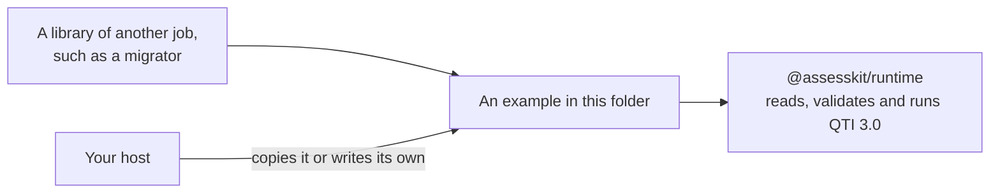

# Examples of the runtime

Each example is a package of its own, with the dependencies that only it needs, and a test that CI runs.

| Example                                | Shows                                                                                                                     |
| -------------------------------------- | ------------------------------------------------------------------------------------------------------------------------- |
| [migrate-qti2](migrate-qti2/README.md) | How to bring QTI 2.x items to QTI 3 with a dedicated migrator, validate and run the result, and what the migrator covers. |

The runtime reads QTI 3.0 only. A tool for another job is a dependency of the example that uses it, never of a package.

QTI® is a trademark of 1EdTech® Consortium, Inc. (1edtech.org).
assesskit is not affiliated with, endorsed by or approved by 1EdTech Consortium, Inc.
