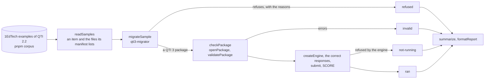
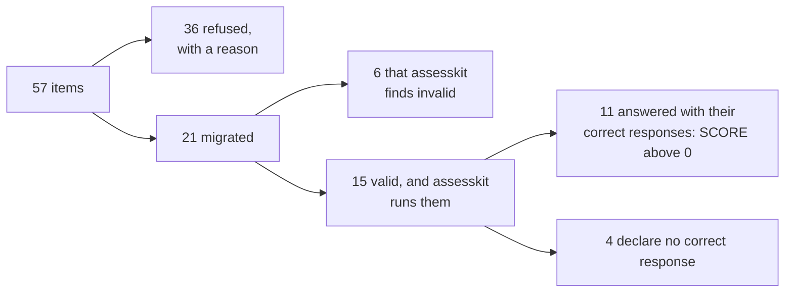

# Migrate QTI 2.x to QTI 3

assesskit reads and runs QTI 3.0, and migration from QTI 1.2 and 2.x is another job. This example does it with
[`@longsightgroup/qti3-migrator`](https://github.com/LongsightGroup/qti3/tree/main/packages/migrator) (MIT, version 0.13.3), a
dependency of this example only. It migrates the 57 items of the 1EdTech examples of QTI 2.2, checks each result with
`@assesskit/runtime`, and reports what passes.



| What                      | Where                                                                                                         |
| ------------------------- | ------------------------------------------------------------------------------------------------------------- |
| The items and their files | `src/samples.ts`: `readSamples` reads the manifest of a QTI 2.2 package                                       |
| The migration             | `src/migrate-sample.ts`: `migrateSample`; `src/migrate-samples.ts`: `migrateSamples`                          |
| The check with assesskit  | `src/check-package.ts`: `checkPackage` reads, validates and runs a QTI 3 package                              |
| The report                | `src/report.ts`: `summarize`, `formatReport`                                                                  |
| The tests, which CI runs  | `test/migrate.corpus.test.ts` and `test/migrate.xsd.test.ts`; `test/probes.ts` builds the APIP and PCI probes |

To run it, download the examples with `pnpm corpus` and start it. The tests run with `pnpm test:corpus` and `pnpm test:xsd`, which
read the examples and the schemas (`pnpm schemas`):

```sh
pnpm corpus
pnpm --filter @assesskit/example-migrate-qti2 start
```

## What the migrator covers

The migrator refuses an item when it cannot keep the scoring, the correct response or the feedback, and says why. It does not
migrate what it cannot preserve. Measured on the 57 items of the 1EdTech examples of QTI 2.2, with its default options:



| Result                          | Items                                                                                                                                                                                                      |
| ------------------------------- | ---------------------------------------------------------------------------------------------------------------------------------------------------------------------------------------------------------- |
| Migrated, valid and run         | `choice`, `choice_aria`, `choice_fixed`, `hottext`, `math`, `order`, `order_rtl`, `orkney1`, `orkney2`, `slider`, `svg`, `extended_text`, `extended_text_rubric`, `nested_object`, `upload`                |
| Migrated, invalid for assesskit | `figures` and `audio_video` (elements of the QTI 2.2 HTML5 namespace, which the ASI schema refuses too); `graphic_order`, `hotspot`, `position_object` and `select_point` (an `alt` attribute on `object`) |
| Refused                         | The other 36, for the reasons below                                                                                                                                                                        |

| Reason of a refusal                        | Items | Meaning                                                                                      |
| ------------------------------------------ | ----- | -------------------------------------------------------------------------------------------- |
| `qti2_composite_interactions_unsupported`  | 10    | An item with several interactions: partial migration is not allowed                          |
| `qti2_response_processing_not_preserved`   | 9     | Authored response processing that the authoring model cannot reproduce                       |
| `qti2_adaptive_not_preserved`              | 8     | The lifecycle of an adaptive item                                                            |
| `qti2_response_mapping_not_preserved`      | 8     | A response mapping, which gives partial credit, that the QTI 3 authoring model cannot keep   |
| `qti2_outcomes_not_preserved`              | 5     | Authored outcome declarations, types, defaults or metadata                                   |
| `qti2_text_entry_correct_response_missing` | 3     | A text entry interaction with no correct text value                                          |
| `qti2_correct_response_not_preserved`      | 2     | No usable correct response, which the authoring model requires                               |
| `qti2_modal_feedback_not_preserved`        | 2     | Authored modal feedback, which the migration path does not translate                         |
| `writer_diagnostics`                       | 2     | The QTI 3 writer rejected the migrated item                                                  |
| `qti2_template_not_preserved`              | 1     | Template declarations and processing                                                         |
| `core_parse.interaction.child.unsupported` | 1     | A child that the QTI 3 model does not allow in the interaction (a blockquote in a gap match) |

An item can have several reasons. `repairPolicy: "safe"` gives the same counts on these items.

### APIP, portable custom interactions and QTI 1.2

The examples hold no APIP, no portable custom interaction and no QTI 1.2 item, so the test builds probes from a real item and
reads the code of the migrator:

| Source                             | What the migrator does                                                                                                                         |
| ---------------------------------- | ---------------------------------------------------------------------------------------------------------------------------------------------- |
| APIP accessibility information     | Nothing: it has no code for APIP. The item `choice` with an `apip:apipAccessibility` block migrates with no diagnostic, and the block is gone. |
| Portable custom interaction of 2.x | Refuses it with `qti2_interaction_unsupported`; only a plain `customInteraction` has a mapping.                                                |
| QTI 1.2                            | Reads it (single-response choice, associate, matching, text entry and the like); this example does not exercise it, as the examples hold none. |

An item with APIP therefore loses its accessibility information without a word. Run an APIP package through a tool that reads APIP
first, or keep the APIP data beside the migrated item.

### The manifest

The migrator writes `<schemaversion>3.0.1</schemaversion>` in the manifest of the package, and the schema of QTI 3 packages
(`imsqtiv3p0_imscpv1p2_v1p0.xsd`) enumerates `3.0.0` only, as every 1EdTech package has. assesskit refuses the manifest as written,
so `migrateSample` changes that one value (`withSchemaVersion`) and nothing else.

### Against the official schemas

`test/migrate.xsd.test.ts` validates the documents of the 21 migrated packages against the XSDs of QTI 3: 19 are valid, and `figures`
and `audio_video` are not, for the elements of the HTML5 namespace of QTI 2.2 that the migrator leaves as they are. The four items with
an `alt` on `object` pass the schema and fail `validatePackage`, which checks the attributes of HTML elements.

## Options

`migrateSamples(samples, options)` passes `options` to the migrator.

| Option              | Default        | Meaning                                                                                      |
| ------------------- | -------------- | -------------------------------------------------------------------------------------------- |
| `repairPolicy`      | `"none"`       | `"safe"` repairs what the migrator considers safe to repair, such as a missing key.          |
| `unsupportedPolicy` | `"diagnostic"` | What to do with an interaction it cannot migrate: report it, make a review stub, or skip it. |

## Errors

| Error       | When                                                                            |
| ----------- | ------------------------------------------------------------------------------- |
| `ReadError` | `readSamples`: the manifest is not well-formed                                  |
| `Error`     | `readSamples`: a file the manifest lists is missing, so run `pnpm corpus` first |
