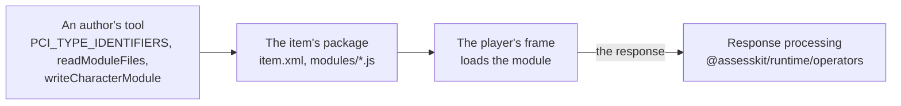

# @assesskit/custom-interactions

QTI 3.0 portable custom interactions for JavaScript and TypeScript: math entry for formulas in LaTeX and stroke writing for characters, each an AMD module that loads entirely from the item's package. A module runs in the frame of [`@assesskit/player`](https://assesskit.wakan.dev/_assesskit/player/), which reaches no network, or in any delivery engine that loads modules by the QTI 3.0 Best Practices and Implementation Guide.

```bash
npm install @assesskit/custom-interactions
```

The runtime dependencies are [`@assesskit/runtime`](https://assesskit.wakan.dev/_assesskit/runtime/), for checks and errors,
and valibot. Each module bundles its library, pinned exactly, with the library's license at its head:
[MathLive](https://mathlive.io) 0.111.4 and [Hanzi Writer](https://hanziwriter.org) 3.7.3, both MIT.

## Quick start

```ts
import { PCI_TYPE_IDENTIFIERS } from "@assesskit/custom-interactions";
import { readModuleFiles } from "@assesskit/custom-interactions/node";

PCI_TYPE_IDENTIFIERS["math-entry"]; // => "urn:fdc:assesskit.wakan.dev:2026:math-entry"
const files = await readModuleFiles("math-entry");
[...files.keys()][0]; // => "modules/math-entry.js"
```

The item names the module at `primary-path="modules/math-entry"`, and the package lists the files;
[math entry](https://assesskit.wakan.dev/_assesskit/custom-interactions/math-entry/) writes a whole item and its package.

## Architecture



## API

| Import                                     | Contents                                                                                                                                                                                        |
| ------------------------------------------ | ----------------------------------------------------------------------------------------------------------------------------------------------------------------------------------------------- |
| `@assesskit/custom-interactions`           | `PCI_TYPE_IDENTIFIERS`, the type identifier of each interaction by its name, and `InteractionName`; `writeCharacterModule` and `CharacterStrokes`, the module of a character for stroke writing |
| `@assesskit/custom-interactions/node`      | `readModuleFiles`: the files of an interaction's module, by their paths in the package                                                                                                          |
| `@assesskit/custom-interactions/modules/*` | The built modules and the files beside them, for a tool that copies them                                                                                                                        |

## Supported

| Interaction      | Response                                                                    | Scored by                                                               |
| ---------------- | --------------------------------------------------------------------------- | ----------------------------------------------------------------------- |
| `math-entry`     | `single` `string`: LaTeX; `ordered` `string`: worked steps, one line a step | `expression-equivalent` and `readable`; the steps by `compareMathSteps` |
| `stroke-writing` | `record`: `strokes` and `mistakes`, integers                                | QTI's own expressions, by `qti-field-value`                             |

The modules run in Chromium 111, Firefox 115, Safari 16.4 and later, the player's
[baseline](https://assesskit.wakan.dev/_assesskit/player/baseline/), and are tested in its frame in the current Chromium,
Firefox and WebKit.

## Documentation

| Guide                                                                                        | Covers                                                                                   |
| -------------------------------------------------------------------------------------------- | ---------------------------------------------------------------------------------------- |
| [Architecture](https://assesskit.wakan.dev/_assesskit/custom-interactions/architecture/)     | Why a package of its own, the build of a module, sizes, dependencies, security and tests |
| [Math entry](https://assesskit.wakan.dev/_assesskit/custom-interactions/math-entry/)         | The item, its properties, what the field writes, worked steps and accessibility          |
| [Stroke writing](https://assesskit.wakan.dev/_assesskit/custom-interactions/stroke-writing/) | The item, its properties, scoring a record, the reference strokes and accessibility      |
| [Supported](https://assesskit.wakan.dev/_assesskit/custom-interactions/supported/)           | What each interaction responds with and how it is scored, and what is left out           |
| [Evidence](https://assesskit.wakan.dev/_assesskit/custom-interactions/evidence/)             | The tests of the modules in Node and in the player's frame, and their sizes              |
| [Choosing](https://assesskit.wakan.dev/_assesskit/custom-interactions/choosing/)             | When the interactions fit, and what other ways to answer have that they lack             |

## License

[Apache-2.0](https://github.com/assesskit/assesskit/blob/main/packages/custom-interactions/LICENSE). Copyright Fariz Wakan. The modules include MathLive and Hanzi Writer, under the MIT license, which
[NOTICE](https://github.com/assesskit/assesskit/blob/main/packages/custom-interactions/NOTICE) reproduces with the license of MathLive's fonts.

QTI® is a trademark of 1EdTech® Consortium, Inc. (1edtech.org).
assesskit is not affiliated with, endorsed by or approved by 1EdTech Consortium, Inc.
