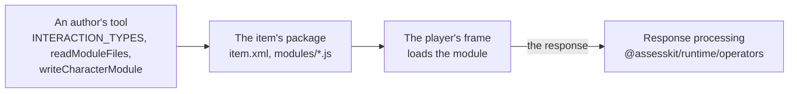

# @assesskit/custom-interactions

Portable custom interactions for QTI 3.0 items: `math-entry`, a formula typed in a [MathLive](https://mathlive.io) field with
a virtual keyboard, whose LaTeX the `expression-equivalent` operator of [`@assesskit/runtime`](../runtime/README.md)
scores, and `stroke-writing`, a character written with strokes in [Hanzi Writer](https://hanziwriter.org)'s quiz, whose
strokes and mistakes response processing scores. Each is an AMD module that the item's package carries, so that it loads entirely from the package in the frame of
[`@assesskit/player`](../player/README.md), which reaches no network, or in any delivery engine that loads modules by the
QTI 3.0 Best Practices and Implementation Guide.



```bash
npm install @assesskit/custom-interactions
```

The package depends on [`@assesskit/runtime`](../runtime/README.md), for its checks and errors. The modules hold their
libraries, bundled and pinned exactly, with each library's license at the head of its module: MathLive 0.111.1 (MIT) and
Hanzi Writer 3.7.3 (MIT).

## Quick start

```ts
import { INTERACTION_TYPES } from "@assesskit/custom-interactions";
import { readModuleFiles } from "@assesskit/custom-interactions/node";

INTERACTION_TYPES["math-entry"]; // => "urn:fdc:assesskit.wakan.dev:2026:math-entry"
const files = await readModuleFiles("math-entry");
[...files.keys()][0]; // => "modules/math-entry.js"
```

The item names the module at `primary-path="modules/math-entry"`, and the package lists the files.
[Math entry](https://github.com/assesskit/assesskit/blob/main/docs/custom-interactions/math-entry.md) writes a whole item
and its package.

## API

| Import                                     | Contents                                                                                                         |
| ------------------------------------------ | ---------------------------------------------------------------------------------------------------------------- |
| `@assesskit/custom-interactions`           | `INTERACTION_TYPES`, the type identifier of each interaction by its name, and `InteractionName`                  |
| `@assesskit/custom-interactions/node`      | `readModuleFiles`, `ReadModuleFilesOptions`: the files of an interaction's module, by their paths in the package |
| `@assesskit/custom-interactions/modules/*` | The built modules and the files beside them, for a tool that copies them                                         |

## Supported

| Interaction      | Response                                                                    | Scored by                                                               |
| ---------------- | --------------------------------------------------------------------------- | ----------------------------------------------------------------------- |
| `math-entry`     | `single` `string`: LaTeX; `ordered` `string`: worked steps, one line a step | `expression-equivalent` and `readable`; the steps by `compareMathSteps` |
| `stroke-writing` | `record`: `strokes` and `mistakes`, integers                                | QTI's own expressions, by `qti-field-value`                             |

The modules run in Chromium 111, Firefox 115 and Safari 16.4, and later versions, the
[baseline](https://github.com/assesskit/assesskit/blob/main/docs/player/baseline.md) of the player, and are tested in its
frame in the current Chromium, Firefox and WebKit.

## Documentation

| Guide                                                                                                     | Covers                                                                                   |
| --------------------------------------------------------------------------------------------------------- | ---------------------------------------------------------------------------------------- |
| [Architecture](https://github.com/assesskit/assesskit/blob/main/docs/custom-interactions/architecture.md) | Why a package of its own, the build of a module, sizes, dependencies, security and tests |
| [Math entry](https://github.com/assesskit/assesskit/blob/main/docs/custom-interactions/math-entry.md)     | The item, its properties, what the field writes, worked steps and accessibility          |

## License

[Apache-2.0](LICENSE). Copyright Fariz Wakan. The modules include MathLive and Hanzi Writer, under the MIT license, which
[NOTICE](NOTICE) reproduces with the license of MathLive's fonts.
