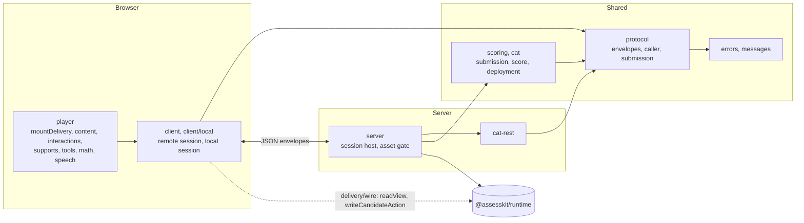

# @assesskit/player

QTI 3.0 player for JavaScript and TypeScript, built on @assesskit/runtime: renders the 20 standard interactions in the browser, hosts portable custom interactions, and serves test sessions and adaptive tests from a server. It applies accessibility in the interface, and its server-side session host has the ports that LTI, a gradebook and an analytics sink plug into. The runtime, [`@assesskit/runtime`](https://assesskit.wakan.dev/_assesskit/runtime/), owns the QTI semantics and the player owns the interface and the network, so the player never evaluates an expression, decides what is visible or valid, chooses a variant, or holds an answer key outside the runtime's solution view.

```bash
npm install @assesskit/player
```

The player depends on [`@assesskit/runtime`](https://assesskit.wakan.dev/_assesskit/runtime/), which npm installs with it, and on two other packages, pinned to
exact versions: `jose` signs the tokens of the asset gate, and `valibot` reads untrusted JSON
([SECURITY](https://github.com/assesskit/assesskit/blob/main/SECURITY.md#runtime-dependencies)).

## Quick start

```ts
import { selectMessages } from "@assesskit/player";
import { ID_MESSAGES } from "@assesskit/player/messages-id";
import { REFUSAL_REASONS } from "@assesskit/player/protocol";

selectMessages("id-ID", { id: ID_MESSAGES }).toolRule; // => "Penggaris"
REFUSAL_REASONS.includes("time-over"); // => true
```

[Client](https://assesskit.wakan.dev/_assesskit/player/client/) and
[Server](https://assesskit.wakan.dev/_assesskit/player/server/) have the samples that mount a session.

## Architecture

The browser draws a session and sends its actions; the server hosts the engine of the runtime and the ports of the integrations.



## API

| Import                                  | Contents                                                                                                                                                                                                                                                                                                                                                     |
| --------------------------------------- | ------------------------------------------------------------------------------------------------------------------------------------------------------------------------------------------------------------------------------------------------------------------------------------------------------------------------------------------------------------ |
| `@assesskit/player`                     | `AccessError`, which extends `AssesskitError` of `@assesskit/runtime/errors`, as does `ServiceError`, which the player throws and a CAT engine throws to refuse a request; `Messages`, `EN_MESSAGES`, `selectMessages`                                                                                                                                       |
| `@assesskit/player/messages-id`         | `ID_MESSAGES`, the interface messages in Indonesian, which a host passes to `selectMessages` or to the `messages` option of a mount                                                                                                                                                                                                                          |
| `@assesskit/player/player`              | `mountPciFrame`, `PciFrame`, `PciFrameOptions`, `PciEvent`, `PciVariable`, `PciFiles`, `MIN_PCI_HEIGHT`, `MAX_PCI_HEIGHT`; `mountTools`, `ToolsInput`, `ToolSupport`, `ToolsOptions`, `ToolSlots`, `SlotTool`; the types of their fields                                                                                                                     |
| `@assesskit/player/player`              | `createContentRoot`, `ContentRoot`, `ContentRootOptions`, `RootContent`, `ContentPart`, `StylesheetFetch`; `createBodyRenderer`, `BodyRenderer`, `BodyRendererOptions`, `InteractionRenderer`, `InteractionRenderers`, `DECLARED_WIDTH`, `DECLARED_HEIGHT`                                                                                                   |
| `@assesskit/player/player`              | `createInteractionRenderers`, `InteractionOptions`, `InteractionFiles`, `MAX_RECORDING_SECONDS`, `CustomInteractionHook`, `CustomInteractionState`, `defineElements`, `InteractionElement`, `ResponseEvent`, `ResponseDetail`, `RESPONSE_EVENT`, `EndAttemptEvent`, `EndAttemptDetail`, `END_ATTEMPT_EVENT`                                                  |
| `@assesskit/player/player`              | `mountDelivery`, `mountItem`, `DeliveryOptions`, `ItemMountOptions`, `MountOptions`, `MountFiles`, `Mounted`, `LtiLogin`, `planActions`                                                                                                                                                                                                                      |
| `@assesskit/player/player`              | `createMathTypesetter`, `MathTypesetter`                                                                                                                                                                                                                                                                                                                     |
| `@assesskit/player/player`              | `SpeechRequest`, `SpeechSettings`, `SpeechHook`, `createWebSpeech`, `readLexicon`, `Lexicon`, `Pronunciation`                                                                                                                                                                                                                                                |
| `@assesskit/player/player`              | `resolvePresentation`, `mediaScale`, `applyPresentation`, `Presentation`; `mountSupportPanel`, `mountContentSupports`, `mountSpoken`, `mountVariantNotice`, and the types of their options; `PciFrame.setPresentation`; `ContentRoot.stage`, `ContentRoot.setMediaScale`                                                                                     |
| `@assesskit/player/player`              | `mountSubmission`, `MountedSubmission`, `SubmissionOptions`, `SubmissionFiles`; `mountRatingForm`, `MountedRatingForm`, `RatingFormOptions`                                                                                                                                                                                                                  |
| `@assesskit/player/protocol`            | `Caller`, `ActionEnvelope`, `ViewEnvelope`, `Submission`, `SubmissionPart`, `SubmissionItem`, `SubmissionValue`, `SubmissionVariable`, `SubmissionSupplied`, `SessionClient`, `DispatchResult`, `HostSession`, `HostStep`, `HostApplyOptions`, `ViewDocuments`, `OfficialResult` and `LtiFrame`, `LTI_TOOL_FRAME`, `LTI_STORAGE_FRAME` and `REFUSAL_REASONS` |
| `@assesskit/player/scoring`             | `buildSubmission`, `buildSupplyScores`, `buildSessionScore`; `SupplyScores`, `ScoreInput`, `SessionScore`, `ScoringProgress`                                                                                                                                                                                                                                 |
| `@assesskit/player/client`              | `createRemoteSession`, `Transport`, `RemoteSessionOptions`, `Clock`, `BROWSER_CLOCK`, `AUTOSAVE_MS`, `FLUSH_BEFORE_DEADLINE_MS`: the client of an exam page                                                                                                                                                                                                  |
| `@assesskit/player/client/local`        | `createLocalSession`, `LocalSession`, `LocalHostSession`, `LocalSessionOptions`, `LocalStore`, `LocalSave`: the client of practice, which loads the engine with `import()`                                                                                                                                                                                   |
| `@assesskit/player/cat`                 | `deployCatSections`, `DeployedCatSection`                                                                                                                                                                                                                                                                                                                    |
| `@assesskit/player/cat-rest`            | `createRestCatPort`, `CatEngine`, `CatEngines`, `OAuthClientCredentials`, `CatFetch`, and the engine side `createCatRestHandler`, `CatAuthorizer`, `CatAuthorization`, `CatOperation`, `CAT_SCOPES`, `listScopes`; the types of their options and results; on a server only, as `createRestCatPort` takes an OAuth client secret                             |
| `@assesskit/player/server`              | `createSessionHost`, `SessionHost`, `createAssetGate`, `AssetGate`, `collectAssetPrefixes`, `SessionStore`, `Scheduler`, `FileStore`, `ToolScoreStore`, `ToolScore`, `createToolScoreIntake`, `SYSTEM_CLOCK`, `EXAM_CLIENT_ACTIONS`, `MAX_SAVE_RETRIES`; `StepEvents`, `StepSink`, `SuppliedGrade`, `ForwardOptions`                                         |
| `@assesskit/player/player.css`          | The stylesheet of a content root: themes, the QTI 3 shared vocabulary and the PNP presentation                                                                                                                                                                                                                                                               |
| `@assesskit/player/pci-frame/*`         | The static files of the frame: `frame.html`, `require.js` and `bridge.js`                                                                                                                                                                                                                                                                                    |
| `@assesskit/player/recorder-worklet.js` | The program of the audio worklet of a WAV recording                                                                                                                                                                                                                                                                                                          |

## Supported

The player holds no 1EdTech certification. [Supported](https://assesskit.wakan.dev/_assesskit/player/supported/)
says what it draws and operates, how WCAG 2.2 levels A and AA are checked, and what it does not support. The browser code runs
in Chromium 111, Firefox 115 and Safari 16.4, and later versions; [Baseline](https://assesskit.wakan.dev/_assesskit/player/baseline/)
lists what that allows and how it is tested.

## Documentation

| Guide                                                                              | Covers                                                                                                                |
| ---------------------------------------------------------------------------------- | --------------------------------------------------------------------------------------------------------------------- |
| [Architecture](https://assesskit.wakan.dev/_assesskit/player/architecture/)        | Principles, layers and errors                                                                                         |
| [Baseline](https://assesskit.wakan.dev/_assesskit/player/baseline/)                | The browser baseline and how it is tested                                                                             |
| [Content](https://assesskit.wakan.dev/_assesskit/player/content/)                  | The renderer, the content root, references, stylesheets, cards and feedback                                           |
| [Portable custom interactions](https://assesskit.wakan.dev/_assesskit/player/pci/) | The frame, its policy, loading, events and serving the files                                                          |
| [Mathematics](https://assesskit.wakan.dev/_assesskit/player/math/)                 | MathJax by URL, shadow roots, elementary math and braille                                                             |
| [Speech](https://assesskit.wakan.dev/_assesskit/player/speech/)                    | The speech request, SSML, `data-ssml`, lexicons, restriction types, voices and the typing echo                        |
| [Delivery](https://assesskit.wakan.dev/_assesskit/player/delivery/)                | `mountDelivery`, `mountItem`, the chrome, the confirmations, the timers, the status messages and the focus            |
| [Client](https://assesskit.wakan.dev/_assesskit/player/client/)                    | The remote session with autosave, and the local session of practice                                                   |
| [Server](https://assesskit.wakan.dev/_assesskit/player/server/)                    | The session host, the client-action policy, the proctor, the scheduler and the stores                                 |
| [Asset gate](https://assesskit.wakan.dev/_assesskit/player/asset-gate/)            | Tokens in the path, prefixes, what is never served, and the tokens of the candidate's files                           |
| [Protocol](https://assesskit.wakan.dev/_assesskit/player/protocol/)                | The caller, the envelopes, the session client, the branded result and the submission                                  |
| [Rating form](https://assesskit.wakan.dev/_assesskit/player/rating/)               | The accessible form that turns a rater's choices into the score of a scoring rubric                                   |
| [Scoring](https://assesskit.wakan.dev/_assesskit/player/scoring/)                  | The submission of a scoring request, the action that supplies its score, and the display for raters                   |
| [LTI items](https://assesskit.wakan.dev/_assesskit/player/lti-items/)              | The ports that wire a tool, a gradebook and an analytics sink to a session, and the example that does it              |
| [CAT](https://assesskit.wakan.dev/_assesskit/player/cat/)                          | The client of the REST binding, any other engine behind `CatPort`, and the deployment of a package                    |
| [Interactions](https://assesskit.wakan.dev/_assesskit/player/interactions/)        | The elements of the interactions, their responses, hints and keys, the board, media, upload and recording             |
| [Graphic interactions](https://assesskit.wakan.dev/_assesskit/player/graphics/)    | The interactions that work on an image: shapes and coordinates, limits, targets, and the drawing                      |
| [Messages](https://assesskit.wakan.dev/_assesskit/player/messages/)                | The interface text and the choice of a catalog by language                                                            |
| [Styling](https://assesskit.wakan.dev/_assesskit/player/styling/)                  | `player.css`, its themes, the PNP properties, the parts and the vocabulary                                            |
| [Supports](https://assesskit.wakan.dev/_assesskit/player/supports/)                | The look of the PNP, the panel of options, cards and popups, captions, reading aloud and the variant                  |
| [Tools](https://assesskit.wakan.dev/_assesskit/player/tools/)                      | The tools of an item, how they are shown and operated                                                                 |
| [Supported](https://assesskit.wakan.dev/_assesskit/player/supported/)              | What the player supports and what it does not, the browsers and WCAG 2.2                                              |
| [Choosing](https://assesskit.wakan.dev/_assesskit/player/choosing/)                | When the player fits, and what Amp-up, Citolab, Longsight, TAO, Learnosity and Inspera have that it lacks, with dates |
| [Evidence](https://assesskit.wakan.dev/_assesskit/player/evidence/)                | How the player is tested                                                                                              |
| [Conformance](https://assesskit.wakan.dev/_assesskit/runtime/conformance/)         | Every feature ID of the 1EdTech conformance document, with its guide and its test                                     |

## License

[Apache-2.0](https://github.com/assesskit/assesskit/blob/main/packages/player/LICENSE). Copyright Fariz Wakan. See [NOTICE](https://github.com/assesskit/assesskit/blob/main/packages/player/NOTICE).

QTI® is a trademark of 1EdTech® Consortium, Inc. (1edtech.org).
LTI® is a trademark of 1EdTech® Consortium, Inc. (1edtech.org).
W3C® is a trademark of the World Wide Web Consortium.
assesskit is not affiliated with, endorsed by or approved by 1EdTech Consortium, Inc. or W3C.
