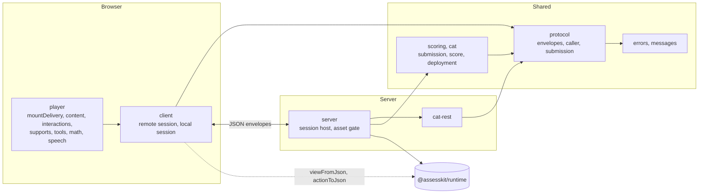

# @assesskit/player

A player and integrations for QTI 3.0 assessments, built on [`@assesskit/runtime`](../runtime/README.md): rendering, the host
of portable custom interactions, accessibility applied in the interface, and the server-side session host with the ports that
LTI, a gradebook and an analytics sink plug into. The runtime owns the
QTI semantics and the player owns the interface and the network, so the player never evaluates an expression, decides what is
visible or valid, chooses a variant, or holds an answer key outside the runtime's solution view.



## Quick start

```ts
import { selectMessages } from "@assesskit/player";
import { checkActionEnvelope } from "@assesskit/player/protocol";

selectMessages("id-ID").toolRule; // => "Penggaris"

const envelope = JSON.parse('{"seq":3,"action":{"type":"move"}}');
checkActionEnvelope(envelope);
envelope.seq; // => 3
```

[Client](https://github.com/assesskit/assesskit/blob/main/docs/player/client.md) and
[Server](https://github.com/assesskit/assesskit/blob/main/docs/player/server.md) have the samples that mount a session.

## What is supported

The player is not certified by 1EdTech. [Supported](https://github.com/assesskit/assesskit/blob/main/docs/player/supported.md)
says what it draws and operates, how WCAG 2.2 levels A and AA are checked, and what it does not support. The browser code runs
in Chromium 111, Firefox 115 and Safari 16.4, and later versions; [Baseline](https://github.com/assesskit/assesskit/blob/main/docs/player/baseline.md)
lists what that allows and how it is tested.

## API

| Import                                  | Contents                                                                                                                                                                                                                                                                                                                                                                                                                                                                                                                                               |
| --------------------------------------- | ------------------------------------------------------------------------------------------------------------------------------------------------------------------------------------------------------------------------------------------------------------------------------------------------------------------------------------------------------------------------------------------------------------------------------------------------------------------------------------------------------------------------------------------------------ |
| `@assesskit/player`                     | `AccessError`, `ServiceError`, which extend `AssesskitError` of `@assesskit/runtime/errors`; `Messages`, `EN_MESSAGES`, `ID_MESSAGES`, `selectMessages`                                                                                                                                                                                                                                                                                                                                                                                                |
| `@assesskit/player/player`              | `mountPciFrame`, `PciFrame`, `PciFrameOptions`, `PciEvent`, `PciVariable`, `PciFiles`, `MIN_PCI_HEIGHT`, `MAX_PCI_HEIGHT`; `mountTools`, `ToolsInput`, `ToolSupport`, `ToolsOptions`, `ToolSlots`, `SlotTool`; the types of their fields                                                                                                                                                                                                                                                                                                               |
| `@assesskit/player/player`              | `createContentRoot`, `ContentRoot`, `ContentRootOptions`, `RootContent`, `ContentPart`, `StylesheetFetch`; `createBodyRenderer`, `BodyRenderer`, `BodyRendererOptions`, `InteractionRenderer`, `InteractionRenderers`, `DECLARED_WIDTH`, `DECLARED_HEIGHT`                                                                                                                                                                                                                                                                                             |
| `@assesskit/player/player`              | `createInteractionRenderers`, `InteractionOptions`, `InteractionFiles`, `CustomInteractionHook`, `CustomInteractionState`, `defineElements`, `InteractionElement`, `ResponseEvent`, `ResponseDetail`, `RESPONSE_EVENT`, `EndAttemptEvent`, `EndAttemptDetail`, `END_ATTEMPT_EVENT`                                                                                                                                                                                                                                                                     |
| `@assesskit/player/player`              | `mountDelivery`, `mountItem`, `DeliveryOptions`, `ItemMountOptions`, `MountOptions`, `MountFiles`, `Mounted`, `LtiLogin`, `planActions`                                                                                                                                                                                                                                                                                                                                                                                                                |
| `@assesskit/player/player`              | `createMathTypesetter`, `MathTypesetter`                                                                                                                                                                                                                                                                                                                                                                                                                                                                                                               |
| `@assesskit/player/player`              | `buildSpeechRequest`, `SpeechOptions`, `SpeechRequest`, `SpeechSettings`, `SpeechHook`, `webSpeech`, `echoTyping`, `TypingEchoOptions`, `applyReadingType`, `parseLexicon`, `Lexicon`, `Pronunciation`                                                                                                                                                                                                                                                                                                                                                 |
| `@assesskit/player/player`              | `presentationOf`, `mediaScaleOf`, `applyPresentation`, `Presentation`; `mountSupportPanel`, `mountContentSupports`, `mountSpoken`, `mountVariantNotice`, and the types of their options; `PciFrame.setPresentation`; `ContentRoot.stage`, `ContentRoot.setMediaScale`                                                                                                                                                                                                                                                                                  |
| `@assesskit/player/player`              | `mountSubmission`, `MountedSubmission`, `SubmissionOptions`, `SubmissionFiles`; `mountRatingForm`, `MountedRatingForm`, `RatingFormOptions`                                                                                                                                                                                                                                                                                                                                                                                                            |
| `@assesskit/player/protocol`            | `Caller`, `ActionEnvelope`, `ViewEnvelope`, `Submission`, `SubmissionPart`, `SubmissionItem`, `SubmissionValue`, `SubmissionVariable`, `SubmissionSupplied`, `checkSubmission`, `SessionClient`, `DispatchResult`, `HostSession`, `HostStep`, `HostApplyOptions`, `SessionCallOptions`, `ViewDocuments`, `OfficialResult` and `LtiFrame`, `LTI_TOOL_FRAME`, `LTI_STORAGE_FRAME` and `checkCaller`, `checkActionEnvelope`, `checkViewEnvelope`, `checkRefusal`, `checkLtiFrame`, `checkAllowList`, `isOfficialResult`, `viewDocuments`, `REFUSAL_CODES` |
| `@assesskit/player/scoring`             | `toSubmission`, `toSupplyScores`, `sessionScore`; `SupplyScores`, `ScoreInput`, `SessionScore`, `ScoringProgress`                                                                                                                                                                                                                                                                                                                                                                                                                                      |
| `@assesskit/player/client`              | `createRemoteSession`, `createLocalSession`, `LocalSession`, `LocalHostSession`, `Transport`, `LocalStore`, `Clock`, `BROWSER_CLOCK`, `AUTOSAVE_MS`, `FLUSH_BEFORE_DEADLINE_MS`                                                                                                                                                                                                                                                                                                                                                                        |
| `@assesskit/player/cat`                 | `deployCatSections`, `DeployedCatSection`                                                                                                                                                                                                                                                                                                                                                                                                                                                                                                              |
| `@assesskit/player/cat-rest`            | `createRestCatPort`, `OAuthClientCredentials`, `CatFetch`, and the engine side `createCatRestHandler`, `CatAuthenticate`, `CatOperation`; the types of their options and results; on a server only, as `createRestCatPort` takes an OAuth client secret                                                                                                                                                                                                                                                                                                |
| `@assesskit/player/server`              | `createSessionHost`, `SessionHost`, `createAssetGate`, `AssetGate`, `collectAssetPrefixes`, `SessionStore`, `Scheduler`, `FileStore`, `ToolScoreStore`, `ToolScore`, `createToolScoreIntake`, `SYSTEM_CLOCK`, `EXAM_CLIENT_ACTIONS`, `MAX_SAVE_RETRIES`; `StepEvents`, `StepSink`, `SuppliedGrade`, `ForwardOptions`                                                                                                                                                                                                                                   |
| `@assesskit/player/player.css`          | The stylesheet of a content root: themes, the QTI 3 shared vocabulary and the PNP presentation                                                                                                                                                                                                                                                                                                                                                                                                                                                         |
| `@assesskit/player/pci-frame/*`         | The static files of the frame: `frame.html`, `require.js` and `bridge.js`                                                                                                                                                                                                                                                                                                                                                                                                                                                                              |
| `@assesskit/player/recorder-worklet.js` | The program of the audio worklet of a WAV recording                                                                                                                                                                                                                                                                                                                                                                                                                                                                                                    |

## Documentation

| Guide                                                                                               | Covers                                                                                                     |
| --------------------------------------------------------------------------------------------------- | ---------------------------------------------------------------------------------------------------------- |
| [Architecture](https://github.com/assesskit/assesskit/blob/main/docs/player/architecture.md)        | Principles, layers and errors                                                                              |
| [Baseline](https://github.com/assesskit/assesskit/blob/main/docs/player/baseline.md)                | The browser baseline and how it is tested                                                                  |
| [Content](https://github.com/assesskit/assesskit/blob/main/docs/player/content.md)                  | The renderer, the content root, references, stylesheets, cards and feedback                                |
| [Portable custom interactions](https://github.com/assesskit/assesskit/blob/main/docs/player/pci.md) | The frame, its policy, loading, events and serving the files                                               |
| [Mathematics](https://github.com/assesskit/assesskit/blob/main/docs/player/math.md)                 | MathJax by URL, shadow roots, elementary math and braille                                                  |
| [Speech](https://github.com/assesskit/assesskit/blob/main/docs/player/speech.md)                    | The speech request, SSML, `data-ssml`, lexicons, restriction types, voices and the typing echo             |
| [Delivery](https://github.com/assesskit/assesskit/blob/main/docs/player/delivery.md)                | `mountDelivery`, `mountItem`, the chrome, the confirmations, the timers, the status messages and the focus |
| [Client](https://github.com/assesskit/assesskit/blob/main/docs/player/client.md)                    | The remote session with autosave, and the local session of practice                                        |
| [Server](https://github.com/assesskit/assesskit/blob/main/docs/player/server.md)                    | The session host, the client-action policy, the proctor, the scheduler and the stores                      |
| [Asset gate](https://github.com/assesskit/assesskit/blob/main/docs/player/asset-gate.md)            | Tokens in the path, prefixes, what is never served, and the tokens of the candidate's files                |
| [Protocol](https://github.com/assesskit/assesskit/blob/main/docs/player/protocol.md)                | The caller, the envelopes, the session client, the official result and the submission                      |
| [Rating form](https://github.com/assesskit/assesskit/blob/main/docs/player/rating.md)               | The accessible form that turns a rater's choices into the score of a scoring rubric                        |
| [Scoring](https://github.com/assesskit/assesskit/blob/main/docs/player/scoring.md)                  | The submission of a scoring request, the action that supplies its score, and the display for raters        |
| [LTI items](https://github.com/assesskit/assesskit/blob/main/docs/player/lti-items.md)              | The ports that wire a tool, a gradebook and an analytics sink to a session, and the example that does it   |
| [CAT](https://github.com/assesskit/assesskit/blob/main/docs/player/cat.md)                          | The client of the REST binding, any other engine behind `CatPort`, and the deployment of a package         |
| [Interactions](https://github.com/assesskit/assesskit/blob/main/docs/player/interactions.md)        | The elements of the interactions, their responses, hints and keys, the board, media, upload and recording  |
| [Graphic interactions](https://github.com/assesskit/assesskit/blob/main/docs/player/graphics.md)    | The interactions that work on an image: shapes and coordinates, limits, targets, and the drawing           |
| [Messages](https://github.com/assesskit/assesskit/blob/main/docs/player/messages.md)                | The interface text and the choice of a catalog by language                                                 |
| [Styling](https://github.com/assesskit/assesskit/blob/main/docs/player/styling.md)                  | `player.css`, its themes, the PNP properties, the parts and the vocabulary                                 |
| [Supports](https://github.com/assesskit/assesskit/blob/main/docs/player/supports.md)                | The look of the PNP, the panel of options, cards and popups, captions, reading aloud and the variant       |
| [Tools](https://github.com/assesskit/assesskit/blob/main/docs/player/tools.md)                      | The tools of an item, how they are shown and operated                                                      |
| [Supported](https://github.com/assesskit/assesskit/blob/main/docs/player/supported.md)              | What the player supports and what it does not, the browsers and WCAG 2.2                                   |
| [Evidence](https://github.com/assesskit/assesskit/blob/main/docs/player/evidence.md)                | How the player is tested                                                                                   |
