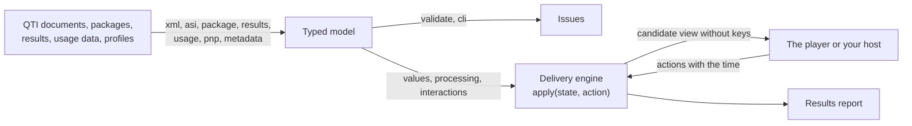

# @assesskit/runtime

A QTI 3.0 runtime for JavaScript and TypeScript. It reads, writes and validates assessment items, tests, content packages,
results, usage data and personal needs and preferences; runs template, response and outcome processing; and delivers a
test session without presenting it: on a server, where the answer keys never reach a candidate's device, or on the device
for practice. Presentation, the host of portable custom interactions, accessibility in the user interface and the
integrations with other systems belong to the player, [`@assesskit/player`](../player/README.md), which is built on the runtime. The core runs in
any JavaScript runtime; the `node` and `cli` subpaths need Node.js 22 or later.



```bash
npm install @assesskit/runtime
```

The runtime has five runtime dependencies, pinned to exact versions: `saxes` and `xmlchars` read XML, `fflate` reads and writes ZIP
archives, `valibot` reads untrusted JSON, and `libxml2-wasm` validates against the official schemas in the `node` subpath
([SECURITY](../../SECURITY.md#runtime-dependencies)).

## Example

Read a package, create the engine of its test, run a short session with `apply`, show the candidate view and write the
results. The engine is a reducer: `apply` takes a state and an action and gives the next state and its events, or a
refusal.

```ts
import { type Action, createEngine, type DeliveryState, viewToJson } from "@assesskit/runtime/delivery";
import { packageResolvers, readManifest, readPackage, writePackage } from "@assesskit/runtime/package";
import { writeResults } from "@assesskit/runtime/results";
import { single } from "@assesskit/runtime/values";

// A package is a ZIP archive of QTI documents. This one is built in memory, so that the example runs as it is; in Node.js
// `readPackageFile` of `@assesskit/runtime/node` reads one from disk.
const NAMESPACE = 'xmlns="http://www.imsglobal.org/xsd/imsqtiasi_v3p0"';
const item = (identifier: string, title: string, correct: string) => `<qti-assessment-item ${NAMESPACE}
    identifier="${identifier}" title="${title}" adaptive="false" time-dependent="false">
  <qti-response-declaration identifier="RESPONSE" cardinality="single" base-type="identifier">
    <qti-correct-response><qti-value>${correct}</qti-value></qti-correct-response>
  </qti-response-declaration>
  <qti-outcome-declaration identifier="SCORE" cardinality="single" base-type="float"/>
  <qti-item-body>
    <qti-choice-interaction response-identifier="RESPONSE" max-choices="1">
      <qti-prompt>${title}</qti-prompt>
      <qti-simple-choice identifier="A">Paris</qti-simple-choice>
      <qti-simple-choice identifier="B">Rome</qti-simple-choice>
    </qti-choice-interaction>
  </qti-item-body>
  <qti-response-processing template="https://purl.imsglobal.org/spec/qti/v3p0/rptemplates/match_correct"/>
</qti-assessment-item>`;
const test = `<qti-assessment-test ${NAMESPACE} identifier="quiz" title="Quiz">
  <qti-outcome-declaration identifier="TOTAL" cardinality="single" base-type="float"/>
  <qti-test-part identifier="part" navigation-mode="linear" submission-mode="individual">
    <qti-assessment-section identifier="main" title="Main" visible="true">
      <qti-assessment-item-ref identifier="q1" href="items/q1.xml"/>
      <qti-assessment-item-ref identifier="q2" href="items/q2.xml"/>
    </qti-assessment-section>
  </qti-test-part>
  <qti-outcome-processing>
    <qti-set-outcome-value identifier="TOTAL">
      <qti-sum><qti-test-variables variable-identifier="SCORE"/></qti-sum>
    </qti-set-outcome-value>
  </qti-outcome-processing>
</qti-assessment-test>`;
const manifest =
  readManifest(`<manifest xmlns="http://www.imsglobal.org/xsd/qti/qtiv3p0/imscp_v1p1" identifier="quiz-package">
  <metadata><schema>QTI Package</schema><schemaversion>3.0.0</schemaversion></metadata>
  <organizations/>
  <resources>
    <resource identifier="quiz" type="imsqti_test_xmlv3p0" href="test.xml">
      <file href="test.xml"/><dependency identifierref="q1"/><dependency identifierref="q2"/>
    </resource>
    <resource identifier="q1" type="imsqti_item_xmlv3p0" href="items/q1.xml"><file href="items/q1.xml"/></resource>
    <resource identifier="q2" type="imsqti_item_xmlv3p0" href="items/q2.xml"><file href="items/q2.xml"/></resource>
  </resources>
</manifest>`);
const encoder = new TextEncoder();
const zip = writePackage(
  manifest,
  new Map([
    ["test.xml", encoder.encode(test)],
    ["items/q1.xml", encoder.encode(item("q1", "Capital of France?", "A"))],
    ["items/q2.xml", encoder.encode(item("q2", "Capital of Italy?", "B"))],
  ]),
);

// Read the package and create the engine of its test. `createEngine` checks everything a session can reach first.
const pkg = readPackage(zip);
const document = pkg.document("test.xml");
if (document.kind !== "test") throw new Error("Expected a test.");
const engine = createEngine({ kind: "test", test: document.test, base: "test.xml", resolvers: packageResolvers(pkg) });

// The engine reads no clock: every step takes the time it happened, in epoch milliseconds. A refusal is data.
const apply = (state: DeliveryState, action: Action) => {
  const step = engine.apply(state, action);
  if (!step.ok) throw new Error(step.refusal.message);
  return step;
};
const started = engine.start({ seed: 7, at: 0 });
if (!started.ok) throw new Error(started.refusal.message);

// The candidate view holds what the candidate sees, and no answer key.
const view = engine.view(started.state, 0);
console.log(view.current?.title);
console.log(view.current?.interactions[0]?.choices.map(({ identifier }) => identifier).join(" "));
console.log(view.actions.join(" "));
// The JSON form of the view, as a server sends it to a client, holds no correct response.
console.log(JSON.stringify(viewToJson(view)).includes("qti-correct-response"));

const answered = apply(started.state, {
  type: "set-responses",
  item: { ref: "q1", instance: 1 },
  responses: new Map([["RESPONSE", single("identifier", "A")]]),
  at: 1_000,
});
const moved = apply(answered.state, { type: "move", to: "next", at: 2_000 });
console.log(moved.events.map(({ type }) => type).join(" "));
const refused = engine.apply(moved.state, { type: "move", to: "previous", at: 2_500 });
console.log(refused.ok ? "accepted" : refused.refusal.code);

const second = apply(moved.state, {
  type: "set-responses",
  item: { ref: "q2", instance: 1 },
  responses: new Map([["RESPONSE", single("identifier", "A")]]),
  at: 3_000,
});
const ended = apply(second.state, { type: "end-test", at: 4_000 });
console.log(ended.state.status, JSON.stringify(ended.state.outcomes.get("TOTAL")));

// The report of the session, as a Results Reporting document.
const results = engine.results(ended.state);
console.log(results.itemResults.map(({ identifier, sessionStatus }) => `${identifier} ${sessionStatus}`).join(", "));
console.log(writeResults(results).match(/<outcomeVariable identifier="TOTAL".*?<\/outcomeVariable>/)?.[0]);
```

It prints:

```text
Capital of France?
A B
set-responses submit skip move end-part end-test suspend
false
attempt-ended response-processed outcome-processed moved presented
linear-backward
ended {"cardinality":"single","baseType":"float","value":1}
q1 final, q2 final
<outcomeVariable identifier="TOTAL" cardinality="single" baseType="float"><value>1</value></outcomeVariable>
```

[Delivery](https://github.com/assesskit/assesskit/blob/main/docs/runtime/delivery.md) describes the actions and refusals of the engine, time limits, the server and device modes
and the pending work of scoring and adaptive sections.

## CLI

The package installs the program `assesskit`. It validates a package or an XML document against the official schemas, which it
downloads once, and with the semantic checks of `validate`:

```bash
npx assesskit schemas fetch
npx assesskit validate packaging/simple/simple.zip
```

```text
packaging/simple/simple.zip: valid (0 errors, 0 warnings)
```

| Command                   | Argument or option    | Default                                                                                                       |
| ------------------------- | --------------------- | ------------------------------------------------------------------------------------------------------------- |
| `assesskit validate`      | `<path>`              | required: a ZIP file, an unpacked package directory or one XML document                                       |
|                           | `--schemas <dir>`     | `assesskit/schemas/<version>` in the user cache directory, where `assesskit schemas fetch` writes the schemas |
|                           | `--format text\|json` | `text`                                                                                                        |
| `assesskit schemas fetch` | `--dir <dir>`         | the same cache directory                                                                                      |
| `assesskit --help`        |                       | prints the commands                                                                                           |

The exit code is 0 when the content has no issue with severity error, 1 when it has one, and 2 when the command line is
wrong, the path cannot be read or is refused, or the schemas are missing. `--format json` prints
`{ tool, version, target, valid, summary: { errors, warnings }, issues }`. `assesskit schemas fetch` is the only code in the runtime that
uses the network. [CLI](https://github.com/assesskit/assesskit/blob/main/docs/runtime/cli.md) has the checks, the output and the cache directory of each platform.

## API

| Import                            | Contents                                                                                                                                                                                                                                                                                                                                                                                                                                                                                                                                          |
| --------------------------------- | ------------------------------------------------------------------------------------------------------------------------------------------------------------------------------------------------------------------------------------------------------------------------------------------------------------------------------------------------------------------------------------------------------------------------------------------------------------------------------------------------------------------------------------------------- |
| `@assesskit/runtime`              | Everything below except `node` and `cli`; `createRandom`, `restoreRandom`, `Random`, `SeededRandom`; `Issue`; `AssesskitError` and its subclasses                                                                                                                                                                                                                                                                                                                                                                                                 |
| `@assesskit/runtime/errors`       | `AssesskitError`, `DataError`, `ReadError`, `SecurityError`, `ProcessingError`, `Issue` and `IssueLocation`, without the other modules                                                                                                                                                                                                                                                                                                                                                                                                            |
| `@assesskit/runtime/asi`          | `readAsi`, `writeAsi`, `AsiDocument`, the model of every assessment and content element, `BodyNode`, `Interaction`, `Expression`, `readScoreCovers`, `scoreCoversBlock`, `walkDocument`                                                                                                                                                                                                                                                                                                                                                           |
| `@assesskit/runtime/results`      | `readResults`, `writeResults` and the model of a Results Reporting document                                                                                                                                                                                                                                                                                                                                                                                                                                                                       |
| `@assesskit/runtime/usage`        | `readUsageData`, `writeUsageData`, the model of usage data, and the vocabularies of item statistics                                                                                                                                                                                                                                                                                                                                                                                                                                               |
| `@assesskit/runtime/pnp`          | `readPnp`, `writePnp`, `resolveSupports` and the model of a personal needs and preferences profile                                                                                                                                                                                                                                                                                                                                                                                                                                                |
| `@assesskit/runtime/metadata`     | `readResourceMetadata`, `writeResourceMetadata`, `deriveQtiMetadata`, QTI metadata, LOM, curriculum standards and the accessibility description of a variant                                                                                                                                                                                                                                                                                                                                                                                      |
| `@assesskit/runtime/package`      | `readManifest`, `readPackage`, `writePackage`, `packageResolvers`, `dependencyClosure`, `readLtiLink`, `DEFAULT_ZIP_LIMITS`                                                                                                                                                                                                                                                                                                                                                                                                                       |
| `@assesskit/runtime/cat`          | `CatPort`, `sectionData`, `isSessionEnd`, `checkPool`, `catMetadata` and the models of the requests and responses of a CAT engine                                                                                                                                                                                                                                                                                                                                                                                                                 |
| `@assesskit/runtime/interactions` | `describeInteractions`, `checkBindings`, `checkResponse`, `answeredStatus`, `shuffleChoices`, `presentChoices`, `numericRecord` and the descriptors of the 22 interactions                                                                                                                                                                                                                                                                                                                                                                        |
| `@assesskit/runtime/pci`          | `encodePciValue`, `decodePciValue` with file callbacks, `parseModuleResolution`, `resolvePciModules`, `pciProperties`, `checkPortableInteraction`                                                                                                                                                                                                                                                                                                                                                                                                 |
| `@assesskit/runtime/content`      | `resolveContent`, `formatPrintedVariable`, `isShown`, feedback, rubric, `selectCard`, `catalogsFor` and `hazardExposure`                                                                                                                                                                                                                                                                                                                                                                                                                          |
| `@assesskit/runtime/processing`   | `createItemVariables`, `runTemplateProcessing`, `runResponseProcessing`, `runOutcomeProcessing`, `evaluate`, `evaluateTestExpression`, `TestScope`, `STANDARD_TEMPLATES`, `OPERATOR_SIGNATURES`, custom operators                                                                                                                                                                                                                                                                                                                                 |
| `@assesskit/runtime/validate`     | `validateAsi`, `validateTest`, `validatePackage`, `validateResults`, `validatePnp`, `validatePnpNamespace`: the rule sets of BIND section 5, the static types of processing, test structure, covers, packages                                                                                                                                                                                                                                                                                                                                     |
| `@assesskit/runtime/delivery`     | `createEngine` with `start`, `apply`, `deadlines`, `view`, `pending`, `scorerView` and `results`, `drainCat`, `stamp`, `serializeState`, `deserializeState`, `viewToJson`, `viewFromJson`, `actionToJson`, `parseCandidateAction`; `resolveStructure`, `planTest`, `planItems`, `nextItem`, `previousItem`, `sessionControl`, `timeLimits`, `additionalTestingTime`; item sessions: `startItemSession`, `presentItem`, `suspendItem`, `closeItem`, `applyItemAction`, `itemFeedback`, `itemResponses`, `resultStatus`, `standaloneSessionControl` |
| `@assesskit/runtime/values`       | Base types, cardinalities, values and NULL, lexical forms, `matchValues`, `promote`, the JSON codec of BPIG Appendix C and the wire value, base64 and base64url, `compileXsdRegex`                                                                                                                                                                                                                                                                                                                                                                |
| `@assesskit/runtime/xml`          | `parseXml`, `serializeXml`, `resolveIncludes`, `ElementReader`, `buildElement`, `DEFAULT_XML_LIMITS` and the tree types                                                                                                                                                                                                                                                                                                                                                                                                                           |
| `@assesskit/runtime/node`         | Node.js only: `SCHEMA_FILES`, `loadSchemaSet`, `validateXmlFiles`, `readPackageFile`, `writePackageFile`                                                                                                                                                                                                                                                                                                                                                                                                                                          |
| `@assesskit/runtime/cli`          | Node.js only: `runCli` and `RunCliOptions`, the command line `assesskit`                                                                                                                                                                                                                                                                                                                                                                                                                                                                          |

The errors are `DataError` for a wrong argument, `ReadError` for a document that cannot be read, `SecurityError` for
input that breaks a limit and `ProcessingError` for a condition that processing does not define as NULL. Validation does
not throw: it returns `Issue`s, each with the specification reference that defines the rule.

## Supported versions

| Specification                               | Version                                                                        |
| ------------------------------------------- | ------------------------------------------------------------------------------ |
| QTI 3.0 assessment items, tests and content | 3.0.0 and 3.0.1: documents of both are read; `writeAsi` names the 3.0.1 schema |
| Results Reporting                           | 3.0                                                                            |
| Usage data                                  | 3.0                                                                            |
| Personal needs and preferences              | 3.0, the QTI profile                                                           |
| Computer adaptive testing                   | 1.0                                                                            |
| Node.js (`node`, `cli`)                     | 22 and later; CI runs 22 and 24                                                |
| Other runtimes (every other subpath)        | any that supports ECMAScript 2023                                              |

The runtime does not read QTI 2.x content.

## What is supported

The runtime is not certified by 1EdTech. [Supported](https://github.com/assesskit/assesskit/blob/main/docs/runtime/supported.md) says what it reads, writes, validates and runs,
and what it does not. The claim is
scoped: items differentially tested; test sessions specification-tested. Items are compared with the Longsight
`qti3-core` engine. No independent implementation of a QTI 3 test session was found to compare with, so the rules of test
sessions rest on tests whose expected values are statements and worked examples of the specifications, on properties
checked with random input, and on the 1EdTech examples. [Spec gaps](https://github.com/assesskit/assesskit/blob/main/docs/runtime/spec-gaps.md) lists where the specifications
contradict themselves or are silent, and what the runtime does.

## Documentation

- [Architecture](https://github.com/assesskit/assesskit/blob/main/docs/runtime/architecture.md): principles, layers, errors and determinism.
- [Conventions](https://github.com/assesskit/assesskit/blob/main/docs/runtime/conventions.md): the runtime convention that names the responses an externally scored outcome of a test covers.
- [Spec gaps](https://github.com/assesskit/assesskit/blob/main/docs/runtime/spec-gaps.md): where the specifications contradict themselves or are silent, and what the runtime does.
- [ASI](https://github.com/assesskit/assesskit/blob/main/docs/runtime/asi.md): the model of assessment documents and their content, the reader and the writer, the covers of external scores, and the element table.
- [Processing](https://github.com/assesskit/assesskit/blob/main/docs/runtime/processing.md): the variables, template, response and outcome processing, the expressions, the standard templates and the decisions where the specifications are silent.
- [Validate](https://github.com/assesskit/assesskit/blob/main/docs/runtime/validate.md): the rule sets of BIND section 5, the static types of processing, test structure, covers, packages, results and profiles, with every issue code and the decisions.
- [Delivery](https://github.com/assesskit/assesskit/blob/main/docs/runtime/delivery.md): the engine: its modes, static gate, actions and refusals, navigation and submission, outcome processing, time limits and deadlines, suspension, supports, variants, events and states; the candidate view and the JSON forms of views and actions; the pending work of scoring requests, adaptive sections with a CAT engine and the results report; the plan of a test session; and item sessions.
- [Values](https://github.com/assesskit/assesskit/blob/main/docs/runtime/values.md): the model, lexical forms, the JSON forms and the regular expressions.
- [XML](https://github.com/assesskit/assesskit/blob/main/docs/runtime/xml.md): the tree, the encodings, the limits, the writer, XInclude and the readers of models.
- [Results](https://github.com/assesskit/assesskit/blob/main/docs/runtime/results.md): the model of a Results Reporting document, its values and its rules.
- [Usage data](https://github.com/assesskit/assesskit/blob/main/docs/runtime/usage.md): item statistics, their values and mappings.
- [Interactions](https://github.com/assesskit/assesskit/blob/main/docs/runtime/interactions.md): the descriptors of the 22 interactions, their bindings, the rules of validity, shuffling and numeric text.
- [PCI](https://github.com/assesskit/assesskit/blob/main/docs/runtime/pci.md): the JSON of variables with file callbacks, module resolution, properties and checks of a portable custom interaction.
- [Content](https://github.com/assesskit/assesskit/blob/main/docs/runtime/content.md): visibility, printed variables and their number formats, rubric views, catalogs and cards, and hazards.
- [PNP](https://github.com/assesskit/assesskit/blob/main/docs/runtime/pnp.md): the supports, the sets, custom supports and the resolution of a profile.
- [Metadata](https://github.com/assesskit/assesskit/blob/main/docs/runtime/metadata.md): QTI metadata, LOM, curriculum standards and the accessibility description.
- [Package](https://github.com/assesskit/assesskit/blob/main/docs/runtime/package.md): the manifest, ZIP archives and their checks, paths, documents, resolvers, dependencies and LTI links.
- [CAT](https://github.com/assesskit/assesskit/blob/main/docs/runtime/cat.md): the port to a CAT engine, section data, item stages, the pool check and the metadata JSON.
- [Node.js](https://github.com/assesskit/assesskit/blob/main/docs/runtime/node.md): getting the schemas, choosing the schema of a document, issues, the engine, and package files.
- [CLI](https://github.com/assesskit/assesskit/blob/main/docs/runtime/cli.md): `assesskit validate` and `assesskit schemas fetch`, their checks, output, exit codes and defaults.
- [Supported](https://github.com/assesskit/assesskit/blob/main/docs/runtime/supported.md): what the runtime supports and what it does not, and the scope of the claim.
- [Evidence](https://github.com/assesskit/assesskit/blob/main/docs/runtime/evidence.md): how the runtime is tested, and how to refresh the corpus and the fixtures.

[SECURITY](../../SECURITY.md) lists the threat model, every default limit and how to report a vulnerability.
[CONTRIBUTING](../../CONTRIBUTING.md) describes how to contribute.

## License

[Apache License 2.0](../../LICENSE). QTI and 1EdTech are trademarks of 1EdTech Consortium, Inc.; see [NOTICE](NOTICE).
