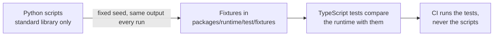

# validation

Python scripts that write the reference fixtures in `packages/runtime/test/fixtures/`. They
use the standard library of Python 3.12 or later and need no packages. Run them from the repository root:



```bash
python3 validation/printf.py       # printed variables: C-style conversions as Python's % operator formats them
python3 validation/rounding.py     # qti-round-to and qti-equal-rounded as Python's decimal module computes them
python3 validation/zip.py          # ZIP archives that Python's zipfile writes and reads: valid, ZIP64 and hostile
```

They write the same files every time they run: random samples use a fixed seed. Commit regenerated fixtures; CI runs only
the TypeScript tests. The oracles, the cases the scripts leave out and why are in
[evidence.md](../docs/runtime/evidence.md).
