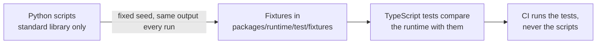

# validation

Python scripts that write the reference fixtures in `packages/runtime/test/fixtures/`. The scripts at the top use the
standard library of Python 3.12 or later and need no packages; those of `operators/` need SymPy, pinned with hashes in
`operators/requirements.txt`, in a virtual environment outside the repository. Run them from the repository root:



```bash
python3 validation/printf.py       # printed variables: C-style conversions as Python's % operator formats them
python3 validation/rounding.py     # qti-round-to and qti-equal-rounded as Python's decimal module computes them
python3 validation/zip.py          # ZIP archives that Python's zipfile writes and reads: valid, ZIP64 and hostile
python3 validation/scoring.py      # the scores of items of the keys that QTI scores, by the rules of the scoring guide
```

`moodle.py` runs Moodle 5.3.0 itself, at its pinned commit and in containers of pinned images, on the cases of
`packages/runtime/test/item-formats-cases.ts`: Moodle's own importers read each file, its questions grade the responses of the
case, and its exporters write each question back (`moodle/questions.php`). It needs Docker with Compose, Git, network access the
first time and about 1 GB of disk for the source, which it keeps in the cache; a run takes about a minute and a half and removes
its containers and volumes. The cache must lie where Docker can mount it.

```bash
COMPOSE_PROJECT_NAME=<a name> python3 -I validation/moodle.py --cache <a folder Docker mounts>   # Moodle's readings and grades
```

```bash
python3 -m venv <a folder outside the repository>
<the folder>/bin/python -m pip install --require-hashes -r validation/operators/requirements.txt
<the folder>/bin/python -I validation/operators/expressions.py packages/runtime/test/fixtures/operators-expressions.json  # SymPy's verdicts and values
<the folder>/bin/python -I validation/operators/numbers.py packages/runtime/test/fixtures/operators-numbers.json          # fractions and decimal
<the folder>/bin/python -I validation/operators/texts.py packages/runtime/test/fixtures/operators-texts.json              # unicodedata and edit distances
```

They write the same files every time they run: random samples use a fixed seed. Commit regenerated fixtures; CI runs only
the TypeScript tests. The oracles, the cases the scripts leave out and why are in
[evidence.md](../docs/runtime/evidence.md).

QTI® is a trademark of 1EdTech® Consortium, Inc. (1edtech.org).
assesskit is not affiliated with, endorsed by or approved by 1EdTech Consortium, Inc.
